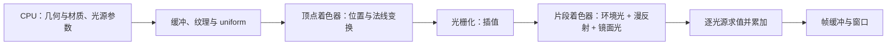

# 复习

| 项目 | 信息 |
|---|---|
| 原文 | [Review](https://learnopengl.com/Lighting/Review)，Joey de Vries |
| 翻译 | Krasjet |
| 校对 | [Geequlim](http://geequlim.com)、Krasjet、[orbitgw](https://github.com/orbitgw/)、[AoZhang](https://github.com/SuperAoao) |
| 来源 | [LearnOpenGL-CN](https://github.com/LearnOpenGL-CN/LearnOpenGL-CN/blob/331560886468e28f28326429334fc48470f9c27b/docs/02%20Lighting/07%20Review.md) |

**光照章节的主线，是把颜色、几何方向和材质参数组织成着色器中的计算，再组合成完整场景。** 除了访问 uniform 数组等接口细节，这一章主要沿用入门部分学过的 OpenGL 操作。视觉效果的变化来自公式与数据：同样的顶点缓冲、顶点属性和绘制调用，可以在不同片段着色器下得到不同的材质和光照效果。

现在应当能够把颜色向量、冯氏光照模型的环境光/漫反射/镜面分量、材质、光源属性、漫反射与镜面贴图，以及平行光、点光源和聚光灯放进同一个场景。建议继续调整光源颜色、材质颜色、反光度与衰减系数，观察每种参数具体控制哪一部分结果，再尝试布置自己的场景。

职责也应保持清楚：应用程序准备几何、纹理和 uniform；OpenGL 规定数据绑定与绘制的语义；驱动实现这些操作；GLFW 负责窗口、上下文与输入。冯氏模型是应用写入着色器的近似公式，并不是调用绘制函数后 OpenGL 自动附加的照明功能。后续模型加载章节会把手写立方体替换为更复杂的几何，继续使用已经建立的光照计算。

## 词汇表

- **颜色向量（Color Vector）**：用红、绿、蓝三个分量表达颜色。在线性 RGB 的简化模型中，物体反射率与入射光颜色逐分量相乘；颜色还取决于照明与观察条件，不能只理解为物体固有的一组三元数。
- **冯氏光照模型（Phong Lighting Model）**：用环境光、漫反射与镜面反射三项近似表面受到照明后的结果。它是经验模型，不能保证物理上的能量守恒。
- **环境光照（Ambient Lighting）**：在本章用一个较小的背景照明项近似未显式计算的间接光，使没有直接受光的物体也不至于完全黑暗；它并未计算真实的全局光照传播。
- **漫反射着色（Diffuse Shading）**：根据表面单位法线与指向光源的单位方向向量的夹角计算照明。本章用 $\max(\mathbf n\cdot\mathbf l,0)$，朝向光源时更亮，背向光源时直接漫反射项为零。
- **法向量（Normal Vector）**：垂直于局部表面切平面的向量。法向量本身不必天然为单位长度；光照点积要求使用标准化后的方向，变换或插值之后通常需要重新标准化。
- **法线矩阵（Normal Matrix）**：若位置使用可逆的线性变换 $A$，法线应使用 $(A^{-1})^T$ 变换，以保持与变换后的切向量垂直。本章在世界空间计算光照时取 $A=\operatorname{mat3}(M)$；若在观察空间计算，则取 $\operatorname{mat3}(VM)$。仅删掉平移不足以正确处理非均匀缩放。
- **镜面光照（Specular Lighting）**：视线方向接近光线在表面的理想反射方向时产生高光。本章由光源方向、法线、观察方向与反光度指数共同控制高光，指数越大，高光通常越集中。
- **冯氏着色（Phong Shading）**：插值顶点法线，在片段处重新标准化并计算光照；本章采用冯氏光照公式。要区分插值/求值位置这一着色方法与具体的光照模型。
- **高洛德着色（Gouraud Shading）**：在顶点处计算光照，再插值光照结果。顶点较稀疏时可能漏掉面内部的小高光；减少光照求值次数不等于在所有场景中都必然更快。
- **GLSL 结构体（GLSL Struct）**：把相关字段组成一个类型，便于组织输入、输出或 uniform 中的材质与光源参数。结构体不负责自动上传 CPU 数据。
- **材质（Material）**：在本章用环境、漫反射和镜面反射颜色及反光度等参数描述表面对不同照明分量的响应；贴图可以让这些参数随表面位置变化。
- **光照属性（Light Properties）**：描述光源各项照明的颜色与强度。本章分别设置环境、漫反射和镜面分量，属于经验模型的可调参数。
- **漫反射贴图（Diffuse Map）**：给出表面不同位置的漫反射颜色，片段着色器用纹理坐标采样，而不是让整个物体只使用一个常量颜色。
- **镜面贴图（Specular Map）**：给出表面不同位置的镜面反射强度或颜色，控制哪些区域出现高光及其强弱，不直接取代本章单独设置的反光度指数。
- **平行光／定向光（Directional Light）**：用一个方向近似来自无限远处的光源。场景各点使用相同的入射光方向，不按到某个光源位置的距离衰减。
- **点光源（Point Light）**：有空间位置、向各方向发光的理想光源。每个着色点的光照方向与距离都需要重新计算，本章用经验衰减公式控制影响范围。
- **衰减（Attenuation）**：描述照明强度随距离减小。本章采用 $1/(K_c+K_l d+K_q d^2)$；这是一种可调近似，不能把所有系数选择都解释成真实的平方反比定律。
- **聚光灯（Spotlight）**：在指定方向的锥形范围内照明的光源。本章通过光线与聚光轴方向的点积判断范围，并用内、外锥角之间的插值软化边缘。
- **手电筒（Flashlight）**：把聚光灯的位置和方向与观察者关联的用法。应用每帧更新相关 uniform，使照明随观察者移动或转向。
- **GLSL uniform 数组（GLSL Uniform Array）**：同一类型的 uniform 元素序列，例如一组点光源结构体。应用按活动 uniform 的名称与位置上传字段；本章普通 uniform 数组的大小受着色器声明及实现资源限制，不能按 C++ 的动态容器任意增长。

> **常见误解：** 冯氏光照和冯氏着色是同一件事。前者描述照明如何计算，后者描述法线如何插值、光照在何处求值；高洛德着色同样可以使用冯氏光照公式。

> **进阶（空间一致性）：** **参与同一次点积或反射运算的方向必须处在同一坐标空间。** 若法线已变换到世界空间，光源方向与观察方向也应由世界坐标相减得到；改到观察空间时，要一起变换位置、法线和光源。观察空间的摄像机位于原点，只是让视线向量计算更方便，并不会改变光照模型。法线使用逆转置，位置使用原变换，这是保持几何关系的两个不同职责。

> **进阶（uniform 的生命周期）：** **uniform 的值属于程序对象，切换程序不会自动把另一程序的光源参数复制过来。** 普通 uniform 的位置应在成功链接后查询；重新链接会使旧位置失效，并重新初始化活动 uniform。`glUniform*` 修改当前程序中的对应变量，因此上传前要确认程序绑定正确。数组大小或结构体字段变化时，还需要同步检查 CPU 的上传范围，不能只修改 GLSL 声明。[依据：GLSL 3.30 §4.3.5](https://registry.khronos.org/OpenGL/specs/gl/GLSLangSpec.3.30.pdf)。

## 本章整体回顾

六个可执行示例依次引入颜色、基础光照、材质、光照贴图、投光物与多光源。本篇是第七篇教程，负责把术语与数据流连接起来，没有新增独立程序。复习时先辨认每个量所在的空间，再追踪 CPU 上传、顶点变换、插值和片段求值，就能定位“光源在动但高光不对”“贴图正常但材质不对”等问题属于哪一层。

修订说明：保留底本全部 20 个词条，纠正“风氏”、衰减随距离的表述，并细化法向量、法线矩阵、着色方法与 uniform 数组的语义；技术解释对照 [英文原文](https://learnopengl.com/Lighting/Review)与上述 GLSL 规范。

下一节：[Assimp](../03_model_loading/01_assimp.md)
