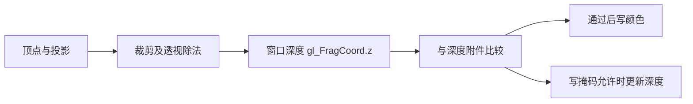
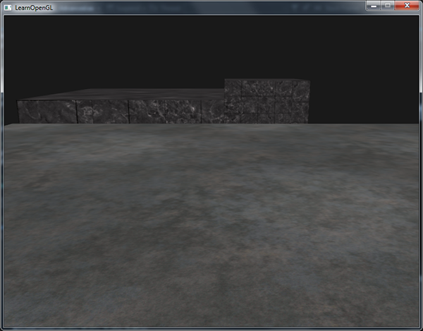
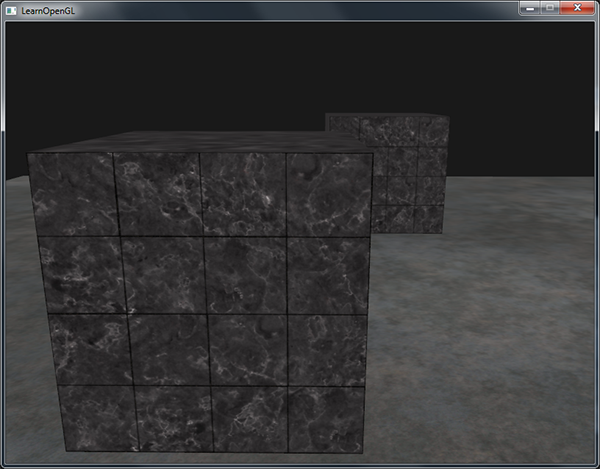
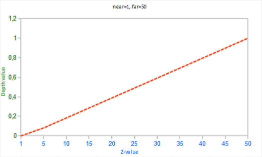
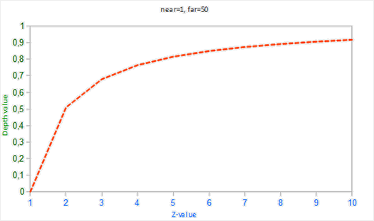
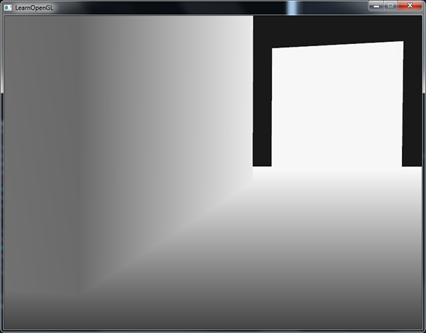
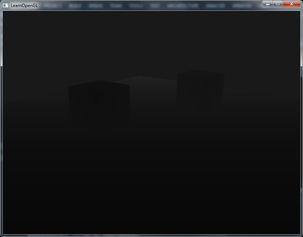
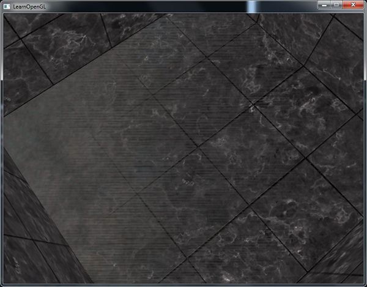
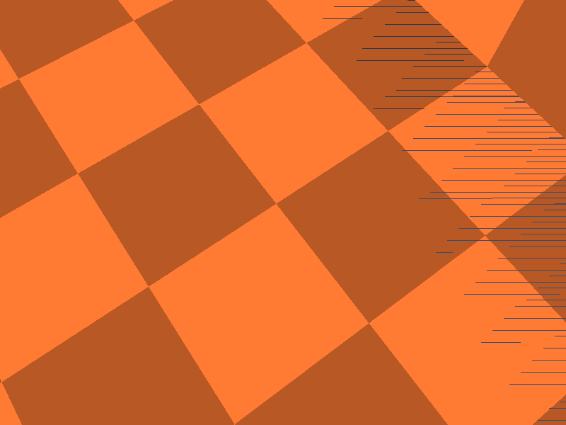
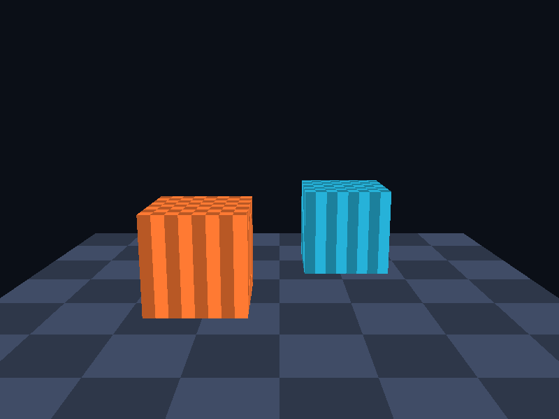

# 深度测试

| 项目 | 信息 |
| --- | --- |
| 原文 | [Depth-testing](https://learnopengl.com/Advanced-OpenGL/Depth-testing) |
| 作者 | Joey de Vries |
| 翻译 | Krasjet |
| 校对 | 暂未校对 |
| 中文底本 | [LearnOpenGL-CN 上游固定版本](https://github.com/LearnOpenGL-CN/LearnOpenGL-CN/blob/331560886468e28f28326429334fc48470f9c27b/docs/04%20Advanced%20OpenGL/01%20Depth%20testing.md)，`new-theme` / `331560886468e28f28326429334fc48470f9c27b` |
| 本仓库示例 | [`apps/04_advanced_opengl/01_depth_testing/main.cpp`](../../apps/04_advanced_opengl/01_depth_testing/main.cpp) |
| 修订 | 按上游完整小节顺序重写，技术差异见正文；[逐项覆盖清单](coverage.md) |

**深度测试用当前片段的深度与附件中保存的深度比较，从而决定可见性；它不按物体中心的距离排序。** 前面的相机示例已经启用深度测试，这里把比较规则、精度和可视化拆开说明。深度是窗口空间值，默认范围为 $[0,1]$，通常近处小、远处大。

OpenGL 规定比较、写掩码和清除的语义，驱动实现存储和可能的提前测试；GLFW 负责请求默认窗口的深度附件，应用负责启用状态并在每帧清除。GLAD 只加载函数入口。常见深度格式包括 16/24 位定点和 32 位浮点，不能把“24 位深度”一概称为浮点缓冲。



启用 `GL_DEPTH_TEST` 后才进行通常的深度比较与写入。`glClear(GL_DEPTH_BUFFER_BIT)` 清除当前绘制帧缓冲的深度附件，默认清除值是 1；若深度写掩码为假，清除也会受影响。开始新帧前要恢复写掩码。`glDepthMask(GL_FALSE)` 保留比较、停止写入，适合之后的透明阶段；完全禁用测试则既不比较也不按正常深度测试路径更新附件。

深度测试在概念管线中处理片段，但实现可以在不改变可观察结果时先剔除会失败的工作，即**提前深度测试**。不要写出“必定在片段着色器之后执行”或“驱动总能提前执行”的结论；写 `gl_FragDepth`、丢弃片段等会影响可用优化。

## 深度测试函数

`glDepthFunc` 设定新片段深度 $d$ 相对已有值 $D$ 的条件。默认是 `GL_LESS`；相等时不通过。

| 比较函数 | 通过条件 |
| --- | --- |
| `GL_ALWAYS` | 恒通过 |
| `GL_NEVER` | 恒失败 |
| `GL_LESS` | $d < D$ |
| `GL_EQUAL` | $d = D$ |
| `GL_LEQUAL` | $d \le D$ |
| `GL_GREATER` | $d > D$ |
| `GL_NOTEQUAL` | $d \ne D$ |
| `GL_GEQUAL` | $d \ge D$ |

先画两个箱子，再画地面。模式 3 使用 `GL_ALWAYS`，地面即使更远也会覆盖箱子已经写出的片段；效果接近关闭遮挡比较，但测试仍启用时深度写入可以继续发生。



切回模式 0 的 `GL_LESS`，地面在箱子后方的片段失败，遮挡恢复。场景中不透明物体通常无须为正确性按远近排序；从近到远提交可能有利于提前剔除，但属于性能策略。



源码中比较函数和着色器显示模式分开设置，避免把“深度显示”误作比较规则：

```cpp
        glDepthFunc(depth_mode == 3 ? GL_ALWAYS : GL_LESS);
        // OpenGL: 写入标量整型或布尔 uniform；sampler 接收纹理单元索引。
        glUniform1i(depth_mode_uniform, depth_mode == 1 || depth_mode == 2 ? depth_mode : 0);
```

## 深度值精度

若把正的观察距离记为 $s=-z_{eye}$，近远平面距离为 $n,f$，理想的**线性距离归一化**为

$$d_{linear}=\frac{s-n}{f-n}.$$



但常规透视投影不是这个函数。投影矩阵给出 $z_{clip}=\frac{f+n}{f-n}s-\frac{2fn}{f-n}$、$w_{clip}=s$，透视除法得到 $z_{ndc}=z_{clip}/w_{clip}$，默认深度范围映射后为

$$d=\frac{z_{ndc}+1}{2}=\frac{f}{f-n}-\frac{fn}{(f-n)s}.$$

代入 $s=n$ 得 0，代入 $s=f$ 得 1。它随 $1/s$ 变化，大部分数值区间集中在近处。不要混淆裁剪空间 $z_{clip}$、除法后的 $z_{ndc}$ 和附件中的窗口深度 $d$；它们有明确先后关系。



曲线意味着：相同大小的定点深度量化间隔，在远处对应更大的观察距离。远处相邻表面更容易量化为相同值。场景单位由应用定义，不能把这一结论表述为 OpenGL 固定在“厘米”尺度提供何种精度。正交投影则没有相同的透视 $1/s$ 分布。

## 深度缓冲的可视化

片段着色器可以读 `gl_FragCoord.z` 并写成灰度。模式 1 直接显示 $d$，大部分可见表面很白，不是附件坏了，而是常规透视深度在 1 附近聚集。



要把它变回正的观察距离，先恢复 NDC，再解出 $s$：

$$z_{ndc}=2d-1,\qquad s=\frac{2nf}{f+n-z_{ndc}(f-n)}.$$

模式 2 为便于显示使用 $s/f$。它是“线性距离除以远平面”，近平面显示 $n/f$，不同于前述严格映射到 $[0,1]$ 的 $(s-n)/(f-n)$；两种表达都应说明归一化方式。反算必须使用实际投影的 near/far，这里是 0.1 和 100。

对应完整片段着色器源码：

```glsl
#version 330 core
in vec3 local_pos;
out vec4 frag_color;
uniform vec4 object_color;
uniform int depth_mode;
void main()
{
    float pattern = mod(floor((local_pos.x + 0.5) * 8.0) +
                        floor((local_pos.z + 0.5) * 8.0), 2.0);
    if (depth_mode == 0) {
        frag_color = vec4(object_color.rgb * mix(0.72, 1.0, pattern), object_color.a);
    } else {
        float depth = gl_FragCoord.z;
        if (depth_mode == 2) {
            float z_ndc = depth * 2.0 - 1.0;
            depth = (2.0 * 0.1 * 100.0) / (100.0 + 0.1 - z_ndc * (100.0 - 0.1));
            depth /= 100.0;
        }
        frag_color = vec4(vec3(depth), 1.0);
    }
}
```



线性显示只是把输出颜色改为深度诊断值，真正的深度比较仍使用硬件生成的窗口深度。远平面若很远，近处物体的线性灰度本来也会很暗；这和非线性图几乎全白是两个不同现象。

## 深度冲突

两个共面或极近的表面可能映射到相同或无法稳定区分的深度值。不同三角形的插值和舍入会使通过比较的一方交替变化，形成闪烁或条纹，称为**深度冲突**（Z-fighting）。常见触发方式是在已有地面上再放一张完全共面的面片。

上游把箱底与地板放在同一高度，并让相机进入箱内向下观察：两个面争夺同一片像素，形成锯齿状花纹。本仓库模式 0 为普通遮挡场景，箱底与地面有间隔；要复现原案例，应启动模式 4。程序会把相机放入第一个箱子内部并朝下，箱子中心 `y=-0.25`、高度 1，箱底为 `-0.75`；地板中心 `y=-0.80`、厚度 0.1，顶面也是 `-0.75`。

1. 以 `--mode 4` 启动，观察橙色箱底中出现的地板条纹；用鼠标微调视角，或轻按 WASD，观察争夺区域如何变化。
2. 按空格切到模式 5。程序恢复相同的箱内观察视角，仅将第一个箱子抬高 0.03，使箱底变成 `-0.72`；地板顶面仍为 `-0.75`，两者不再共面。
3. 比较模式 4 与 5。为了便于观察，两者都使用 `near=0.001`、`far=100`；这个很小的 near 用于展示精度问题，不是实际场景的推荐设置。条纹形态受深度格式、驱动和视角影响，某个静止视角下没有明显条纹不表示共面布局可靠。



深度冲突既不是透明混合错误，也不应靠随意改绘制顺序掩盖。即使数学上共面的两个图元，光栅化计算路径也可能不同，不能依靠逐位相等实现稳定覆盖。

### 防止深度冲突

1. 避免无必要的重叠共面几何。贴花可按明确策略稍作偏移，或使用适当的多边形偏移；偏移幅度与视角、深度精度有关。
2. 在场景允许时增大近裁剪距离。由于精度分布对 near 非常敏感，near 从极小值适当调大通常很有效，但会裁掉过近的物体。合理收紧 far 也有帮助。
3. 选择更合适的深度格式或渲染方案。更高精度能缓解量化问题，却不能自动解决真正共面的几何竞争；也不能保证所有窗口系统都会给出所请求的格式。

本例的几何对照直接对应第一种处理方法。以下代码是两种模式实际使用的高度设置；模式 5 通过分离几何修正问题，没有关闭深度测试或更换比较函数：

```cpp
        const float box_y{depth_mode == 5 ? -0.22F : -0.25F};
        draw_cube(uniforms, {-0.8F, box_y, 0.0F}, {1.0F, 1.0F, 1.0F}, {1.0F, 0.48F, 0.2F, 1.0F});
        draw_cube(uniforms, {0.8F, -0.25F, -1.3F}, {1.0F, 1.0F, 1.0F}, {0.15F, 0.7F, 0.85F, 1.0F});
        // OpenGL: 模式 4 的地板顶面与箱底同为 y=-0.75；模式 5 将箱子抬高 0.03。
        const float floor_y{depth_mode >= 4 ? -0.80F : -0.85F};
        draw_cube(uniforms, {0.0F, floor_y, 0.0F}, {6.0F, 0.1F, 6.0F}, {0.25F, 0.3F, 0.4F, 1.0F});
```




> **常见误解：** `GL_LEQUAL` 不会消除一般深度冲突。它改变相等值的处理，仍没有增加精度，也没有给共面几何建立稳定的语义优先级。

> **进阶（精度与投影）：** **near 的选择是投影设计的一部分。** 常规透视深度把精度集中到近处，near 越接近零，远处区分能力越差。先根据场景尺度选择合理裁剪范围，再考虑浮点深度和反向深度等方案。反向深度还涉及清除值、比较函数与投影约定，不能只把 `GL_LESS` 改成 `GL_GREATER`；本例继续使用 OpenGL 3.3 的常规约定。

## 上游源码与附加资源

以下保留底本引用的源码、资源与附加阅读入口；正文使用本仓库实现，外部旧演示与本地程序的组织可能不同。

- [上游源码或资源对照](https://learnopengl.com/code_viewer_gh.php?code=src/4.advanced_opengl/1.1.depth_testing/depth_testing.cpp)
- [这篇文章](http://www.songho.ca/opengl/gl_projectionmatrix.html)

## 本仓库示例

源码：[`main.cpp`](../../apps/04_advanced_opengl/01_depth_testing/main.cpp)，目标：`04_advanced_opengl__01_depth_testing`。正文标为源码的 C++/GLSL 均直接摘取此文件；标为概念说明的独立片段用于说明规范或未启用的更高版本功能。

```powershell
cmake --preset mingw-gcc-debug
cmake --build --preset mingw-gcc-debug --target 04_advanced_opengl__01_depth_testing
.\build\mingw-gcc-debug\apps\04_advanced_opengl\01_depth_testing\04_advanced_opengl__01_depth_testing.exe --mode 0
```

依赖准备、多配置生成器与其他工具链见[构建指南](../build.md)。Esc 是退出键；除 07 的二维数据示例外，三维场景支持 WASD、鼠标与滚轮。空格按表中顺序切换（07 用启动参数选择映射方法）。有限帧检查可追加 `--frames 3 --capture output.ppm`，截图取最后一帧；它验证绘制路径，不能代替交互和视觉检查。

| `--mode` | 可观察内容 |
| --- | --- |
| 0 | GL_LESS 场景 |
| 1 | 原始深度 |
| 2 | 线性距离 / far |
| 3 | GL_ALWAYS 对照 |
| 4 | 箱底与地板共面；预置箱内视角观察深度冲突 |
| 5 | 同视角、同投影，抬高第一个箱子 0.03 消除共面 |



## 本章整体回顾

深度附件保存已通过片段的深度；比较、写入与清除是不同操作。透视深度的非线性来自投影与透视除法，原始深度不能直接当作线性距离；理解精度分布后再处理深度冲突。

本篇承接前一篇，正文保留底本对应的小节与主案例。图片中的背包、箱子等属于上游演示，本仓库使用独立注明的教学场景；本仓库截图与上游图分开标注。图片出处见[资源记录](../img/04/README.md)，对应关系与验证边界见[覆盖清单](coverage.md)。

技术核校：[英文原文](https://learnopengl.com/Advanced-OpenGL/Depth-testing)、[OpenGL 3.3 Core 规范](https://registry.khronos.org/OpenGL/specs/gl/glspec33.core.pdf)、[GLSL 3.30 规范](https://registry.khronos.org/OpenGL/specs/gl/GLSLangSpec.3.30.pdf)。

下一节：[模板测试](02_stencil_testing.md)。
