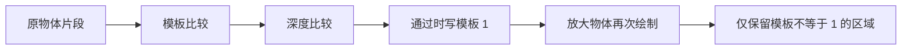

# 模板测试

| 项目 | 内容 |
| --- | --- |
| 原文 | [Stencil testing](https://learnopengl.com/Advanced-OpenGL/Stencil-testing) |
| 作者 | JoeyDeVries |
| 来源 | [LearnOpenGL-CN](https://github.com/with-fair-wind/LearnOpenGL-CN/blob/new-theme/docs/04%20Advanced%20OpenGL/02%20Stencil%20testing.md)，按本仓库代码整理修订 |
| 本仓库示例 | [`apps/04_advanced_opengl/02_stencil_testing/`](../../apps/04_advanced_opengl/02_stencil_testing/) |

**模板缓冲保存应用定义的整数标记；模板比较决定哪些区域允许绘制，写掩码决定哪些位允许改变。** 本节先给立方体的可见区域写入 1，再绘制稍大的立方体，仅保留模板值不为 1 的区域，得到选中轮廓。

## 模板与深度的分工



模板是整数位平面，深度是距离比较记录，颜色是最终可见值。三者可以来自默认窗口，也可以作为 FBO 附件；GLFW 只负责窗口侧的请求，模板更新规则由 OpenGL 定义，应用负责管理多次绘制之间的状态。本例创建窗口前请求 8 位模板缓冲，不能把“所有窗口系统都必然提供模板附件”当作前提。


参考图展示用整数标记限制可绘制区域的思路。

## 比较函数、更新操作与写掩码

`glStencilFunc` 的三个参数分别是比较函数、参考整数和比较掩码。比较使用掩码后的参考值与已有模板值。`glStencilOp` 则分别设置模板失败、模板通过但深度失败、两者都通过时的更新操作。

| 操作 | 含义 |
| --- | --- |
| `GL_KEEP` | 保留已有模板值 |
| `GL_REPLACE` | 用参考值替换允许写入的位 |
| `GL_ZERO` | 将允许写入的位清零 |
| `GL_INCR` / `GL_DECR` | 饱和递增 / 递减 |
| `GL_INCR_WRAP` / `GL_DECR_WRAP` | 溢出时环绕 |
| `GL_INVERT` | 翻转允许写入的位 |

> **常见误解：** `glStencilMask(0x00)` 会把模板值写成 0。
> **纠正：** 零写掩码表示所有位都保留。若旧值为 $s$、待写值为 $v$、写掩码为 $m$，更新结果为 $(s\mathbin{\&}\sim m)\mathbin{|}(v\mathbin{\&}m)$。把比较掩码与写掩码混为一谈，会使轮廓在第二帧后失效。

## 轮廓绘制的状态切换

下面是本例每帧的实际步骤，包含恢复写掩码后清除、地板不写模板、原物体写入和放大轮廓绘制：

```c++
        // OpenGL: 清除也受写掩码限制，必须在每帧清除前恢复全部模板位。
        // OpenGL: 设置模板写掩码，零表示保留所有已有位。
        glStencilMask(0xFFU);
        // OpenGL: 清除已绑定绘制帧缓冲；清除受相关写掩码限制。
        glClear(GL_COLOR_BUFFER_BIT | GL_DEPTH_BUFFER_BIT | GL_STENCIL_BUFFER_BIT);
        glStencilMask(0x00U);
        draw_cube(uniforms, {0.0F, -0.85F, 0.0F}, {6.0F, 0.1F, 6.0F}, {0.3F, 0.35F, 0.4F, 1.0F});
        // OpenGL: 将掩码后的参考值与存储模板值进行比较。
        glStencilFunc(GL_ALWAYS, 1, 0xFFU);
        glStencilMask(0xFFU);
        draw_cube(uniforms, {0.0F, -0.2F, 0.0F}, {1.0F, 1.0F, 1.0F}, {0.15F, 0.65F, 0.8F, 1.0F});
        glStencilFunc(GL_NOTEQUAL, 1, 0xFFU);
        glStencilMask(0x00U);
        // OpenGL: 本例选择可穿透遮挡的轮廓；保留深度测试可让轮廓参与场景遮挡。
        // OpenGL: 关闭指定状态；多阶段绘制结束后恢复下一阶段的前置条件。
        glDisable(GL_DEPTH_TEST);
        draw_cube(uniforms, {0.0F, -0.2F, 0.0F}, {1.08F, 1.08F, 1.08F}, {1.0F, 0.65F, 0.1F, 1.0F});
        glEnable(GL_DEPTH_TEST);
        glStencilFunc(GL_ALWAYS, 0, 0xFFU);
        glStencilMask(0xFFU);
```

本例轮廓阶段关闭深度测试，是允许轮廓穿透遮挡的表现选择；它不是模板描边的必然要求。希望轮廓被地板或其它物体挡住时，应保留深度比较，并根据需求调整深度写入或偏移。

> **进阶（多物体轮廓）：** **共用一个标记会生成选中集合的联合边界。** 如果多个选中对象都写入 1，再统一绘制其放大版本，集合内部相互重叠的区域会被模板排除；需要逐对象独立边框时，应设计清除时机或分配不同标记。8 位模板标记的容量有限，还需与门户、镜面遮罩等用途协调，不能无限增加对象编号。

## 本仓库示例

示例源码：[`apps/04_advanced_opengl/02_stencil_testing/main.cpp`](../../apps/04_advanced_opengl/02_stencil_testing/main.cpp)。代码片段均原样取自此文件；原站概念图片与本例实测截图分别标明。

首次安装依赖与工具链要求见[构建指南](../build.md)。已安装默认 MinGW GCC Debug 依赖时，在仓库根目录执行：

```powershell
cmake --preset mingw-gcc-debug
cmake --build --preset mingw-gcc-debug --target 04_advanced_opengl__02_stencil_testing
.\build\mingw-gcc-debug\apps\04_advanced_opengl\02_stencil_testing\04_advanced_opengl__02_stencil_testing.exe
```

Esc 退出；W/A/S/D 移动，鼠标转向，滚轮修改 FOV。

本仓库实测截图（默认模式）：


本章示例还支持 `--frames 3` 隐藏窗口运行指定帧数、`--mode M` 选择初始模式；配合 `--capture output.ppm` 可保存最后一帧。参数与检查方式详见[构建指南的高级 OpenGL 示例说明](../build.md#高级-opengl-示例)。

## 本章整体回顾

- **局部**：先写可见区域的模板标记，再用不等比较保留放大物体的轮廓。
- **整体**：模板把已绘制几何变成空间遮罩，后续混合则改变颜色合成方式。

## 核校参考

- [OpenGL 3.3 Core 规范](https://registry.khronos.org/OpenGL/specs/gl/glspec33.core.pdf)：模板测试、更新操作及帧缓冲写掩码。
- [GLSL 3.30 规范](https://registry.khronos.org/OpenGL/specs/gl/GLSLangSpec.3.30.pdf)：阶段输入输出、内建变量及本例使用的语言语义。

下一节：[混合](03_blending.md)
