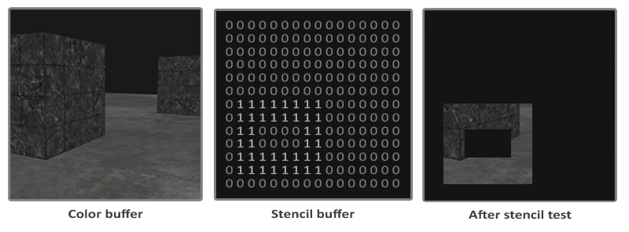
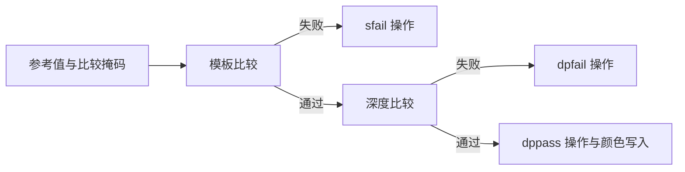
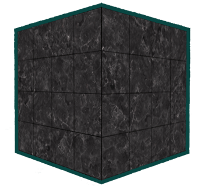
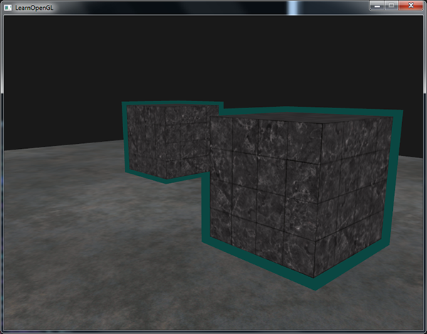
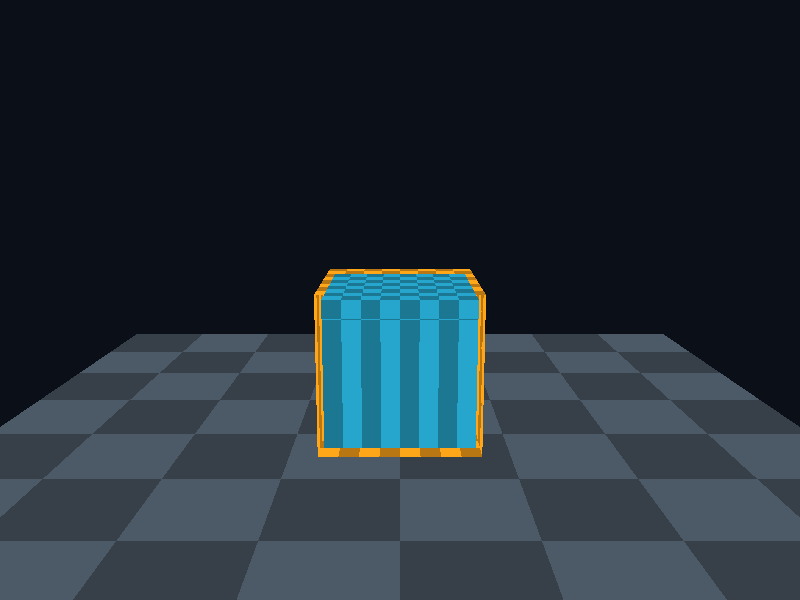

# 模板测试

| 项目 | 信息 |
| --- | --- |
| 原文 | [Stencil-testing](https://learnopengl.com/Advanced-OpenGL/Stencil-testing) |
| 作者 | Joey de Vries |
| 翻译 | Krasjet |
| 校对 | 暂未校对 |
| 中文底本 | [LearnOpenGL-CN 上游固定版本](https://github.com/LearnOpenGL-CN/LearnOpenGL-CN/blob/331560886468e28f28326429334fc48470f9c27b/docs/04%20Advanced%20OpenGL/02%20Stencil%20testing.md)，`new-theme` / `331560886468e28f28326429334fc48470f9c27b` |
| 本仓库示例 | [`apps/04_advanced_opengl/02_stencil_testing/main.cpp`](../../apps/04_advanced_opengl/02_stencil_testing/main.cpp) |
| 修订 | 按上游完整小节顺序重写，技术差异见正文；[逐项覆盖清单](coverage.md) |

**模板测试用整数标记筛选片段，深度测试解决前后遮挡；两者可以组合，但不会彼此替代。** 模板缓冲常与深度一起以 `GL_DEPTH24_STENCIL8` 等格式存储。典型模板位数是 8，实际窗口格式由 GLFW 请求、窗口系统选择，应用不应无条件假定所有目标都有模板附件。



图中的区域保存整数标记。下一次绘制可以只允许特定标记内或标记外的片段通过，例如镜面区域、门窗孔洞、门户和物体轮廓。模板是每个片段/样本的操作，不能直接理解为对整个物体的布尔开关。



OpenGL 定义比较与位操作，驱动执行；GLFW 负责默认附件的创建请求，应用通过 `GL_STENCIL_TEST`、函数、操作和写掩码组织阶段。模板默认禁用。每帧用 `GL_STENCIL_BUFFER_BIT` 清除附件，默认清除值是 0。

模板**写掩码**由 `glStencilMask` 控制：`0xFFU` 允许写低 8 位，`0x00U` 保留原值。写掩码为零不表示“写入零”。它也影响清除，所以本例在每次清除之前恢复全部写位：

```cpp
        glStencilMask(0xFFU);
        // OpenGL: 清除已绑定绘制帧缓冲；清除受相关写掩码限制。
        glClear(GL_COLOR_BUFFER_BIT | GL_DEPTH_BUFFER_BIT | GL_STENCIL_BUFFER_BIT);
```

## 模板函数

`glStencilFunc(func, ref, mask)` 控制比较。先把参考值和缓冲值分别与 `mask` 做按位与，再执行比较。以 `GL_LESS` 为例，判定的是 $(ref\mathbin{\&}mask)<(stencil\mathbin{\&}mask)$，不要把两个操作数反过来。`ref` 会按模板位数约束。

| `func` | 掩码后参考值 $R$ 与存储值 $S$ 的关系 |
| --- | --- |
| `GL_NEVER` / `GL_ALWAYS` | 恒失败 / 恒通过 |
| `GL_LESS` / `GL_LEQUAL` | $R<S$ / $R\le S$ |
| `GL_GREATER` / `GL_GEQUAL` | $R>S$ / $R\ge S$ |
| `GL_EQUAL` / `GL_NOTEQUAL` | $R=S$ / $R\ne S$ |

比较不会自动决定如何修改模板。`glStencilOp(sfail, dpfail, dppass)` 才决定模板失败、模板通过但深度失败、两者均通过时的更新操作。没有深度附件或未启用深度测试时，模板通过后走通过对应的分支。

| 操作 | 作用于模板值 |
| --- | --- |
| `GL_KEEP` | 保持原值 |
| `GL_ZERO` | 写零 |
| `GL_REPLACE` | 写入 `glStencilFunc` 的参考值 |
| `GL_INCR` / `GL_DECR` | 饱和递增 / 递减，到边界保持 |
| `GL_INCR_WRAP` / `GL_DECR_WRAP` | 按位数回绕递增 / 递减 |
| `GL_INVERT` | 按位取反 |

操作计算出的值还要经过写掩码合并。默认三个分支都是 `GL_KEEP`，因此只启用测试不会留下任何新标记。轮廓案例用 `GL_KEEP, GL_KEEP, GL_REPLACE`：隐藏在已有几何后方的箱子片段不会标记，只有通过深度测试的箱子片段写 1。底本中“所有片段都替换”应加上这些前置条件。

> **常见误解：** `glStencilFunc` 的第三参数是比较掩码，`glStencilMask` 是写掩码。两者都像位掩码，却参与不同步骤，不能用一个替代另一个。

## 物体轮廓



轮廓的思路是先记住物体覆盖的区域，再绘制稍大的同一几何，只让原区域外的片段通过。放大体覆盖中心的部分被模板剔除，边缘露出的部分构成外描边。它是一次额外几何绘制，并不是分析图像边缘。

完整流程如下，地面与两个箱子构成场景：

1. 开启深度和模板测试，设置模板通过时可替换。
2. 恢复模板写掩码，清除颜色、深度和模板。
3. 禁止模板写入，正常画地面。地面参与遮挡，却不属于被描边的集合。
4. 用 `GL_ALWAYS`、参考值 1、可写掩码，画两个正常大小的箱子。可见箱子区域记为 1。
5. 切到 `GL_NOTEQUAL, 1` 并禁止模板写入，让放大体只出现在未标记处。
6. 本例关闭深度测试，选择可穿透其他物体的轮廓；若产品希望描边受遮挡，应保留深度测试并处理偏移和相等深度。
7. 以 1.08 倍缩放绘制两个箱子，统一输出橙色轮廓。
8. 恢复深度测试、模板比较与写掩码，保证下一帧和其他 pass 的前置条件。

下面摘取模板阶段的源码。两个正常大小物体全部画完，才一起画放大轮廓，避免后画物体的轮廓覆盖先前集合的内部：

```cpp
        glStencilFunc(GL_ALWAYS, 1, 0xFFU);
        glStencilMask(0xFFU);
        draw_cube(uniforms, {-0.9F, -0.2F, 0.0F}, {1.0F, 1.0F, 1.0F}, {0.15F, 0.65F, 0.8F, 1.0F});
        draw_cube(uniforms, {0.9F, -0.2F, -1.0F}, {1.0F, 1.0F, 1.0F}, {0.15F, 0.65F, 0.8F, 1.0F});
        glStencilFunc(GL_NOTEQUAL, 1, 0xFFU);
        glStencilMask(0x00U);
        // OpenGL: 本例选择可穿透遮挡的轮廓；保留深度测试可让轮廓参与场景遮挡。
        // OpenGL: 关闭指定状态；多阶段绘制结束后恢复下一阶段的前置条件。
        glDisable(GL_DEPTH_TEST);
        draw_cube(uniforms, {-0.9F, -0.2F, 0.0F}, {1.08F, 1.08F, 1.08F}, {1.0F, 0.65F, 0.1F, 1.0F});
        draw_cube(uniforms, {0.9F, -0.2F, -1.0F}, {1.08F, 1.08F, 1.08F}, {1.0F, 0.65F, 0.1F, 1.0F});
        glEnable(GL_DEPTH_TEST);
        glStencilFunc(GL_ALWAYS, 0, 0xFFU);
```

上游用另一套纯色片段程序输出边框；本仓库通过同一程序的颜色 uniform 切换颜色，模板比较、两遍几何和缩放操作保持对应。两个箱子的标记形成并集，所以它们交叠时内部公共区域不会各自再被画出一条完整轮廓。



> **原提示（合并轮廓与独立轮廓）：** 多选单位时，通常希望得到选中集合的合并边框。如果需要每个物体各自完整的边框，应逐物体执行“清空模板 → 写入该物体标记 → 绘制它的放大轮廓”。清空前恢复模板写掩码，且只清模板，不清场景深度。还要明确轮廓是否受其他物体遮挡：保持深度测试时，重画表面的相等深度需按既定策略处理；关闭深度测试则可能让隐藏轮廓穿透前景。逐物体清模板不会自动解决这些遮挡和绘制顺序问题。本例模式 0 展示合并轮廓，这段保留上游独立轮廓的实现思路。

可在模型状态中保存是否选中的布尔值，仅为选中物体绘制轮廓；也可以把轮廓遮罩交给后处理，以高斯模糊柔化边缘。模板还可限制后视镜内的绘制区域，或用于阴影体积。这些是上游给出的应用方向，当前程序没有实现柔化轮廓和阴影体积。

场景截图展示地面不被标记、箱子写模板和外圈通过三件事。放大模型会使描边宽度随距离和投影变化，它并不是固定屏幕像素宽度的轮廓；凹模型和复杂拓扑也可能出现明显差异。

> **进阶（状态恢复）：** **每个绘制阶段应明确声明自己需要的状态。** 模板比较、模板写入、深度测试和深度写入是独立状态，离开一段绘制后仍然保留。调试轮廓消失时，先检查清除是否被零写掩码屏蔽，再检查模板附件是否存在、参考值是否匹配，最后检查深度状态。资源对象的 RAII 不会自动恢复这些上下文状态。

## 上游源码与附加资源

以下保留底本引用的源码、资源与附加阅读入口；正文使用本仓库实现，外部旧演示与本地程序的组织可能不同。

- [上游源码或资源对照](https://learnopengl.com/code_viewer_gh.php?code=src/4.advanced_opengl/2.stencil_testing/stencil_testing.cpp)

## 本仓库示例

源码：[`main.cpp`](../../apps/04_advanced_opengl/02_stencil_testing/main.cpp)，目标：`04_advanced_opengl__02_stencil_testing`。正文标为源码的 C++/GLSL 均直接摘取此文件；标为概念说明的独立片段用于说明规范或未启用的更高版本功能。

```powershell
cmake --preset mingw-gcc-debug
cmake --build --preset mingw-gcc-debug --target 04_advanced_opengl__02_stencil_testing
.\build\mingw-gcc-debug\apps\04_advanced_opengl\02_stencil_testing\04_advanced_opengl__02_stencil_testing.exe --mode 0
```

依赖准备、多配置生成器与其他工具链见[构建指南](../build.md)。Esc 是退出键；除 07 的二维数据示例外，三维场景支持 WASD、鼠标与滚轮。空格按表中顺序切换（07 用启动参数选择映射方法）。有限帧检查可追加 `--frames 3 --capture output.ppm`，截图取最后一帧；它验证绘制路径，不能代替交互和视觉检查。

| `--mode` | 可观察内容 |
| --- | --- |
| 0 | 双物体模板轮廓 |



## 本章整体回顾

模板把可见片段标成整数区域，再利用比较条件筛选下一次绘制。轮廓由“正常大小写标记、放大物体避开标记”组成，模板掩码和深度状态必须按阶段设置并恢复。

本篇承接前一篇，正文保留底本对应的小节与主案例。图片中的背包、箱子等属于上游演示，本仓库使用独立注明的教学场景；本仓库截图与上游图分开标注。图片出处见[资源记录](../img/04/README.md)，对应关系与验证边界见[覆盖清单](coverage.md)。

技术核校：[英文原文](https://learnopengl.com/Advanced-OpenGL/Stencil-testing)、[OpenGL 3.3 Core 规范](https://registry.khronos.org/OpenGL/specs/gl/glspec33.core.pdf)、[GLSL 3.30 规范](https://registry.khronos.org/OpenGL/specs/gl/GLSLangSpec.3.30.pdf)。

下一节：[混合](03_blending.md)。
