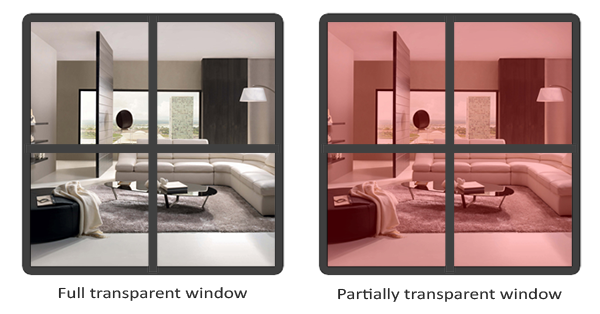
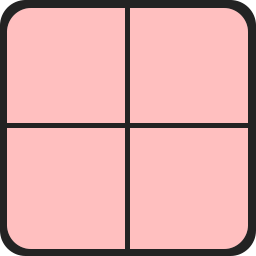
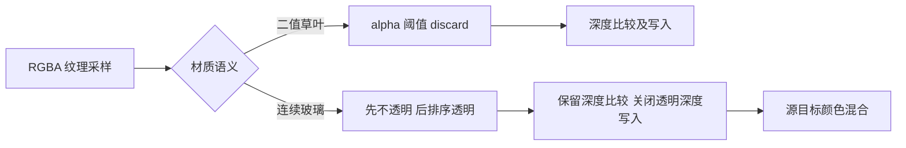
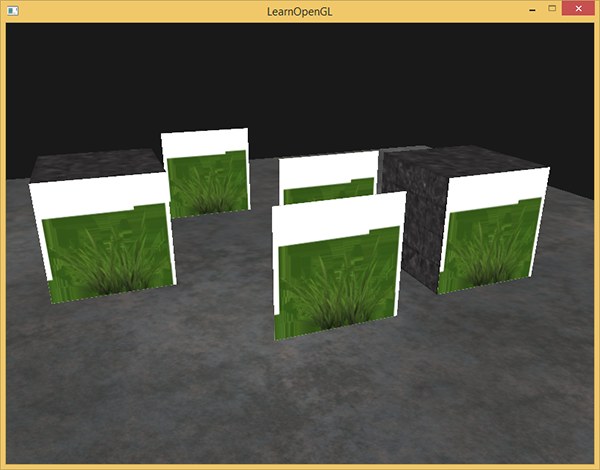
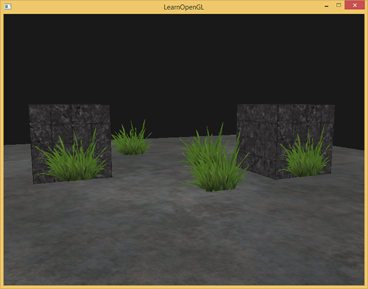
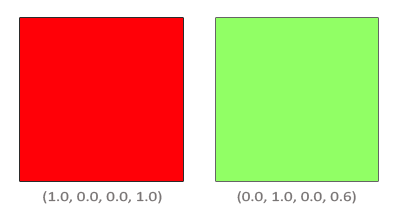
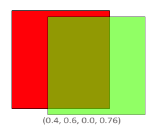
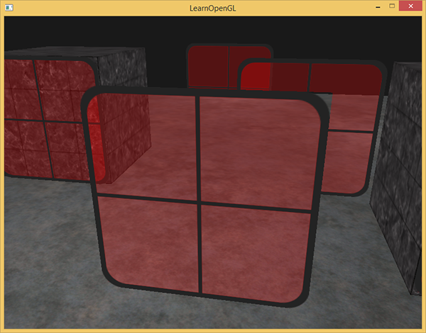

# 混合

| 项目 | 信息 |
| --- | --- |
| 原文 | [Blending](https://learnopengl.com/Advanced-OpenGL/Blending) |
| 作者 | Joey de Vries |
| 翻译 | Krasjet, [Django](http://bullteacher.com/) |
| 校对 | 暂无校对 |
| 来源 | [LearnOpenGL-CN](https://github.com/LearnOpenGL-CN/LearnOpenGL-CN/blob/331560886468e28f28326429334fc48470f9c27b/docs/04%20Advanced%20OpenGL/03%20Blending.md) |
| 本仓库示例 | [`apps/04_advanced_opengl/03_blending/main.cpp`](../../apps/04_advanced_opengl/03_blending/main.cpp) |

**alpha 表示覆盖或透明程度的数据；只有应用选择的丢弃、混合和深度策略，才能把它变成预期的图像。** 窗口、草叶、烟雾等都可能使用 alpha，但草叶的空白背景与玻璃的连续透光需要不同处理。





PNG 等格式可保存 alpha，JPEG 一般没有这个通道。本例由 stb_image 解码为 RGBA 并上传 `GL_RGBA8`，保留每个纹素的透明信息；不把整张图乘同一个固定透明度来替代贴图。GLFW 创建窗口，OpenGL 定义采样、片段和混合状态，驱动执行，应用决定绘制顺序。



## 丢弃片段

草叶可以放在简单矩形上，颜色由纹理给出，矩形外的背景 alpha 为零。这样用很少的三角形即可表达复杂边缘。先像普通纹理一样画五个四边形，模式 2 不丢弃任何片段，矩形透明背景仍产生颜色和深度写入，得到明显的矩形块。




在片段程序里检查采样 alpha，小于 0.1 就 `discard`。被丢弃的片段不会按通常路径写颜色和深度，草叶内部则按不透明片段参与遮挡。模式 3 对应这个案例。完整片段着色器摘录如下，`surface_mode` 把普通场景、直接采样和阈值丢弃分开：

```glsl
#version 330 core
in vec3 local_pos;
out vec4 frag_color;
uniform vec4 object_color;
uniform sampler2D surface_texture;
uniform int surface_mode;
void main()
{
    if (surface_mode != 0) {
        vec4 sampled = texture(surface_texture, vec2(local_pos.x + 0.5, 0.5 - local_pos.y));
        if (surface_mode == 2 && sampled.a < 0.1) discard;
        frag_color = sampled;
        return;
    }
    float pattern = mod(floor((local_pos.x + 0.5) * 8.0) +
                        floor((local_pos.z + 0.5) * 8.0), 2.0);
    frag_color = vec4(object_color.rgb * mix(0.72, 1.0, pattern), object_color.a);
}
```



阈值可调，线性过滤会使边缘 alpha 连续变化。此法适合只有“有 / 无”的覆盖，不适合需要保留多级透明度的玻璃。UV 本例由局部矩形坐标得到，并在 y 方向匹配图像行顺序；图片加载不依赖全局垂直翻转。

> **译注与修订（边缘采样）：** 草图边界外应使用边缘纹素，避免默认 `GL_REPEAT` 把另一侧颜色混进来。本例两轴设为 `GL_CLAMP_TO_EDGE`。纹理自身透明像素的 RGB 仍可能影响过滤，资源制作和预乘处理也是消除边缘色晕的因素。

对应加载函数检查失败路径，用 RAII 释放 CPU 图像，上传后设置过滤与环绕：

```cpp
GLuint load_texture(gpu_resources& resources, const char* relative) {
    const auto path{asset_path(relative)};
    int width{0};
    int height{0};
    int channels{0};
    const std::unique_ptr<unsigned char, stbi_image_deleter> pixels{
        stbi_load(path.string().c_str(), &width, &height, &channels, STBI_rgb_alpha)};
    if (!pixels) {
        std::cerr << "Texture load failed: " << path << '\n';
        return 0U;
    }
    GLuint texture{0U};
    // OpenGL: 创建纹理对象名称。
    glGenTextures(1, &texture);
    resources.textures.push_back(texture);
    // OpenGL: 绑定纹理到当前活动纹理单元的指定目标。
    glBindTexture(GL_TEXTURE_2D, texture);
    // OpenGL: 定义纹理图像存储；空指针仅分配空间。
    glTexImage2D(GL_TEXTURE_2D, 0, GL_RGBA8, width, height, 0, GL_RGBA, GL_UNSIGNED_BYTE,
                 pixels.get());
    // OpenGL: 配置纹理过滤与环绕状态。
    glTexParameteri(GL_TEXTURE_2D, GL_TEXTURE_MIN_FILTER, GL_LINEAR);
    glTexParameteri(GL_TEXTURE_2D, GL_TEXTURE_MAG_FILTER, GL_LINEAR);
    glTexParameteri(GL_TEXTURE_2D, GL_TEXTURE_WRAP_S, GL_CLAMP_TO_EDGE);
    glTexParameteri(GL_TEXTURE_2D, GL_TEXTURE_WRAP_T, GL_CLAMP_TO_EDGE);
    return texture;
}
```

## 混合

半透明表面需要把新片段颜色（**源** $C_s$）与当前颜色附件已有值（**目标** $C_d$）组合。混合默认禁用，启用 `GL_BLEND` 后由方程和系数控制，默认方程为加法：

$$C_{out}=C_sF_s+C_dF_d.$$



对于非预乘 alpha，常见 RGB 系数是 $F_s=\alpha_s$、$F_d=1-\alpha_s$。与上下两图一致，绿色源 `(0,1,0,0.6)` 覆盖红色目标 `(1,0,0,1)`：源 RGB 贡献 `(0,0.6,0)`，目标贡献 `(0.4,0,0)`，相加得到 `(0.4,0.6,0)`。源与目标来自当前片段和附件，不表示固定的某两个物体。



`glBlendFunc` 给 RGB 和 alpha 选同一对系数；`glBlendFuncSeparate` 分开指定。下表记常量颜色为 $C_c$，常量 alpha 为 $\alpha_c$，常量由 `glBlendColor` 设置。颜色因子按分量计算，alpha 分量有相应规则。

| 因子 | RGB 因子含义 |
| --- | --- |
| `GL_ZERO` / `GL_ONE` | 0 / 1 |
| `GL_SRC_COLOR` / `GL_ONE_MINUS_SRC_COLOR` | $C_s$ / $1-C_s$ |
| `GL_DST_COLOR` / `GL_ONE_MINUS_DST_COLOR` | $C_d$ / $1-C_d$ |
| `GL_SRC_ALPHA` / `GL_ONE_MINUS_SRC_ALPHA` | $\alpha_s$ / $1-\alpha_s$ |
| `GL_DST_ALPHA` / `GL_ONE_MINUS_DST_ALPHA` | $\alpha_d$ / $1-\alpha_d$ |
| `GL_CONSTANT_COLOR` / `GL_ONE_MINUS_CONSTANT_COLOR` | $C_c$ / $1-C_c$ |
| `GL_CONSTANT_ALPHA` / `GL_ONE_MINUS_CONSTANT_ALPHA` | $\alpha_c$ / $1-\alpha_c$ |
| `GL_SRC_ALPHA_SATURATE` | RGB 用 $\min(\alpha_s,1-\alpha_d)$，alpha 因子为 1；用于源因子 |

例如普通 `glBlendFunc(GL_SRC_ALPHA, GL_ONE_MINUS_SRC_ALPHA)` 会让输出 alpha 也按 $\alpha_s^2+\alpha_d(1-\alpha_s)$ 计算。若希望保留通常的 source-over 覆盖 alpha，应分开用 `GL_ONE, GL_ONE_MINUS_SRC_ALPHA`，得到 $\alpha_s+\alpha_d(1-\alpha_s)$。底本的 `GL_ONE, GL_ZERO` 方案则直接把 alpha 改成源 alpha，是另一种目标，不能称为通用透明合成。

`glBlendEquation` 改变合成方式：

| 方程 | 结果 |
| --- | --- |
| `GL_FUNC_ADD` | $C_sF_s+C_dF_d$ |
| `GL_FUNC_SUBTRACT` | $C_sF_s-C_dF_d$ |
| `GL_FUNC_REVERSE_SUBTRACT` | $C_dF_d-C_sF_s$ |
| `GL_MIN` / `GL_MAX` | 逐分量最小 / 最大，忽略混合系数 |

## 渲染半透明纹理

换用玻璃纹理，保留采样 alpha，启用混合，不再对低 alpha 直接丢弃。四边形顶点和 UV 生成方式与草叶相同。模式 1 先按数组原顺序绘制，并让透明片段写深度，用来观察问题：前方窗口即使 alpha 为零或很小，也可能先写深度，使后方窗口再也无法贡献颜色。



深度测试不知道“看起来透明”，它仍按片段深度比较。只开混合不会取消深度写入。反过来，完全关闭深度测试又会使玻璃覆盖本应挡住它的不透明物体，因此需要同时安排比较、写入与顺序。

## 不要打乱顺序

加权透明合成通常不满足交换律。先混合 A 后混合 B，与反过来做的目标颜色不同。推荐的基础流程是：先绘制全部不透明物体（包括完成二值丢弃的草叶），然后把半透明几何按远到近排列，保留深度测试、关闭深度写入，最后恢复状态。

本例模式 0 每帧依据相机到各窗口中心的距离平方进行稳定排序，再绘制玻璃。平方距离避免不必要的开方；使用数组排序而不是 `map<float,position>`，防止等距离对象被相同键覆盖。关键源码：

```cpp
        std::array<glm::vec3, 5> sorted{positions};
        if (mode == 0) {
            std::stable_sort(sorted.begin(), sorted.end(), [](const auto& left, const auto& right) {
                return glm::dot(camera_position - left, camera_position - left) >
                       glm::dot(camera_position - right, camera_position - right);
            });
        }
        // OpenGL: 选择纹理单元；sampler uniform 中填写相应的零起始索引。
        glBindVertexArray(quad);
        glActiveTexture(GL_TEXTURE0);
        glBindTexture(GL_TEXTURE_2D, mode >= 2 ? grass : glass);
        glUniform1i(surface_texture, 0);
        glUniform1i(surface_mode, mode == 3 ? 2 : 1);
        if (mode < 2) {
            glEnable(GL_BLEND);
            // OpenGL: 分别设置 RGB 与 alpha 的源/目标系数。
            glBlendFuncSeparate(GL_SRC_ALPHA, GL_ONE_MINUS_SRC_ALPHA, GL_ONE,
                                GL_ONE_MINUS_SRC_ALPHA);
            glDepthMask(mode == 0 ? GL_FALSE : GL_TRUE);
        }
        for (const auto& position : sorted) {
            const glm::mat4 model{glm::translate(glm::mat4{1.0F}, position)};
            glUniformMatrix4fv(uniforms.model, 1, GL_FALSE, glm::value_ptr(model));
            glDrawArrays(GL_TRIANGLES, 0, 6);
        }
        glDepthMask(GL_TRUE);
```


这种排序对于分离、近似平行的窗口有效，但按中心排序不是所有透明几何的精确解：相交表面可能互相穿插，细长表面的中心距离也不能代表每个像素的前后关系。更精确的方法需要拆分图元或采用深度剥离等顺序无关透明技术；这里保留底本的限制说明，不把中心排序说成通用算法。透明粒子、玻璃和植被也可能需要不同材质策略。

> **常见误解：** alpha 等于 0 不会自动执行 discard，也不会自动禁止深度写入；片段着色器、固定功能混合和深度附件是三个独立环节。

> **进阶（预乘 alpha）：** **纹理与混合系数必须采用同一约定。** 本例的 RGB 尚未乘 alpha，使用源 RGB 因子 `GL_SRC_ALPHA`。预乘纹理已保存 $C\alpha$，通常改用 `GL_ONE` 与 `GL_ONE_MINUS_SRC_ALPHA`，避免再乘一次。预乘还能改善某些过滤边缘，但不能消除绘制顺序问题；颜色空间和离屏目标 alpha 的含义也应一起约定。

## 上游源码与附加资源

以下保留底本引用的源码、资源与附加阅读入口；正文使用本仓库实现，外部旧演示与本地程序的组织可能不同。

- [Django](http://bullteacher.com/)
- [上游源码或资源对照](https://learnopengl.com/code_viewer_gh.php?code=src/4.advanced_opengl/3.1.blending_discard/blending_discard.cpp)
- [上游源码或资源对照](https://learnopengl.com/code_viewer_gh.php?code=src/4.advanced_opengl/3.2.blending_sort/blending_sorted.cpp)

## 本仓库示例

源码：[`main.cpp`](../../apps/04_advanced_opengl/03_blending/main.cpp)，目标：`04_advanced_opengl__03_blending`。正文标为源码的 C++/GLSL 均直接摘取此文件；标为概念说明的独立片段用于说明规范或未启用的更高版本功能。

```powershell
cmake --preset mingw-gcc-debug
cmake --build --preset mingw-gcc-debug --target 04_advanced_opengl__03_blending
.\build\mingw-gcc-debug\apps\04_advanced_opengl\03_blending\04_advanced_opengl__03_blending.exe --mode 0
```

依赖准备、多配置生成器与其他工具链见[构建指南](../build.md)。Esc 是退出键；除 07 的二维数据示例外，三维场景支持 WASD、鼠标与滚轮。空格按表中顺序切换（07 用启动参数选择映射方法）。有限帧检查可追加 `--frames 3 --capture output.ppm`，截图取最后一帧；它验证绘制路径，不能代替交互和视觉检查。

| `--mode` | 可观察内容 |
| --- | --- |
| 0 | 排序玻璃，关闭深度写入 |
| 1 | 未排序玻璃，保留深度写入 |
| 2 | 草纹理，不丢弃 |
| 3 | 草纹理，alpha 丢弃 |


## 本章整体回顾

透明贴图需要先区分二值覆盖与连续半透明。前者用 discard，后者用混合；混合系数、绘制顺序、深度比较与深度写入共同决定结果，alpha 不会自动解决遮挡。

本篇承接前一篇，正文保留底本对应的小节与主案例。图片中的背包、箱子等属于上游演示，本仓库使用独立注明的教学场景；本仓库截图与上游图分开标注。图片出处见[资源记录](../img/04/README.md)，对应关系与验证边界见[覆盖清单](coverage.md)。

技术核校：[英文原文](https://learnopengl.com/Advanced-OpenGL/Blending)、[OpenGL 3.3 Core 规范](https://registry.khronos.org/OpenGL/specs/gl/glspec33.core.pdf)、[GLSL 3.30 规范](https://registry.khronos.org/OpenGL/specs/gl/GLSLangSpec.3.30.pdf)。

下一节：[面剔除](04_face_culling.md)。
