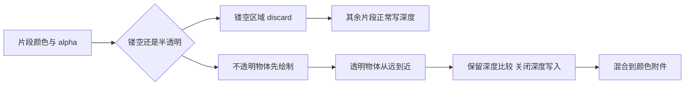
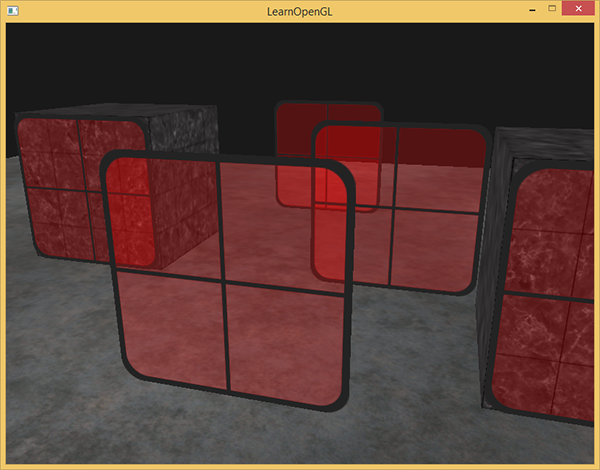
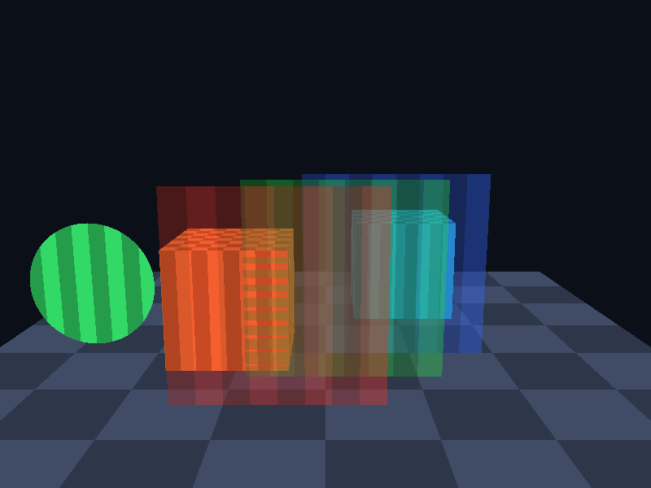

# 混合

| 项目 | 内容 |
| --- | --- |
| 原文 | [Blending](https://learnopengl.com/Advanced-OpenGL/Blending) |
| 作者 | JoeyDeVries |
| 来源 | [LearnOpenGL-CN](https://github.com/with-fair-wind/LearnOpenGL-CN/blob/new-theme/docs/04%20Advanced%20OpenGL/03%20Blending.md)，按本仓库代码整理修订 |
| 本仓库示例 | [`apps/04_advanced_opengl/03_blending/`](../../apps/04_advanced_opengl/03_blending/) |

**透明效果需要同时协调片段保留、颜色混合、绘制顺序和深度写入；仅输出小于 1 的 alpha 并不会自动透明。** 本例用数学圆形演示镂空，用三个半透明平面演示颜色叠加，核心机制与使用 RGBA 纹理一致。

## 两条不同的路径



应用决定顺序、alpha 语义和状态；着色器输出源颜色；OpenGL 固定功能混合阶段读取颜色附件中的目标值并合成；驱动不会自动判断玻璃应位于哪一层。alpha 可以表示不透明程度或覆盖率等约定，单个分量不能完整描述真实介质的吸收与折射。

## 镂空：丢弃而非混合

叶片边缘、围栏孔洞这类二值可见区域，通常不需要半透明叠加。本例在局部 XY 平面上用半径阈值代替 alpha 贴图：

```c++
constexpr const char* fragment_shader_source{R"glsl(
#version 330 core
in vec3 local_pos;
out vec4 frag_color;
uniform vec4 object_color;
uniform bool cutout;
void main()
{
    if (cutout && length(local_pos.xy) > 0.48) discard;
    float pattern = mod(floor((local_pos.x + 0.5) * 8.0) +
                        floor((local_pos.z + 0.5) * 8.0), 2.0);
    frag_color = vec4(object_color.rgb * mix(0.72, 1.0, pattern), object_color.a);
}
)glsl"};
```

圆外片段被 `discard`，不会通过后续常规路径写入颜色与深度。若改为输出 alpha=0 却继续写深度，后面的物体仍可能被挡住。实际 RGBA 图片还需要处理采样插值与边缘颜色，`GL_CLAMP_TO_EDGE` 能避免重复环绕引入另一端边缘，但不能解决所有透明边缘问题。

## 非预乘 alpha 的混合

本例 RGB 采用 $C_o=\alpha_s C_s+(1-\alpha_s)C_d$，alpha 采用 $\alpha_o=\alpha_s+(1-\alpha_s)\alpha_d$。因此用 `glBlendFuncSeparate` 分开配置 RGB 与 alpha 系数。预乘 alpha 数据已经把 RGB 乘过 alpha，需要相应使用源系数 `GL_ONE`，不可重复相乘。

## 透明排序与深度写入

先绘制不透明场景和镂空圆，再把透明平面从远到近排序。保留深度比较，防止玻璃盖住前方不透明物体；关闭深度写入，避免前方玻璃阻断其它透明层。实际排序与混合代码如下：

```c++
        std::stable_sort(panes.begin(), panes.end(), [](const pane& left, const pane& right) {
            return glm::dot(camera_position - left.position, camera_position - left.position) >
                   glm::dot(camera_position - right.position, camera_position - right.position);
        });
        glEnable(GL_BLEND);
        // OpenGL: 分别设置 RGB 与 alpha 的源/目标系数。
        glBlendFuncSeparate(GL_SRC_ALPHA, GL_ONE_MINUS_SRC_ALPHA, GL_ONE, GL_ONE_MINUS_SRC_ALPHA);
        // OpenGL: 只控制深度写入，不关闭深度比较。
        glDepthMask(GL_FALSE);
        for (const pane& item : panes) {
            model = glm::scale(glm::translate(glm::mat4{1.0F}, item.position), glm::vec3{1.6F});
            glUniformMatrix4fv(uniforms.model, 1, GL_FALSE, glm::value_ptr(model));
            glUniform4fv(uniforms.color, 1, glm::value_ptr(item.color));
            glDrawArrays(GL_TRIANGLES, 0, 6);
        }
        glDepthMask(GL_TRUE);
        // OpenGL: 关闭指定状态；多阶段绘制结束后恢复下一阶段的前置条件。
        glDisable(GL_BLEND);
```

`stable_sort` 会保留等距离元素，不会像“浮点距离作为唯一 map 键”的方法那样覆盖同距离物体。平面颜色来自 uniform，没有加载参考教程的草或玻璃纹理。



上图是原教程贴图玻璃的排序效果；本仓库截图见下方示例小节。

> **常见误解：** 关闭深度测试就能解决所有透明排序。
> **纠正：** 那会让本来被墙挡住的透明面也覆盖到墙上。通常需要的是保留与不透明深度的比较，同时禁止透明面更新深度；颜色合成的顺序仍由应用负责。

> **进阶（排序的边界）：** **按物体中心距离排序只是近似方案。** 相交几何、大面积斜面或互相穿插的透明表面，可能不存在一个按对象排列就正确的顺序；本例也不宣称任意视角下都能正确处理这类情况。工程上可按三角形拆分排序，或研究深度剥离、加权混合等顺序无关透明方法，并评估其内存与质量取舍。

## 本仓库示例

示例源码：[`apps/04_advanced_opengl/03_blending/main.cpp`](../../apps/04_advanced_opengl/03_blending/main.cpp)。代码片段均原样取自此文件；原站概念图片与本例实测截图分别标明。

首次安装依赖与工具链要求见[构建指南](../build.md)。已安装默认 MinGW GCC Debug 依赖时，在仓库根目录执行：

```powershell
cmake --preset mingw-gcc-debug
cmake --build --preset mingw-gcc-debug --target 04_advanced_opengl__03_blending
.\build\mingw-gcc-debug\apps\04_advanced_opengl\03_blending\04_advanced_opengl__03_blending.exe
```

Esc 退出；W/A/S/D 移动，鼠标转向，滚轮修改 FOV。

本仓库实测截图（默认模式）：



本章示例还支持 `--frames 3` 隐藏窗口运行指定帧数、`--mode M` 选择初始模式；配合 `--capture output.ppm` 可保存最后一帧。参数与检查方式详见[构建指南的高级 OpenGL 示例说明](../build.md#高级-opengl-示例)。

## 本章整体回顾

- **局部**：分别控制镂空丢弃、透明排序、颜色混合与深度写入。
- **整体**：透明需要着色器输出与固定功能状态配合，下一节进一步减少无用图元。

## 核校参考

- [OpenGL 3.3 Core 规范](https://registry.khronos.org/OpenGL/specs/gl/glspec33.core.pdf)：混合系数、深度写入和片段操作。
- [GLSL 3.30 规范](https://registry.khronos.org/OpenGL/specs/gl/GLSLangSpec.3.30.pdf)：阶段输入输出、内建变量及本例使用的语言语义。

下一节：[面剔除](04_face_culling.md)
