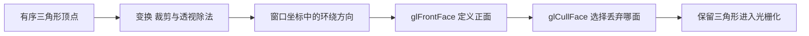
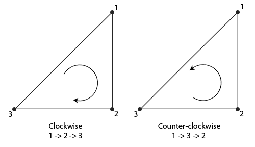

# 面剔除

| 项目 | 内容 |
| --- | --- |
| 原文 | [Face culling](https://learnopengl.com/Advanced-OpenGL/Face-culling) |
| 作者 | JoeyDeVries |
| 来源 | [LearnOpenGL-CN](https://github.com/with-fair-wind/LearnOpenGL-CN/blob/new-theme/docs/04%20Advanced%20OpenGL/04%20Face%20culling.md)，按本仓库代码整理修订 |
| 本仓库示例 | [`apps/04_advanced_opengl/04_face_culling/`](../../apps/04_advanced_opengl/04_face_culling/) |

**面剔除根据三角形在窗口坐标中的环绕方向判定正反面，与光照法线朝向不是同一套机制。** 对从外部观察的封闭物体，丢弃背面通常能减少光栅化与片段处理工作。

## 从顶点顺序到剔除



建模数据或应用决定顶点顺序；`glFrontFace` 定义哪种窗口环绕方向是正面，默认是 `GL_CCW`；`glCullFace` 选择剔除正面、背面或两者，默认选择背面；剔除开关默认关闭。驱动执行这些规则，不通过法线或物体颜色猜测“内外”。



## 本例的顶点与状态

本例立方体每个三角形从外部观察均采用 CCW 顺序。入门示例在未开启剔除时可以容忍不一致的面顺序，这里必须先纠正数据，再启用剔除：

```c++
    glEnable(GL_CULL_FACE);
    // OpenGL: 选择丢弃背面三角形。
    glCullFace(GL_BACK);
    // OpenGL: 依据窗口坐标中的顶点环绕顺序定义正面。
    glFrontFace(GL_CCW);
```

空格切换 `GL_CCW` 与 `GL_CW`。片段着色器通过 `gl_FrontFacing` 区分正反面，反面使用紫红色；切换定义后仍然只保留新定义下的正面，因此不会必然看到反面调试色。可以自行关闭剔除，再同时观察两类颜色。

> **常见误解：** 把法线乘以 -1，就会改变被剔除的面。
> **纠正：** 法线参与着色，环绕顺序参与面判定。改变三角形的顶点顺序、改变 `glFrontFace` 定义，或进行改变坐标系手性的变换，才可能改变正反面判定。

## 哪些物体不适合直接剔除背面

双面叶片、布料、打开的容器和从内部观察的房间都可能需要背面。透明封闭物体还涉及前后表面的排序，不能简单套用不透明场景规则。天空盒从立方体内部观察，必须关闭剔除、反转数据，或选择剔除外部正面中的一种一致方案。

> **进阶（镜像缩放）：** **包含负缩放的变换可能翻转环绕方向。** 对模型线性变换的行列式为负时，应检查实例的坐标系手性，按需要改变剔除状态或修正数据。法线矩阵解决的是法线变换，不能自动修复环绕方向；批量实例同时含镜像和非镜像时，还要考虑拆批或双面材质，而不能每个实例共享一套错误的正面定义。

> **进阶（性能判断）：** **“少画一半面”不等于性能固定提高一倍。** 面剔除通常仍需完成相关顶点处理，提前深度测试也可能已经消除了部分片段工作。收益取决于遮挡、材质复杂度、几何规模和当前瓶颈；应以目标场景测量，不能沿用参考译文中的百分比描述作性能保证。

## 本仓库示例

示例源码：[`apps/04_advanced_opengl/04_face_culling/main.cpp`](../../apps/04_advanced_opengl/04_face_culling/main.cpp)。代码片段均原样取自此文件；原站概念图片与本例实测截图分别标明。

首次安装依赖与工具链要求见[构建指南](../build.md)。已安装默认 MinGW GCC Debug 依赖时，在仓库根目录执行：

```powershell
cmake --preset mingw-gcc-debug
cmake --build --preset mingw-gcc-debug --target 04_advanced_opengl__04_face_culling
.\build\mingw-gcc-debug\apps\04_advanced_opengl\04_face_culling\04_advanced_opengl__04_face_culling.exe
```

Esc 退出；W/A/S/D 移动，鼠标转向，滚轮修改 FOV。空格切换 CCW/CW 正面定义。

本仓库实测截图（默认模式）：


本章示例还支持 `--frames 3` 隐藏窗口运行指定帧数、`--mode M` 选择初始模式；配合 `--capture output.ppm` 可保存最后一帧。参数与检查方式详见[构建指南的高级 OpenGL 示例说明](../build.md#高级-opengl-示例)。

## 本章整体回顾

- **局部**：依据窗口环绕判定正反面，启用剔除前检查网格方向与镜像变换。
- **整体**：剔除作用于三角形，下一节把颜色、深度和模板的输出目的地组织成 FBO。

## 核校参考

- [OpenGL 3.3 Core 规范](https://registry.khronos.org/OpenGL/specs/gl/glspec33.core.pdf)：正反面判定与剔除状态。
- [GLSL 3.30 规范](https://registry.khronos.org/OpenGL/specs/gl/GLSLangSpec.3.30.pdf)：阶段输入输出、内建变量及本例使用的语言语义。

下一节：[帧缓冲](05_framebuffers.md)
