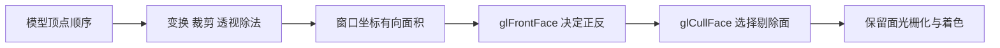
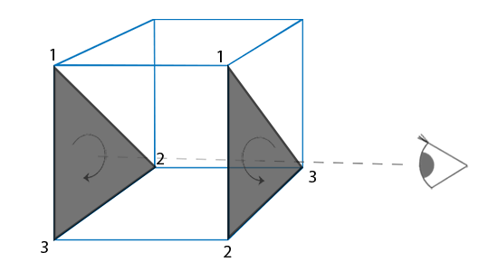
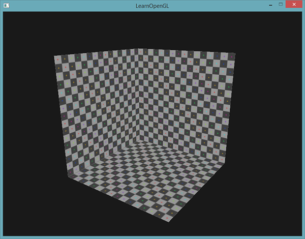

# 面剔除

| 项目 | 信息 |
| --- | --- |
| 原文 | [Face-culling](https://learnopengl.com/Advanced-OpenGL/Face-culling) |
| 作者 | Joey de Vries |
| 翻译 | Krasjet |
| 校对 | 暂未校对 |
| 中文底本 | [LearnOpenGL-CN 上游固定版本](https://github.com/LearnOpenGL-CN/LearnOpenGL-CN/blob/331560886468e28f28326429334fc48470f9c27b/docs/04%20Advanced%20OpenGL/04%20Face%20culling.md)，`new-theme` / `331560886468e28f28326429334fc48470f9c27b` |
| 本仓库示例 | [`apps/04_advanced_opengl/04_face_culling/main.cpp`](../../apps/04_advanced_opengl/04_face_culling/main.cpp) |
| 修订 | 按上游完整小节顺序重写，技术差异见正文；[逐项覆盖清单](coverage.md) |

**面剔除按三角形投影后的环绕顺序判断正反面，把不需要的一面在片段阶段之前剔除。** 对封闭箱子而言，从外面看通常只需要面向观察者的表面；草叶、纸张、打开的薄壳却可能需要两面，不能直接套用同一策略。

一个立方体有六面，但单个视角通常最多直接看到三面。剔除背面有机会减少后续片段工作，却不意味着必定快 50%：顶点处理仍然存在，收益取决于瓶颈、遮挡、分辨率和驱动。OpenGL 定义面分类与剔除状态，驱动实现；GLFW 只负责上下文和窗口，应用必须保证网格环绕约定一致。



## 环绕顺序

同一三角形的顶点可以按顺时针（CW）或逆时针（CCW）列出。面对一张纸看见逆时针，从纸背看就变成顺时针，因此一致的外表面顺序能用来分类封闭网格。


OpenGL 默认把窗口坐标中逆时针的三角形认作正面。这个判断不是比较顶点法线和视线方向，也不依赖光照计算；即使法线全部错误，面分类仍使用几何环绕。输入位置在模型空间固定，但相机转动后投影顺序可能改变，正是背面可被识别的原因。



本仓库 `cube_vertices` 已逐三角形校验为从外部观察时 CCW，两个三角形组成每个面。不要只交换某一个三角形的顶点来修复整个面；网格所有面都应遵守约定。若模型变换含负缩放，几何的朝向可能反转，绘制时要考虑相应的 `glFrontFace` 选择。

## 面剔除

开启 `GL_CULL_FACE` 后，`glCullFace` 决定丢弃哪类面，`glFrontFace` 决定何为正面。它们是两个独立状态：

| 设置 | 含义 |
| --- | --- |
| `glCullFace(GL_BACK)` | 剔除背面，默认选择 |
| `glCullFace(GL_FRONT)` | 剔除正面 |
| `glCullFace(GL_FRONT_AND_BACK)` | 三角形两面都剔除，不等于禁止所有点线绘制 |
| `glFrontFace(GL_CCW)` / `GL_CW` | 把逆时针 / 顺时针设为正面 |

对应初始化源码：

```cpp
    glEnable(GL_CULL_FACE);
    // OpenGL: 选择丢弃背面三角形。
    glCullFace(GL_BACK);
    // OpenGL: 依据窗口坐标中的顶点环绕顺序定义正面。
    glFrontFace(GL_CCW);
```

模式 0 保留外表面，模式 1 把 CW 改为正面，仍剔除背面，于是外表面被丢弃、可以看见原先朝内的表面。本例片段着色器也提供 `gl_FrontFacing` 颜色区分，但启用背面剔除后保留下来的片段都属于当前定义的正面；颜色不能替代环绕设置。

```cpp
        if (key_pressed(window, GLFW_KEY_SPACE, previous_space)) {
            reverse_winding = !reverse_winding;
        }
        glFrontFace(reverse_winding ? GL_CW : GL_CCW);
```



底本把“CCW 正面 + 剔除正面”和“CW 正面 + 剔除背面”作对照：对同一组多边形，它们保留的几何面相同，但 `gl_FrontFacing` 的真假分类不同，所以双面着色结果不一定一样。

关闭面剔除使用 `glDisable(GL_CULL_FACE)`。纹理 alpha 丢弃发生在片段程序内，面剔除更早发生：若草叶的背面已经被剔除，后面再写怎样的透明着色都无法把它找回来。天空盒从内部观察，也必须选择合适环绕或关闭剔除。

## 练习

按上游要求，重新定义立方体顶点，让每个面从外部观察时均为**顺时针**；再通过 `glFrontFace(GL_CW)` 保持外表面可见。不要只改变状态而保留旧顶点，练习要同时验证数据与约定。对比底本[参考解答](https://learnopengl.com/code_viewer_gh.php?code=src/4.advanced_opengl/4.face_culling_exercise1/face_culling_exercise1.cpp)。本仓库的模式切换用于观察状态，练习中的顶点重排仍由读者完成。

> **常见误解：** 顶点法线、材质是否透明、深度测试都不决定正面。环绕决定分类，剔除状态决定是否保留，法线决定后续着色，各环节需分别检查。

> **进阶（镜像变换）：** **含反射的变换可能翻转网格定向。** 负缩放常用于镜像模型，但它可能把原本一致的 CCW 外表面变成 CW。应用可以针对该批绘制调整正面定义，或在资源处理阶段修正索引；同时法线仍需使用适当的逆转置矩阵。修复法线只修复光照，不会自动修复面剔除，两项应分别核验。

## 上游源码与附加资源

以下保留底本引用的源码、资源与附加阅读入口；正文使用本仓库实现，外部旧演示与本地程序的组织可能不同。

- [上游源码或资源对照](https://learnopengl.com/code_viewer.php?code=advanced/faceculling_vertexdata)
- [上游源码或资源对照](https://learnopengl.com/code_viewer.php?code=advanced/faceculling-exercise1)

## 本仓库示例

源码：[`main.cpp`](../../apps/04_advanced_opengl/04_face_culling/main.cpp)，目标：`04_advanced_opengl__04_face_culling`。正文标为源码的 C++/GLSL 均直接摘取此文件；标为概念说明的独立片段用于说明规范或未启用的更高版本功能。

```powershell
cmake --preset mingw-gcc-debug
cmake --build --preset mingw-gcc-debug --target 04_advanced_opengl__04_face_culling
.\build\mingw-gcc-debug\apps\04_advanced_opengl\04_face_culling\04_advanced_opengl__04_face_culling.exe --mode 0
```

依赖准备、多配置生成器与其他工具链见[构建指南](../build.md)。Esc 是退出键；除 07 的二维数据示例外，三维场景支持 WASD、鼠标与滚轮。空格按表中顺序切换（07 用启动参数选择映射方法）。有限帧检查可追加 `--frames 3 --capture output.ppm`，截图取最后一帧；它验证绘制路径，不能代替交互和视觉检查。

| `--mode` | 可观察内容 |
| --- | --- |
| 0 | CCW 为正面，剔除背面 |
| 1 | CW 为正面，剔除背面 |


## 本章整体回顾

正反面由投影后的环绕顺序判定，法线负责着色，二者职责不同。只有封闭且背面确实不可见的几何才适合直接剔除背面；负缩放和镜像需要重新检查环绕。

本篇承接前一篇，正文保留底本对应的小节与主案例。图片中的背包、箱子等属于上游演示，本仓库使用独立注明的教学场景；本仓库截图与上游图分开标注。图片出处见[资源记录](../img/04/README.md)，对应关系与验证边界见[覆盖清单](coverage.md)。

技术核校：[英文原文](https://learnopengl.com/Advanced-OpenGL/Face-culling)、[OpenGL 3.3 Core 规范](https://registry.khronos.org/OpenGL/specs/gl/glspec33.core.pdf)、[GLSL 3.30 规范](https://registry.khronos.org/OpenGL/specs/gl/GLSLangSpec.3.30.pdf)。

下一节：[帧缓冲](05_framebuffers.md)。
