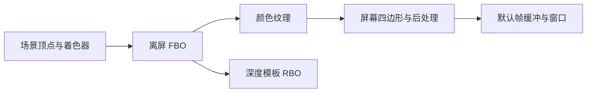
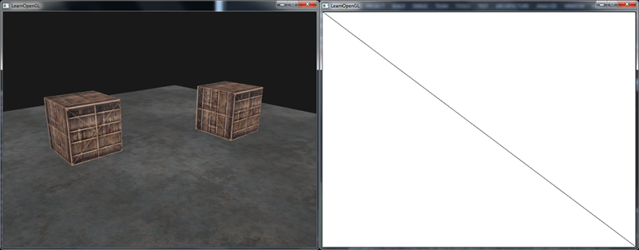
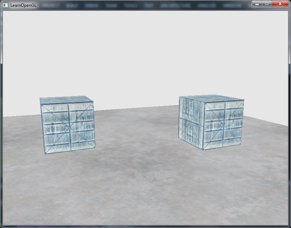
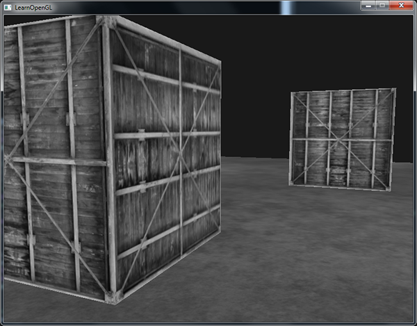
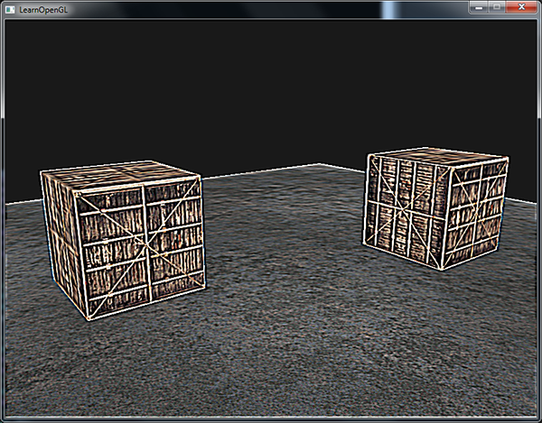
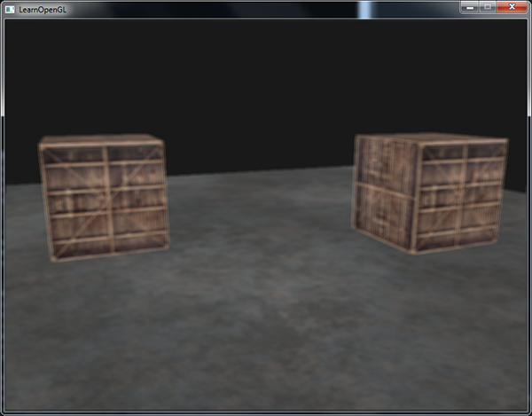
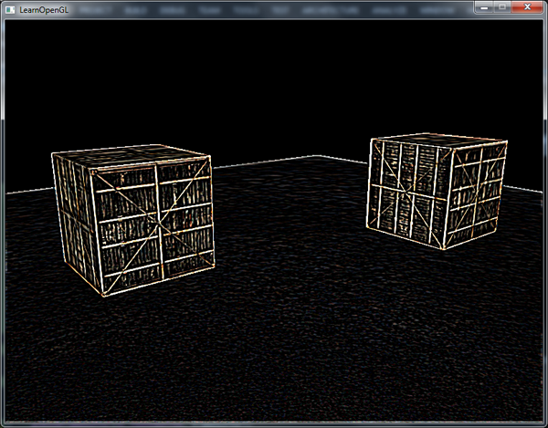
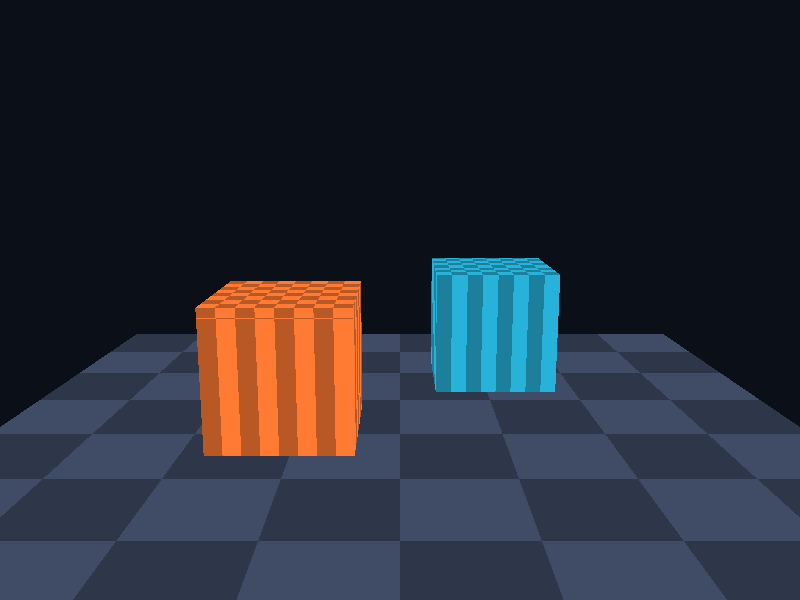

# 帧缓冲

| 项目 | 信息 |
| --- | --- |
| 原文 | [Framebuffers](https://learnopengl.com/Advanced-OpenGL/Framebuffers) |
| 作者 | Joey de Vries |
| 翻译 | Krasjet |
| 校对 | [AoZhang](https://github.com/SuperAoao) |
| 中文底本 | [LearnOpenGL-CN 上游固定版本](https://github.com/LearnOpenGL-CN/LearnOpenGL-CN/blob/331560886468e28f28326429334fc48470f9c27b/docs/04%20Advanced%20OpenGL/05%20Framebuffers.md)，`new-theme` / `331560886468e28f28326429334fc48470f9c27b` |
| 本仓库示例 | [`apps/04_advanced_opengl/05_framebuffers/main.cpp`](../../apps/04_advanced_opengl/05_framebuffers/main.cpp) |
| 修订 | 按上游完整小节顺序重写，技术差异见正文；[逐项覆盖清单](coverage.md) |

**帧缓冲对象（FBO）组织绘制结果写到哪里，附件才提供颜色、深度和模板的存储。** 此前绘制到编号 0 的默认帧缓冲，由窗口系统管理；现在由应用创建离屏附件，把场景先保存成纹理，再将纹理画回窗口。

OpenGL 规定附件和完整性规则，驱动分配并使用存储；GLFW 负责默认窗口附件与交换缓冲，应用负责自建 FBO 的尺寸、格式和绘制阶段。FBO 不是一张自动包含全部缓冲的图像，创建名称也不会自动分配颜色和深度。



## 创建一个帧缓冲

创建名称后绑定到 `GL_FRAMEBUFFER`，后续附件配置、清除与绘制针对该对象。这个目标同时设置读与绘制帧缓冲；`GL_READ_FRAMEBUFFER` 和 `GL_DRAW_FRAMEBUFFER` 可以分别指定源与目标。绑定 0 回到默认帧缓冲；删除 FBO 不会替应用删除其纹理和 RBO，因此本例的资源守卫分别管理它们。

至少要有适合用途的完整附件配置。对本例，需要有效颜色附件、与绘制缓冲选择相符的颜色目标、有效深度/模板存储以及兼容的样本数。不能用“已经 attach”代替 `glCheckFramebufferStatus` 检查。深度专用 FBO 可以没有颜色，但需相应关闭颜色读写选择；这里只创建完整的颜色场景目标。

### 纹理附件

纹理附件允许后续着色器采样绘制结果。本例用 `glTexImage2D` 为颜色纹理分配 `GL_RGB8` 存储，data 为 `nullptr`，表示尚未提供像素；真正内容来自后面的场景绘制。宽高使用实际帧缓冲像素，设置线性 min/mag 过滤，不要求 mipmap。再以 `glFramebufferTexture2D` 把 level 0 附到 `GL_COLOR_ATTACHMENT0`。

五个参数含义要分清：target 选择读/绘制/两者帧缓冲，附件点决定它承担颜色还是深度等角色，纹理目标决定图像类型，纹理名称决定存储对象，level 决定 mip 层。深度纹理通常用 `GL_DEPTH_COMPONENT` 系列格式并附到 `GL_DEPTH_ATTACHMENT`，不是把 RGB 图像换个附件名就能充当深度。

组合深度/模板纹理可以用内部格式 `GL_DEPTH24_STENCIL8`、上传格式 `GL_DEPTH_STENCIL` 和类型 `GL_UNSIGNED_INT_24_8` 分配，再附到 `GL_DEPTH_STENCIL_ATTACHMENT`。底本提到直接用 `GL_STENCIL_INDEX` 建独立模板纹理，需要注意版本：独立模板纹理由后来引入的 [ARB_texture_stencil8](https://registry.khronos.org/OpenGL/extensions/ARB/ARB_texture_stencil8.txt) 等提供，不应作为本例 3.3 核心的通用写法；本例选择组合 RBO，避免混淆纹理格式支持和 FBO 附件点。

窗口改变尺寸时，附件不会自动变大。重新分配颜色纹理和深度/模板存储、重新核验完整性，并在每次绑定绘制目标后设置正确视口。OpenGL 3.3 的 FBO 完整性不笼统要求所有附件尺寸相同，但可用区域受到附件尺寸约束；本例主动保持同尺寸，避免渲染被较小附件限制。

### 渲染缓冲对象附件

RBO 提供供渲染使用的图像存储，不能直接作为普通纹理交给 `sampler2D`。若后续只需要颜色纹理而不采样深度，深度/模板用 RBO 很方便。本例生成并绑定 RBO，调用 `glRenderbufferStorage(GL_RENDERBUFFER, GL_DEPTH24_STENCIL8, ...)`，以一个打包存储附到 `GL_DEPTH_STENCIL_ATTACHMENT`。

不要把“不能用纹理采样”解释为“CPU 完全不能读”。附件内容可以经允许的帧缓冲读回或 blit 路径处理；RBO 与纹理的选择也没有无条件的性能排名。应根据后续是否采样、格式和平台测量选择。

本仓库的创建/调整函数完整源码包含颜色纹理、组合 RBO 和状态检查：

```cpp
bool resize_target(gpu_resources& resources, render_target& target, int width, int height) {
    if (target.framebuffer == 0U) {
        // OpenGL: 创建用于组织离屏附件的帧缓冲对象。
        glGenFramebuffers(1, &target.framebuffer);
        // OpenGL: 创建纹理对象名称。
        glGenTextures(1, &target.color);
        // OpenGL: 创建不需要普通纹理采样的附件存储对象。
        glGenRenderbuffers(1, &target.depth_stencil);
        resources.framebuffers.push_back(target.framebuffer);
        resources.textures.push_back(target.color);
        resources.renderbuffers.push_back(target.depth_stencil);
    }
    // OpenGL: GL_FRAMEBUFFER 同时设置读目标与写目标。
    glBindFramebuffer(GL_FRAMEBUFFER, target.framebuffer);
    if (target.width != width || target.height != height) {
        // OpenGL: 绑定纹理到当前活动纹理单元的指定目标。
        glBindTexture(GL_TEXTURE_2D, target.color);
        // OpenGL: 定义纹理图像存储；空指针仅分配空间。
        glTexImage2D(GL_TEXTURE_2D, 0, GL_RGB8, width, height, 0, GL_RGB, GL_UNSIGNED_BYTE,
                     nullptr);
        // OpenGL: 配置纹理过滤与环绕状态。
        glTexParameteri(GL_TEXTURE_2D, GL_TEXTURE_MIN_FILTER, GL_LINEAR);
        glTexParameteri(GL_TEXTURE_2D, GL_TEXTURE_MAG_FILTER, GL_LINEAR);
        glTexParameteri(GL_TEXTURE_2D, GL_TEXTURE_WRAP_S, GL_CLAMP_TO_EDGE);
        glTexParameteri(GL_TEXTURE_2D, GL_TEXTURE_WRAP_T, GL_CLAMP_TO_EDGE);
        // OpenGL: 将纹理的一个图像层接到当前 FBO。
        glFramebufferTexture2D(GL_FRAMEBUFFER, GL_COLOR_ATTACHMENT0, GL_TEXTURE_2D, target.color,
                               0);
        // OpenGL: 选择后续存储分配使用的 RBO。
        glBindRenderbuffer(GL_RENDERBUFFER, target.depth_stencil);
        // OpenGL: 分配单采样深度/模板附件。
        glRenderbufferStorage(GL_RENDERBUFFER, GL_DEPTH24_STENCIL8, width, height);
        // OpenGL: 将渲染缓冲接到 FBO 的指定附件点。
        glFramebufferRenderbuffer(GL_FRAMEBUFFER, GL_DEPTH_STENCIL_ATTACHMENT, GL_RENDERBUFFER,
                                  target.depth_stencil);
        target.width = width;
        target.height = height;
    }
    // OpenGL: 渲染前检查附件格式、采样数和读写目标等完整性条件。
    const GLenum status{glCheckFramebufferStatus(GL_FRAMEBUFFER)};
    if (status != GL_FRAMEBUFFER_COMPLETE) {
        std::cerr << "Framebuffer incomplete: " << status << '\n';
        return false;
    }
    return true;
}
```

失败时打印状态并终止该例，不能继续使用不完整目标。没有深度附件时深度比较不会按场景期望产生遮挡，不能指望仅仅启用 `GL_DEPTH_TEST` 就获得可用深度存储。

## 渲染到纹理

两遍绘制是关键：第一遍绑定离屏 FBO、启用深度、清除颜色与深度、画正常场景；第二遍回到默认 FBO、停用深度、将颜色纹理贴到覆盖屏幕的两个三角形上。清除针对当前绑定目标，所以要在绑定之后调用。第二遍不需要相机矩阵，因为四边形直接覆盖裁剪空间。

上游用[箱子照片](../img/04/05/container.jpg)装饰场景；本仓库用同样的地面和两个箱子，表面格纹由局部坐标生成，让教程聚焦 FBO 的存储与采样。这个资源变化不改变两遍绘制和邻域采样步骤。

屏幕顶点着色器由位置生成 $[0,1]$ UV，位置本身直接作为裁剪空间输出：

```glsl
#version 330 core
layout (location = 0) in vec3 a_pos;
out vec2 tex_coord;
void main()
{
    tex_coord = a_pos.xy * 0.5 + 0.5;
    gl_Position = vec4(a_pos, 1.0);
}
```

模式 0 的片段程序只采样屏幕纹理。场景纹理在作为绘制附件时不能同时被同一次绘制读取，本例进入场景阶段前解绑上一帧采样的纹理；进入屏幕阶段则切换到默认目标再绑定采样纹理。第一遍重新启用深度，第二遍关闭深度，避免上一阶段状态泄漏。

```cpp
        glBindFramebuffer(GL_FRAMEBUFFER, 0);
        glViewport(0, 0, width, height);
        // OpenGL: 关闭指定状态；多阶段绘制结束后恢复下一阶段的前置条件。
        glDisable(GL_DEPTH_TEST);
        glClear(GL_COLOR_BUFFER_BIT);
        glUseProgram(screen_program);
        // OpenGL: 写入标量整型或布尔 uniform；sampler 接收纹理单元索引。
        glUniform1i(screen_texture_uniform, 0);
        glUniform1i(effect_uniform, effect);
        // OpenGL: 选择纹理单元；sampler uniform 中填写相应的零起始索引。
        glActiveTexture(GL_TEXTURE0);
        glBindTexture(GL_TEXTURE_2D, target.color);
        glBindVertexArray(screen_vao);
        glDrawArrays(GL_TRIANGLES, 0, 6);
```



视觉上和直接渲染接近，但最后实际画的是屏幕四边形。诊断时可以检查两个阶段各自的 framebuffer、viewport、program、VAO、sampler 单元和 depth 状态，逐步确认，而不是只盯着矩阵。

## 后期处理

把场景变成纹理后，屏幕片段程序可修改当前像素，也可采样周围像素。下面七个模式共享同一屏幕程序，场景几何不变，只改变 `effect`。

### 反相

模式 1 对 RGB 计算 $C'=1-C$，alpha 输出 1。黑白互换、彩色变成互补色；只改变屏幕颜色，离屏场景几何和深度完全不变。



### 灰度

最直接的方法是 $g=(r+g+b)/3$，模式 6 对应等权平均。人眼对三通道敏感性不同，模式 2 使用 $g=0.2126r+0.7152g+0.0722b$，再将标量写入三个颜色分量。



加权公式不是对任意编码 RGB 都自动“物理准确”。这些系数对应线性 RGB 的亮度组合；若采样的是经过非线性编码的 sRGB，应先考虑解码和输出编码。本例的离屏 `RGB8` 不启用额外 sRGB 转换，目的是比较算法，不把它当作完整的颜色管理方案。

### 核效果

核是邻域样本的权重表。以当前位置 $p$ 为中心，3×3 核计算 $C'(p)=\sum_{i=-1}^{1}\sum_{j=-1}^{1}K_{ij}C(p+(i,j))$。本例实际采样步长为 `(1/width, 1/height)`，由 `textureSize` 得到；不像固定 `1/300` 那样随分辨率改变滤波跨度。

底本先给出一个邻域强调例子，再使用中心为 9、邻居为 -1 的锐化核，两者都保留如下：

$$K_a=\begin{bmatrix}2&2&2\\2&-15&2\\2&2&2\end{bmatrix},\qquad
K_{sharp}=\begin{bmatrix}-1&-1&-1\\-1&9&-1\\-1&-1&-1\end{bmatrix}.$$

核权重和为 1，意味着常量输入保持常量，不表示每个像素都不会变亮或变暗。边缘检测核通常权重和为 0，故“所有正确的核都必须和为 1”是错误要求。负值和超过 1 的输出还会受到目标格式的范围限制。

先建立九个偏移，再按对应权重采样相乘求和。本例把偏移生成写成双循环，按同一行列顺序索引权重；模式 3 实现锐化。完整屏幕片段程序含反相、两种灰度及三个核：

```glsl
#version 330 core
in vec2 tex_coord;
out vec4 frag_color;
uniform sampler2D screen_texture;
uniform int effect;
void main()
{
    vec3 color = texture(screen_texture, tex_coord).rgb;
    if (effect == 1) color = vec3(1.0) - color;
    if (effect == 2) color = vec3(dot(color, vec3(0.2126, 0.7152, 0.0722)));
    if (effect == 6) color = vec3((color.r + color.g + color.b) / 3.0);
    if (effect >= 3 && effect <= 5) {
        vec2 step_size = 1.0 / vec2(textureSize(screen_texture, 0));
        float blur[9] = float[](1.0,2.0,1.0,2.0,4.0,2.0,1.0,2.0,1.0);
        color = vec3(0.0);
        for (int y = -1; y <= 1; ++y) {
            for (int x = -1; x <= 1; ++x) {
                bool center = x == 0 && y == 0;
                float weight = effect == 3 ? (center ? 9.0 : -1.0) :
                    effect == 4 ? blur[(y+1)*3+x+1] / 16.0 : (center ? -8.0 : 1.0);
                color += texture(screen_texture, tex_coord + vec2(x,y)*step_size).rgb * weight;
            }
        }
    }
    frag_color = vec4(color, 1.0);
}
```



### 模糊

模式 4 使用归一化的 3×3 高斯近似核：

$$K_{blur}=\frac1{16}\begin{bmatrix}1&2&1\\2&4&2\\1&2&1\end{bmatrix}.$$

未除以 16 时，常量图像也会整体放大 16 倍。归一化后中心权重大、邻居权重小，局部颜色被平滑。较大的模糊范围可以扩大步长或核，但这是两种不同滤波；重复模糊也不等同于任意放大采样距离。



这种平滑可表达失焦、醉酒视觉或为后续效果准备低频图像。这里保留底本的应用动机，但一个 3×3 屏幕核本身并没有模拟真实镜头景深。

### 边缘检测

模式 5 使用中心为 -8、周围为 1 的离散拉普拉斯核：

$$K_{edge}=\begin{bmatrix}1&1&1\\1&-8&1\\1&1&1\end{bmatrix}.$$

常量区域相互抵消，颜色突变处保留较大响应，得到边缘。该核有正负响应，本例直接写普通颜色附件会截去负值；若要同时显示两种符号，可显式取绝对值或加偏置，但那会改变显示方式。



> **译注（屏幕边界）：** 周围八个采样会越过纹理边界。默认 repeat 会把屏幕另一侧卷进来，产生条纹；本例两轴使用 `GL_CLAMP_TO_EDGE`，用边缘像素延拓。它是一种明确的边界条件，其他算法也可选择零填充或镜像，不能不加说明地混用。

## 练习

1. 保留上游的后视镜练习：场景绘制两次，一次正常视角，一次绕相机竖直方向旋转 180°；把背向视角的颜色纹理贴在屏幕顶部的小四边形。需要时调整 UV 形成镜像。[效果图](https://learnopengl.com/img/advanced/framebuffers_mirror.png)与[参考解答](https://learnopengl.com/code_viewer_gh.php?code=src/4.advanced_opengl/5.2.framebuffers_exercise1/framebuffers_exercise1.cpp)。这是原有练习，不是用它替代正文卷积案例。
2. 改变核并比较常量区域、尖锐边缘和噪声的响应，尝试其他滤镜。记录权重和与边界条件，不只调整数字到“看起来有变化”。

> **常见误解：** 绑定 FBO 不会自动设置 viewport，也不会自动关闭深度或切换 sampler。FBO 完整与最终画面对不对是两层验收。

> **进阶（读写反馈）：** **同一绘制中读取正在写入的纹理图像会形成反馈风险。** 常见解决方法是交替使用两个离屏目标：从 A 读、向 B 写，再交换角色。FBO 本身不是同步屏障；安全性来自明确的输入输出关系和规范允许的访问方式。多次模糊、颜色分级等后处理链应先画出这条资源流，再安排绑定与绘制。

## 上游源码与附加资源

以下保留底本引用的源码、资源与附加阅读入口；正文使用本仓库实现，外部旧演示与本地程序的组织可能不同。

- [AoZhang](https://github.com/SuperAoao)
- [这些](https://www.khronos.org/registry/OpenGL-Refpages/gl4/html/glCheckFramebufferStatus.xhtml)
- [顶点坐标](https://learnopengl.com/code_viewer.php?code=advanced/framebuffers_quad_vertices)
- [上游源码或资源对照](https://learnopengl.com/code_viewer_gh.php?code=src/4.advanced_opengl/5.1.framebuffers/framebuffers.cpp)
- [这样](https://learnopengl.com/img/advanced/framebuffers_mirror.png)
- [上游源码或资源对照](https://learnopengl.com/code_viewer_gh.php?code=src/4.advanced_opengl/5.2.framebuffers_exercise1/framebuffers_exercise1.cpp)

## 本仓库示例

源码：[`main.cpp`](../../apps/04_advanced_opengl/05_framebuffers/main.cpp)，目标：`04_advanced_opengl__05_framebuffers`。正文标为源码的 C++/GLSL 均直接摘取此文件；标为概念说明的独立片段用于说明规范或未启用的更高版本功能。

```powershell
cmake --preset mingw-gcc-debug
cmake --build --preset mingw-gcc-debug --target 04_advanced_opengl__05_framebuffers
.\build\mingw-gcc-debug\apps\04_advanced_opengl\05_framebuffers\04_advanced_opengl__05_framebuffers.exe --mode 0
```

依赖准备、多配置生成器与其他工具链见[构建指南](../build.md)。Esc 是退出键；除 07 的二维数据示例外，三维场景支持 WASD、鼠标与滚轮。空格按表中顺序切换（07 用启动参数选择映射方法）。有限帧检查可追加 `--frames 3 --capture output.ppm`，截图取最后一帧；它验证绘制路径，不能代替交互和视觉检查。

| `--mode` | 可观察内容 |
| --- | --- |
| 0 | 直通 |
| 1 | 反相 |
| 2 | 加权灰度 |
| 3 | 锐化 |
| 4 | 高斯模糊 |
| 5 | 边缘检测 |
| 6 | 平均灰度 |



## 本章整体回顾

FBO 组织附件，纹理与 RBO 提供存储。场景先写颜色纹理，再由屏幕四边形采样；逐像素变换和邻域卷积由此共享同一条后处理链。

本篇承接前一篇，正文保留底本对应的小节与主案例。图片中的背包、箱子等属于上游演示，本仓库使用独立注明的教学场景；本仓库截图与上游图分开标注。图片出处见[资源记录](../img/04/README.md)，对应关系与验证边界见[覆盖清单](coverage.md)。

技术核校：[英文原文](https://learnopengl.com/Advanced-OpenGL/Framebuffers)、[OpenGL 3.3 Core 规范](https://registry.khronos.org/OpenGL/specs/gl/glspec33.core.pdf)、[GLSL 3.30 规范](https://registry.khronos.org/OpenGL/specs/gl/GLSLangSpec.3.30.pdf)。

下一节：[立方体贴图](06_cubemaps.md)。
