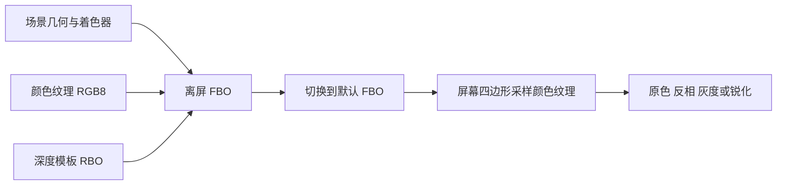

# 帧缓冲

| 项目 | 内容 |
| --- | --- |
| 原文 | [Framebuffers](https://learnopengl.com/Advanced-OpenGL/Framebuffers) |
| 作者 | JoeyDeVries |
| 来源 | [LearnOpenGL-CN](https://github.com/with-fair-wind/LearnOpenGL-CN/blob/new-theme/docs/04%20Advanced%20OpenGL/05%20Framebuffers.md)，按本仓库代码整理修订 |
| 本仓库示例 | [`apps/04_advanced_opengl/05_framebuffers/`](../../apps/04_advanced_opengl/05_framebuffers/) |

**FBO 是附件与读写目标的组织对象，纹理和渲染缓冲才提供图像存储。** 把场景先渲染成纹理，再用屏幕四边形采样它，就把三维场景绘制与二维后期处理拆成了两个阶段。

## 两次绘制，一条图像数据流



默认帧缓冲由窗口系统创建；应用创建的 FBO 用附件描述渲染目的地。绑定 `GL_FRAMEBUFFER` 同时改变读与写绑定，`GL_READ_FRAMEBUFFER` 和 `GL_DRAW_FRAMEBUFFER` 可以分别设置它们。视口、深度测试和 program 不会因为切换 FBO 自动变成合适的状态，应用必须明确设置。

## 纹理附件与 RBO

本例颜色需要供下一阶段采样，所以使用 `GL_RGB8` 的二维纹理；深度/模板仅供测试，使用 `GL_DEPTH24_STENCIL8` RBO。RBO 不是“只能写不能读”：它不能像普通纹理那样直接交给 sampler，但仍可作为帧缓冲读回或 blit 的来源。

窗口尺寸变化时重分配附件，并检查完整性：

```c++
bool resize_target(gpu_resources& resources, render_target& target, int width, int height) {
    if (target.framebuffer == 0U) {
        // OpenGL: 创建用于组织离屏附件的帧缓冲对象。
        glGenFramebuffers(1, &target.framebuffer);
        // OpenGL: 创建纹理对象名称。
        glGenTextures(1, &target.color);
        // OpenGL: 创建不需要普通纹理采样的附件存储对象。
        glGenRenderbuffers(1, &target.depth_stencil);
        resources.framebuffers.push_back(target.framebuffer);
        resources.textures.push_back(target.color);
        resources.renderbuffers.push_back(target.depth_stencil);
    }
    // OpenGL: GL_FRAMEBUFFER 同时设置读目标与写目标。
    glBindFramebuffer(GL_FRAMEBUFFER, target.framebuffer);
    if (target.width != width || target.height != height) {
        // OpenGL: 绑定纹理到当前活动纹理单元的指定目标。
        glBindTexture(GL_TEXTURE_2D, target.color);
        // OpenGL: 定义纹理图像存储；空指针仅分配空间。
        glTexImage2D(GL_TEXTURE_2D, 0, GL_RGB8, width, height, 0, GL_RGB, GL_UNSIGNED_BYTE,
                     nullptr);
        // OpenGL: 配置纹理过滤与环绕状态。
        glTexParameteri(GL_TEXTURE_2D, GL_TEXTURE_MIN_FILTER, GL_LINEAR);
        glTexParameteri(GL_TEXTURE_2D, GL_TEXTURE_MAG_FILTER, GL_LINEAR);
        glTexParameteri(GL_TEXTURE_2D, GL_TEXTURE_WRAP_S, GL_CLAMP_TO_EDGE);
        glTexParameteri(GL_TEXTURE_2D, GL_TEXTURE_WRAP_T, GL_CLAMP_TO_EDGE);
        // OpenGL: 将纹理的一个图像层接到当前 FBO。
        glFramebufferTexture2D(GL_FRAMEBUFFER, GL_COLOR_ATTACHMENT0, GL_TEXTURE_2D, target.color,
                               0);
        // OpenGL: 选择后续存储分配使用的 RBO。
        glBindRenderbuffer(GL_RENDERBUFFER, target.depth_stencil);
        // OpenGL: 分配单采样深度/模板附件。
        glRenderbufferStorage(GL_RENDERBUFFER, GL_DEPTH24_STENCIL8, width, height);
        // OpenGL: 将渲染缓冲接到 FBO 的指定附件点。
        glFramebufferRenderbuffer(GL_FRAMEBUFFER, GL_DEPTH_STENCIL_ATTACHMENT, GL_RENDERBUFFER,
                                  target.depth_stencil);
        target.width = width;
        target.height = height;
    }
    // OpenGL: 渲染前检查附件格式、采样数和读写目标等完整性条件。
    const GLenum status{glCheckFramebufferStatus(GL_FRAMEBUFFER)};
    if (status != GL_FRAMEBUFFER_COMPLETE) {
        std::cerr << "Framebuffer incomplete: " << status << '\n';
        return false;
    }
    return true;
}
```

零尺寸窗口在调用这个函数之前暂停绘制，避免最小化时创建无效附件。OpenGL 3.3 的附件并非一概要求同尺寸，但匹配尺寸便于明确控制渲染区域；完整性还涉及格式可渲染性、读写缓冲和多采样一致性等规则，最终以 `glCheckFramebufferStatus` 为准。

> **常见误解：** 深度测试开启时，FBO 必须带深度附件才可能完整。
> **纠正：** 完整性检查与“当前功能是否能达到预期效果”应分开。颜色 FBO 可以没有深度附件；此时深度测试不能提供正常遮挡。没有颜色附件的深度 FBO 也可以完整，但需把相应读写颜色目标设为 `GL_NONE` 等，满足规范要求。

## 后期处理

本例空格依次切换原色、反相、灰度和 3×3 锐化。下面的片段着色器原样取自源码：

```c++
constexpr const char* screen_fragment_source{R"glsl(
#version 330 core
in vec2 tex_coord;
out vec4 frag_color;
uniform sampler2D screen_texture;
uniform int effect;
void main()
{
    vec3 color = texture(screen_texture, tex_coord).rgb;
    if (effect == 1) color = vec3(1.0) - color;
    if (effect == 2) color = vec3(dot(color, vec3(0.2126, 0.7152, 0.0722)));
    if (effect == 3) {
        vec2 step_size = 1.0 / vec2(textureSize(screen_texture, 0));
        color = 9.0 * color;
        for (int y = -1; y <= 1; ++y) {
            for (int x = -1; x <= 1; ++x) {
                if (x != 0 || y != 0) color -= texture(screen_texture, tex_coord + vec2(x, y) * step_size).rgb;
            }
        }
    }
    frag_color = vec4(color, 1.0);
}
)glsl"};
```

核采样步长来自 `textureSize`，避免写死分辨率。边界使用 `GL_CLAMP_TO_EDGE`。灰度系数属于常用的线性 RGB 亮度权重；本例用于教学展示，未实现包含 sRGB 解码和输出转换的完整色彩管理链。模糊和边缘检测可通过替换卷积权重继续练习。


上图是原教程的灰度效果，本例默认仍显示原色。

> **进阶（反馈环路）：** **不能一边渲染某个纹理图像，一边从同一图像采样并期待可移植结果。** 本例先完成场景 FBO，再切回默认 FBO 采样颜色纹理；下一帧开始前也明确解绑上一阶段的采样纹理。多次模糊或迭代滤镜通常使用两组图像交替读写，让每次绘制的输入与输出互不重叠。

## 本仓库示例

示例源码：[`apps/04_advanced_opengl/05_framebuffers/main.cpp`](../../apps/04_advanced_opengl/05_framebuffers/main.cpp)。代码片段均原样取自此文件；原站概念图片与本例实测截图分别标明。

首次安装依赖与工具链要求见[构建指南](../build.md)。已安装默认 MinGW GCC Debug 依赖时，在仓库根目录执行：

```powershell
cmake --preset mingw-gcc-debug
cmake --build --preset mingw-gcc-debug --target 04_advanced_opengl__05_framebuffers
.\build\mingw-gcc-debug\apps\04_advanced_opengl\05_framebuffers\04_advanced_opengl__05_framebuffers.exe
```

Esc 退出；W/A/S/D 移动，鼠标转向，滚轮修改 FOV。空格切换原色、反相、灰度和锐化。

本仓库实测截图（默认模式）：


本章示例还支持 `--frames 3` 隐藏窗口运行指定帧数、`--mode M` 选择初始模式；配合 `--capture output.ppm` 可保存最后一帧。参数与检查方式详见[构建指南的高级 OpenGL 示例说明](../build.md#高级-opengl-示例)。

## 本章整体回顾

- **局部**：先将场景渲染到附件，再切回默认帧缓冲采样颜色纹理。
- **整体**：离屏颜色可以继续作为纹理输入，下一节研究以方向索引的环境纹理。

## 核校参考

- [OpenGL 3.3 Core 规范](https://registry.khronos.org/OpenGL/specs/gl/glspec33.core.pdf)：帧缓冲对象、附件完整性及像素传输。
- [GLSL 3.30 规范](https://registry.khronos.org/OpenGL/specs/gl/GLSLangSpec.3.30.pdf)：阶段输入输出、内建变量及本例使用的语言语义。

下一节：[立方体贴图](06_cubemaps.md)
