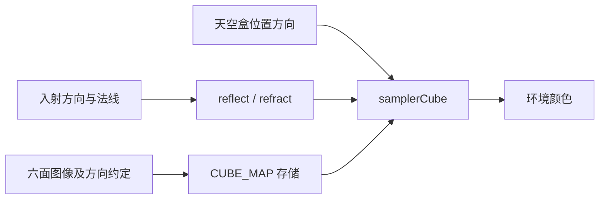
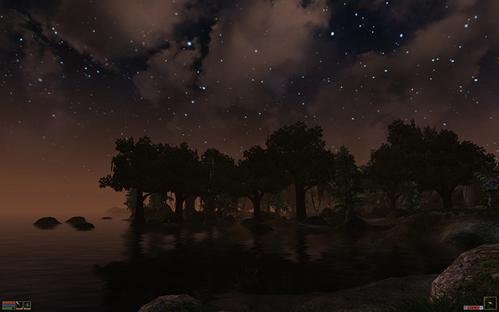
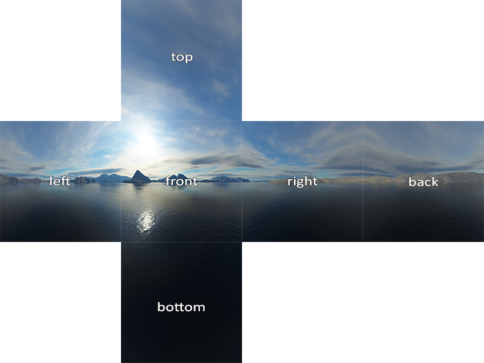
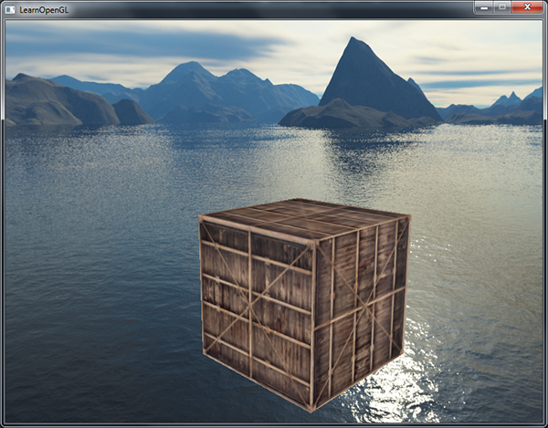
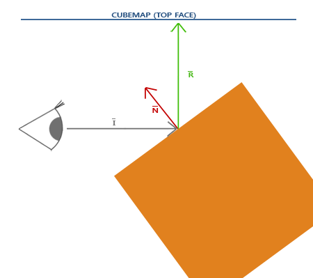
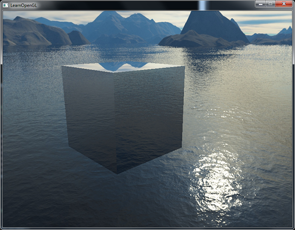
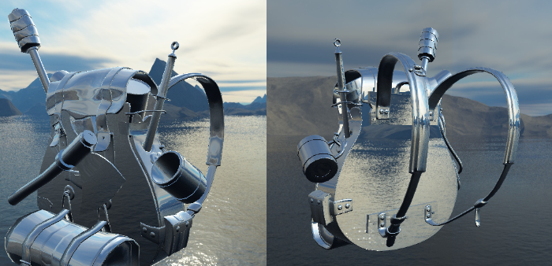
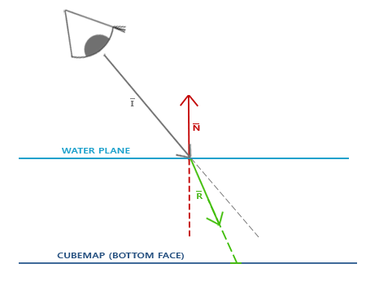
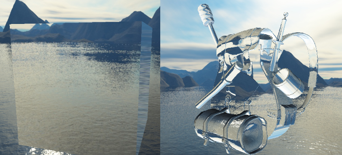

# 立方体贴图

| 项目 | 信息 |
| --- | --- |
| 原文 | [Cubemaps](https://learnopengl.com/Advanced-OpenGL/Cubemaps) |
| 作者 | Joey de Vries |
| 翻译 | Krasjet |
| 校对 | 暂未校对 |
| 来源 | [LearnOpenGL-CN](https://github.com/LearnOpenGL-CN/LearnOpenGL-CN/blob/331560886468e28f28326429334fc48470f9c27b/docs/04%20Advanced%20OpenGL/06%20Cubemaps.md) |
| 本仓库示例 | [`apps/04_advanced_opengl/06_cubemaps/main.cpp`](../../apps/04_advanced_opengl/06_cubemaps/main.cpp) |

**立方体贴图把六幅正方形图像组成按方向采样的环境；采样输入是方向，不是某一面的二维 UV。** 方向的主分量决定选择哪个面，再投影到该面。非零方向乘一个正比例因子不会改变采样位置，零向量不提供有效方向。


立方体居中时，表面位置向量就是从中心出发的方向，可以直接用作天空盒采样方向。OpenGL 定义面选择与采样规则，驱动执行；stb_image 负责读取图片，应用负责六面顺序、朝向和尺寸，GLFW 不负责解释图片内容。



## 创建立方体贴图

生成一个纹理名称，绑定 `GL_TEXTURE_CUBE_MAP`，用六次 `glTexImage2D` 分别分配六面。六个面目标枚举从正 X 连续递增，但图像的文件名“front/back”取决于资源约定，不能仅凭中文方位猜顺序。

| 面目标 | 轴向 | 本例文件 |
| --- | --- | --- |
| `GL_TEXTURE_CUBE_MAP_POSITIVE_X` | +X | right.jpg |
| `GL_TEXTURE_CUBE_MAP_NEGATIVE_X` | -X | left.jpg |
| `GL_TEXTURE_CUBE_MAP_POSITIVE_Y` | +Y | top.jpg |
| `GL_TEXTURE_CUBE_MAP_NEGATIVE_Y` | -Y | bottom.jpg |
| `GL_TEXTURE_CUBE_MAP_POSITIVE_Z` | +Z | front.jpg |
| `GL_TEXTURE_CUBE_MAP_NEGATIVE_Z` | -Z | back.jpg |

底本早期表格把 +Z/-Z 称为后/前，而资源列表又使用 front/back；本篇保留可验证的轴向和实际资源对应，避免让“前”混同相机朝向。六面必须是相同大小的正方形，并具备兼容格式；若 min filter 需要 mipmap，还必须提供相应级别。本例只用 `GL_LINEAR`，不要求 mipmap。

S、T、R 三轴的环绕均设 `GL_CLAMP_TO_EDGE`，限制面边缘的寻址；这并不意味着自动校正错误图像朝向，或让不连续的边缘内容变得连续。`samplerCube` 配合 `texture(environment_map, direction)` 取色，sampler uniform 保存纹理单元索引，仍需应用激活单元并绑定立方体纹理。

## 天空盒

天空盒用围绕观察者的立方体模拟遥远环境。上古卷轴的星空是这种视觉用途的例子，截图中的远处环境不要求真的建造同样巨大的可到达几何。



资源常以十字展开图或六个独立文件提供。展开图需要先按资源的面方向和旋转约定拆分；六个文件也应逐一确认接缝。底本提供[天空盒资源网站](http://www.custommapmakers.org/skyboxes.php)与[原资源压缩包](https://github.com/LearnOpenGL-CN/LearnOpenGL-CN/blob/331560886468e28f28326429334fc48470f9c27b/docs/data/skybox.rar)。



### 加载天空盒

本仓库实际复制并解码 LearnOpenGL 示例仓库的六张 JPG，放在 `assets/textures/skybox/`，不再使用六种纯色的 1×1 纹理冒充加载步骤。完整加载函数按轴顺序上传、检查每面的失败和尺寸，并用 RAII 释放图像：

```cpp
GLuint load_cubemap(gpu_resources& resources) {
    constexpr std::array<const char*, 6> names{"right.jpg",  "left.jpg",  "top.jpg",
                                               "bottom.jpg", "front.jpg", "back.jpg"};
    GLuint cubemap{0U};
    // OpenGL: 创建供六面图像共享的纹理名称。
    glGenTextures(1, &cubemap);
    resources.textures.push_back(cubemap);
    glBindTexture(GL_TEXTURE_CUBE_MAP, cubemap);
    int side{0};
    for (std::size_t face{0U}; face < names.size(); ++face) {
        const auto path{asset_path("textures/skybox") / names[face]};
        int width{0};
        int height{0};
        int channels{0};
        const std::unique_ptr<unsigned char, stbi_image_deleter> pixels{
            stbi_load(path.string().c_str(), &width, &height, &channels, STBI_rgb_alpha)};
        if (!pixels || width != height || (face != 0U && width != side)) {
            std::cerr << "Invalid cubemap face: " << path << '\n';
            return 0U;
        }
        side = width;
        // OpenGL: 分别上传六面 level 0 图像，面目标决定轴向而非绑定六个纹理。
        glTexImage2D(GL_TEXTURE_CUBE_MAP_POSITIVE_X + static_cast<GLenum>(face), 0, GL_RGBA8, width,
                     height, 0, GL_RGBA, GL_UNSIGNED_BYTE, pixels.get());
    }
    // OpenGL: 立方体纹理采用不需要 mipmap 的线性过滤与边缘延拓。
    glTexParameteri(GL_TEXTURE_CUBE_MAP, GL_TEXTURE_MIN_FILTER, GL_LINEAR);
    glTexParameteri(GL_TEXTURE_CUBE_MAP, GL_TEXTURE_MAG_FILTER, GL_LINEAR);
    glTexParameteri(GL_TEXTURE_CUBE_MAP, GL_TEXTURE_WRAP_S, GL_CLAMP_TO_EDGE);
    glTexParameteri(GL_TEXTURE_CUBE_MAP, GL_TEXTURE_WRAP_T, GL_CLAMP_TO_EDGE);
    glTexParameteri(GL_TEXTURE_CUBE_MAP, GL_TEXTURE_WRAP_R, GL_CLAMP_TO_EDGE);
    return cubemap;
}
```

所有面统一请求 RGBA，避免三通道行对齐与图片通道差异造成误解。天空盒照片通常不应套用普通 2D 纹理的全局垂直翻转设置；若素材方向不同，应根据六面的坐标约定修正。

### 显示天空盒

天空盒只需要立方体的位置属性，方向插值后由 `samplerCube` 采样。它使用独立程序；本例与物体复用相同位置数据，但绘制前明确绑定对应 VAO，不能沿用刚画完模型的 VAO。

```glsl
#version 330 core
in vec3 direction;
out vec4 frag_color;
uniform samplerCube environment_map;
void main()
{
    frag_color = texture(environment_map, direction);
}
```

先理解基础做法：天空盒先画，禁止深度写入，再画正常物体，使后者覆盖背景。由于环境模拟无限远，天空盒应随观察者平移而保持相对位置，却随旋转改变方向；因此用 `mat4(mat3(view))` 去除视图平移。不能同时去掉旋转，否则看向哪里都是同一幅背景。



### 优化

先画天空盒会对后来被物体遮挡的大量像素进行无用采样。改为正常物体先画、天空盒后画，让已有深度帮助拒绝被遮挡部分。本例顶点程序把输出改为 `position.xyww`，透视除法后 $z/w=1$，天空盒落在默认深度范围最远端。

```glsl
#version 330 core
layout (location = 0) in vec3 a_pos;
out vec3 direction;
uniform mat4 view;
uniform mat4 projection;
void main()
{
    direction = a_pos;
    vec4 position = projection * mat4(mat3(view)) * vec4(a_pos, 1.0);
    gl_Position = position.xyww;
}
```

深度缓冲默认清除为 1，所以天空盒使用 `GL_LEQUAL`，只在未被较近物体遮挡的地方通过，并关闭深度写入。结束后恢复 `GL_LESS` 和写掩码，防止污染下一帧。原文“提前深度测试一定更快”应理解为可利用的优化机会，具体调度和收益由实现与场景决定。

```cpp
        glDepthFunc(GL_LEQUAL);
        // OpenGL: 只控制深度写入，不关闭深度比较。
        glDepthMask(GL_FALSE);
        glUseProgram(sky_program);
        glUniformMatrix4fv(sky_view, 1, GL_FALSE, glm::value_ptr(view));
        glUniformMatrix4fv(sky_projection, 1, GL_FALSE, glm::value_ptr(projection));
        glUniform1i(sky_environment, 0);
        glDrawArrays(GL_TRIANGLES, 0, 36);
        glDepthMask(GL_TRUE);
        glDepthFunc(GL_LESS);
```

## 环境映射

天空盒显示环境，环境映射则让物体表面依据方向取环境颜色。可以用反射表现镜面，用折射表现玻璃般的透视。静态立方体贴图把周围环境视为从某点或无限远观察得到，因此近邻物体的位置和视差不能自动准确匹配。

### 反射

反射需要入射方向和表面法线，且必须处在同一空间。世界空间中，$I=normalize(P-C)$ 从相机指向表面，$N$ 为单位外法线；`reflect(I,N)` 给出 $R=I-2(N\cdot I)N$。方向若写反，会采到不对应的环境。



顶点程序输出世界位置。模型法线用 $transpose(inverse(mat3(model)))$ 变换，不能直接把非均匀缩放后的法线当作方向向量。普通立方体模式可由各面坐标构造轴向法线，导入模型模式则必须读模型的真实法线属性，不能继续猜测面轴。

```glsl
#version 330 core
layout (location = 0) in vec3 a_pos;
layout (location = 1) in vec3 a_normal;
uniform bool imported_model;
uniform mat4 model;
uniform mat4 view;
uniform mat4 projection;
out vec3 world_pos;
out vec3 local_pos;
out vec3 world_normal;
void main()
{
    world_pos = vec3(model * vec4(a_pos, 1.0));
    local_pos = a_pos;
    world_normal = mat3(transpose(inverse(model))) * a_normal;
    gl_Position = projection * view * vec4(world_pos, 1.0);
}
```



模式 0 是立方体反射，模式 2 从第三章的场景 OBJ 递归导入多个网格，再用同一环境程序绘制。底本的背包图展示复杂法线下的效果，本例用仓库自带模型；模型导入、节点变换、法线矩阵、索引绘制和环境采样步骤保留。



### 折射

折射取决于介质折射率比 $\eta=n_1/n_2$。Snell 定律为 $n_1\sin\theta_1=n_2\sin\theta_2$；`refract(I,N,eta)` 按该比值产生方向。常用近似折射率：空气 1.00、水 1.33、冰 1.309、玻璃约 1.52、钻石约 2.42，具体值还随材料和波长变化。



本例空气到玻璃取 `1.0 / 1.52`，模式 1/3 分别显示立方体/导入模型折射。片段程序在同一入射方向和法线基础上切换 reflect/refract：

```glsl
#version 330 core
in vec3 world_pos;
in vec3 local_pos;
in vec3 world_normal;
uniform bool imported_model;
out vec4 frag_color;
uniform samplerCube environment_map;
uniform vec3 camera_pos;
uniform mat4 model;
uniform bool refract_mode;
void main()
{
    vec3 axis = abs(local_pos);
    vec3 normal = axis.x > axis.y && axis.x > axis.z ? vec3(sign(local_pos.x), 0.0, 0.0) :
                  axis.y > axis.z ? vec3(0.0, sign(local_pos.y), 0.0) : vec3(0.0, 0.0, sign(local_pos.z));
    normal = normalize(mat3(transpose(inverse(model))) * normal);
    if (imported_model) normal = normalize(world_normal);
    vec3 incident = normalize(world_pos - camera_pos);
    vec3 direction = refract_mode ? refract(incident, normal, 1.0 / 1.52) : reflect(incident, normal);
    frag_color = texture(environment_map, direction);
}
```



它没有追踪从玻璃另一侧出射的第二次折射，也没有厚度、吸收和物体内部光路，所以只是环境折射近似。全内反射时 GLSL 的 `refract` 返回零向量，实际材质需检测并选择反射等回退，而不是把零方向当可靠的贴图坐标。本演示固定空气到较高折射率的比值。

### 动态环境贴图

静态天空盒不会包含当前场景中移动的物体。动态环境做法是在反射物体位置放置六个朝向 ±X/±Y/±Z 的 90° 相机，逐面把场景渲染到立方体贴图，再在最终视角采样更新后的环境。捕获时通常排除反射物体自身，确保六面使用一致朝向、投影和曝光。

一个反射探针通常增加六遍场景绘制，加上最终视角至少七遍；多个探针、阴影和反射物体之间的递归还会继续增加开销。可以降低分辨率、分帧更新或只在必要时刷新。上游本小节解释原理，没有提供完整动态捕获程序，本仓库也把它明确标为概念教学，不声称现有四个模式已经实现动态环境。

## 练习

保留上游的反射贴图练习：读取一张反射强度图，混合普通漫反射/光照结果与环境反射，使不同表面具有不同反射程度。白色趋向环境反射，黑色保留原有表面，中间值插值。上游[反射贴图示意](../img/04/06/cubemaps_reflection_map.png)、[带反射贴图的纳米装资源](https://github.com/LearnOpenGL-CN/LearnOpenGL-CN/blob/331560886468e28f28326429334fc48470f9c27b/docs/data/nanosuit_reflection.zip)和[参考解答](https://learnopengl.com/code_viewer_gh.php?code=src/4.advanced_opengl/6.3.cubemaps_environment_mapping/cubemaps_environment_mapping.cpp)用于对照；本仓库四模式不冒称已完成这一练习。

> **译注与修订（材质字段）：** 反射强度图不等于通用漫反射图。导入 MTL 时，应核对资源实际写入 `map_Ka`、`map_Kd` 等哪个字段，以及 Assimp 对应类型；这个旧资源借环境项保存反射遮罩，对应 `aiTextureType_AMBIENT`，不能称为漫反射贴图。原资源借用了镜面图来制作遮罩，某些位置并不精确。若模型程序已占三个纹理单元，把天空盒放在第四个单元（索引 3），设置各 sampler 并检查硬件限额；将贴图绑定到新 sampler 后，还要显式定义混合约定。

> **常见误解：** 立方体贴图保存的是一组方向颜色，不是场景几何；反射方向正确不等于近处反射的空间位置和视差也正确。

> **进阶（接缝与过滤）：** **环绕方式与跨面过滤解决不同问题。** `GL_CLAMP_TO_EDGE` 避免面内越界重复；OpenGL 3.3 的 `GL_TEXTURE_CUBE_MAP_SEAMLESS` 可让合适的线性过滤跨越相邻面，但它不能修复素材之间不连续的亮度或旋转。制作资源时先保证六面的内容连续，再选择过滤策略；环境反射的粗糙度还需要预过滤等额外处理。

## 上游源码与附加资源

以下保留底本引用的源码、资源与附加阅读入口；正文使用本仓库实现，外部旧演示与本地程序的组织可能不同。

- [网站](http://www.custommapmakers.org/skyboxes.php)
- [上游源码或资源对照](https://github.com/LearnOpenGL-CN/LearnOpenGL-CN/blob/331560886468e28f28326429334fc48470f9c27b/docs/data/skybox.rar)
- [上游源码或资源对照](https://learnopengl.com/code_viewer.php?code=advanced/cubemaps_skybox_data)
- [上游源码或资源对照](https://learnopengl.com/code_viewer_gh.php?code=src/4.advanced_opengl/6.1.cubemaps_skybox/cubemaps_skybox.cpp)
- [顶点数据](https://learnopengl.com/code_viewer.php?code=lighting/basic_lighting_vertex_data)
- [上游源码或资源对照](https://learnopengl.com/code_viewer_gh.php?code=src/4.advanced_opengl/6.2.cubemaps_environment_mapping/cubemaps_environment_mapping.cpp)
- [斯涅尔定律](https://en.wikipedia.org/wiki/Snell%27s_law)
- [上游源码或资源对照](https://github.com/LearnOpenGL-CN/LearnOpenGL-CN/blob/331560886468e28f28326429334fc48470f9c27b/docs/data/nanosuit_reflection.zip)

## 本仓库示例

源码：[`main.cpp`](../../apps/04_advanced_opengl/06_cubemaps/main.cpp)，目标：`04_advanced_opengl__06_cubemaps`。正文标为源码的 C++/GLSL 均直接摘取此文件；标为概念说明的独立片段用于说明规范或未启用的更高版本功能。

```powershell
cmake --preset mingw-gcc-debug
cmake --build --preset mingw-gcc-debug --target 04_advanced_opengl__06_cubemaps
.\build\mingw-gcc-debug\apps\04_advanced_opengl\06_cubemaps\04_advanced_opengl__06_cubemaps.exe --mode 0
```

依赖准备、多配置生成器与其他工具链见[构建指南](../build.md)。Esc 是退出键；除 07 的二维数据示例外，三维场景支持 WASD、鼠标与滚轮。空格按表中顺序切换（07 用启动参数选择映射方法）。有限帧检查可追加 `--frames 3 --capture output.ppm`，截图取最后一帧；它验证绘制路径，不能代替交互和视觉检查。

| `--mode` | 可观察内容 |
| --- | --- |
| 0 | 立方体反射 |
| 1 | 立方体折射 |
| 2 | Assimp 模型反射 |
| 3 | Assimp 模型折射 |


## 本章整体回顾

立方体贴图以方向选择六面之一。天空盒去除视图平移以模拟远景，环境映射用同一空间中的入射方向和法线计算反射或折射；动态环境需要从物体位置重新捕获六面。

本篇承接前一篇，正文保留底本对应的小节与主案例。图片中的背包、箱子等属于上游演示，本仓库使用独立注明的教学场景；本仓库截图与上游图分开标注。图片出处见[资源记录](../img/04/README.md)，对应关系与验证边界见[覆盖清单](coverage.md)。

技术核校：[英文原文](https://learnopengl.com/Advanced-OpenGL/Cubemaps)、[OpenGL 3.3 Core 规范](https://registry.khronos.org/OpenGL/specs/gl/glspec33.core.pdf)、[GLSL 3.30 规范](https://registry.khronos.org/OpenGL/specs/gl/GLSLangSpec.3.30.pdf)。[纹理与立方体贴图参考](https://registry.khronos.org/OpenGL-Refpages/gl3/html/glTexImage2D.xhtml)。

下一节：[高级数据](07_advanced_data.md)。
