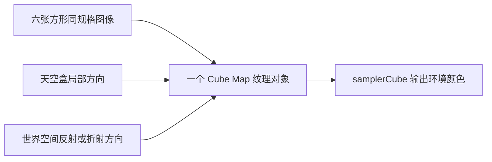
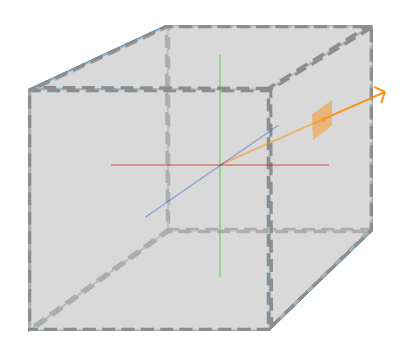
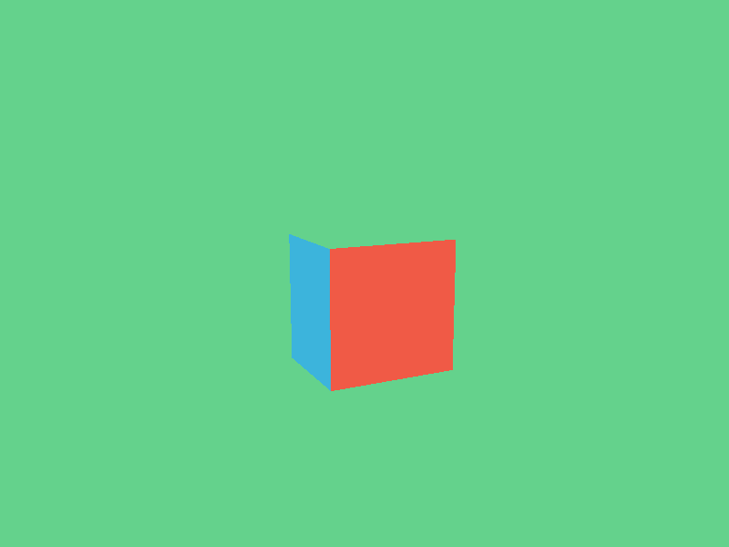

# 立方体贴图

| 项目 | 内容 |
| --- | --- |
| 原文 | [Cubemaps](https://learnopengl.com/Advanced-OpenGL/Cubemaps) |
| 作者 | JoeyDeVries |
| 来源 | [LearnOpenGL-CN](https://github.com/with-fair-wind/LearnOpenGL-CN/blob/new-theme/docs/04%20Advanced%20OpenGL/06%20Cubemaps.md)，按本仓库代码整理修订 |
| 本仓库示例 | [`apps/04_advanced_opengl/06_cubemaps/`](../../apps/04_advanced_opengl/06_cubemaps/) |

**立方体贴图用三维方向选择六个二维图像中的采样位置，方向不是物体的三维位置。** 它可以表示远处环境，也可以为反射与折射提供近似背景颜色；它本身并不是一个立方体网格。

## 六面图像与方向采样



应用保证面顺序、图像朝向和坐标空间一致；OpenGL 定义方向到面的选择与采样规则；驱动提供存储和执行。方向向量的长度通常不改变采样结果，但零向量不能表达有效方向。



六面的提交顺序为 +X、-X、+Y、-Y、+Z、-Z。各面必须为方形，并满足对应层级的尺寸和格式一致性。本例使用六个 1×1 RGBA 纯色面来直接观察选面规则，无需下载天空盒资源；普通过滤也不需要生成 mipmap。

```c++
    constexpr std::array<std::array<unsigned char, 4>, 6> face_colors{{{240, 90, 70, 255},
                                                                       {60, 180, 220, 255},
                                                                       {100, 150, 240, 255},
                                                                       {50, 60, 80, 255},
                                                                       {230, 190, 70, 255},
                                                                       {100, 210, 140, 255}}};
    for (std::size_t face{0U}; face < face_colors.size(); ++face) {
        // OpenGL: 定义纹理图像存储；空指针仅分配空间。
        glTexImage2D(GL_TEXTURE_CUBE_MAP_POSITIVE_X + static_cast<GLenum>(face), 0, GL_RGBA8, 1, 1,
                     0, GL_RGBA, GL_UNSIGNED_BYTE, face_colors[face].data());
    }
    // OpenGL: 配置纹理过滤与环绕状态。
    glTexParameteri(GL_TEXTURE_CUBE_MAP, GL_TEXTURE_MIN_FILTER, GL_LINEAR);
    glTexParameteri(GL_TEXTURE_CUBE_MAP, GL_TEXTURE_MAG_FILTER, GL_LINEAR);
    glTexParameteri(GL_TEXTURE_CUBE_MAP, GL_TEXTURE_WRAP_S, GL_CLAMP_TO_EDGE);
    glTexParameteri(GL_TEXTURE_CUBE_MAP, GL_TEXTURE_WRAP_T, GL_CLAMP_TO_EDGE);
    glTexParameteri(GL_TEXTURE_CUBE_MAP, GL_TEXTURE_WRAP_R, GL_CLAMP_TO_EDGE);
```

## 天空盒与深度

天空盒网格只提供方向。顶点着色器保留观察矩阵的旋转、移除平移，使环境随转头变化但不随相机平移产生近景视差。将裁剪位置写成 `xyww`，透视除法后深度为 1；在默认深度范围下，配合 `GL_LEQUAL` 与关闭深度写入，可放在不透明场景之后绘制。

```c++
constexpr const char* sky_vertex_source{R"glsl(
#version 330 core
layout (location = 0) in vec3 a_pos;
out vec3 direction;
uniform mat4 view;
uniform mat4 projection;
void main()
{
    direction = a_pos;
    vec4 position = projection * mat4(mat3(view)) * vec4(a_pos, 1.0);
    gl_Position = position.xyww;
}
)glsl"};
```

天空盒绘制结束后恢复 `GL_LESS` 与深度写入，防止状态泄漏到下一帧。此例未启用面剔除，因此从立方体内部也能看到天空盒。

## 反射与折射

物体片段先取得世界位置和法线，再用相机到表面的入射方向计算 `reflect` 或 `refract`。空格在两种模式间切换；折射率比取空气进入玻璃的 $1/1.52$。这里根据立方体的局部面位置构造平面法线，再以法线矩阵变换，不把局部法线和世界入射向量混用。

```c++
constexpr const char* fragment_shader_source{R"glsl(
#version 330 core
in vec3 world_pos;
in vec3 local_pos;
out vec4 frag_color;
uniform samplerCube environment_map;
uniform vec3 camera_pos;
uniform mat4 model;
uniform bool refract_mode;
void main()
{
    vec3 axis = abs(local_pos);
    vec3 normal = axis.x > axis.y && axis.x > axis.z ? vec3(sign(local_pos.x), 0.0, 0.0) :
                  axis.y > axis.z ? vec3(0.0, sign(local_pos.y), 0.0) : vec3(0.0, 0.0, sign(local_pos.z));
    normal = normalize(mat3(transpose(inverse(model))) * normal);
    vec3 incident = normalize(world_pos - camera_pos);
    vec3 direction = refract_mode ? refract(incident, normal, 1.0 / 1.52) : reflect(incident, normal);
    frag_color = texture(environment_map, direction);
}
)glsl"};
```

> **常见误解：** 环境反射会自动映出当前场景里的所有物体。
> **纠正：** 本例采样的是预定义六面颜色，不包含现场其它几何体。环境映射没有自动执行射线与场景的求交；折射示例也只计算一次空气入玻璃的方向，没有模拟光线从玻璃另一面出射。

> **进阶（动态环境与局部性）：** **动态反射探针需要从探针位置重新渲染六个方向。** 这会增加渲染工作，还应避免把探针所属物体不恰当地渲染进自己的环境。单个探针只在有限区域内近似正确，近处物体的视差误差不能靠更高分辨率消除；真实场景通常需要多探针、更新预算以及不同反射技术之间的组合。

## 本仓库示例

示例源码：[`apps/04_advanced_opengl/06_cubemaps/main.cpp`](../../apps/04_advanced_opengl/06_cubemaps/main.cpp)。代码片段均原样取自此文件；原站概念图片与本例实测截图分别标明。

首次安装依赖与工具链要求见[构建指南](../build.md)。已安装默认 MinGW GCC Debug 依赖时，在仓库根目录执行：

```powershell
cmake --preset mingw-gcc-debug
cmake --build --preset mingw-gcc-debug --target 04_advanced_opengl__06_cubemaps
.\build\mingw-gcc-debug\apps\04_advanced_opengl\06_cubemaps\04_advanced_opengl__06_cubemaps.exe
```

Esc 退出；W/A/S/D 移动，鼠标转向，滚轮修改 FOV。空格切换反射和折射。

本仓库实测截图（默认模式）：



本章示例还支持 `--frames 3` 隐藏窗口运行指定帧数、`--mode M` 选择初始模式；配合 `--capture output.ppm` 可保存最后一帧。参数与检查方式详见[构建指南的高级 OpenGL 示例说明](../build.md#高级-opengl-示例)。

## 本章整体回顾

- **局部**：以方向选择六面环境，统一天空盒与反射/折射的坐标空间。
- **整体**：环境图像与场景几何分工清晰，下一节回到 CPU 到 GPU 的字节数据管理。

## 核校参考

- [OpenGL 3.3 Core 规范](https://registry.khronos.org/OpenGL/specs/gl/glspec33.core.pdf)：立方体纹理完整性与方向选面。
- [GLSL 3.30 规范](https://registry.khronos.org/OpenGL/specs/gl/GLSLangSpec.3.30.pdf)：阶段输入输出、内建变量及本例使用的语言语义。

下一节：[高级数据](07_advanced_data.md)
