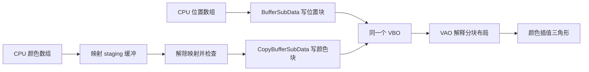

# 高级数据

| 项目 | 内容 |
| --- | --- |
| 原文 | [Advanced Data](https://learnopengl.com/Advanced-OpenGL/Advanced-Data) |
| 作者 | JoeyDeVries |
| 来源 | [LearnOpenGL-CN](https://github.com/with-fair-wind/LearnOpenGL-CN/blob/new-theme/docs/04%20Advanced%20OpenGL/07%20Advanced%20Data.md)，按本仓库代码整理修订 |
| 本仓库示例 | [`apps/04_advanced_opengl/07_advanced_data/`](../../apps/04_advanced_opengl/07_advanced_data/) |

**缓冲对象管理一段字节存储，绑定目标决定当前命令怎样使用它；顶点布局则由 VAO 中的属性格式与偏移解释。** 这一节从“整块上传顶点”推进到分段更新、映射和缓冲间复制。

## 一段存储，多种操作



应用决定数据所有权、范围与布局；OpenGL 检查缓冲访问条件并定义可见性；驱动管理具体存储和同步。缓冲位于设备本地内存还是某种可访问映射内存属于实现选择，不能把 API 抽象等同于固定的物理位置。

## 预留存储与分段更新

`glBufferData(..., nullptr, ...)` 分配存储但不初始化内容；它不是清零操作。`glBufferSubData` 只能更新已分配范围，不会扩容。本例预留位置和颜色两块空间，再写入位置：

```c++
    const GLuint vao{create_vertex_array(resources, nullptr, sizeof(positions) + sizeof(colors))};
    const GLuint vbo{resources.buffers.back()};
    // OpenGL: 更新已分配存储中的指定字节范围，不能扩大容量。
    glBufferSubData(GL_ARRAY_BUFFER, 0, sizeof(positions), positions.data());
```

## 映射、解除映射与复制

映射 staging 缓冲后，检查指针再复制颜色；解除映射必须检查返回值。`GL_FALSE` 表示数据存储内容已经损坏，应重新初始化或放弃绘制，不可继续假定数据正确。解除映射后，原指针立即失效。

```c++
    void* mapped{glMapBufferRange(GL_COPY_READ_BUFFER, 0, sizeof(colors), GL_MAP_WRITE_BIT)};
    if (mapped == nullptr) {
        std::cerr << "Buffer mapping failed\n";
        return EXIT_FAILURE;
    }
    std::memcpy(mapped, colors.data(), sizeof(colors));
    // OpenGL: 解除映射后指针失效，GL_FALSE 表示内容已损坏。
    if (glUnmapBuffer(GL_COPY_READ_BUFFER) != GL_TRUE) {
        std::cerr << "Mapped buffer contents became invalid\n";
        return EXIT_FAILURE;
    }
    glBindBuffer(GL_COPY_WRITE_BUFFER, vbo);
    // OpenGL: 在两个已分配缓冲的字节区间之间复制数据。
    glCopyBufferSubData(GL_COPY_READ_BUFFER, GL_COPY_WRITE_BUFFER, 0, sizeof(positions),
                        sizeof(colors));
```

两种 COPY 目标仅提供独立绑定点，避免为了复制而改动 VAO 的顶点或索引关联；目标缓冲须事先有足够容量。本例先解除映射，再把颜色复制到最终 VBO。staging 是教学用的额外一步，不宣称对这九个浮点数比直接上传更高效。

## 分块属性布局

内存布局为 `[全部位置][全部颜色]`。两组属性各自紧密排列，步长均是三个 float；颜色偏移是整个位置块的字节数。它与“位置颜色交错排列”的差别只在数据组织与属性配置，不会改变着色器的输入语义。

```c++
    // OpenGL: 分块布局 [全部位置][全部颜色]；颜色起点是位置块的字节数。
    glBindBuffer(GL_ARRAY_BUFFER, vbo);
    glVertexAttribPointer(1, 3, GL_FLOAT, GL_FALSE, 3 * sizeof(float),
                          reinterpret_cast<const void*>(sizeof(positions)));
    glEnableVertexAttribArray(1);
```

> **常见误解：** 把同一缓冲改绑到 `GL_COPY_WRITE_BUFFER` 会复制或重新分配数据。
> **纠正：** 绑定只改变命令所引用的对象。`glBufferData`、子范围更新、映射写入和复制命令才改变存储或内容。

> **进阶（流式数据与同步）：** **映射不等于免费获得异步写权限。** GPU 仍在读取时，驱动可能为了正确性等待；使用 unsynchronized 等选项则需要应用自行保证不冲突。本例全部在初始绘制前上传，因此没有每帧复用的同步压力。频繁更新时可研究缓冲轮换、孤立旧存储或栅栏同步，并以正确的生命周期为前提测量收益。

## 本仓库示例

示例源码：[`apps/04_advanced_opengl/07_advanced_data/main.cpp`](../../apps/04_advanced_opengl/07_advanced_data/main.cpp)。代码片段均原样取自此文件；原站概念图片与本例实测截图分别标明。

首次安装依赖与工具链要求见[构建指南](../build.md)。已安装默认 MinGW GCC Debug 依赖时，在仓库根目录执行：

```powershell
cmake --preset mingw-gcc-debug
cmake --build --preset mingw-gcc-debug --target 04_advanced_opengl__07_advanced_data
.\build\mingw-gcc-debug\apps\04_advanced_opengl\07_advanced_data\04_advanced_opengl__07_advanced_data.exe
```

Esc 退出；本例使用固定的二维视图，不捕获鼠标。

本仓库实测截图（默认模式）：


本章示例还支持 `--frames 3` 隐藏窗口运行指定帧数、`--mode M` 选择初始模式；配合 `--capture output.ppm` 可保存最后一帧。参数与检查方式详见[构建指南的高级 OpenGL 示例说明](../build.md#高级-opengl-示例)。

## 本章整体回顾

- **局部**：在已分配的字节范围内更新、映射和复制，再由 VAO 解释布局。
- **整体**：明确存储与解释的分工后，可将共享矩阵放到统一布局的缓冲块中。

## 核校参考

- [OpenGL 3.3 Core 规范](https://registry.khronos.org/OpenGL/specs/gl/glspec33.core.pdf)：缓冲数据存储、映射和复制。
- [GLSL 3.30 规范](https://registry.khronos.org/OpenGL/specs/gl/GLSLangSpec.3.30.pdf)：阶段输入输出、内建变量及本例使用的语言语义。

下一节：[高级 GLSL](08_advanced_glsl.md)
