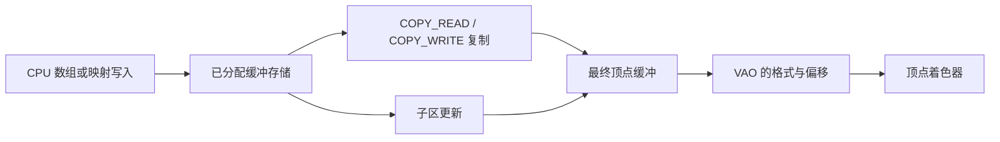

# 高级数据

| 项目 | 信息 |
| --- | --- |
| 原文 | [Advanced-Data](https://learnopengl.com/Advanced-OpenGL/Advanced-Data) |
| 作者 | Joey de Vries |
| 翻译 | Krasjet |
| 校对 | 暂未校对 |
| 来源 | [LearnOpenGL-CN](https://github.com/LearnOpenGL-CN/LearnOpenGL-CN/blob/331560886468e28f28326429334fc48470f9c27b/docs/04%20Advanced%20OpenGL/07%20Advanced%20Data.md) |
| 本仓库示例 | [`apps/04_advanced_opengl/07_advanced_data/main.cpp`](../../apps/04_advanced_opengl/07_advanced_data/main.cpp) |

**缓冲对象管理一段字节存储，绑定目标决定这次怎样使用它；目标不是对象不可改变的永久类型。** 同一个缓冲可以在不同操作中绑定为顶点数据、复制源或复制目标。驱动决定存储和同步实现，OpenGL 规定可访问范围；应用负责偏移、布局和生命周期，GLFW 不管理这些数据。



此前 `glBufferData` 常在分配时一起上传数据；data 为 `nullptr` 时仅分配，内容未初始化。之后用 `glBufferSubData(target, offset, size, data)` 更新已有存储的一部分。它不会自动扩大缓冲，必须满足非负范围及 $offset+size\le buffer\_size$。

若偏移为 24、长度为 $N$，更新范围是半开区间 $[24,24+N)$，不是包含末字节的闭区间。参数以字节计数，不能直接把顶点数或 float 元素数当字节偏移。本例先给位置和颜色两块预留足够存储，再写位置。

另一条路径是映射：`glMapBuffer` 返回可在 CPU 访问的指针，访问方式如 `GL_WRITE_ONLY`；`glMapBufferRange` 选择范围和标志。映射不意味着应用拿到了显卡物理内存地址，实现可能使用可见映射或中转存储。

本例模式 0 映射指定范围，模式 1 映射整个 staging 缓冲。两者都检查空指针，写入后调用 `glUnmapBuffer` 并检查布尔结果。解除映射后原指针失效；返回 `GL_FALSE` 表示内容可能损坏，应重新建立数据，而不是继续绘制。普通非持久映射期间也不能把该缓冲按常规绘制读取方式直接使用。

```cpp
    void* mapped{options.initial_mode == 0 ?
                                           // OpenGL: 映射指定范围；使用前必须检查返回指针。
                     glMapBufferRange(GL_COPY_READ_BUFFER, 0, sizeof(colors), GL_MAP_WRITE_BIT)
                                           :
                                           // OpenGL: 映射整个已分配缓冲，解除映射前检查返回指针。
                     glMapBuffer(GL_COPY_READ_BUFFER, GL_WRITE_ONLY)};
    if (mapped == nullptr) {
        std::cerr << "Buffer mapping failed\n";
        return EXIT_FAILURE;
    }
    std::memcpy(mapped, colors.data(), sizeof(colors));
    // OpenGL: 解除映射后指针失效，GL_FALSE 表示内容已损坏。
    if (glUnmapBuffer(GL_COPY_READ_BUFFER) != GL_TRUE) {
        std::cerr << "Mapped buffer contents became invalid\n";
        return EXIT_FAILURE;
    }
    glBindBuffer(GL_COPY_WRITE_BUFFER, vbo);
```

失败分支打印错误并返回失败。映射适合直接生成或读取文件数据到目标区域，但不保证比一次上传更快；同步、复制量和使用模式都影响收益。

## 分批顶点属性

此前采用交错布局：`位置0/颜色0/位置1/颜色1/...`，也就是 AoS 风格；分批布局改为 `全部位置/全部颜色`，对应 SoA 风格。法线和 UV 也可各占一个连续块。着色器仍看到每个顶点的位置和颜色，改变的是字节组织和 VAO 解释。

本例预留 `sizeof(positions)+sizeof(colors)`，位置先用 `glBufferSubData` 写入，颜色稍后从 staging 复制到位置块后。属性 0 的起点为 0、步长 `3*sizeof(float)`；属性 1 的起点为 `sizeof(positions)`，步长同样是三个 float，因为颜色块中的相邻颜色紧挨着。

```cpp
    constexpr std::array<float, 9> positions{-0.75F, -0.6F, 0.0F, 0.75F, -0.6F,
                                             0.0F,   0.0F,  0.7F, 0.0F};
    constexpr std::array<float, 9> colors{1.0F, 0.2F, 0.15F, 0.15F, 0.9F, 0.25F, 0.2F, 0.4F, 1.0F};
    const GLuint vao{create_vertex_array(resources, nullptr, sizeof(positions) + sizeof(colors))};
    const GLuint vbo{resources.buffers.back()};
    // OpenGL: 更新已分配存储中的指定字节范围，不能扩大容量。
    glBufferSubData(GL_ARRAY_BUFFER, 0, sizeof(positions), positions.data());
```

颜色属性配置源码：

```cpp
    // OpenGL: 分块布局 [全部位置][全部颜色]；颜色起点是位置块的字节数。
    glBindBuffer(GL_ARRAY_BUFFER, vbo);
    glVertexAttribPointer(1, 3, GL_FLOAT, GL_FALSE, 3 * sizeof(float),
                          reinterpret_cast<const void*>(sizeof(positions)));
    glEnableVertexAttribArray(1);
```

上面如果需要查找具体颜色块起点，可在代码中看到 `reinterpret_cast<const void*>(sizeof(positions))`。指针参数在这里表达绑定缓冲中的**字节偏移**，不是要解引用的普通 CPU 地址。若再加入法线和 UV，三块可分别从 `0`、`sizeof(positions)`、`sizeof(positions)+sizeof(normals)` 开始，步长分别为单个属性元素大小。

原教程建议交错布局以改善同一顶点所需数据的局部性，这是常见经验，不是所有 GPU 上的强制最优解。只更新位置、只读取某些属性或资源原本分成数组时，分批布局也可能更方便；布局应服从实际数据流与测量。

## 复制缓冲

`glCopyBufferSubData(readtarget,writetarget,readoffset,writeoffset,size)` 复制已经存在的两个存储范围。前两个参数是绑定目标，不是对象名称；真正源/目标由当前绑定决定。后面三个值均为字节单位。复制不会自动分配目标，也不能把同一缓冲中重叠的区间用于这种复制。

如果两个缓冲平常都用 `GL_ARRAY_BUFFER`，它们仍可分别绑定到 `GL_COPY_READ_BUFFER` 和 `GL_COPY_WRITE_BUFFER`，不需要改变对象本身。这样还能避免为数据搬运而意外改写顶点配置；`GL_ELEMENT_ARRAY_BUFFER` 的绑定尤其属于当前 VAO 状态，应谨慎处理。

本例先给 staging 分配颜色存储，经映射填入颜色，再把它复制到最终顶点缓冲的颜色块：

```cpp
    glBindBuffer(GL_COPY_WRITE_BUFFER, vbo);
    // OpenGL: 在两个已分配缓冲的字节区间之间复制数据。
    glCopyBufferSubData(GL_COPY_READ_BUFFER, GL_COPY_WRITE_BUFFER, 0, sizeof(positions),
                        sizeof(colors));
```

底本还展示保留读源在 `GL_ARRAY_BUFFER`、只把写目标设为 `GL_COPY_WRITE_BUFFER` 的等价方案。要点是两个目标能分别指向两个缓冲，而不是必须选择一对特殊名字。复制由实现执行，不要求应用先 `glGetBufferSubData` 读回 CPU 再重新上传。

> **常见误解：** `glBufferData` 是分配/替换存储，`glBufferSubData` 是写已有子区，`glCopyBufferSubData` 是存储间复制。三个函数都带 size，却有不同的前置条件，不能混用。

> **进阶（映射与同步）：** **CPU 可以访问一个指针，不代表 GPU 已经不再使用对应数据。** 常规映射可能等待前面的 GPU 工作，范围映射标志也有各自同步契约。本例在开始绘制前一次性初始化，避免展示未经说明的异步写入。持续流式更新应结合多缓冲、孤立存储或明确同步策略设计；不要随意加入 unsynchronized 标志来掩盖等待。

## 本仓库示例

源码：[`main.cpp`](../../apps/04_advanced_opengl/07_advanced_data/main.cpp)，目标：`04_advanced_opengl__07_advanced_data`。正文标为源码的 C++/GLSL 均直接摘取此文件；标为概念说明的独立片段用于说明规范或未启用的更高版本功能。

```powershell
cmake --preset mingw-gcc-debug
cmake --build --preset mingw-gcc-debug --target 04_advanced_opengl__07_advanced_data
.\build\mingw-gcc-debug\apps\04_advanced_opengl\07_advanced_data\04_advanced_opengl__07_advanced_data.exe --mode 0
```

依赖准备、多配置生成器与其他工具链见[构建指南](../build.md)。Esc 是退出键；除 07 的二维数据示例外，三维场景支持 WASD、鼠标与滚轮。空格按表中顺序切换（07 用启动参数选择映射方法）。有限帧检查可追加 `--frames 3 --capture output.ppm`，截图取最后一帧；它验证绘制路径，不能代替交互和视觉检查。

| `--mode` | 可观察内容 |
| --- | --- |
| 0 | 范围映射与复制 |
| 1 | 完整缓冲映射与复制 |


## 本章整体回顾

缓冲对象管理字节，绑定目标决定当前操作。分块布局改变属性偏移而不改变顶点着色器语义；映射、子区更新、复制均要检查范围、同步与对象生命周期。

本篇承接前一篇，正文保留底本对应的小节与主案例。图片中的背包、箱子等属于上游演示，本仓库使用独立注明的教学场景；本仓库截图与上游图分开标注。图片出处见[资源记录](../img/04/README.md)，对应关系与验证边界见[覆盖清单](coverage.md)。

技术核校：[英文原文](https://learnopengl.com/Advanced-OpenGL/Advanced-Data)、[OpenGL 3.3 Core 规范](https://registry.khronos.org/OpenGL/specs/gl/glspec33.core.pdf)、[GLSL 3.30 规范](https://registry.khronos.org/OpenGL/specs/gl/GLSLangSpec.3.30.pdf)。

下一节：[高级 GLSL](08_advanced_glsl.md)。
