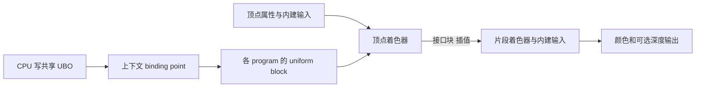
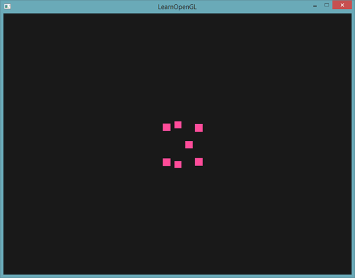
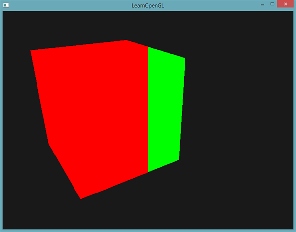
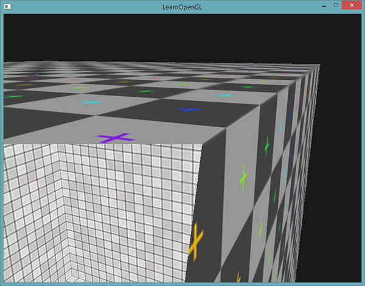
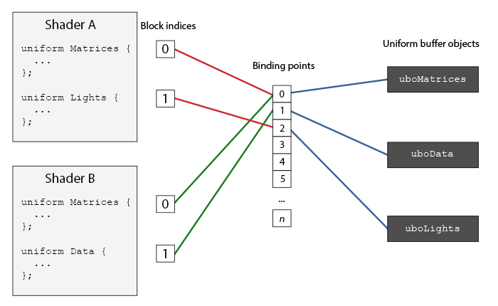
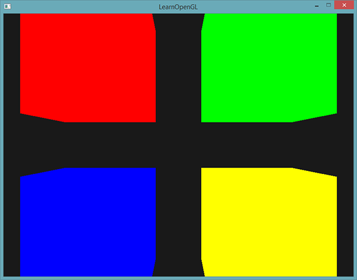
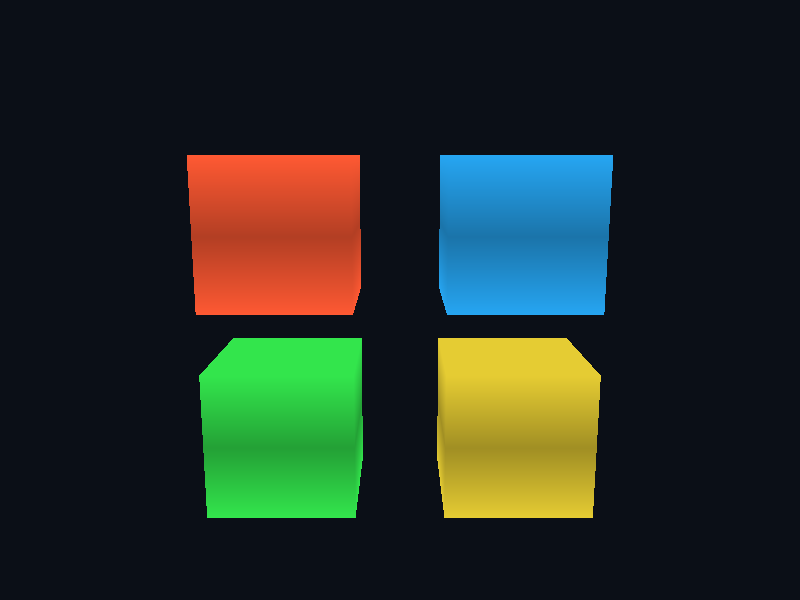

# 高级 GLSL

| 项目 | 信息 |
| --- | --- |
| 原文 | [Advanced-GLSL](https://learnopengl.com/Advanced-OpenGL/Advanced-GLSL) |
| 作者 | Joey de Vries |
| 翻译 | Krasjet |
| 校对 | AoZhang |
| 中文底本 | [LearnOpenGL-CN 上游固定版本](https://github.com/LearnOpenGL-CN/LearnOpenGL-CN/blob/331560886468e28f28326429334fc48470f9c27b/docs/04%20Advanced%20OpenGL/08%20Advanced%20GLSL.md)，`new-theme` / `331560886468e28f28326429334fc48470f9c27b` |
| 本仓库示例 | [`apps/04_advanced_opengl/08_advanced_glsl/main.cpp`](../../apps/04_advanced_opengl/08_advanced_glsl/main.cpp) |
| 修订 | 按上游完整小节顺序重写，技术差异见正文；[逐项覆盖清单](coverage.md) |

**GLSL 内建变量、阶段接口块和 uniform 块解决三类问题：阶段语义、数据组织和多程序共享参数。** 它们都出现在 shader 中，但来源、可写性和更新方式不同。OpenGL/GLSL 规范定义这些接口，驱动负责编译链接和数据读取，应用负责缓冲布局与绑定，GLFW 只提供有效上下文。



## GLSL 的内建变量

`gl_` 前缀为语言保留。已经见过 `gl_Position` 和 `gl_FragCoord`，这里继续研究点大小、顶点编号、朝向和深度输出。它们不是需要应用自行查询位置再上传的普通 uniform；完整名单可查[内建变量资料](https://wikis.khronos.org/opengl/Built-in_Variable_(GLSL))，语义以本例 GLSL 3.30 为准。

### 顶点着色器变量

`gl_Position` 是最终顶点处理阶段的齐次裁剪空间输出，后面还会经历裁剪、透视除法和视口映射。不要把其中 z 分量直接当世界距离。没有后续几何阶段时，由顶点着色器提供该输出。

#### gl_PointSize

`GL_POINTS` 把顶点画成点图元。固定状态 `glPointSize` 可设置统一尺寸；启用 `GL_PROGRAM_POINT_SIZE` 后，最终顶点处理阶段写出的 `gl_PointSize` 可按顶点变化，单位是像素。尺寸还受实现支持范围和光栅化规则约束。

模式 1 将立方体顶点改画为点，本例按 `gl_VertexID` 给出不同大小。底本的距离演示用裁剪 z 近似驱动大小；更明确的方案可用观察空间距离或投影的 w，并进行合理限制。若要模拟真实透视粒子，通常距离越远点越小，不能把“远处变大”的示意当作物理规律。



#### gl_VertexID

这是只读整数输入。非索引 `glDrawArrays` 时包含 `first` 引入的顶点编号，并不是总从零开始的“本次执行计数”；索引绘制时来自对应顶点索引（还应考虑具有 base-vertex 的调用）。重复索引可以使多次顶点引用拥有相同 ID，驱动也可能复用顶点处理结果，不能用它统计真实 shader 调用次数。

本例在大小表达式中读取该 ID。它也可以用于按顶点编号生成颜色或查询程序定义的数据，但访问数组时仍必须保证边界；后面几何篇使用实际颜色属性演示跨阶段传递，与这里的编号输入区分开。

### 片段着色器变量

片段输入反映光栅化结果。前面的顶点 ID 与这里的窗口坐标不具有一对一关系，三角形会生成很多片段。

#### gl_FragCoord

`gl_FragCoord.xy` 是窗口坐标，默认左下为原点，像素中心通常位于半整数；z 是窗口深度，w 与插值后的齐次倒数有关。视口有偏移、使用高 DPI 帧缓冲时，不能直接用固定 800 来判断左右。

模式 2 将 x 与实际帧缓冲宽度的一半比较，左红右绿，可用于并排比较光照算法。它改变的是已有几何片段颜色，不会自动生成覆盖全屏的四边形。



#### gl_FrontFacing

只读 bool 表示当前片段所在多边形是否属于按 `glFrontFace` 定义的正面。正确的启用枚举是 `GL_CULL_FACE`；若已经剔除背面，正常三角形绘制就没有背面片段供这个分支观察。

模式 3 关闭剔除，以两种颜色代替底本的内外两张纹理；从箱子外看正面，从内部看背面。可以把同一条件用于选择两个 sampler，实现原图中的内外不同材质。法线方向不参与这个布尔值判定。



#### gl_FragDepth

`gl_FragCoord.z` 只读，`gl_FragDepth` 是可写深度输出。如果 shader 完全不静态写该变量，默认使用光栅化深度；一旦静态写入，就必须在所有实际执行路径上提供定义的值，不能在某个分支没写时指望自动回退。

模式 4 写 0.5，其他模式显式写回 `gl_FragCoord.z`，用来对比深度行为。写深度通常限制可用的提前测试优化，但“不论何种情况都关闭所有早期工作”过于绝对；实际优化依赖规范允许的语义和实现。本例为教学把模式放进同一程序，因此其他模式也承担静态深度输出的约束，生产程序可拆成不同 shader 变体。

上游还介绍**保守深度**条件。它属于 OpenGL 4.2 / `ARB_conservative_depth`，不能直接塞进本例 `#version 330 core` 作为核心功能：

| 布局条件 | 对实际写入值的约束 |
| --- | --- |
| `depth_any` | 可任意改变，默认情况 |
| `depth_greater` | 不小于原始深度 |
| `depth_less` | 不大于原始深度 |
| `depth_unchanged` | 等于原始深度 |

概念语法为 `layout(depth_greater) out float gl_FragDepth;`，要求相应版本或扩展。比如在完整路径中写入 `gl_FragCoord.z + 0.1`，并确保符合声明，能为实现提供单调性信息；是否能提前拒绝还取决于深度比较方向。这不是“添加限定符必然恢复全部 early-Z”的开关。

## 接口块

当阶段之间要传位置、UV、颜色和法线时，多个松散变量不易管理。`in`/`out` 接口块把这些变量归组。块名和成员定义参与跨阶段匹配，实例名只是本阶段访问用的名字，可不同；仅块名相同而成员类型、顺序、数组和相关限定不兼容仍会链接失败。

本例顶点输出 `VertexData` 的 `vertex_out`，片段输入同名块的 `fragment_in`；通过实例访问成员。它没有把数据变成 UBO，数据仍按顶点输出、光栅化插值、片段输入的路径传递。几何阶段输入则会成为按图元排列的数组，下一篇展开。

顶点程序完整源码同时展示接口块和接下来的 uniform 块：

```glsl
#version 330 core
layout (location = 0) in vec3 a_pos;
layout (std140) uniform Matrices {
    mat4 projection;
    mat4 view;
};
uniform mat4 model;
uniform int demo_mode;
out VertexData {
    vec3 local_pos;
} vertex_out;
void main()
{
    vertex_out.local_pos = a_pos;
    gl_PointSize = 5.0 + float(gl_VertexID % 8);
    gl_Position = projection * view * model * vec4(a_pos, 1.0);
}
```

片段程序完整源码展示输入块及上述内建变量：

```glsl
#version 330 core
in VertexData {
    vec3 local_pos;
} fragment_in;
uniform int demo_mode;
uniform float frame_width;
out vec4 frag_color;
void main()
{
    vec3 color = vec3(1.0, 0.35, 0.2);
    if (demo_mode == 2) color = gl_FragCoord.x < frame_width * 0.5 ? vec3(1,0,0) : vec3(0,1,0);
    if (demo_mode == 3) color = gl_FrontFacing ? vec3(1,0.5,0.1) : vec3(0.1,0.7,1);
    gl_FragDepth = demo_mode == 4 ? 0.5 : gl_FragCoord.z;
    frag_color = vec4(color * (0.7 + 0.3 * abs(fragment_in.local_pos.y) * 2.0), 1.0);
}
```

## Uniform 缓冲对象

四个 program 使用同一相机矩阵时，逐个 `glUniformMatrix4fv` 上传相同 view/projection 很重复。UBO 将共享数据放进一个缓冲，各 program 的 uniform block 指向同一个绑定点，于是每帧只更新一份。每个物体不同的 model 仍用普通 uniform。

`Matrices` 中包含 **projection 和 view**，不是 projection 和 model；这是底本一句话的笔误。uniform block 的数据来源是缓冲，不能像普通 uniform 一样直接用 `glUniform*` 更新其中成员。没有块实例名时可以直接访问成员名。

### Uniform 块布局

缓冲只存字节，CPU 和 GLSL 必须就每个成员的偏移、数组/矩阵步长和总大小达成一致。默认 `shared` 由实现布局，同样定义的块可跨 program 共享，但应用需要查询布局；`packed` 可按 program 优化未使用成员，不能假设同布局。`std140` 给出确定规则，方便手工布局与检查。

令普通 32 位标量的字节单位 $N=4$。**基准对齐量不等于成员实际占用大小**。当前偏移要先向上对齐到成员的基准对齐量，再放入内容，数组和结构还需按自身步长/尾部规则处理。

| 类型 | std140 规则（本篇的 32 位类型） |
| --- | --- |
| float/int/bool | 基准对齐 4；UBO bool 按 4 字节表示，不能直接复制 C++ bool |
| vec2 | 基准对齐 8，内容 8 字节 |
| vec3 / vec4 | 基准对齐 16，内容分别 12 / 16 字节；vec3 后继成员需按规则计算 |
| 标量/向量数组 | 元素基准对齐向上取到 vec4 对齐，步长通常至少 16 |
| 矩阵 | 按列向量数组（默认列主序）；mat4 四列，列步长 16，总 64 |
| 结构体 | 基准对齐为成员最大对齐再向上取到 16；结尾补齐到结构体对齐 |

用原教程 `ExampleBlock` 逐步计算，而不是只记规则：

| 顺序和成员 | 对齐 | 起点 / 步长 | 推导 |
| --- | --- | --- | --- |
| `float value` | 4 | 0 | 占到 4 |
| `vec3 vector` | 16 | 16 | 从 4 补到 16，内容到 28 |
| `mat4 matrix` | 16 | 32 / 16 | 四列 32、48、64、80，结束 96 |
| `float values[3]` | 16 | 96 / 16 | 三个元素 96、112、128，数组结束 144 |
| `bool boolean` | 4 | 144 | 用 32 位值写入，结束 148 |
| `int integer` | 4 | 148 | 结束 152 |
| 整块尾部 | 16 | **160 字节** | 152 向上补齐到 16 的倍数 |

底本的成员偏移示意有用，但直接只分配 152 字节忽略了整个块的尾部对齐。通用实现应查询 `GL_UNIFORM_BLOCK_DATA_SIZE` 并按实际块大小分配；成员布局可用 `glGetUniformIndices` / `glGetActiveUniformsiv` 校验。也不要无检查地 memcpy 任意 C++ struct，编译器和 GLM 配置可能引入不同填充。

练习：不看答案重新计算上表，并尝试在 vec3 后放一个 float，解释为何“vec3 永远占 16 字节”不是完整规则。简单工程可主动用 vec4 降低布局出错机会，但不能因此改写规范。

### 使用 Uniform 缓冲

有三个标识要区分：**program 内的块索引**、**上下文的绑定点编号**、**缓冲对象名称**。先查每个 program 的 `Matrices` 索引，再用 `glUniformBlockBinding` 将它关联到绑定点 0；最后用 `glBindBufferBase` 把实际 UBO 关联到同一编号。



本例对四个 program 逐个查询、检查 `GL_INVALID_INDEX` 并绑定：

```cpp
    std::array<GLint, 4> model_uniforms{};
    for (std::size_t index{0U}; index < programs.size(); ++index) {
        // OpenGL: 查询 program 内的活动 uniform 块索引，失败为 GL_INVALID_INDEX。
        const GLuint block{glGetUniformBlockIndex(programs[index], "Matrices")};
        if (block == GL_INVALID_INDEX) {
            std::cerr << "Matrices uniform block missing\n";
            return EXIT_FAILURE;
        }
        // OpenGL: 把 program 内的块索引关联到上下文绑定点。
        glUniformBlockBinding(programs[index], block, 0);
        model_uniforms[index] = uniform_location(programs[index], "model");
        if (model_uniforms[index] < 0) {
            return EXIT_FAILURE;
        }
    }
    GLuint uniform_buffer{0U};
```

创建缓冲后分配两张 mat4 共 128 字节并绑定整块：

```cpp
    glGenBuffers(1, &uniform_buffer);
    resources.buffers.push_back(uniform_buffer);
    static_assert(sizeof(glm::mat4) == 64U);
    glBindBuffer(GL_UNIFORM_BUFFER, uniform_buffer);
    glBufferData(GL_UNIFORM_BUFFER, 2 * sizeof(glm::mat4), nullptr, GL_DYNAMIC_DRAW);
    // OpenGL: 把 UBO 对象接到绑定点，使多个 program 共享矩阵。
    glBindBufferBase(GL_UNIFORM_BUFFER, 0, uniform_buffer);
```

`glBindBufferRange` 也可把一个缓冲的子范围绑定到某编号，需要额外 offset/size，并满足 `GL_UNIFORM_BUFFER_OFFSET_ALIGNMENT` 等约束。这样可让不同绑定点读同一大缓冲的不同区域。不要把普通 `glBindBuffer(GL_UNIFORM_BUFFER,...)` 误作已经建立索引绑定。

上游还提到 `layout(std140, binding=2)`，它在 OpenGL 4.2 / 对应扩展中可把块直接关联到编号，本例 3.3 使用 API 绑定。更新原示例的 bool 时，应把 32 位 0/1 写入偏移 144 的四字节，而不是复制 `sizeof(bool)`。

### 一个简单的例子

四个独立 program 使用同一顶点程序、不同固定基础色的片段程序，绘制四个位置不同的立方体。`Matrices` 里的 projection/view 每帧只更新一次；每个物体只切换 program 和自己的 model。

```cpp
        glBufferSubData(GL_UNIFORM_BUFFER, 0, sizeof(glm::mat4), glm::value_ptr(projection));
        glBufferSubData(GL_UNIFORM_BUFFER, sizeof(glm::mat4), sizeof(glm::mat4),
                        glm::value_ptr(view));
        glBindVertexArray(vao);
```

其中 view 随相机改变，projection 随 FOV、宽高比改变；本例每帧更新两者以保持代码直观，工程上可在真正改变时更新。四个块共享的前提是定义和布局一致，不是只把它们绑定到同一个编号就会自动转换类型。



UBO 可减少重复更新并集中管理参数，但没有保证任何场景都比少量普通 uniform 更快。默认 uniform 的限制可查 `GL_MAX_VERTEX_UNIFORM_COMPONENTS` 等；块的大小、每阶段块数和绑定点另有 `GL_MAX_UNIFORM_BLOCK_SIZE` 等限制，使用 UBO 并不是无限容量。骨骼矩阵较多时它是可选方案之一，仍要检查实际容量。

> **常见误解：** 接口块从前一 shader 阶段接收数据，uniform 块从缓冲接收共享参数；二者都叫 block，却不具有相同生命周期和更新 API。

> **进阶（布局验收）：** **布局约定应能被查询结果验证。** 即使采用 std140，也建议在调试构建中核对块总大小、成员偏移和矩阵步长，尤其使用 vec3、数组或自定义结构时。UBO 的数据错误往往仍能正常编译链接，只是画面出现异常；先验证字节布局，再检查数学计算，比凭画面反复调整矩阵更直接。

## 上游源码与附加资源

以下保留底本引用的源码、资源与附加阅读入口；正文使用本仓库实现，外部旧演示与本地程序的组织可能不同。

- [wiki](https://www.khronos.org/opengl/wiki/Built-in_Variable_(GLSL))
- [上游源码或资源对照](http://www.opengl.org/registry/specs/ARB/uniform_buffer_object.txt)
- [上游源码或资源对照](https://learnopengl.com/code_viewer_gh.php?code=src/4.advanced_opengl/8.advanced_glsl_ubo/advanced_glsl_ubo.cpp)

## 本仓库示例

源码：[`main.cpp`](../../apps/04_advanced_opengl/08_advanced_glsl/main.cpp)，目标：`04_advanced_opengl__08_advanced_glsl`。正文标为源码的 C++/GLSL 均直接摘取此文件；标为概念说明的独立片段用于说明规范或未启用的更高版本功能。

```powershell
cmake --preset mingw-gcc-debug
cmake --build --preset mingw-gcc-debug --target 04_advanced_opengl__08_advanced_glsl
.\build\mingw-gcc-debug\apps\04_advanced_opengl\08_advanced_glsl\04_advanced_opengl__08_advanced_glsl.exe --mode 0
```

依赖准备、多配置生成器与其他工具链见[构建指南](../build.md)。Esc 是退出键；除 07 的二维数据示例外，三维场景支持 WASD、鼠标与滚轮。空格按表中顺序切换（07 用启动参数选择映射方法）。有限帧检查可追加 `--frames 3 --capture output.ppm`，截图取最后一帧；它验证绘制路径，不能代替交互和视觉检查。

| `--mode` | 可观察内容 |
| --- | --- |
| 0 | 四程序共享 UBO |
| 1 | gl_PointSize 与 gl_VertexID |
| 2 | gl_FragCoord 左右对比 |
| 3 | gl_FrontFacing 双面颜色 |
| 4 | gl_FragDepth 固定深度 |



## 本章整体回顾

内建变量有固定阶段和坐标语义，接口块组织阶段间数据，UBO 则把多程序共享参数放到受布局约束的缓冲中。block index、binding point 和 buffer object 是三个不同概念。

本篇承接前一篇，正文保留底本对应的小节与主案例。图片中的背包、箱子等属于上游演示，本仓库使用独立注明的教学场景；本仓库截图与上游图分开标注。图片出处见[资源记录](../img/04/README.md)，对应关系与验证边界见[覆盖清单](coverage.md)。

技术核校：[英文原文](https://learnopengl.com/Advanced-OpenGL/Advanced-GLSL)、[OpenGL 3.3 Core 规范](https://registry.khronos.org/OpenGL/specs/gl/glspec33.core.pdf)、[GLSL 3.30 规范](https://registry.khronos.org/OpenGL/specs/gl/GLSLangSpec.3.30.pdf)。[ARB_uniform_buffer_object](https://registry.khronos.org/OpenGL/extensions/ARB/ARB_uniform_buffer_object.txt)、[ARB_conservative_depth](https://registry.khronos.org/OpenGL/extensions/ARB/ARB_conservative_depth.txt)。

下一节：[几何着色器](09_geometry_shader.md)。
