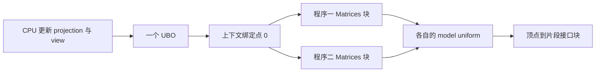

# 高级 GLSL

| 项目 | 内容 |
| --- | --- |
| 原文 | [Advanced GLSL](https://learnopengl.com/Advanced-OpenGL/Advanced-GLSL) |
| 作者 | JoeyDeVries |
| 来源 | [LearnOpenGL-CN](https://github.com/with-fair-wind/LearnOpenGL-CN/blob/new-theme/docs/04%20Advanced%20OpenGL/08%20Advanced%20GLSL.md)，按本仓库代码整理修订 |
| 本仓库示例 | [`apps/04_advanced_opengl/08_advanced_glsl/`](../../apps/04_advanced_opengl/08_advanced_glsl/) |

**接口块组织阶段间的数据接口，uniform 块组织多个程序共享的只读参数；二者的用途和绑定规则不同。** 本节的两个独立 program 共享同一份投影与观察矩阵，但仍各自持有 model uniform。

## 数据路径全景



GLSL 定义数据类型、阶段接口和布局规则；OpenGL API 连接程序块索引、上下文绑定点与缓冲对象；应用负责正确排列字节并在每帧更新共享参数。UBO 中的 uniform 不能再通过普通 `glUniform*` 接口写入。

## 内建变量的职责

| 变量 | 阶段与用途 |
| --- | --- |
| `gl_Position` | 顶点处理输出的裁剪坐标，不是 NDC |
| `gl_VertexID` | 顶点调用关联的索引，不是任意对象编号 |
| `gl_PointSize` | 点大小输出；采用程序点大小还需开启对应状态 |
| `gl_FragCoord` | 片段窗口坐标，其 z 是窗口深度 |
| `gl_FrontFacing` | 片段对应图元的正反面判定 |
| `gl_FragDepth` | 可选覆盖片段深度；若静态写入，执行路径需给出确定值 |

本例聚焦 UBO 与接口块，没有为了演示表中每个变量而额外增加绘制阶段。前三节已经用到片段深度和正反面，几何与实例化示例将继续使用内建索引。

## 接口块与 std140

顶点/片段阶段通过同名 `VertexData` 块及匹配成员对接；实例名称可以不同。共享矩阵则放在 `layout (std140) uniform Matrices` 中：

```c++
constexpr const char* vertex_shader_source{R"glsl(
#version 330 core
layout (location = 0) in vec3 a_pos;
layout (std140) uniform Matrices {
    mat4 projection;
    mat4 view;
};
uniform mat4 model;
out VertexData {
    vec3 local_pos;
} vertex_out;
void main()
{
    vertex_out.local_pos = a_pos;
    gl_Position = projection * view * model * vec4(a_pos, 1.0);
}
)glsl"};
```

在本例列主序 std140 布局里，每个 `mat4` 由四列 vec4 组成，占 64 字节；projection 位于偏移 0，view 位于偏移 64。源码用 `static_assert` 检查所用 GLM 配置的 `mat4` 大小。不能把这个特例推广成“任意 C++ struct 都可直接 memcpy 到任意 uniform 块”。

## 块索引、绑定点与对象

块索引属于一个 program；绑定点属于上下文。先逐 program 查询块索引并绑定到点 0，再将同一个 UBO 接到点 0。本例的真实初始化步骤如下：

```c++
    std::array<GLint, 2> model_uniforms{};
    for (std::size_t index{0U}; index < programs.size(); ++index) {
        // OpenGL: 查询 program 内的活动 uniform 块索引，失败为 GL_INVALID_INDEX。
        const GLuint block{glGetUniformBlockIndex(programs[index], "Matrices")};
        if (block == GL_INVALID_INDEX) {
            std::cerr << "Matrices uniform block missing\n";
            return EXIT_FAILURE;
        }
        // OpenGL: 把 program 内的块索引关联到上下文绑定点。
        glUniformBlockBinding(programs[index], block, 0);
        model_uniforms[index] = uniform_location(programs[index], "model");
        if (model_uniforms[index] < 0) {
            return EXIT_FAILURE;
        }
    }
    GLuint uniform_buffer{0U};
    glGenBuffers(1, &uniform_buffer);
    resources.buffers.push_back(uniform_buffer);
    static_assert(sizeof(glm::mat4) == 64U);
    glBindBuffer(GL_UNIFORM_BUFFER, uniform_buffer);
    glBufferData(GL_UNIFORM_BUFFER, 2 * sizeof(glm::mat4), nullptr, GL_DYNAMIC_DRAW);
    // OpenGL: 把 UBO 对象接到绑定点，使多个 program 共享矩阵。
    glBindBufferBase(GL_UNIFORM_BUFFER, 0, uniform_buffer);
```

每帧用两次 `glBufferSubData` 更新共享矩阵，两个程序随后都从这份存储读取；model 仍分别设置。


> **常见误解：** 在 `#version 330 core` 中直接写 `layout(binding = 0)` 就能取代 API 绑定。
> **纠正：** 这个限定符不是 GLSL 3.30 核心保证的功能。本例使用 `glUniformBlockBinding`，不依赖更高版本或未声明扩展。

> **进阶（std140 对齐）：** **数组步长、结构体边界与向量对齐必须按块布局计算。** 例如不能假定 vec3 在所有布局组合中等价于紧跟的三个 C++ float；成员偏移、数组步长和矩阵步长都可以通过活动 uniform 查询获得。生产代码应使用明确布局、填充和静态断言，必要时核对驱动返回的布局信息，避免靠编译器碰巧排出的结构工作。

## 本仓库示例

示例源码：[`apps/04_advanced_opengl/08_advanced_glsl/main.cpp`](../../apps/04_advanced_opengl/08_advanced_glsl/main.cpp)。代码片段均原样取自此文件；原站概念图片与本例实测截图分别标明。

首次安装依赖与工具链要求见[构建指南](../build.md)。已安装默认 MinGW GCC Debug 依赖时，在仓库根目录执行：

```powershell
cmake --preset mingw-gcc-debug
cmake --build --preset mingw-gcc-debug --target 04_advanced_opengl__08_advanced_glsl
.\build\mingw-gcc-debug\apps\04_advanced_opengl\08_advanced_glsl\04_advanced_opengl__08_advanced_glsl.exe
```

Esc 退出；W/A/S/D 移动，鼠标转向，滚轮修改 FOV。

本仓库实测截图（默认模式）：


本章示例还支持 `--frames 3` 隐藏窗口运行指定帧数、`--mode M` 选择初始模式；配合 `--capture output.ppm` 可保存最后一帧。参数与检查方式详见[构建指南的高级 OpenGL 示例说明](../build.md#高级-opengl-示例)。

## 本章整体回顾

- **局部**：将 std140 矩阵块关联到公共绑定点，使两个程序共享参数。
- **整体**：共享矩阵与阶段接口为更复杂的 GPU 处理建立数据契约。

## 核校参考

- [OpenGL 3.3 Core 规范](https://registry.khronos.org/OpenGL/specs/gl/glspec33.core.pdf)：uniform 缓冲、块索引与绑定点。
- [GLSL 3.30 规范](https://registry.khronos.org/OpenGL/specs/gl/GLSLangSpec.3.30.pdf)：阶段输入输出、内建变量及本例使用的语言语义。

下一节：[几何着色器](09_geometry_shader.md)
