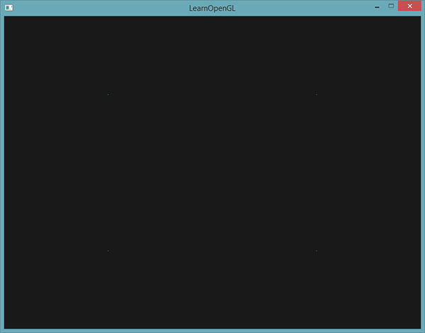
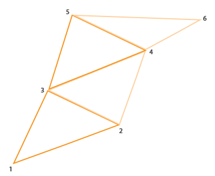
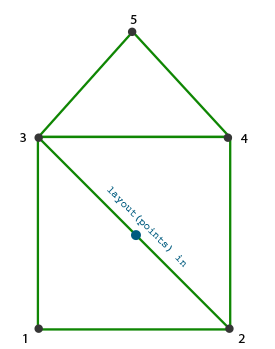
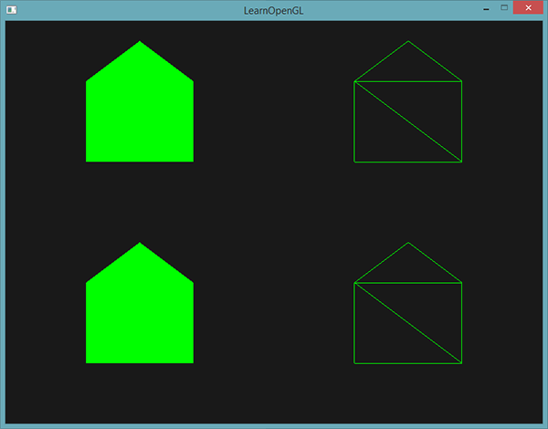
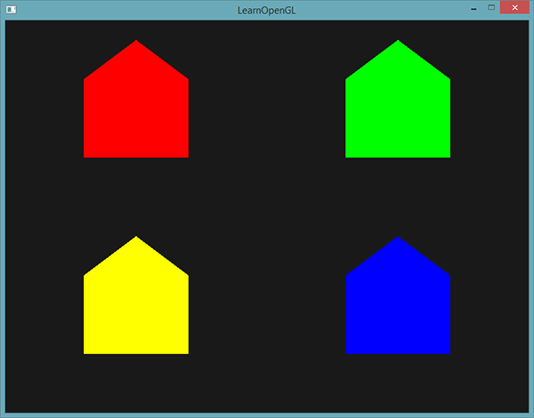
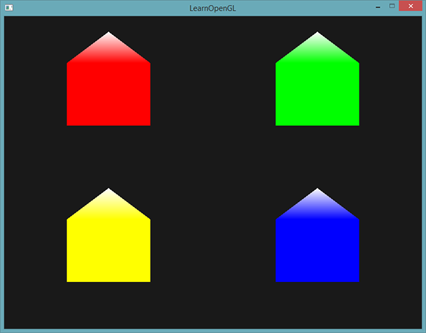
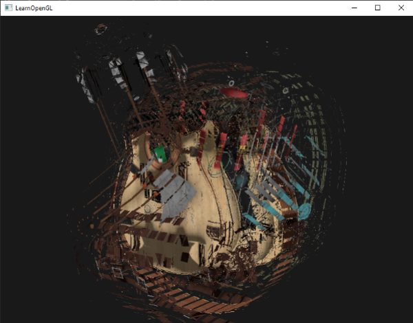
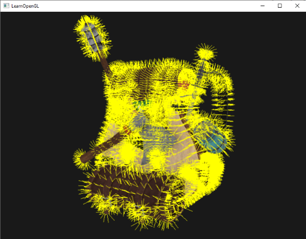
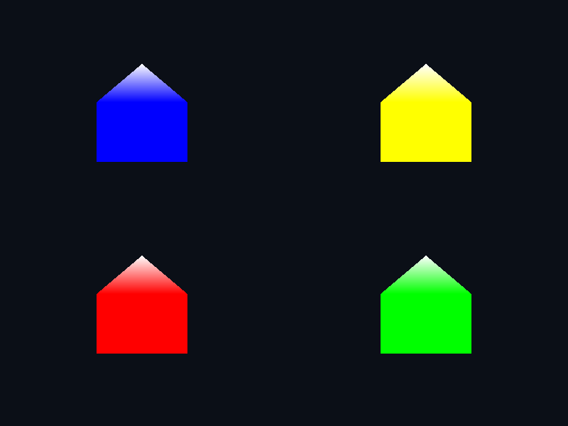

# 几何着色器

| 项目 | 信息 |
| --- | --- |
| 原文 | [Geometry-Shader](https://learnopengl.com/Advanced-OpenGL/Geometry-Shader) |
| 作者 | Joey de Vries |
| 翻译 | Krasjet |
| 校对 | 暂未校对 |
| 中文底本 | [LearnOpenGL-CN 上游固定版本](https://github.com/LearnOpenGL-CN/LearnOpenGL-CN/blob/331560886468e28f28326429334fc48470f9c27b/docs/04%20Advanced%20OpenGL/09%20Geometry%20Shader.md)，`new-theme` / `331560886468e28f28326429334fc48470f9c27b` |
| 本仓库示例 | [`apps/04_advanced_opengl/09_geometry_shader/main.cpp`](../../apps/04_advanced_opengl/09_geometry_shader/main.cpp) |
| 修订 | 按上游完整小节顺序重写，技术差异见正文；[逐项覆盖清单](coverage.md) |

**几何着色器按一个输入图元处理一组顶点，再显式发射零个或多个输出图元。** 它位于顶点阶段之后、光栅化之前，可以从点生成线和三角形，也可以修改模型三角形或为调试生成辅助线。它是可选阶段，不是每个程序都必须经过的共享工具。

OpenGL 规定输入拓扑、输出拓扑与限制，GLSL 定义数组和发射语义，驱动编译链接并运行；应用负责用匹配的图元类型绘制，并检查阶段编译及跨阶段链接错误。GLFW 不会替应用创建或配置这个阶段。


先看点生成水平线的完整实际程序（模式 2）：输入一个点，写第一个位置与颜色，发射；再写第二个位置与颜色，发射并结束线条。绘制命令仍然是 `GL_POINTS`，输出的线由几何阶段生成。

```glsl
#version 330 core
layout (points) in;
layout (line_strip, max_vertices=2) out;
in vec3 point_color[];
out vec3 vertex_color;
void main() { gl_Position=gl_in[0].gl_Position; gl_PointSize=12.0;
vertex_color=point_color[0]; EmitVertex(); gl_Position=gl_in[0].gl_Position+vec4(0.2,0,0,0); vertex_color=point_color[0]; EmitVertex(); EndPrimitive(); }
```

| 输入布局 | 对应绘制拓扑 | 每次调用输入顶点数 |
| --- | --- | --- |
| `points` | `GL_POINTS` | 1 |
| `lines` | `GL_LINES` / `GL_LINE_STRIP` / `GL_LINE_LOOP` | 2 |
| `lines_adjacency` | 带邻接信息的线拓扑 | 4 |
| `triangles` | `GL_TRIANGLES` / `GL_TRIANGLE_STRIP` / `GL_TRIANGLE_FAN` | 3 |
| `triangles_adjacency` | 带邻接信息的三角形拓扑 | 6 |

输出只能声明 `points`、`line_strip`、`triangle_strip` 之一，并指定 `max_vertices`，表示一次调用最多发射多少顶点。它不是“超过上限的顶点会被可靠地忽略”的容错机制；应用必须遵守声明及实现限制。


线条带的首两个点组成第一段，后续每点与前一点再组成一段。`EndPrimitive` 结束当前条带，后续发射另起一条；点输出则每次发射各成一个点。`gl_in[]` 是前一阶段内建顶点数据的数组，大小由输入拓扑确定，即使点输入只有一个顶点，仍用 `gl_in[0]` 访问。

`EmitVertex` 提交当前输出值后，输出变量变为未定义，下一次发射前要重新赋值所需的 `gl_Position`、颜色、UV 等。`EndPrimitive` 用于分隔输出，不是把此前完全没有定义的顶点“补齐成合法图元”。


## 使用几何着色器

从四个二维位置开始，创建一个 VAO 和位置缓冲。顶点程序直接输出裁剪空间点，片段程序输出输入颜色。位置源码如下：

```cpp
    constexpr std::array<float, 12> points{-0.5F, -0.5F, 0.0F, 0.5F, -0.5F, 0.0F,
                                           -0.5F, 0.4F,  0.0F, 0.5F, 0.4F,  0.0F};
    const GLuint vao{create_vertex_array(resources, points.data(), sizeof(points))};
```

```glsl
#version 330 core
layout (location = 0) in vec3 a_pos;
layout (location = 1) in vec3 a_color;
out vec3 point_color;
void main()
{
    gl_Position = vec4(a_pos, 1.0);
    point_color = a_color;
}
```

没有几何阶段时，这条路径已经能画点。为了验证插入阶段不会改变几何，模式 1 加一个传递几何程序：接收点，原位置发射同一个点。此处设置像素点尺寸只是方便观察，上游的微小绿点图用于对照原始形状。



```glsl
#version 330 core
layout (points) in;
layout (points, max_vertices=1) out;
in vec3 point_color[];
out vec3 vertex_color;
void main() { gl_Position=gl_in[0].gl_Position; gl_PointSize=12.0;
vertex_color=point_color[0]; EmitVertex(); EndPrimitive(); }
```

编译时阶段类型使用 `GL_GEOMETRY_SHADER`，与顶点/片段阶段一样检查编译日志；链接时把三个阶段都附到同一个 program，再检查链接结果。`create_program` 已支持可选 geometry 参数，成功链接后删除各阶段对象引用。不要因为画面仍是四个点就断言几何阶段没有执行，传递程序本来就保持拓扑和位置。

```cpp
    const GLuint points_program{create_program(resources, vertex_shader_source,
                                               fragment_shader_source, pass_geometry_source)};
    const GLuint line_program{create_program(resources, vertex_shader_source,
                                             fragment_shader_source, line_geometry_source)};
```

上面的片段展示不同拓扑必须分别链接成 program。`layout(points) out`、`layout(line_strip) out` 与三角条带是编译期声明，不能靠一个运行时整数把同一输出布局随意切成另一种图元。本例保留独立点、线、房子程序。传递阶段仍得到同样的四点，正好用于核验新阶段的接线。


## 造几个房子

房子由三角形带的五个顶点组成：左下、右下、左上、右上、屋顶。前四个构成矩形，最后一个补屋顶。N 个连续顶点最多产生 N-2 个三角形；三角形带组装会交替调整有效顶点顺序以保持一致朝向，不能把每个连续三元组都按不变顺序理解。





模式 6 先用统一绿色绘制基本房子，对应底本“一个点生成一个绿房子”的步骤。输入蓝点只是锚点，本例在裁剪空间中加固定偏移，得到屏幕上固定尺度的房子；这不是世界空间有厚度的建筑模型。



接着为每个输入点提供颜色属性。每个点颜色由 VBO 的属性 1 读取，经顶点输出传给几何阶段的 `in vec3 point_color[]`。因为一次几何调用接收一组顶点，用户输入必须按顶点组织为数组；可以像本例用松散数组，也可以用上一篇的输入接口块数组，二者都合法。

颜色属性配置源码：

```cpp
    constexpr std::array<float, 12> point_colors{1.0F, 0.0F, 0.0F, 0.0F, 1.0F, 0.0F,
                                                 0.0F, 0.0F, 1.0F, 1.0F, 1.0F, 0.0F};
    GLuint color_buffer{0U};
    glGenBuffers(1, &color_buffer);
    resources.buffers.push_back(color_buffer);
    glBindVertexArray(vao);
    glBindBuffer(GL_ARRAY_BUFFER, color_buffer);
    glBufferData(GL_ARRAY_BUFFER, sizeof(point_colors), point_colors.data(), GL_STATIC_DRAW);
    glVertexAttribPointer(1, 3, GL_FLOAT, GL_FALSE, 3 * sizeof(float), nullptr);
    glEnableVertexAttribArray(1);
```

模式 3 在每次发射前把当前点颜色写给 `vertex_color`，片段程序接收插值颜色，四个房子各有自己的颜色。片段输入不是数组，数组仅描述几何阶段的多顶点输入。



最后把屋顶顶点设为白色，其他顶点保留点颜色，插值得到渐白的雪顶（模式 0）。完整房子几何程序逐次写位置和颜色：

```glsl
#version 330 core
layout (points) in;
layout (triangle_strip, max_vertices = 5) out;
in vec3 point_color[];
out vec3 vertex_color;
uniform int house_mode;
void emit_corner(vec2 offset, vec3 color)
{
    gl_Position = gl_in[0].gl_Position + vec4(offset, 0.0, 0.0);
    vertex_color = color;
    EmitVertex();
}
void main()
{
    vec3 color = house_mode == 6 ? vec3(0.0,1.0,0.0) : point_color[0];
    emit_corner(vec2(-0.16,-0.16),color);
    emit_corner(vec2( 0.16,-0.16),color);
    emit_corner(vec2(-0.16, 0.12),color);
    emit_corner(vec2( 0.16, 0.12),color);
    emit_corner(vec2(0.0,0.30),house_mode == 0 ? vec3(1.0) : color);
    EndPrimitive();
}
```



> **修订（输出生命周期）：** 底本声称“只在第一次发射前设置颜色，后续自动沿用”，不符合 GLSL 的发射语义。本例每次 `emit_corner` 都重写颜色；纹理坐标等其他输出也应同样处理。不要因为某驱动碰巧保留了旧寄存器值就依赖它。

从点扩增形状可用于草、体素等场景，但几何阶段有吞吐与输出放大成本，不能宣称比预建顶点缓冲或实例化一定快。这个案例用于理解图元生成，优化方案需要按硬件和负载测量。

## 爆破物体

**沿每个三角形自己的面法线平移三个顶点，可以让完整模型像碎片一样向外展开。** 它不修改磁盘模型，也不是物理破碎系统；同一个输入顶点被多个三角形引用时，可以在不同几何调用中得到不同位移。



底本用复杂背包，本仓库模式 4 实际由 Assimp 加载 `crate.obj`，遍历节点、累积变换、建立带法线/UV 的顶点及索引缓冲，再由几何阶段处理每个三角形。不能用二维房子动画替代这个模型案例。这里采用简化木箱，让每片三角形分离和 UV 保留更容易观察。

对同一空间的三点 $p_0,p_1,p_2$，建立两条边 $a=p_1-p_0$、$b=p_2-p_0$，法线为 $N=normalize(a\times b)$。交换叉乘顺序会反向；零面积三角形需要在资源处理时排除。这里用**观察空间**位置做叉乘，不能在透视除法后的坐标上求世界几何法线。

观察空间顶点程序同时把模型法线经逆转置矩阵变换，供下一小节复用：

```glsl
#version 330 core
layout (location = 0) in vec3 a_pos;
layout (location = 1) in vec3 a_normal;
layout (location = 2) in vec2 a_tex_coord;
uniform mat4 model;
uniform mat4 view;
out VertexData { vec3 normal; vec2 tex_coord; } vertex_out;
void main() {
    gl_Position = view * model * vec4(a_pos,1.0);
    vertex_out.normal = normalize(mat3(transpose(inverse(view*model))) * a_normal);
    vertex_out.tex_coord = a_tex_coord;
}
```

时间位移写成 $p'_i=p_i+N\,A\,(\sin t+1)/2$，把正弦从 $[-1,1]$ 映射到 $[0,1]$，确保只向外移动再返回。本例取 $A=0.7$，等价于源码中的 `(sin(time_seconds)+1.0)*0.35`。位置偏移使用 w=0 的方向，随后才乘 projection。

完整爆破几何程序：

```glsl
#version 330 core
layout (triangles) in;
layout (triangle_strip, max_vertices = 3) out;
in VertexData { vec3 normal; vec2 tex_coord; } vertex_in[];
out vec2 tex_coord;
uniform mat4 projection;
uniform float time_seconds;
uniform bool explode;
void main() {
    vec3 edge_a = vec3(gl_in[1].gl_Position-gl_in[0].gl_Position);
    vec3 edge_b = vec3(gl_in[2].gl_Position-gl_in[0].gl_Position);
    vec3 normal = normalize(cross(edge_a,edge_b));
    float distance = explode ? (sin(time_seconds)+1.0)*0.35 : 0.0;
    for (int i=0; i<3; ++i) {
        gl_Position = projection * (gl_in[i].gl_Position+vec4(normal*distance,0.0));
        tex_coord = vertex_in[i].tex_coord;
        EmitVertex();
    }
    EndPrimitive();
}
```

每次发射还重写对应顶点 UV，片段程序继续采样木箱纹理；几何破碎没有理由让材质坐标消失。CPU 每帧设置 `time_seconds`，有限帧截图使用固定 0.7 秒，以便检查可复现。交互运行使用 GLFW 单调计时器，模型随时间展开、收拢。

```glsl
#version 330 core
in vec2 tex_coord;
out vec4 frag_color;
uniform sampler2D surface_texture;
void main() { frag_color = texture(surface_texture,tex_coord); }
```

## 法向量可视化

光照错误常来自法线加载、属性偏移或空间变换不正确。模式 5 先使用**没有几何阶段**的普通程序绘制模型颜色，再用法线程序对同一模型追加绘制，每个三角形输出三条黄色线，每个顶点一条。两遍都使用一致的 model/view/projection，保留深度比较来帮助观察可见表面。

这里用的是模型提供的**顶点法线**，与爆破用的三角形面法线不同。平滑曲面上顶点法线不必等于某个相邻面的几何法线。非均匀缩放下，位置乘 model/view，法线乘相应 3×3 逆转置并归一化；不能直接乘原矩阵后认为结果仍垂直。

几何输入中的位置和法线均在观察空间。线起点是 $p$，终点是 $p+0.3N$，两个端点再分别投影。每条线调用一次 `EndPrimitive`，否则三组法线会连成一条折线。最大输出顶点数是 $3\times2=6$：

```glsl
#version 330 core
layout (triangles) in;
layout (line_strip, max_vertices = 6) out;
in VertexData { vec3 normal; vec2 tex_coord; } vertex_in[];
uniform mat4 projection;
void main() {
    for (int i=0; i<3; ++i) {
        gl_Position = projection * gl_in[i].gl_Position;
        EmitVertex();
        gl_Position = projection * (gl_in[i].gl_Position+vec4(vertex_in[i].normal*0.3,0.0));
        EmitVertex();
        EndPrimitive();
    }
}
```

片段程序固定黄色，不需要为法线另外计算光照。运行时先正常绘制再叠加法线，得到类似原图的“毛茸茸”效果：



细线的朝向帮助检查法线是否朝外、是否随模型转动，长度帮助识别归一化和缩放处理错误。这种调试显示也能启发毛发等技术，但真正毛发还需要更完整的几何、透明度和光照模型，不应把几条调试线称为完整毛发渲染。

> **常见误解：** `gl_in[].gl_Position` 不自动保证是世界或观察空间；它就是上个阶段写入的值。本例在模型顶点程序中有意暂存观察空间位置，最后由几何阶段乘投影，不能在两个阶段重复投影。

> **进阶（限制与替代）：** **输出扩增会消耗真实的顶点与带宽预算。** 几何 shader 的输出顶点数、总输出分量和吞吐都有实现限制，声明过大的 `max_vertices` 也不是免费资源。大量重复几何通常应比较预建网格、实例化与几何扩增的实际表现；法线可视化的价值在于调试表达清晰，不依赖它胜过所有其他绘制方案。

## 上游源码与附加资源

以下保留底本引用的源码、资源与附加阅读入口；正文使用本仓库实现，外部旧演示与本地程序的组织可能不同。

- [上游源码或资源对照](https://learnopengl.com/code_viewer_gh.php?code=src/4.advanced_opengl/9.1.geometry_shader_houses/geometry_shader_houses.cpp)
- [上游源码或资源对照](https://learnopengl.com/code_viewer_gh.php?code=src/4.advanced_opengl/9.2.geometry_shader_exploding/geometry_shader_exploding.cpp)
- [上游源码或资源对照](https://learnopengl.com/code_viewer_gh.php?code=src/4.advanced_opengl/9.3.geometry_shader_normals/normal_visualization.cpp)

## 本仓库示例

源码：[`main.cpp`](../../apps/04_advanced_opengl/09_geometry_shader/main.cpp)，目标：`04_advanced_opengl__09_geometry_shader`。正文标为源码的 C++/GLSL 均直接摘取此文件；标为概念说明的独立片段用于说明规范或未启用的更高版本功能。

```powershell
cmake --preset mingw-gcc-debug
cmake --build --preset mingw-gcc-debug --target 04_advanced_opengl__09_geometry_shader
.\build\mingw-gcc-debug\apps\04_advanced_opengl\09_geometry_shader\04_advanced_opengl__09_geometry_shader.exe --mode 0
```

依赖准备、多配置生成器与其他工具链见[构建指南](../build.md)。Esc 是退出键；除 07 的二维数据示例外，三维场景支持 WASD、鼠标与滚轮。空格按表中顺序切换（07 用启动参数选择映射方法）。有限帧检查可追加 `--frames 3 --capture output.ppm`，截图取最后一帧；它验证绘制路径，不能代替交互和视觉检查。

| `--mode` | 可观察内容 |
| --- | --- |
| 0 | 彩色雪顶房子 |
| 1 | 点传递 |
| 2 | 点生成线段 |
| 3 | 无雪顶彩色房子 |
| 4 | 模型三角形爆破 |
| 5 | 模型法线叠加 |
| 6 | 统一绿色房子 |



## 本章整体回顾

几何阶段按图元处理输入，用 EmitVertex 和 EndPrimitive 生成输出。点扩增演示拓扑，爆破演示面法线位移，法线显示演示顶点法线与空间一致性；几何阶段不提供无条件的性能提升。

本篇承接前一篇，正文保留底本对应的小节与主案例。图片中的背包、箱子等属于上游演示，本仓库使用独立注明的教学场景；本仓库截图与上游图分开标注。图片出处见[资源记录](../img/04/README.md)，对应关系与验证边界见[覆盖清单](coverage.md)。

技术核校：[英文原文](https://learnopengl.com/Advanced-OpenGL/Geometry-Shader)、[OpenGL 3.3 Core 规范](https://registry.khronos.org/OpenGL/specs/gl/glspec33.core.pdf)、[GLSL 3.30 规范](https://registry.khronos.org/OpenGL/specs/gl/GLSLangSpec.3.30.pdf)。

下一节：[实例化](10_instancing.md)。
