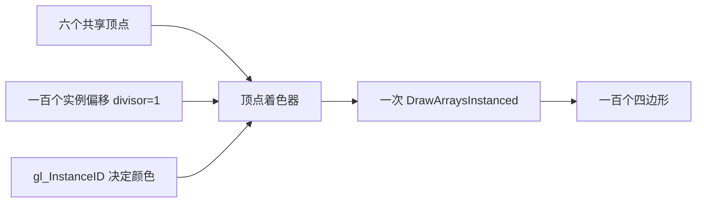

# 实例化

| 项目 | 内容 |
| --- | --- |
| 原文 | [Instancing](https://learnopengl.com/Advanced-OpenGL/Instancing) |
| 作者 | JoeyDeVries |
| 来源 | [LearnOpenGL-CN](https://github.com/with-fair-wind/LearnOpenGL-CN/blob/new-theme/docs/04%20Advanced%20OpenGL/10%20Instancing.md)，按本仓库代码整理修订 |
| 本仓库示例 | [`apps/04_advanced_opengl/10_instancing/`](../../apps/04_advanced_opengl/10_instancing/) |

**实例化把重复网格的多次提交合并为一次绘制，但每个实例的顶点处理、光栅化和片段工作仍然存在。** 本例用一个六顶点四边形和一百个偏移量，绘制 10×10 彩色网格。

## 顶点频率与实例频率



应用组织重复几何、实例参数和批次；OpenGL 定义属性除数及实例索引；驱动执行合并后的提交。减少 CPU 提交不意味着 CPU 与 GPU 只通信一次，更不意味着实例数量增加后 GPU 成本不变。

## 实例属性与 gl_InstanceID

位置属性的默认除数为 0，逐顶点推进；偏移属性除数为 1，逐实例推进。除数为 2 时每两个实例复用同一项。`gl_InstanceID` 从 0 起表示本次调用中的实例序号，本例用它生成颜色，偏移则来自 VBO：

```c++
constexpr const char* vertex_shader_source{R"glsl(
#version 330 core
layout (location = 0) in vec3 a_pos;
layout (location = 1) in vec2 a_offset;
out vec3 vertex_color;
void main()
{
    gl_Position = vec4(a_pos.xy + a_offset, a_pos.z, 1.0);
    vertex_color = vec3(float(gl_InstanceID % 10) / 9.0, float(gl_InstanceID / 10) / 9.0, 0.7);
}
)glsl"};
```

实例属性可容纳比小型 uniform 数组更多的数据，但仍受缓冲容量、属性位置数和实际显存预算约束。实例化不是无限制的参数传输接口。

```c++
    glVertexAttribPointer(1, 2, GL_FLOAT, GL_FALSE, sizeof(glm::vec2), nullptr);
    glEnableVertexAttribArray(1);
    // OpenGL: 除数 1 表示每个实例推进一次此属性。
    glVertexAttribDivisor(1, 1);
```

## 一次提交

本例渲染循环只有一次实例化绘制，最后一个参数来自实际偏移数组大小：

```c++
        glDrawArraysInstanced(GL_TRIANGLES, 0, 6, static_cast<GLsizei>(offsets.size()));
```

顶点属性和实例属性都记录在同一 VAO 上。绑定另一个 VAO 不会自动继承实例属性的 buffer、格式或除数，模型有多个 mesh 时要分别配置。


参考图同样展示实例数组；本例使用 uniform 大小的四边形和彩色渐变，未加载小行星模型。

> **常见误解：** `gl_InstanceID` 可以直接当顶点属性 location。
> **纠正：** 它是内建索引，不是用户属性位置。location 标识输入槽，divisor 决定该槽的数据推进频率，实例索引用于本次调用内的逻辑与数组访问，三者各自承担不同职责。

## 从网格到小行星带

将偏移升级为实例模型矩阵，可用四个 vec4 属性列表示 mat4，并给四个位置都设置除数。每个 mesh 使用自己的 VAO 与索引缓冲，再按 mesh 批量绘制实例。这个扩展复用第三章 Model 的数据思路，但当前独立例子仅演示基本实例数组机制。

> **进阶（批次与瓶颈）：** **实例化更适合共享几何、程序和材质状态的对象。** 不同贴图、混合规则或剔除设置可能仍需拆批；增加实例数也会增加不可见几何和过度绘制。大场景应结合视锥裁剪、层次细节和材质分组，再分别测量 CPU 提交与 GPU 工作，不能把原教程特定机器的十万小行星数字当作普遍性能保证。

## 本仓库示例

示例源码：[`apps/04_advanced_opengl/10_instancing/main.cpp`](../../apps/04_advanced_opengl/10_instancing/main.cpp)。代码片段均原样取自此文件；原站概念图片与本例实测截图分别标明。

首次安装依赖与工具链要求见[构建指南](../build.md)。已安装默认 MinGW GCC Debug 依赖时，在仓库根目录执行：

```powershell
cmake --preset mingw-gcc-debug
cmake --build --preset mingw-gcc-debug --target 04_advanced_opengl__10_instancing
.\build\mingw-gcc-debug\apps\04_advanced_opengl\10_instancing\04_advanced_opengl__10_instancing.exe
```

Esc 退出；本例使用固定的二维视图，不捕获鼠标。

本仓库实测截图（默认模式）：


本章示例还支持 `--frames 3` 隐藏窗口运行指定帧数、`--mode M` 选择初始模式；配合 `--capture output.ppm` 可保存最后一帧。参数与检查方式详见[构建指南的高级 OpenGL 示例说明](../build.md#高级-opengl-示例)。

## 本章整体回顾

- **局部**：对共享顶点与实例偏移采用不同读取频率，一次提交重复几何。
- **整体**：实例化减少提交开销；下一节讨论输出图像的几何边界采样质量。

## 核校参考

- [OpenGL 3.3 Core 规范](https://registry.khronos.org/OpenGL/specs/gl/glspec33.core.pdf)：实例绘制及顶点属性除数。
- [GLSL 3.30 规范](https://registry.khronos.org/OpenGL/specs/gl/GLSLangSpec.3.30.pdf)：阶段输入输出、内建变量及本例使用的语言语义。

下一节：[抗锯齿](11_anti_aliasing.md)
