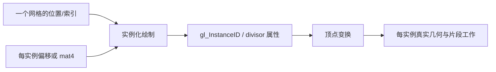
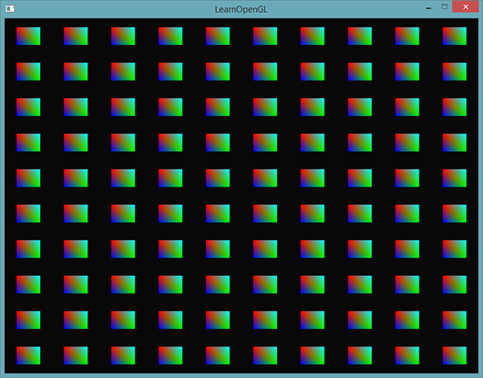
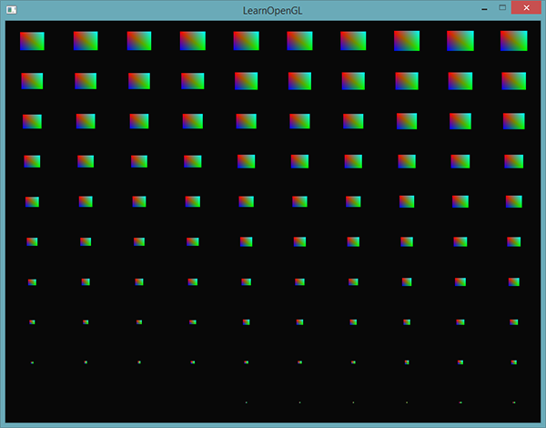
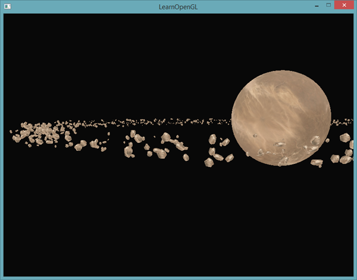
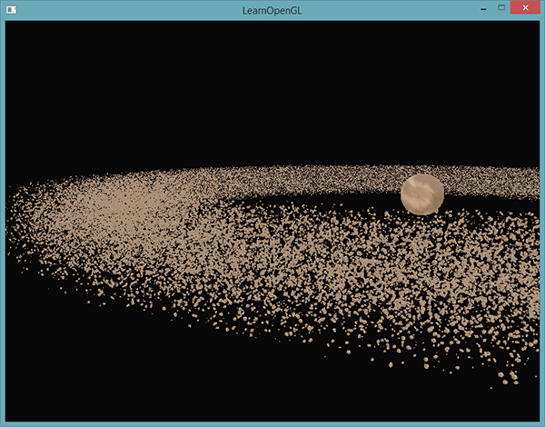
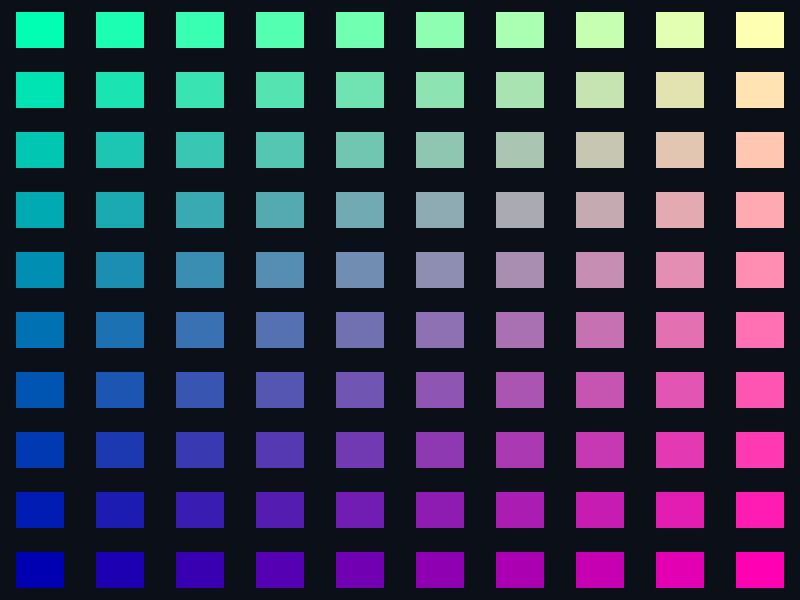

# 实例化

| 项目 | 信息 |
| --- | --- |
| 原文 | [Instancing](https://learnopengl.com/Advanced-OpenGL/Instancing) |
| 作者 | Joey de Vries |
| 翻译 | Krasjet |
| 校对 | 暂未校对 |
| 来源 | [LearnOpenGL-CN](https://github.com/LearnOpenGL-CN/LearnOpenGL-CN/blob/331560886468e28f28326429334fc48470f9c27b/docs/04%20Advanced%20OpenGL/10%20Instancing.md) |
| 本仓库示例 | [`apps/04_advanced_opengl/10_instancing/main.cpp`](../../apps/04_advanced_opengl/10_instancing/main.cpp) |

**实例化把同一网格的多份绘制合成较少的提交，再用实例编号或实例属性区分位置、颜色和变换。** 草丛、粒子和小行星常有这种结构：几何相同，但每份的位置或姿态不同。逐物体设置 uniform 再 draw 会增加 CPU 提交和驱动工作；瓶颈是否在这里需要实际测量，不能断言任意绘制都由总线通信主导。

`glDrawArraysInstanced` 和 `glDrawElementsInstanced` 在普通绘制参数后增加实例数。OpenGL 规定属性推进与编号，驱动执行，应用上传实例数据并选择批次。GLFW 只提供窗口与上下文，GLAD 只提供函数入口；减少调用不会让每个实例的顶点和片段工作凭空消失。



如果只是把 draw 改成实例化，而所有实例仍使用相同变换，它们就叠在同一位置。`gl_InstanceID` 是顶点着色器只读输入，在一次实例化调用中从 0 到 `instance_count-1`，第 43 个实例的 ID 为 42，可用来索引差异数据。

先画 100 个二维小四边形。每个由两个三角形、六个顶点组成；建立 10×10 网格偏移，x/y 从 -0.9 开始、步进 0.2。模式 1 将偏移写入 `uniform vec2 offsets[100]`，顶点程序用 ID 取对应偏移。本例颜色由 ID 生成，上游通过顶点颜色属性得到渐变，二者都把颜色继续送入片段程序。



顶点和偏移数据的实际源码：

```cpp
    constexpr std::array<float, 18> quad_vertices{-0.06F, -0.06F, 0.0F, 0.06F,  -0.06F, 0.0F,
                                                  0.06F,  0.06F,  0.0F, -0.06F, -0.06F, 0.0F,
                                                  0.06F,  0.06F,  0.0F, -0.06F, 0.06F,  0.0F};
    const GLuint vao{create_vertex_array(resources, quad_vertices.data(), sizeof(quad_vertices))};
    std::array<glm::vec2, 100> offsets{};
    for (std::size_t index{0U}; index < offsets.size(); ++index) {
        offsets[index] = {-0.9F + static_cast<float>(index % 10U) * 0.2F,
                          -0.9F + static_cast<float>(index / 10U) * 0.2F};
    }
    GLuint instance_buffer{0U};
```

上游逐项生成 `offsets[i]` 名字、查询位置并上传。本例查询 `offsets[0]` 后用一次 `glUniform2fv` 上传 100 个连续 vec2，保留同样的数组索引教学目标，避免为字符串拼装分散注意。这个数组按普通 uniform 的容量规则计数，不能无限扩展。

实际顶点程序同时容纳 uniform 和实例属性路径，`uniform_offsets` 选择来源，`scale_instances` 控制后面的尺寸渐变：

```glsl
#version 330 core
layout (location = 0) in vec3 a_pos;
layout (location = 1) in vec2 a_offset;
uniform vec2 offsets[100];
uniform bool uniform_offsets;
uniform bool scale_instances;
out vec3 vertex_color;
void main()
{
    vec2 position = a_pos.xy * (scale_instances ? float(gl_InstanceID)/100.0 : 1.0);
    gl_Position = vec4(position + (uniform_offsets ? offsets[gl_InstanceID] : a_offset), a_pos.z, 1.0);
    vertex_color = vec3(float(gl_InstanceID % 10) / 9.0, float(gl_InstanceID / 10) / 9.0, 0.7);
}
```

调用 `glDrawArraysInstanced(GL_TRIANGLES,0,6,100)` 表示重复六个顶点一百次。绘制次数的批处理与顶点数据只有一份是两件相关而不同的事；非实例化循环也可以复用同一个 VBO，但仍有重复命令提交。

## 实例化数组

当实例数较多，普通 uniform 数组容易触及阶段容量限制。实例化数组用 VBO 保存每实例属性，通过 `glVertexAttribDivisor` 改变属性推进频率。位置仍按每个顶点读取，偏移改为每个实例读取。

本例 `a_offset` 放在 location 1，单独的 instance buffer 保存 100 个 vec2。先绑定 VAO，再绑定该 VBO，设置格式、步长、偏移并开启属性，最后设置 divisor：

```cpp
    glGenBuffers(1, &instance_buffer);
    resources.buffers.push_back(instance_buffer);
    glBindBuffer(GL_ARRAY_BUFFER, instance_buffer);
    glBufferData(GL_ARRAY_BUFFER, sizeof(offsets), offsets.data(), GL_STATIC_DRAW);
    glVertexAttribPointer(1, 2, GL_FLOAT, GL_FALSE, sizeof(glm::vec2), nullptr);
    glEnableVertexAttribArray(1);
    // OpenGL: 除数 1 表示每个实例推进一次此属性。
    glVertexAttribDivisor(1, 1);
```

divisor 为 0 时按顶点推进，是普通属性的默认状态；为 1 时每实例推进；为 2 时每两个实例推进，同一属性元素被相邻两个实例共享。它属于 VAO 属性状态，只对指定 location 生效，设置一次不代表所有属性或其他 VAO 都已配置。

模式 0 改从实例属性取偏移，输出与 uniform 数组网格相同。片段着色器继续接收插值颜色，不需要理解偏移来自哪里。这展示“改变供数方式而保持几何效果”的对应关系。


进一步保留底本的 ID 尺寸变化：模式 4 让局部四边形乘 `float(gl_InstanceID)/100.0`，再加实例偏移。首实例缩到零，随后逐渐增大，最后一个接近原尺寸；不同数据顺序决定哪一角先变大。实例属性与 `gl_InstanceID` 可以同时使用，不是二选一。



> **常见误解：** `glVertexAttribDivisor` 不会复制 VBO，也不会自动读取模型矩阵。它只改变一个已配置属性的元素选择频率，数据格式和存储仍由其他 API 配置。

## 小行星带

网格演示机制，但真正用途是大量重复模型。本案例先用普通绘制构建行星与 1000 块岩石，再保持同一组变换切换到矩阵实例属性，比较画面和提交结构。

上游的[行星资源](https://github.com/LearnOpenGL-CN/LearnOpenGL-CN/blob/331560886468e28f28326429334fc48470f9c27b/docs/data/planet.rar)与[岩石资源](https://github.com/LearnOpenGL-CN/LearnOpenGL-CN/blob/331560886468e28f28326429334fc48470f9c27b/docs/data/rock.rar)保留为附加资源。本仓库使用自制 `planet.obj` 和 `rock.obj`，仍通过 Assimp 实际读取索引网格、递归处理节点、上传法线，而不是拿二维四边形充当小行星。几何外观较简单，实例化步骤与多 mesh 的 VAO 配置都保留。

每块岩石的变换分三步构造：先按圆周角计算 x/z，再加有限随机位移；y 随机范围压小，形成扁平环；最后随机缩放、绕单位轴随机旋转。圆周角和 `glm::rotate` 都用弧度，不能把 0–360 的角度直接传给 `sin/cos`。固定随机种子便于普通绘制与实例化一一对照。

$$\theta_i=2\pi\frac{i}{N},\quad x_i=r\sin\theta_i+\delta_x,\quad
z_i=r\cos\theta_i+\delta_z,\quad y_i=0.25\delta_y.$$

本例半径 10、位移范围 ±1.6、比例 0.08–0.3。GLM 连乘形成 $T\,S\,R$，作用到列向量时从右向左执行；不要把代码调用顺序等同顶点实际受变换顺序。矩阵数组使用 `std::vector` 管理堆存储，十万个 `mat4` 约占 6.4 MB，不占用同等大小的线程栈。上传长度应按 `matrices.size() * sizeof(glm::mat4)` 计算，不能使用容器对象自身的 `sizeof`。完整生成代码：

```cpp
    constexpr std::size_t amount{1000U};
    // 实例数量可提高到十万；矩阵存储放在堆上，避免耗尽 Windows 线程栈。
    std::vector<glm::mat4> matrices(amount, glm::mat4{1.0F});
    std::mt19937 generator{42U};
    std::uniform_real_distribution<float> displacement{-1.6F, 1.6F};
    std::uniform_real_distribution<float> scale_range{0.08F, 0.3F};
    std::uniform_real_distribution<float> rotation_range{0.0F, 360.0F};
    for (std::size_t index{0U}; index < amount; ++index) {
        const float angle{static_cast<float>(index) / static_cast<float>(amount) *
                          glm::radians(360.0F)};
        const glm::vec3 position{std::sin(angle) * 10.0F + displacement(generator),
                                 displacement(generator) * 0.25F,
                                 std::cos(angle) * 10.0F + displacement(generator)};
        glm::mat4 model{glm::translate(glm::mat4{1.0F}, position)};
        model = glm::scale(model, glm::vec3{scale_range(generator)});
        matrices[index] = glm::rotate(model, glm::radians(rotation_range(generator)),
                                      glm::normalize(glm::vec3{0.4F, 0.6F, 0.8F}));
    }
    GLuint matrix_buffer{0U};
```

**先普通绘制。** 模式 2 先画放大后的行星，再对每个岩石更新 model uniform 并调用 `draw_model`。当岩石模型有 $M$ 个 mesh、行星有 $P$ 个 mesh 时，每帧调用数为 $P+NM$；上游所述 1001 次只适用于两模型各单 mesh 的情形。



这时逐物体更新和提交可能成为瓶颈。不能照搬底本旧机器的“2000 块必卡”作为当前硬件事实；模型复杂度、驱动、同步、可见像素数都会改变结果。比较性能时也要控制垂直同步、构建类型和测量方法，本章只记录功能检查，不虚报 FPS。

**再用实例矩阵。** `mat4` 顶点属性占四个连续 location。普通模型已有位置 0、法线 1、UV 2，因此从 3 开始使用 3、4、5、6。矩阵列主序，每列一个 vec4，步长为 `sizeof(glm::mat4)`，偏移依次为 0、`sizeof(vec4)`、两倍和三倍；每列都必须启用并设置 divisor 1。

对岩石的每一个 mesh VAO 分别执行同一配置，四列共享同一个矩阵 VBO。只配置第一个 mesh 会让其他网格使用错误或常量矩阵。源码包含布局断言：

```cpp
    glGenBuffers(1, &matrix_buffer);
    resources.buffers.push_back(matrix_buffer);
    glBindBuffer(GL_ARRAY_BUFFER, matrix_buffer);
    glBufferData(GL_ARRAY_BUFFER, static_cast<GLsizeiptr>(matrices.size() * sizeof(glm::mat4)),
                 matrices.data(), GL_STATIC_DRAW);
    static_assert(sizeof(glm::mat4) == 4U * sizeof(glm::vec4));
    for (const render_mesh& mesh : rocks) {
        glBindVertexArray(mesh.vao);
        for (GLuint column{0U}; column < 4U; ++column) {
            const GLuint location{3U + column};
            glEnableVertexAttribArray(location);
            glVertexAttribPointer(location, 4, GL_FLOAT, GL_FALSE, sizeof(glm::mat4),
                                  reinterpret_cast<const void*>(static_cast<std::size_t>(column) *
                                                                sizeof(glm::vec4)));
            glVertexAttribDivisor(location, 1);
        }
    }
    // OpenGL: 后续 uniform 更新和绘制使用此程序。
```

模型着色器在模式 2 取普通 model、模式 3 取 `a_instance_model`。位置、法线使用同一选择出的变换，避免实例移动而光照仍按原位置/姿态计算：

```glsl
#version 330 core
layout (location=0) in vec3 a_pos;
layout (location=1) in vec3 a_normal;
layout (location=2) in vec2 a_tex_coord;
layout (location=3) in mat4 a_instance_model;
uniform mat4 model;
uniform mat4 view;
uniform mat4 projection;
uniform bool use_instances;
out vec3 vertex_color;
void main() {
    mat4 transform = use_instances ? a_instance_model : model;
    vec3 normal = normalize(mat3(transpose(inverse(transform))) * a_normal);
    vertex_color = vec3(0.55,0.48,0.36)*(0.3+0.7*max(dot(normal,normalize(vec3(1,2,3))),0.0));
    gl_Position = projection*view*transform*vec4(a_pos,1);
}
```

模式 3 对每个岩石 mesh 使用 `glDrawElementsInstanced`，实例数为 amount，EBO 仍从 mesh VAO 读取。`count` 是单个网格索引数，最后一个参数才是实例数；两个数量不要相乘后塞进 count。行星仍单独画一次。

```cpp
                glUniform1i(instanced_uniform, GL_TRUE);
                for (const render_mesh& mesh : rocks) {
                    glBindVertexArray(mesh.vao);
                    // OpenGL: 对当前索引网格重复绘制实例，实例属性由 divisor 推进。
                    glDrawElementsInstanced(GL_TRIANGLES, mesh.count, GL_UNSIGNED_INT, nullptr,
                                            static_cast<GLsizei>(amount));
                }
```

这样岩石部分从 $NM$ 次 draw 降到 $M$ 次，画面应与模式 2 对应。上游把数量提高到十万展示扩展能力，本例默认 1000 以便普通路径也容易交互；调整源码中的 `amount` 后重新构建即可比较，还需根据数量适当增大环半径/离散范围，避免只增加重叠。



> **原提示与修订：** 十万实例可能超过一些机器的可接受帧率，应逐步调整到合适负载。实例化减少命令提交，不保证“5700 万顶点也没有性能影响”；顶点、三角形、片段、存储和带宽消耗仍随场景增长。

底本通过公开 Mesh 的 VAO 方便演示。本仓库的局部 `render_mesh` 直接保存 VAO 与索引数，GPU 对象由当前文件的资源守卫集中释放，不抽取公共库；矩阵 VBO 必须活到全部实例绘制结束，不能在配置完属性后就按普通 CPU 临时数组的思路释放。

> **进阶（批次边界）：** **实例化批次仍受网格、程序和材质状态约束。** 不是场景里所有对象都能合进同一次调用。相同几何且可共享状态的物体适合分批；不同纹理可进一步考虑数组纹理等方案，但要设计明确索引。还应先做可见性剔除，避免仅为减少 draw 次数就把大量完全不可见实例也送去处理。

## 上游源码与附加资源

以下保留底本引用的源码、资源与附加阅读入口；正文使用本仓库实现，外部旧演示与本地程序的组织可能不同。

- [上限](https://www.khronos.org/opengl/wiki/GLSL_Uniform#Implementation_limits)
- [上游源码或资源对照](https://learnopengl.com/code_viewer_gh.php?code=src/4.advanced_opengl/10.1.instancing_quads/instancing_quads.cpp)
- [上游源码或资源对照](https://github.com/LearnOpenGL-CN/LearnOpenGL-CN/blob/331560886468e28f28326429334fc48470f9c27b/docs/data/planet.rar)
- [上游源码或资源对照](https://github.com/LearnOpenGL-CN/LearnOpenGL-CN/blob/331560886468e28f28326429334fc48470f9c27b/docs/data/rock.rar)
- [上游源码或资源对照](https://learnopengl.com/code_viewer_gh.php?code=src/4.advanced_opengl/10.2.asteroids/asteroids.cpp)
- [上游源码或资源对照](https://learnopengl.com/code_viewer_gh.php?code=src/4.advanced_opengl/10.3.asteroids_instanced/asteroids_instanced.cpp)

## 本仓库示例

源码：[`main.cpp`](../../apps/04_advanced_opengl/10_instancing/main.cpp)，目标：`04_advanced_opengl__10_instancing`。正文标为源码的 C++/GLSL 均直接摘取此文件；标为概念说明的独立片段用于说明规范或未启用的更高版本功能。

初始化时按各 program 查询并缓存必需 uniform，任一位置为 -1 就报告失败并返回非零；渲染循环只使用已经检查的位置。位置属于具体 program，不能跨程序复用；也不能仅等待帧末 OpenGL 错误检查，因为 `glUniform*` 对位置 -1 会静默忽略更新。

```powershell
cmake --preset mingw-gcc-debug
cmake --build --preset mingw-gcc-debug --target 04_advanced_opengl__10_instancing
.\build\mingw-gcc-debug\apps\04_advanced_opengl\10_instancing\04_advanced_opengl__10_instancing.exe --mode 0
```

依赖准备、多配置生成器与其他工具链见[构建指南](../build.md)。Esc 是退出键；除 07 的二维数据示例外，三维场景支持 WASD、鼠标与滚轮。空格按表中顺序切换（07 用启动参数选择映射方法）。有限帧检查可追加 `--frames 3 --capture output.ppm`，截图取最后一帧；它验证绘制路径，不能代替交互和视觉检查。

| `--mode` | 可观察内容 |
| --- | --- |
| 0 | 实例属性网格 |
| 1 | uniform 数组网格 |
| 2 | 逐物体绘制小行星 |
| 3 | 矩阵属性实例化小行星 |
| 4 | 实例 ID 尺寸渐变 |



## 本章整体回顾

实例化减少重复提交同一网格的命令。uniform 数组适合小示例，实例属性可承载大量变换；mat4 占四个连续属性位置，并且每个 mesh 的 VAO 都要配置 divisor。

本篇承接前一篇，正文保留底本对应的小节与主案例。图片中的背包、箱子等属于上游演示，本仓库使用独立注明的教学场景；本仓库截图与上游图分开标注。图片出处见[资源记录](../img/04/README.md)，对应关系与验证边界见[覆盖清单](coverage.md)。

技术核校：[英文原文](https://learnopengl.com/Advanced-OpenGL/Instancing)、[OpenGL 3.3 Core 规范](https://registry.khronos.org/OpenGL/specs/gl/glspec33.core.pdf)、[GLSL 3.30 规范](https://registry.khronos.org/OpenGL/specs/gl/GLSLangSpec.3.30.pdf)。

下一节：[抗锯齿](11_anti_aliasing.md)。
