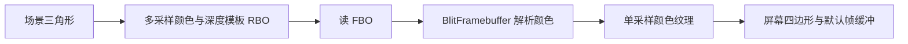

# 抗锯齿

| 项目 | 内容 |
| --- | --- |
| 原文 | [Anti Aliasing](https://learnopengl.com/Advanced-OpenGL/Anti-Aliasing) |
| 作者 | JoeyDeVries |
| 来源 | [LearnOpenGL-CN](https://github.com/with-fair-wind/LearnOpenGL-CN/blob/new-theme/docs/04%20Advanced%20OpenGL/11%20Anti%20Aliasing.md)，按本仓库代码整理修订 |
| 本仓库示例 | [`apps/04_advanced_opengl/11_anti_aliasing/`](../../apps/04_advanced_opengl/11_anti_aliasing/) |

**MSAA 在像素内保留多个覆盖与深度/模板样本，再把颜色解析成单采样图像，以改善几何边界走样。** 它不等同于把所有片段着色工作无条件执行 N 次，也不解决所有纹理或着色器内部的高频走样。

## 从覆盖样本到屏幕图像



GLFW 可为默认窗口请求采样数，但请求值不等于实际获得的格式；应用创建离屏 FBO 时则必须自行分配多采样附件。OpenGL 定义样本存储、覆盖规则与解析条件；驱动选择符合要求的具体实现。开启 `GL_MULTISAMPLE` 本身不会把已有单采样附件变成多采样附件。


## MSAA、SSAA 与采样频率

SSAA 通过更密的整体图像采样并下采样减少走样；MSAA 通常共享部分着色计算，同时保留子样本的覆盖和深度信息。片段着色调用次数不能简单等同于“每像素永远恰好一次”；实际执行与图元覆盖、采样规则和实现有关。纹理缩小仍需合适的过滤与 mipmap，动态走样可能还需其它方法。

## 离屏附件

本例查询 `GL_MAX_SAMPLES`，请求不超过 4 个样本，并要求至少两个；颜色与深度/模板 RBO 使用同一请求采样数，之后检查 FBO 完整性。查询上限不替代错误处理与完整性检查。

```c++
bool resize_multisample(gpu_resources& resources, multisample_target& target, int width, int height,
                        GLsizei samples) {
    if (target.framebuffer == 0U) {
        glGenFramebuffers(1, &target.framebuffer);
        glGenRenderbuffers(1, &target.color);
        glGenRenderbuffers(1, &target.depth_stencil);
        resources.framebuffers.push_back(target.framebuffer);
        resources.renderbuffers.push_back(target.color);
        resources.renderbuffers.push_back(target.depth_stencil);
    }
    glBindFramebuffer(GL_FRAMEBUFFER, target.framebuffer);
    if (target.width != width || target.height != height) {
        glBindRenderbuffer(GL_RENDERBUFFER, target.color);
        // OpenGL: 分配多采样存储；同一 FBO 的附件须有相同采样数。
        glRenderbufferStorageMultisample(GL_RENDERBUFFER, samples, GL_RGB8, width, height);
        glFramebufferRenderbuffer(GL_FRAMEBUFFER, GL_COLOR_ATTACHMENT0, GL_RENDERBUFFER,
                                  target.color);
        glBindRenderbuffer(GL_RENDERBUFFER, target.depth_stencil);
        glRenderbufferStorageMultisample(GL_RENDERBUFFER, samples, GL_DEPTH24_STENCIL8, width,
                                         height);
        glFramebufferRenderbuffer(GL_FRAMEBUFFER, GL_DEPTH_STENCIL_ATTACHMENT, GL_RENDERBUFFER,
                                  target.depth_stencil);
        target.width = width;
        target.height = height;
    }
    if (glCheckFramebufferStatus(GL_FRAMEBUFFER) != GL_FRAMEBUFFER_COMPLETE) {
        std::cerr << "Multisample framebuffer incomplete\n";
        return false;
    }
    return true;
}
```

多采样纹理目标的正确拼写是 `GL_TEXTURE_2D_MULTISAMPLE`；它可通过 `sampler2DMS` 与 `texelFetch` 按样本读取，不能直接使用普通 `sampler2D` 的过滤采样。本例选择 RBO，多采样结果先解析到普通二维纹理，再使用第五节的屏幕采样程序。

## 解析与比较

空格切换 MSAA 与直接单采样离屏渲染。两条路径最终采样同一个单采样颜色纹理，保证比较的显示阶段一致。解析阶段源与目标矩形保持同尺寸，只复制颜色；此处使用 `GL_NEAREST`，不在多采样解析时同时缩放。

```c++
            glBindFramebuffer(GL_READ_FRAMEBUFFER, multisample.framebuffer);
            glBindFramebuffer(GL_DRAW_FRAMEBUFFER, target.framebuffer);
            // OpenGL: 多采样解析必须保持源/目标尺寸一致；这里仅解析颜色。
            // OpenGL: 从读 FBO 解析颜色到单采样写 FBO；解析时不缩放。
            glBlitFramebuffer(0, 0, width, height, 0, 0, width, height, GL_COLOR_BUFFER_BIT,
                              GL_NEAREST);
```

窗口尺寸变化会重建两组附件的存储；最小化时暂停，防止零尺寸分配。默认窗口是否提供 MSAA 不影响本例对离屏多采样存储的显式管理。

> **常见误解：** 将多采样纹理绑定到 `sampler2D` 后可以直接获得平均颜色。
> **纠正：** 多采样图像和普通二维图像是不同纹理目标，需要匹配的 sampler 类型。要么先进行颜色解析再普通采样，要么用 `sampler2DMS` 按样本索引读取，自己定义合成规则。

> **进阶（解析后的信息）：** **解析会把多个颜色样本合并为一个像素值，后处理不能再从该纹理恢复原始覆盖信息。** 之后的锐化、阈值或边缘检测可能重新产生明显锯齿；需要按样本工作的效果应在解析前设计，或者另配后处理抗锯齿。增加采样数也会提高附件容量与带宽需求，应在画质、分辨率和目标硬件预算之间评估。

## 本仓库示例

示例源码：[`apps/04_advanced_opengl/11_anti_aliasing/main.cpp`](../../apps/04_advanced_opengl/11_anti_aliasing/main.cpp)。代码片段均原样取自此文件；原站概念图片与本例实测截图分别标明。

首次安装依赖与工具链要求见[构建指南](../build.md)。已安装默认 MinGW GCC Debug 依赖时，在仓库根目录执行：

```powershell
cmake --preset mingw-gcc-debug
cmake --build --preset mingw-gcc-debug --target 04_advanced_opengl__11_anti_aliasing
.\build\mingw-gcc-debug\apps\04_advanced_opengl\11_anti_aliasing\04_advanced_opengl__11_anti_aliasing.exe
```

Esc 退出；W/A/S/D 移动，鼠标转向，滚轮修改 FOV。空格切换离屏 MSAA 与单采样。

本仓库实测截图（默认模式）：


本章示例还支持 `--frames 3` 隐藏窗口运行指定帧数、`--mode M` 选择初始模式；配合 `--capture output.ppm` 可保存最后一帧。参数与检查方式详见[构建指南的高级 OpenGL 示例说明](../build.md#高级-opengl-示例)。

## 本章整体回顾

- **局部**：为附件分配一致采样数，解析颜色到单采样纹理后再做屏幕采样。
- **整体**：本章把可见性、颜色合成、数据组织与采样串成完整流程，为高级光照的多阶段渲染打基础。

## 核校参考

- [OpenGL 3.3 Core 规范](https://registry.khronos.org/OpenGL/specs/gl/glspec33.core.pdf)：多采样附件完整性与 blit 限制。
- [GLSL 3.30 规范](https://registry.khronos.org/OpenGL/specs/gl/GLSLangSpec.3.30.pdf)：阶段输入输出、内建变量及本例使用的语言语义。

下一章：05 Advanced Lighting（高级光照，教程与示例尚未编写）。
