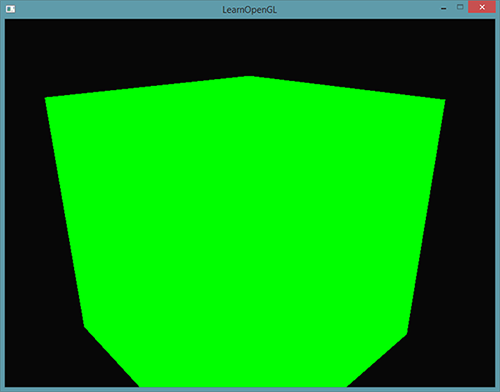
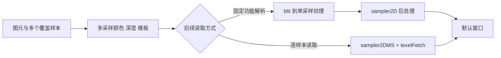
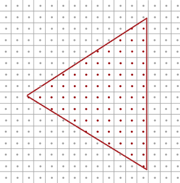
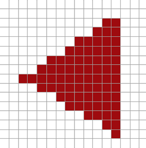
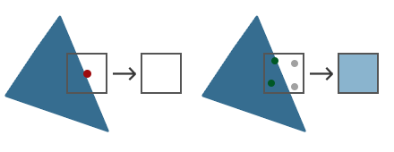
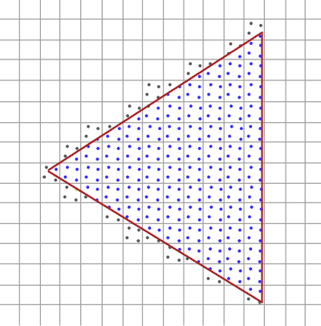
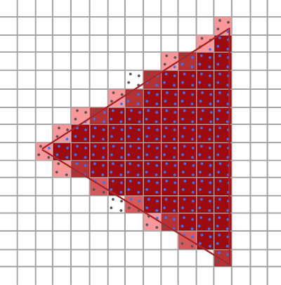
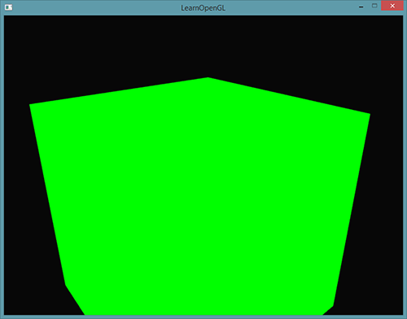
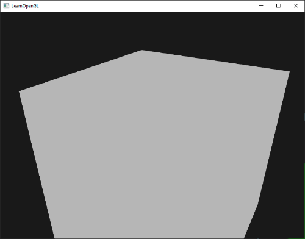
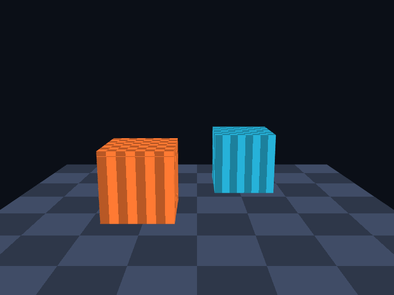

# 抗锯齿

| 项目 | 信息 |
| --- | --- |
| 原文 | [Anti-Aliasing](https://learnopengl.com/Advanced-OpenGL/Anti-Aliasing) |
| 作者 | Joey de Vries |
| 翻译 | Krasjet, [Django](http://bullteacher.com/) |
| 校对 | 暂未校对 |
| 中文底本 | [LearnOpenGL-CN 上游固定版本](https://github.com/LearnOpenGL-CN/LearnOpenGL-CN/blob/331560886468e28f28326429334fc48470f9c27b/docs/04%20Advanced%20OpenGL/11%20Anti%20Aliasing.md)，`new-theme` / `331560886468e28f28326429334fc48470f9c27b` |
| 本仓库示例 | [`apps/04_advanced_opengl/11_anti_aliasing/main.cpp`](../../apps/04_advanced_opengl/11_anti_aliasing/main.cpp) |
| 修订 | 按上游完整小节顺序重写，技术差异见正文；[逐项覆盖清单](coverage.md) |

**MSAA 在一个像素内保留多个覆盖和深度/模板样本，以更细的几何覆盖信息平滑图元边缘。** 模型边缘连续变化，最终图像却只能用有限像素表示，单个覆盖判定容易形成阶梯，这种取样失真称为走样（aliasing）。




SSAA 先以更高分辨率完整着色，再缩小到目标分辨率，能同时改善更多类型的取样失真，但像素工作和存储开销较大。MSAA 把几何覆盖采样与通常的片段着色频率部分分离，常以较低代价改善多边形轮廓；不能因此说 SSAA 已完全失效或所有走样都由 MSAA 解决。

OpenGL 规定多采样光栅化、附件和解析操作，驱动实现样本与着色调度；GLFW 只为默认窗口请求多采样格式，应用必须自行配置离屏 FBO。`GL_MULTISAMPLE` 状态不会把一个单采样附件变成多采样附件。



## 多重采样

先用单采样像素网格理解光栅化：图元覆盖测试点才产生相应贡献，边缘经过像素但没有盖住测试点时，该像素不显示该图元。顶点坐标和像素不是一对一关系，光栅化也不是“决定顶点对应哪个片段”这么简单，而是把整个图元转换为片段及覆盖信息。





一个像素只取一次覆盖判定时，边缘要么有、要么没有，形成明显阶梯。改成每像素四个样本，图元只盖住其中两个时，颜色存储仍能区分覆盖与未覆盖部分。



通常的 MSAA 路径不要求每个样本都完整运行一次片段着色器：一次片段着色结果可广播到该图元覆盖且通过测试的样本，深度/模板测试则按样本进行。实现可能因辅助调用、着色策略等执行不同数量的 shader，不能把“每像素永远严格一次”写成规范保证，也不能把 MSAA 等同每样本完整着色的 SSAA。

样本位置由实现提供，并非固定是图里的规则四角。采样数也不是任意整数都支持，要查询限制并检查实际分配；更多样本通常提高几何覆盖分辨能力，同时增加存储、带宽和测试成本。



蓝点表示图元覆盖，灰点保留之前的颜色。若背景为黑、图元为蓝，四样本中两个蓝、两个黑，常规颜色解析得到半亮蓝，视觉上近似半覆盖；它不是自动启用了 alpha 混合，也没有把所有未覆盖样本变成透明。



深度和模板也按样本保存，两个图元在同一像素不同位置相交时，仍可保留各自覆盖信息。普通插值可能在像素中心求值；使用 centroid 等限定可以对边缘采样作出更合适的约束，不能假设插值位置总在图元内部。

> **译者附加阅读：** 原教程推荐的[抗锯齿图解](https://www.zhihu.com/question/20236638/answer/14438218)作为直观补充保留；具体 OpenGL 行为仍按规范解释。

## OpenGL 中的 MSAA

窗口创建前设置 `glfwWindowHint(GLFW_SAMPLES,4)`，请求默认帧缓冲的多采样格式，然后创建窗口与上下文。本例显式启用 `GL_MULTISAMPLE`，该状态在 OpenGL 核心状态中默认已启用；这里保留调用以便看清依赖，而不是说默认只在“多数驱动”启用。

```cpp
    glfwWindowHint(GLFW_SAMPLES, 4);
    glfwWindowHint(GLFW_DEPTH_BITS, 24);
    glfwWindowHint(GLFW_STENCIL_BITS, 8);
```

请求是窗口格式选择的提示，创建后用 `GL_SAMPLES` 查询实际值，不能只因写了 4 就报告获得四样本。本例控制台输出默认帧缓冲实际样本数，模式 3 直接渲染到默认窗口。交换缓冲由窗口系统处理最终显示解析。



默认窗口附件和自建 FBO 是两套存储。即使默认窗口有四样本，应用后面建立的普通 `GL_TEXTURE_2D` 仍是单采样。模式 1 先画到单采样纹理再显示，用作与离屏 MSAA 的对照；这样比较不受默认窗口请求影响。

## 离屏 MSAA

离屏多采样可用纹理或 RBO。两种颜色附件都能用于渲染，但后续读取方式不同；同一 FBO 的相关附件必须满足匹配的样本数和固定样本位置等完整性要求。颜色多采样而深度单采样不能直接当作本例的完整配置。

### 多重采样纹理附件

纹理目标正确拼写是 `GL_TEXTURE_2D_MULTISAMPLE`，修正底本漏字拼写。调用 `glTexImage2DMultisample` 取代普通 `glTexImage2D`，参数给样本数、内部格式、尺寸和 fixed-sample-locations。

本例固定位置设为 `GL_TRUE`，同一图像内使用固定样本布局，便于与 RBO 深度/模板配套。多采样纹理没有普通 mipmap/过滤用法，不要照搬 `GL_TEXTURE_2D` 的 min/mag 配置；后续以像素整数坐标和样本编号读取。

完整创建函数（模式 2）同时创建多采样颜色纹理和匹配的深度/模板 RBO：

```cpp
bool resize_multisample_texture(gpu_resources& resources, multisample_texture_target& target,
                                int width, int height, GLsizei samples) {
    if (target.framebuffer == 0U) {
        glGenFramebuffers(1, &target.framebuffer);
        glGenTextures(1, &target.color);
        glGenRenderbuffers(1, &target.depth_stencil);
        resources.framebuffers.push_back(target.framebuffer);
        resources.textures.push_back(target.color);
        resources.renderbuffers.push_back(target.depth_stencil);
    }
    glBindFramebuffer(GL_FRAMEBUFFER, target.framebuffer);
    if (target.width != width || target.height != height) {
        glBindTexture(GL_TEXTURE_2D_MULTISAMPLE, target.color);
        // OpenGL: 分配固定样本位置的多采样纹理，不使用常规过滤和 mipmap。
        glTexImage2DMultisample(GL_TEXTURE_2D_MULTISAMPLE, samples, GL_RGB8, width, height,
                                GL_TRUE);
        glFramebufferTexture2D(GL_FRAMEBUFFER, GL_COLOR_ATTACHMENT0, GL_TEXTURE_2D_MULTISAMPLE,
                               target.color, 0);
        glBindRenderbuffer(GL_RENDERBUFFER, target.depth_stencil);
        glRenderbufferStorageMultisample(GL_RENDERBUFFER, samples, GL_DEPTH24_STENCIL8, width,
                                         height);
        glFramebufferRenderbuffer(GL_FRAMEBUFFER, GL_DEPTH_STENCIL_ATTACHMENT, GL_RENDERBUFFER,
                                  target.depth_stencil);
        target.width = width;
        target.height = height;
    }
    if (glCheckFramebufferStatus(GL_FRAMEBUFFER) != GL_FRAMEBUFFER_COMPLETE) {
        std::cerr << "Multisample framebuffer incomplete\n";
        return false;
    }
    return true;
}
```

### 多重采样渲染缓冲对象

RBO 路径使用 `glRenderbufferStorageMultisample`。模式 0/4 的颜色 `RGB8` 和深度/模板 `DEPTH24_STENCIL8` 都分配相同样本数，再分别附到颜色与深度模板附件。RBO 不能直接绑定给 `sampler2DMS`，需要后续解析或其他允许的帧缓冲操作。

```cpp
bool resize_multisample(gpu_resources& resources, multisample_target& target, int width, int height,
                        GLsizei samples) {
    if (target.framebuffer == 0U) {
        glGenFramebuffers(1, &target.framebuffer);
        glGenRenderbuffers(1, &target.color);
        glGenRenderbuffers(1, &target.depth_stencil);
        resources.framebuffers.push_back(target.framebuffer);
        resources.renderbuffers.push_back(target.color);
        resources.renderbuffers.push_back(target.depth_stencil);
    }
    glBindFramebuffer(GL_FRAMEBUFFER, target.framebuffer);
    if (target.width != width || target.height != height) {
        glBindRenderbuffer(GL_RENDERBUFFER, target.color);
        // OpenGL: 分配多采样存储；同一 FBO 的附件须有相同采样数。
        glRenderbufferStorageMultisample(GL_RENDERBUFFER, samples, GL_RGB8, width, height);
        glFramebufferRenderbuffer(GL_FRAMEBUFFER, GL_COLOR_ATTACHMENT0, GL_RENDERBUFFER,
                                  target.color);
        glBindRenderbuffer(GL_RENDERBUFFER, target.depth_stencil);
        glRenderbufferStorageMultisample(GL_RENDERBUFFER, samples, GL_DEPTH24_STENCIL8, width,
                                         height);
        glFramebufferRenderbuffer(GL_FRAMEBUFFER, GL_DEPTH_STENCIL_ATTACHMENT, GL_RENDERBUFFER,
                                  target.depth_stencil);
        target.width = width;
        target.height = height;
    }
    if (glCheckFramebufferStatus(GL_FRAMEBUFFER) != GL_FRAMEBUFFER_COMPLETE) {
        std::cerr << "Multisample framebuffer incomplete\n";
        return false;
    }
    return true;
}
```

本例查询 `GL_MAX_SAMPLES` 并以最多四样本为目标。这个上限不是所有内部格式任意样本数都支持的保证，最终仍检查 `GL_FRAMEBUFFER_COMPLETE`，不满足就报错退出。窗口调整时更新所有相关附件和视口。

### 渲染到多重采样帧缓冲

绑定完整 MSAA FBO 后，正常清除和画场景，覆盖与测试按多采样规则执行。结果中每个像素有多个样本，不能直接当作普通单采样纹理交给 `sampler2D`；但下一小节的 `sampler2DMS` 可以直接读取，因此“多采样纹理完全不能在 shader 采样”也是错误表述。

最常见的解析（resolve）用 `glBlitFramebuffer`：分别绑定读源和绘制目标，再给源矩形、目标矩形、缓冲位和过滤参数。本例从多采样 FBO 解析到同尺寸的**单采样颜色纹理 FBO**，只复制颜色，使用 `GL_NEAREST`。这与任意缩放或深度/模板 blit 的规则不同，不能把尺寸和格式限制一概省掉。

```cpp
                glBindFramebuffer(GL_READ_FRAMEBUFFER, multisample.framebuffer);
                glBindFramebuffer(GL_DRAW_FRAMEBUFFER, target.framebuffer);
                // OpenGL: 从读 FBO 解析颜色到单采样写 FBO；解析时不缩放。
                glBlitFramebuffer(0, 0, width, height, 0, 0, width, height, GL_COLOR_BUFFER_BIT,
                                  GL_NEAREST);
```

解析后再绑定默认帧缓冲，画屏幕四边形、以 `sampler2D` 读取单采样颜色。模式 0 的轮廓效果应与使用匹配样本的默认 MSAA 路径对应，图中的原案例用于观察这种等价关系：


模式 4 应用第五篇的加权灰度；离屏深度/模板不参与最后屏幕四边形绘制。



也可以在兼容条件下 blit 到默认窗口，但不能无视源/目标样本数与格式。用明确的单采样中间 FBO 使后处理输入更清楚，也避免把默认窗口的样本配置误作应用可控的离屏格式。

> **原提示与修订：** 解析后的图像只有单个颜色值，后续锐化、边缘检测等滤镜可能重新增强锯齿。模糊或专用后处理抗锯齿可继续处理，但会引入其他取舍；MSAA 不能保证后面的任意滤镜输出仍无走样。较高样本数也会增加成本，四样本是本例选用的教学设置，不是所有平台的最佳配置。

## 自定义抗锯齿算法

多采样纹理可以用 `uniform sampler2DMS` 直接读取。`texelFetch` 的第二参数是 **ivec2 像素坐标**，第三参数是零起始样本索引，不是 mip level，也不是归一化 UV。取第 4 个样本使用编号 3，前提是纹理至少四样本。

模式 2 实现一个明确的自定义解析基线：遍历样本，对 RGB 求平均。它演示逐样本访问，不冒称先进的自适应抗锯齿。完整片段程序：

```glsl
#version 330 core
out vec4 frag_color;
uniform sampler2DMS multisample_texture;
uniform int sample_count;
void main() {
    vec3 color = vec3(0);
    for (int sample_index=0; sample_index<sample_count; ++sample_index)
        color += texelFetch(multisample_texture,ivec2(gl_FragCoord.xy),sample_index).rgb;
    frag_color = vec4(color/float(sample_count),1);
}
```

由于输入和输出尺寸一致、视口起点为零，本例可把 `gl_FragCoord.xy` 转为像素整数坐标。若将图像放到子区域或缩放显示，必须显式转换目标坐标到源纹理范围，不能照抄。样本数 uniform 与实际分配保持一致，避免越界读取。

在此基础上可以根据颜色/深度差异选择更复杂的重建方案，或与其他抗锯齿技术结合。上游本小节只给读取样本的入口，本仓库增加平均解析作为可运行对照，并不将研究性算法写成已完成案例。

> **常见误解：** MSAA 主要改善几何边缘覆盖，透明贴图里的高频 alpha、纹理闪烁和 shader 内部高光走样还需要各自的过滤或抗锯齿方法，增加样本数不是通用修复。

> **进阶（覆盖与着色频率）：** **多样本存储和逐样本着色是不同能力。** 本例在 OpenGL 3.3 中采用普通 MSAA，部分扩展或更高核心版本可控制 sample shading，以更高频率计算片段颜色。那会改变性能与插值需求，不能仅因已有四样本附件就宣称 shader 每像素执行四次。诊断画面时先分清覆盖不足还是着色采样不足，再选择方案。

## 上游源码与附加资源

以下保留底本引用的源码、资源与附加阅读入口；正文使用本仓库实现，外部旧演示与本地程序的组织可能不同。

- [Django](http://bullteacher.com/)
- [@文刀秋二](https://www.zhihu.com/people/edliu/answers)
- [精彩介绍](https://www.zhihu.com/question/20236638/answer/14438218)
- [上游源码或资源对照](https://learnopengl.com/code_viewer_gh.php?code=src/4.advanced_opengl/11.1.anti_aliasing_msaa/anti_aliasing_msaa.cpp)
- [上游源码或资源对照](https://learnopengl.com/code_viewer_gh.php?code=src/4.advanced_opengl/11.2.anti_aliasing_offscreen/anti_aliasing_offscreen.cpp)

## 本仓库示例

源码：[`main.cpp`](../../apps/04_advanced_opengl/11_anti_aliasing/main.cpp)，目标：`04_advanced_opengl__11_anti_aliasing`。正文标为源码的 C++/GLSL 均直接摘取此文件；标为概念说明的独立片段用于说明规范或未启用的更高版本功能。

```powershell
cmake --preset mingw-gcc-debug
cmake --build --preset mingw-gcc-debug --target 04_advanced_opengl__11_anti_aliasing
.\build\mingw-gcc-debug\apps\04_advanced_opengl\11_anti_aliasing\04_advanced_opengl__11_anti_aliasing.exe --mode 0
```

依赖准备、多配置生成器与其他工具链见[构建指南](../build.md)。Esc 是退出键；除 07 的二维数据示例外，三维场景支持 WASD、鼠标与滚轮。空格按表中顺序切换（07 用启动参数选择映射方法）。有限帧检查可追加 `--frames 3 --capture output.ppm`，截图取最后一帧；它验证绘制路径，不能代替交互和视觉检查。

| `--mode` | 可观察内容 |
| --- | --- |
| 0 | RBO MSAA → blit → 屏幕 |
| 1 | 单采样对照 |
| 2 | 多采样纹理 → 自定义解析 |
| 3 | GLFW 默认帧缓冲 MSAA |
| 4 | MSAA 解析后灰度 |



## 本章整体回顾

MSAA 在一个像素内保留多个覆盖、颜色和深度/模板样本。窗口默认附件由 GLFW 请求，离屏附件由应用创建；后处理通常先解析到单采样纹理，也可以用 sampler2DMS 自行读取样本。

本篇承接前一篇，正文保留底本对应的小节与主案例。图片中的背包、箱子等属于上游演示，本仓库使用独立注明的教学场景；本仓库截图与上游图分开标注。图片出处见[资源记录](../img/04/README.md)，对应关系与验证边界见[覆盖清单](coverage.md)。

技术核校：[英文原文](https://learnopengl.com/Advanced-OpenGL/Anti-Aliasing)、[OpenGL 3.3 Core 规范](https://registry.khronos.org/OpenGL/specs/gl/glspec33.core.pdf)、[GLSL 3.30 规范](https://registry.khronos.org/OpenGL/specs/gl/GLSLangSpec.3.30.pdf)。[GLFW 帧缓冲提示](https://www.glfw.org/docs/3.4/window_guide.html#window_hints_fb)。

下一节：05 Advanced Lighting（高级光照，尚未编写）。
