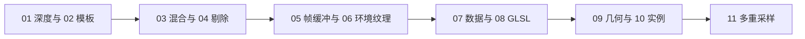

# 高级 OpenGL 教程（04 章）

本章共 11 篇教程和 11 个独立可执行示例，按 LearnOpenGL 的 Advanced OpenGL 顺序学习。内容参考 [LearnOpenGL-CN](https://github.com/with-fair-wind/LearnOpenGL-CN)，以英文原文和 OpenGL/GLSL 3.3 规范核校，并用本仓库 C++23 源码逐段解释。

## 篇章列表

| 篇 | 教程 | 示例 | 核心内容 |
| --- | --- | --- | --- |
| 01 | [深度测试](01_depth_testing.md) | [`01_depth_testing`](../../apps/04_advanced_opengl/01_depth_testing/) | 比较、写掩码、深度线性化与冲突 |
| 02 | [模板测试](02_stencil_testing.md) | [`02_stencil_testing`](../../apps/04_advanced_opengl/02_stencil_testing/) | 模板整数标记与物体轮廓 |
| 03 | [混合](03_blending.md) | [`03_blending`](../../apps/04_advanced_opengl/03_blending/) | 镂空、非预乘 alpha、排序与深度写入 |
| 04 | [面剔除](04_face_culling.md) | [`04_face_culling`](../../apps/04_advanced_opengl/04_face_culling/) | 环绕顺序、正反面与剔除 |
| 05 | [帧缓冲](05_framebuffers.md) | [`05_framebuffers`](../../apps/04_advanced_opengl/05_framebuffers/) | 颜色纹理、深度模板 RBO 与后期处理 |
| 06 | [立方体贴图](06_cubemaps.md) | [`06_cubemaps`](../../apps/04_advanced_opengl/06_cubemaps/) | 六面选向、天空盒、反射与折射 |
| 07 | [高级数据](07_advanced_data.md) | [`07_advanced_data`](../../apps/04_advanced_opengl/07_advanced_data/) | 分块布局、映射、复制与范围 |
| 08 | [高级 GLSL](08_advanced_glsl.md) | [`08_advanced_glsl`](../../apps/04_advanced_opengl/08_advanced_glsl/) | 接口块、std140、共享矩阵 UBO |
| 09 | [几何着色器](09_geometry_shader.md) | [`09_geometry_shader`](../../apps/04_advanced_opengl/09_geometry_shader/) | 点扩增、三角形带、发射输出生命周期 |
| 10 | [实例化](10_instancing.md) | [`10_instancing`](../../apps/04_advanced_opengl/10_instancing/) | 实例 VBO、divisor 与内建索引 |
| 11 | [抗锯齿](11_anti_aliasing.md) | [`11_anti_aliasing`](../../apps/04_advanced_opengl/11_anti_aliasing/) | 离屏多采样、解析与单采样对比 |

## 学习与运行

本章承接[模型加载](../03_model_loading/README.md)，复用入门章的矩阵与相机知识，但每个程序仍自包含。示例只依赖已有的 GLAD、GLFW 和 GLM；格纹、透明面及立方体贴图颜色由程序定义，不引入新的外部模型或贴图依赖。

每篇的 C++/GLSL 片段逐字摘自对应 `main.cpp`。参考教程图片复制到 `docs/img/04/<节号>/`，本仓库运行截图也在同目录，正文会区分两者。示例针对每节核心机制，原站的背包爆破、小行星带和复杂透明几何等延伸效果作为练习，不当作已实现功能。

首次构建见[构建指南](../build.md)。三维示例支持 Esc、WASD、鼠标和滚轮；高级数据、几何着色器和实例化使用固定二维视图。各节空格切换内容见正文；所有新示例支持有限帧运行、`--mode M` 初始模式与 PPM 截图，便于复查。图片来源与截图方式见[图片记录](../img/04/README.md)。

## 章节主线

本章修正了参考材料中的深度格式、零模板写掩码、附件尺寸、RBO 读取、几何输出生命周期以及性能保证等表述。每篇末尾列出规范与英文来源，后续修改应继续核对这些边界。

上一章：[模型加载](../03_model_loading/README.md) · 下一章：05 Advanced Lighting（尚未编写）。
