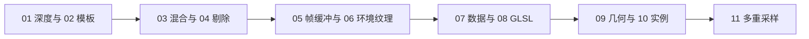

# 高级 OpenGL 教程（04 章）

本章按 [LearnOpenGL-CN 官方上游](https://github.com/LearnOpenGL-CN/LearnOpenGL-CN) 的 11 篇文章修订。底本固定为 `new-theme` 分支提交 `331560886468e28f28326429334fc48470f9c27b`，保留原小节顺序、正文案例、推导、图示、提示、练习和资源，技术事实结合英文原文与 OpenGL/GLSL 规范核校。74 项标题对应及非标题内容核验见[覆盖清单](coverage.md)。

## 篇章列表

| 篇 | 教程 | 对应实现 | 模式数 |
| --- | --- | --- | --- |
| 01 | [深度测试](01_depth_testing.md) | LESS/ALWAYS、原始与线性深度、共面冲突/分离对照 | 6 |
| 02 | [模板测试](02_stencil_testing.md) | 两个物体写模板与放大轮廓 | 1 |
| 03 | [混合](03_blending.md) | RGBA 草叶丢弃、玻璃排序与错误顺序对照 | 4 |
| 04 | [面剔除](04_face_culling.md) | 环绕、正反面与剔除 | 2 |
| 05 | [帧缓冲](05_framebuffers.md) | 两遍渲染、两种灰度、锐化、模糊、边缘检测 | 7 |
| 06 | [立方体贴图](06_cubemaps.md) | 六张照片天空盒、立方体/Assimp 模型反射折射 | 4 |
| 07 | [高级数据](07_advanced_data.md) | 分块属性、范围/整体映射、缓冲复制 | 2 |
| 08 | [高级 GLSL](08_advanced_glsl.md) | 内建变量、接口块、四程序共享 std140 UBO | 5 |
| 09 | [几何着色器](09_geometry_shader.md) | 点/线、绿色/彩色/雪顶房子、模型爆破与法线 | 7 |
| 10 | [实例化](10_instancing.md) | uniform/实例数组、ID 尺寸、普通/矩阵实例化小行星 | 5 |
| 11 | [抗锯齿](11_anti_aliasing.md) | 默认窗口、两种离屏附件、解析后处理、自定义样本平均 | 5 |

## 学习与运行

本章承接[模型加载](../03_model_loading/README.md)。仍为 11 个自包含程序，各文件的 helper 在匿名命名空间内复制；使用已有 GLAD、GLFW、GLM，以及部分示例需要的 stb_image/Assimp，不新增 Conan 包。源码入口在 [`apps/04_advanced_opengl/`](../../apps/04_advanced_opengl/)，代码块逐字摘取各篇指定的 `main.cpp`。

首次准备依赖、全部 preset 和产物布局见[构建指南](../build.md#高级-opengl-示例)。Esc 退出，三维模式支持 WASD、鼠标和滚轮；07 为固定二维视图。`--mode M` 选择模式，空格循环切换（07 用启动参数选择映射方法）。有限帧运行用 `--frames N`，配合 `--capture output.ppm` 保存末帧。各篇模式表按实际程序编号给出。

上游 67 个教学图片/图像资源已复制到 `docs/img/04/`，文件名和 blob 来源见[图片记录](../img/04/README.md)。本仓库截图独立标注；天空盒和透明 PNG 有[程序资源记录](../../assets/chapter04_resources.md)。模型爆破与小行星使用本仓库模型，实际执行导入、属性上传、变换和绘制，保留原教学目标。

## 章节主线

本次在 MinGW GCC Debug / GTX 1660 上构建并运行全部 48 模式，检查截图、资源、GL 错误和文档引用。其他工具链/显卡、完整键鼠缩放交互和性能基准未实测。原教程的后视镜、反射遮罩等仍为练习，动态环境捕获仍按原文作为概念讲解，不把它们误报为程序已实现。

上一章：[模型加载](../03_model_loading/README.md) · 下一章：05 Advanced Lighting（尚未编写）。
