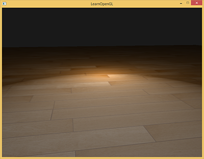
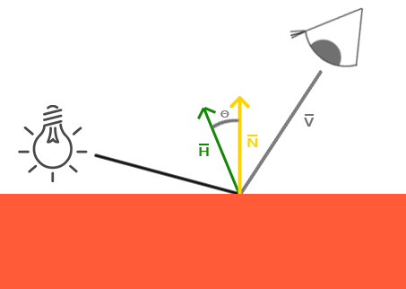
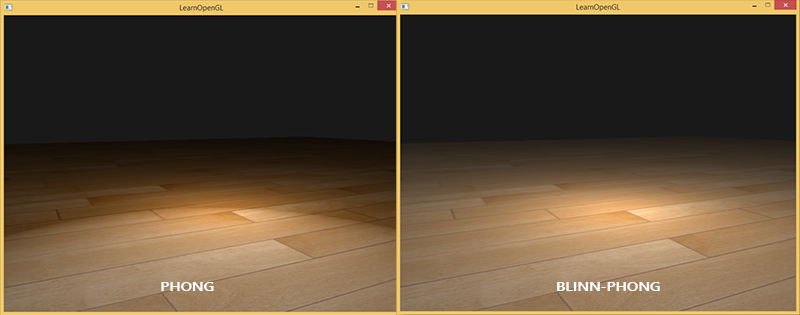
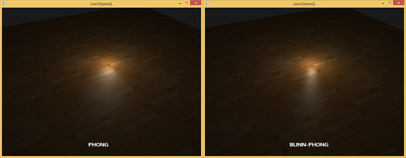
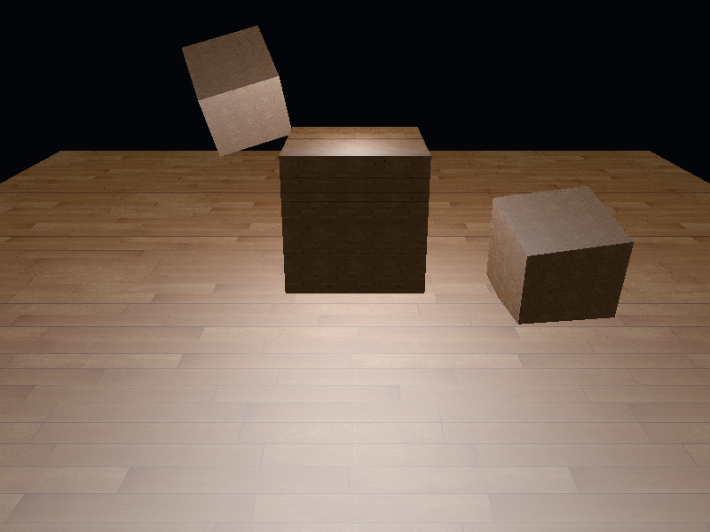

# 高级光照

| 项目 | 信息 |
| --- | --- |
| 原文 | [Advanced-Lighting](https://learnopengl.com/Advanced-Lighting/Advanced-Lighting) |
| 作者 | Joey de Vries |
| 翻译 | Krasjet |
| 校对 | 暂未校对 |
| 来源 | [LearnOpenGL-CN](https://github.com/LearnOpenGL-CN/LearnOpenGL-CN/blob/331560886468e28f28326429334fc48470f9c27b/docs/05%20Advanced%20Lighting/01%20Advanced%20Lighting.md) |
| 本仓库示例 | [main.cpp](../../apps/05_advanced_lighting/01_advanced_lighting/main.cpp) |

第二章用环境光、漫反射和镜面反射近似表面光照。本篇只替换镜面项，观察低高光指数时的截断现象。**Blinn-Phong 用半程向量与法线的夹角构造高光，Phong 用反射方向与观察方向的夹角构造高光。** 两者都是经验模型，不是完整的物理材质模型。

GLFW 建立 OpenGL 上下文，驱动编译并执行 GLSL；光源强度、材质指数和向量所在空间由应用约定。OpenGL 不会因为某个 uniform 叫 shininess 就替我们计算反射。先保证法线、光线与视线处于同一空间，再讨论高光曲线。


## Blinn-Phong

Phong 镜面项为 $k_s\max(\mathbf V\cdot\mathbf R,0)^p$，其中 $\mathbf R=\operatorname{reflect}(-\mathbf L,\mathbf N)$，三个方向都需归一化。这里的 $p$ 是高光指数：指数越小，高光越宽；它不是物体反射了多少能量。模式 1 使用 $p=1$，便于观察宽高光的边界。



当 $\mathbf V\cdot\mathbf R$ 变为负数，截断后的镜面项立即为零。高指数时，这个边界前的贡献已很小；低指数时，截断可能在仍显著的高光中形成可见接缝。不要把这个夹角误当成漫反射的 $\mathbf N\cdot\mathbf L$：光源位于表面背面时不产生单面直接漫反射，与观察方向远离理想反射方向是不同条件。


Blinn 的做法是使用光线与视线之间的单位半程向量：

$$\mathbf H=\frac{\mathbf L+\mathbf V}{\lVert\mathbf L+\mathbf V\rVert},\qquad
I_s=k_s\max(\mathbf N\cdot\mathbf H,0)^q.$$



当观察方向等于镜面反射方向时，半程向量与法线对齐，高光达到峰值。偏离后以 $\mathbf N\cdot\mathbf H$ 平滑衰减。要修正上游“无论观察哪个方向夹角都不超过 90°”的表述：只有光线与视线都位于法线的同侧半球时才能作这种保证；若 $\mathbf L=-\mathbf V$，它们的和为零，半程方向本身也没有定义。本例检查照射与观察半球，并在归一化前排除零长度。

完整片段着色器摘自本仓库，四个模式在同一几何、光源和最终编码下比较两种镜面项：

```glsl
#version 330 core
in VertexData { vec3 position; vec3 normal; vec2 tex_coord; } vertex_in;
out vec4 frag_color;
uniform sampler2D diffuse_texture;
uniform vec3 camera_pos;
uniform vec3 light_pos;
uniform int mode;
void main() {
    vec3 normal = normalize(vertex_in.normal);
    vec3 light_dir = normalize(light_pos - vertex_in.position);
    vec3 view_dir = normalize(camera_pos - vertex_in.position);
    vec3 halfway = light_dir + view_dir;
    float specular = 0.0;
    float diffuse = max(dot(normal, light_dir), 0.0);
    if (diffuse > 0.0 && dot(normal, view_dir) > 0.0) {
        if (mode == 0 || mode == 2) {
            float nh = dot(halfway, halfway) > 0.000001 ?
                max(dot(normal, normalize(halfway)), 0.0) : 0.0;
            specular = pow(nh, mode == 0 ? 4.0 : 32.0);
        } else {
            vec3 reflected = reflect(-light_dir, normal);
            specular = pow(max(dot(view_dir, reflected), 0.0), mode == 1 ? 1.0 : 8.0);
        }
    }
    vec3 albedo = texture(diffuse_texture, vertex_in.tex_coord * 4.0).rgb;
    vec3 linear_color = (0.05 + 0.65 * diffuse) * albedo + vec3(0.5 * specular);
    frag_color = vec4(pow(max(linear_color, vec3(0.0)), vec3(1.0 / 2.2)), 1.0);
}
```

模式 0 的 Blinn 指数为 4，与模式 1 的 Phong 指数 1 对照，展示低指数的差异。上游下图以另一组系数比较两种方法，图中的系数不是本例模式编号或当前参数。



半程角通常比反射方向与视线的夹角小，所以相同指数并不产生同等宽度的高光。常见起点是把 Blinn 指数设为 Phong 的 2–4 倍，再根据材质和光照调节；这不是普适的精确换算。模式 2 使用 Blinn 32，模式 3 使用 Phong 8，对应上游的第二组比较。



原示例用 B 键切换。本仓库用空格依次经过四个模式，或用 `--mode` 直接指定，以便统一自动截图和交互方式。两种模型的环境项、漫反射项与采样方式保持相同，因此观察到的差别主要来自镜面曲线。

> **常见误解：** Blinn-Phong 不会自动解决所有高光问题，也不能直接替代基于物理的微表面 BRDF；贴图精度、法线插值、颜色空间和能量归一化仍会影响结果。

> **进阶（方向与职责）：** **镜面模型的输入必须具有明确方向约定。** 本例 L 从表面指向光源，V 从表面指向相机，因此 reflect 接收 -L。若把其中一根方向反过来，程序仍可能编译并画出高光，却已经在计算另一个角度。位置可以含平移，方向不能把平移当作自身分量；非均匀缩放下法线还必须采用逆转置，而不是照抄位置的变换。


## 上游源码与附加资源

保留底本中的源码、资源与阅读入口。外部旧程序的文件组织与本仓库不同，实际实现以本文标注的本地目标为准。

- [这里](https://learnopengl.com/code_viewer_gh.php?code=src/5.advanced_lighting/1.advanced_lighting/advanced_lighting.cpp)

## 本仓库示例

源码：[main.cpp](../../apps/05_advanced_lighting/01_advanced_lighting/main.cpp)，目标 `05_advanced_lighting__01_advanced_lighting`。helper 保留在各文件匿名命名空间，不依赖共享源码；GLSL 为内嵌字符串。必需 uniform 在初始化时检查并缓存，资源由上下文有效期内的 RAII 守卫释放。

```powershell
cmake --preset mingw-gcc-debug
cmake --build --preset mingw-gcc-debug --target 05_advanced_lighting__01_advanced_lighting
.\build\mingw-gcc-debug\apps\05_advanced_lighting\01_advanced_lighting\05_advanced_lighting__01_advanced_lighting.exe --mode 0
```

依赖安装与其他 preset 见[构建指南](../build.md)。Esc 退出，WASD 移动，鼠标转向，滚轮调整 FOV，空格依次切换以下模式；`--mode M` 选择初始模式。 有限帧检查使用 `--frames 3 --capture output.ppm`，隐藏窗口并保存末帧。

| `--mode` | 可观察内容 |
| --- | --- |
| 0 | Blinn-Phong 4，低指数高光 |
| 1 | Phong 1，低指数截断对照 |
| 2 | Blinn-Phong 32 |
| 3 | Phong 8 |



## 本章整体回顾

先统一 L/V/N 的空间，再比较 R 与 H 的镜面曲线；指数的经验对应不能代替材质与能量模型。 本篇保留原小节、教学图片及附加资源，程序资源与上游截图的对应和差异见[图片记录](../img/05/README.md)与[资源来源](../../assets/chapter05_resources.md)。

技术核校：[英文原文](https://learnopengl.com/Advanced-Lighting/Advanced-Lighting)、[OpenGL 3.3 Core 规范](https://registry.khronos.org/OpenGL/specs/gl/glspec33.core.pdf)、[GLSL 3.30 规范](https://registry.khronos.org/OpenGL/specs/gl/GLSLangSpec.3.30.pdf)。

下一节：[Gamma 校正](02_gamma_correction.md)。
