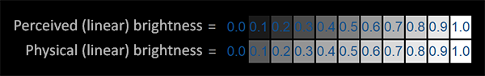
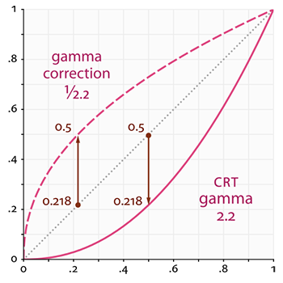
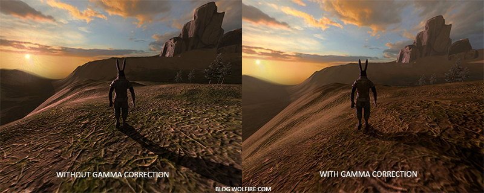
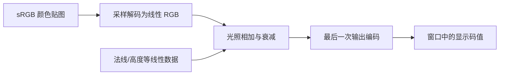
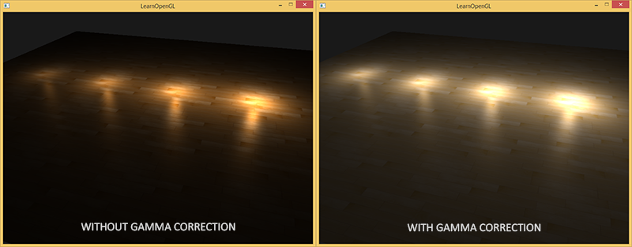
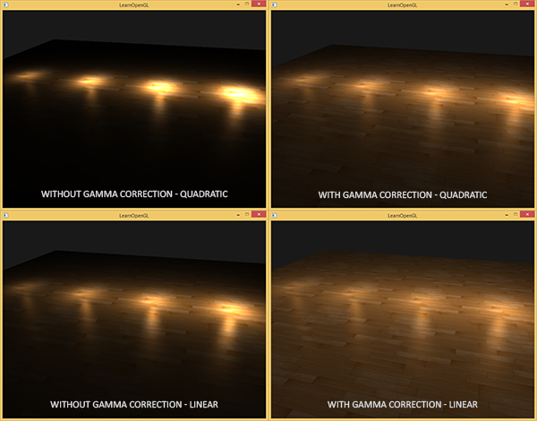
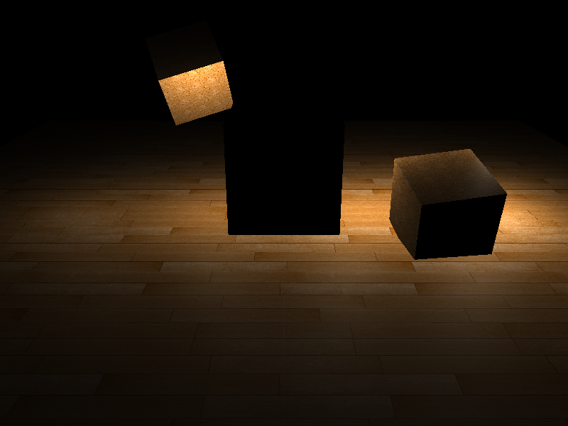

# Gamma 校正

| 项目 | 信息 |
| --- | --- |
| 原文 | [Gamma-Correction](https://learnopengl.com/Advanced-Lighting/Gamma-Correction) |
| 作者 | Joey de Vries |
| 翻译 | [Django](http://bullteacher.com/) |
| 校对 | [AoZhang](https://github.com/SuperAoao) |
| 中文底本 | [LearnOpenGL-CN 固定版本](https://github.com/LearnOpenGL-CN/LearnOpenGL-CN/blob/331560886468e28f28326429334fc48470f9c27b/docs/05%20Advanced%20Lighting/02%20Gamma%20Correction.md)，`new-theme` / `331560886468e28f28326429334fc48470f9c27b` |
| 本仓库示例 | [main.cpp](../../apps/05_advanced_lighting/02_gamma_correction/main.cpp) |
| 修订与范围 | [逐项覆盖与验证记录](coverage.md)；纯 GFM，代码片段逐字取自对应源码 |

**把颜色解码到线性空间进行光照，再对最终结果编码一次；不要对法线、深度等数据贴图应用颜色传递函数。** 本篇把图片中的数值、线性光照量与显示编码分开。原译文附有“尚未重写”的提示，本仓库已对照英文与 OpenGL 3.3 规范重写；其中关于人眼、设备和 sRGB 的绝对化说法不作为技术结论沿用。

历史 CRT 的电压与发光亮度大致呈幂函数关系。用归一化码值 $C$ 和亮度 $L$ 描述这种简化模型，可写为 $L\approx C^{2.2}$。例如把码值从 0.5 加到 1，不意味着发光亮度只增加一倍。现代显示链路还涉及色彩管理、显示器特性和系统合成，不能直接把 CRT 电压模型当作所有设备的精确响应。



人对暗部变化更敏感，是非线性编码能有效利用有限码值的重要背景，但“感知亮度”并不是“光子数”或线性 RGB 的同义词，也没有一个适用于所有观察条件的“感知翻倍”公式。原译注用灰阶帮助区分物理量与感觉，这个区别应保留，具体感知不能简单由固定 2.2 次幂定义。



曲线图中的直线代表线性量与其数值成比例，弯曲曲线代表码值经过非线性响应。例如 $0.5^{2.2}\approx0.218$，所以码值 1 相对于码值 0.5 对应的亮度比约为 4.59。在线性光照公式里把强度翻倍，与在编码后的图片上直接把 RGB 翻倍，不是同一操作。过去靠提高灯光参数“补亮”的场景，接入线性流程后需要重新调参。



OpenGL 规范定义纹理的 sRGB 解码和帧缓冲的 sRGB 编码；驱动执行转换，应用给材质指定正确格式并安排只编码一次。GLFW 只能请求窗口系统提供 sRGB 能力，不能保证结果。本例因此使用格式明确的自建 sRGB 输出附件，再把已编码结果复制到窗口。



## Gamma 校正

在纯幂模型中，编码为 $C=L^{1/2.2}$，随后设备响应 $C^{2.2}$ 恢复到线性亮度。线性 0.5 先编码约为 0.73，经过响应后仍约为 0.5。这里的操作是取幂，不是“乘上一条曲线”；0 和 1 之外的中间值才会变化。

> **原提示与修订：** 2.2 是常用近似，**sRGB 不是纯 Gamma 2.2**。它包含接近黑色处的线性段和其他区间的 2.4 次幂段。游戏的亮度滑块也不能替代对附件格式、输入颜色空间和最终编码次数的检查。

对 $0\le L\le1$，sRGB 编码可以写为

$$C=\begin{cases}12.92L,& L\le0.0031308\\1.055L^{1/2.4}-0.055,& L>0.0031308.\end{cases}$$

两种实现路径都应掌握。第一种由硬件完成：给输出颜色附件选择 `GL_SRGB8_ALPHA8`，再开启 `GL_FRAMEBUFFER_SRGB`，片段程序输出线性 RGB，写附件时由 OpenGL 编码。若附件是线性格式，仅启用状态不会把它变成 sRGB。对默认窗口需请求能力并查询实际编码；本例的模式 3 使用自建附件，从而不依赖窗口系统选择。

第二种在片段程序中用 `pow(color, vec3(1.0/2.2))` 近似编码，或显式实现分段函数。此时目标必须接收这些已经编码的数值，不能再进行一次硬件编码。模式 4 故意同时执行近似编码和硬件编码，展示重复处理造成的偏亮。

本仓库片段程序同时保留手动解码、平方反比与一次反比的对照：

```glsl
#version 330 core
in VertexData { vec3 position; vec3 normal; vec2 tex_coord; } vertex_in;
out vec4 frag_color;
uniform sampler2D diffuse_texture;
uniform vec3 camera_pos;
uniform int mode;
void main() {
    vec3 albedo = texture(diffuse_texture, vertex_in.tex_coord * 4.0).rgb;
    if (mode == 1) albedo = pow(albedo, vec3(2.2));
    vec3 normal = normalize(vertex_in.normal);
    vec3 view_dir = normalize(camera_pos - vertex_in.position);
    vec3 color = vec3(0.0);
    for (int i = 0; i < 4; ++i) {
        vec3 light_pos = vec3(-3.0 + 2.0 * float(i), 1.5, 0.0);
        vec3 delta = light_pos - vertex_in.position;
        float distance_to_light = max(length(delta), 0.1);
        vec3 light_dir = normalize(delta);
        vec3 halfway = normalize(light_dir + view_dir);
        float diffuse = max(dot(normal, light_dir), 0.0);
        float specular = diffuse > 0.0 ? pow(max(dot(normal, halfway), 0.0), 32.0) : 0.0;
        float attenuation = mode == 5 ? 1.0 / distance_to_light :
            1.0 / (distance_to_light * distance_to_light);
        color += (albedo * diffuse + vec3(specular * 0.2)) *
                 (0.5 + float(i) * 0.8) * attenuation;
    }
    if (mode != 0 && mode != 3) color = pow(max(color, vec3(0.0)), vec3(1.0 / 2.2));
    frag_color = vec4(color, 1.0);
}
```

实际渲染与复制步骤如下。复制前关闭 sRGB 转换，复制后重新绑定默认帧缓冲，保证截图读取窗口后缓冲；它不是又一次光照或纹理采样。

```cpp
        constexpr std::array<GLint, 1> output_format{GL_SRGB8_ALPHA8};
        if (!resize_target(resources, output_target, width, height, output_format, true))
            return EXIT_FAILURE;
        GLint encoding{0};
        // OpenGL: 只有 sRGB 附件才会受 FRAMEBUFFER_SRGB 状态控制。
        glGetFramebufferAttachmentParameteriv(GL_FRAMEBUFFER, GL_COLOR_ATTACHMENT0,
                                              GL_FRAMEBUFFER_ATTACHMENT_COLOR_ENCODING, &encoding);
        if (encoding != GL_SRGB)
            return EXIT_FAILURE;
        if (mode == 3 || mode == 4)
            glEnable(GL_FRAMEBUFFER_SRGB);
        else
            glDisable(GL_FRAMEBUFFER_SRGB);
        // OpenGL: 清除当前绘制目标的所选缓冲，仍受写掩码约束。
        glClearColor(0.0F, 0.0F, 0.0F, 1.0F);
        glClear(GL_COLOR_BUFFER_BIT | GL_DEPTH_BUFFER_BIT);
        // OpenGL: uniform 更新总是指向当前绑定的 program。
        glUseProgram(program.id);
        set_mat4(program, "view", view);
        set_mat4(program, "projection", projection);
        set_vec3(program, "camera_pos", camera_position);
        set_int(program, "mode", mode);
        set_int(program, "diffuse_texture", 0);
        bind_texture(0, mode < 2 ? raw_wood : wood);
        draw_scene(program, cube, quad);
        // OpenGL: 已编码数值按原样复制到窗口；关闭 sRGB 转换，避免再次编码/解码。
        glDisable(GL_FRAMEBUFFER_SRGB);
        glBindFramebuffer(GL_READ_FRAMEBUFFER, output_target.framebuffer);
        glBindFramebuffer(GL_DRAW_FRAMEBUFFER, 0);
        // OpenGL: 在显式读/写 FBO 之间复制指定区域，过滤与格式须兼容。
        glBlitFramebuffer(0, 0, width, height, 0, 0, width, height, GL_COLOR_BUFFER_BIT,
                          GL_NEAREST);
        glBindFramebuffer(GL_FRAMEBUFFER, 0);
```

若场景包含多级帧缓冲，光照、泛光合成和其他需要线性运算的中间附件应保持线性。把编码安排到最后一个输出阶段，通常比在每个物体程序结尾各自编码更容易检查。硬件 sRGB 写入还对混合有相应的线性化语义；不要先编码源颜色再让固定功能混合把它当成线性量。

### sRGB 纹理

照片、绘画和为显示而制作的颜色贴图经常采用 sRGB 编码，但不是所有图片都如此，应以资源约定为准。若把编码值直接当作线性反照率参与光照，随后又执行最终编码，就会得到错误的亮度关系。



有两种相应的输入方案：对普通颜色纹理采样后手动做约 $C^{2.2}$ 的解码，或者给颜色纹理使用 sRGB 内部格式，让采样硬件完成规范定义的解码。模式 1 用前一种近似，模式 2 用后一种。资源字节相同，区别在于解释这些字节的内部格式。

```cpp
GLuint load_texture(gpu_resources& resources, const std::filesystem::path& path, bool srgb) {
    int width{0};
    int height{0};
    int channels{0};
    const std::unique_ptr<unsigned char, stbi_image_deleter> pixels{
        stbi_load(path.string().c_str(), &width, &height, &channels, STBI_rgb_alpha)};
    if (!pixels) {
        std::cerr << "Texture load failed: " << path << '\n';
        return 0U;
    }
    GLuint texture{0U};
    // OpenGL: 创建纹理名称，实际存储由后续图像分配建立。
    glGenTextures(1, &texture);
    resources.textures.push_back(texture);
    // OpenGL: 将纹理绑定到当前活动单元的指定目标。
    glBindTexture(GL_TEXTURE_2D, texture);
    glTexImage2D(GL_TEXTURE_2D, 0, srgb ? GL_SRGB8_ALPHA8 : GL_RGBA8, width, height, 0, GL_RGBA,
                 GL_UNSIGNED_BYTE, pixels.get());
    // OpenGL: 设置当前目标纹理的过滤或环绕参数。
    glTexParameteri(GL_TEXTURE_2D, GL_TEXTURE_MIN_FILTER, GL_LINEAR);
    glTexParameteri(GL_TEXTURE_2D, GL_TEXTURE_MAG_FILTER, GL_LINEAR);
    glTexParameteri(GL_TEXTURE_2D, GL_TEXTURE_WRAP_S, GL_REPEAT);
    glTexParameteri(GL_TEXTURE_2D, GL_TEXTURE_WRAP_T, GL_REPEAT);
    return texture;
}
```

`GL_SRGB8_ALPHA8` 的 RGB 在采样时解码，alpha 不按 sRGB 曲线变换。上传参数中的外部 `GL_RGBA` 描述 CPU 字节排列；内部格式才决定 GPU 存储与颜色解释。法线图、粗糙度图、深度/高度图和本仓库的镜面强度遮罩是数值数据，保持线性格式。镜面颜色贴图是否需要解码取决于它存的是颜色还是参数，不能仅凭文件名判断。

> **常见误解：** sRGB 解码与最终编码相互配合，不是“同一份颜色校正两次”。前者把输入码值变成线性量，后者把计算结果变成输出码值。错误是遗漏其中一步，或对同一方向重复执行。

## 衰减

理想点光源在自由空间、固定接收方向等条件下满足距离平方反比，即 $a(d)=1/d^2$。实际局部光照还需考虑接收面的余弦项、材质与光源模型，不能将这个公式称为适用于所有光源的完整规律。



若把线性 $1/d^2$ 直接交给幂响应显示设备，简化模型下可见响应变为 $(1/d^2)^{2.2}=1/d^{4.4}$，显得下降过快。以前用 $1/d$ 调出的外观，可能相当于在抵消错误的显示响应；接入正确编码后，它又会衰减过慢。这解释了原文的对照图，而不是证明一次反比在物理上更准确。

模式 2 与模式 5 只改变平方反比和一次反比，颜色纹理都由硬件解码，最后都近似编码。程序将过小距离钳到 0.1，避免在理想点源位置除零。这是数值上的保护，也意味着极近区域不再严格遵循理想公式。

> **原提示：** 第二章的 $1/(K_c+K_ld+K_qd^2)$ 仍可作为可控的经验衰减。线性流程并不禁止艺术调整，但应在统一的空间中重新选择参数，不能把旧场景经过错误编码“刚好好看”的值当作物理标定。

> **进阶（一次编码）：** **检查颜色管线时先检查数据含义，再看开关。** 同一个 RGBA 字节数组可以被当作显示颜色，也可以是四个无关参数。硬件只按格式执行解码，不知道美术资源的真实含义。调试可固定光源和几何，分别比较原始字节、采样后的线性值和最终输出，避免同时改灯光、衰减、贴图和 Gamma 后失去可定位的对照。


## 附加资源

保留底本中的源码、资源与阅读入口。外部旧程序的文件组织与本仓库不同，实际实现以本文标注的本地目标为准。

- [答案](https://www.zhihu.com/question/27467127/answer/37602200)
- [这里](https://learnopengl.com/code_viewer_gh.php?code=src/5.advanced_lighting/2.gamma_correction/gamma_correction.cpp)
- [What every coder should know about gamma](https://blog.johnnovak.net/2016/09/21/what-every-coder-should-know-about-gamma/)
- [cambridgeincolour.com](http://www.cambridgeincolour.com/tutorials/gamma-correction.htm)
- [blog.wolfire.com](http://blog.wolfire.com/2010/02/Gamma-correct-lighting)
- [renderwonk.com](http://renderwonk.com/blog/index.php/archive/adventures-with-gamma-correct-rendering/)

## 本仓库示例

源码：[main.cpp](../../apps/05_advanced_lighting/02_gamma_correction/main.cpp)，目标 `05_advanced_lighting__02_gamma_correction`。helper 保留在各文件匿名命名空间，不依赖共享源码；GLSL 为内嵌字符串。必需 uniform 在初始化时检查并缓存，资源由上下文有效期内的 RAII 守卫释放。

```powershell
cmake --preset mingw-gcc-debug
cmake --build --preset mingw-gcc-debug --target 05_advanced_lighting__02_gamma_correction
.\build\mingw-gcc-debug\apps\05_advanced_lighting\02_gamma_correction\05_advanced_lighting__02_gamma_correction.exe --mode 0
```

依赖安装与其他 preset 见[构建指南](../build.md)。Esc 退出，WASD 移动，鼠标转向，滚轮调整 FOV，空格依次切换以下模式；`--mode M` 选择初始模式。 有限帧检查使用 `--frames 3 --capture output.ppm`，隐藏窗口并保存末帧。

| `--mode` | 可观察内容 |
| --- | --- |
| 0 | 未解码颜色且不编码输出的错误对照，平方衰减 |
| 1 | 手动近似解码与编码，平方衰减 |
| 2 | 硬件 sRGB 纹理解码＋近似输出编码 |
| 3 | 硬件纹理解码＋自建 sRGB 附件编码 |
| 4 | 故意重复编码的错误对照 |
| 5 | 硬件解码＋近似编码，一次反比衰减 |



## 本章整体回顾

输入解码、线性计算和最终编码是三个环节；颜色格式与数值数据格式必须分别选择。 本篇保留原小节、教学图片及附加资源，程序资源与上游截图的对应和差异见[图片记录](../img/05/README.md)与[资源来源](../../assets/chapter05_resources.md)。

技术核校：[英文原文](https://learnopengl.com/Advanced-Lighting/Gamma-Correction)、[OpenGL 3.3 Core 规范](https://registry.khronos.org/OpenGL/specs/gl/glspec33.core.pdf)、[GLSL 3.30 规范](https://registry.khronos.org/OpenGL/specs/gl/GLSLangSpec.3.30.pdf)。

下一节：[阴影映射](03_shadow_mapping.md)。
