# 阴影映射

| 项目 | 信息 |
| --- | --- |
| 原文 | [Shadow-Mapping](https://learnopengl.com/Advanced-Lighting/Shadows/Shadow-Mapping) |
| 作者 | Joey de Vries |
| 翻译 | [Django](http://bullteacher.com/) |
| 校对 | gjy_1992, [1i9h7_b1u3](https://github.com/1012796366/) |
| 来源 | [LearnOpenGL-CN](https://github.com/LearnOpenGL-CN/LearnOpenGL-CN/blob/331560886468e28f28326429334fc48470f9c27b/docs/05%20Advanced%20Lighting/03%20Shadows/01%20Shadow%20Mapping.md) |
| 本仓库示例 | [main.cpp](../../apps/05_advanced_lighting/03_shadow_mapping/main.cpp) |

**阴影贴图保存光源视角下最近的深度；相机绘制每个表面时，再到同一光源空间比较它是否被挡住。** 阴影不是把背光面统一涂黑，也不由距离相机的远近决定。图中的阴影让悬空箱子、地面和其他箱子的空间关系更容易辨认。

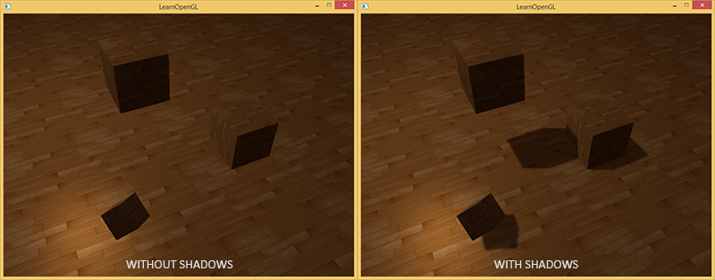

光栅化阴影是一种近似，会遇到分辨率、偏移、覆盖范围等问题。本篇依次完成深度目标、光源变换、阴影比较，再逐个处理瑕疵。OpenGL 定义附件、投影后的深度测试和采样行为；驱动执行绘制，应用决定光源投影、偏移、过滤方式及超出覆盖范围的策略。GLFW 只提供上下文与窗口。

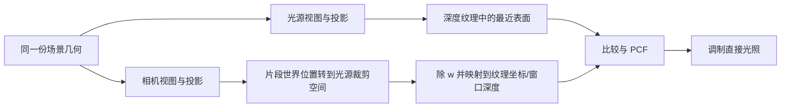

## 阴影映射

设光线先到达箱子，再到达它后面的地面。从光源方向渲染时，深度测试只留下箱子，这样我们无需真的逐片段发射射线，就能查询该方向首先遇到的表面。

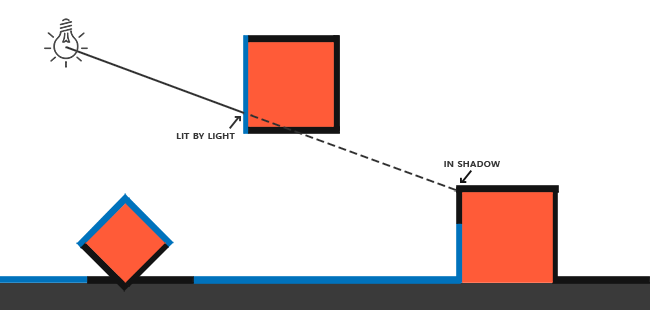

把世界点 $P$ 乘以光源矩阵 $T=P_LV_L$，经过透视除法和深度范围映射后，可用它的 XY 采样阴影图，用 Z 与采样深度比较。若 $P$ 的深度是 0.9，而同一阴影图位置的最近深度为 0.4，则 $P$ 被前方表面遮挡。这里比较的是光源投影所定义的深度，不是相机的深度附件，也不是任意世界距离。

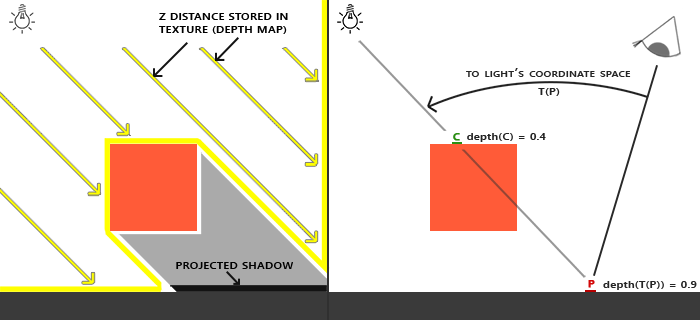

> **原提示：** 平行光没有唯一位置；用于建立视图矩阵的虚拟观察点只是捕获阴影覆盖区域的工具。其视线必须与光照方向一致。本例正交模式的光照方向采用虚拟位置指向原点这一轴线，透视模式则按点到光源的方向计算。

整帧分两遍：先用光源矩阵渲染深度，再用相机矩阵渲染颜色，并查询刚生成的纹理。投影、模型变换和参与投影的物体必须对应；若只更新颜色阶段的模型矩阵，阴影就会与物体分离。

## 深度贴图

创建一个 FBO，再分配 `GL_DEPTH_COMPONENT24` 深度纹理。1024×1024 是阴影图的采样分辨率，与窗口像素数独立。最近过滤方便直接检查逐样本比较，后面的 PCF 由着色器明确完成。

```cpp
bool make_depth_target(gpu_resources& resources, GLuint& framebuffer, GLuint& texture) {
    // OpenGL: 创建组织附件的 FBO 名称，不隐含分配颜色或深度存储。
    glGenFramebuffers(1, &framebuffer);
    glGenTextures(1, &texture);
    resources.framebuffers.push_back(framebuffer);
    resources.textures.push_back(texture);
    bind_texture(0, texture);
    glTexImage2D(GL_TEXTURE_2D, 0, GL_DEPTH_COMPONENT24, 1024, 1024, 0, GL_DEPTH_COMPONENT,
                 GL_FLOAT, nullptr);
    glTexParameteri(GL_TEXTURE_2D, GL_TEXTURE_MIN_FILTER, GL_NEAREST);
    glTexParameteri(GL_TEXTURE_2D, GL_TEXTURE_MAG_FILTER, GL_NEAREST);
    glTexParameteri(GL_TEXTURE_2D, GL_TEXTURE_WRAP_S, GL_CLAMP_TO_BORDER);
    glTexParameteri(GL_TEXTURE_2D, GL_TEXTURE_WRAP_T, GL_CLAMP_TO_BORDER);
    constexpr std::array<float, 4> border{1.0F, 1.0F, 1.0F, 1.0F};
    // OpenGL: 越过 XY 边界返回深度 1；越过远平面仍需着色器单独处理。
    glTexParameterfv(GL_TEXTURE_2D, GL_TEXTURE_BORDER_COLOR, border.data());
    glBindFramebuffer(GL_FRAMEBUFFER, framebuffer);
    // OpenGL: 将纹理的一张二维图像作为当前 FBO 的附件。
    glFramebufferTexture2D(GL_FRAMEBUFFER, GL_DEPTH_ATTACHMENT, GL_TEXTURE_2D, texture, 0);
    // OpenGL: 深度 FBO 不提供颜色附件，禁用其颜色读/写选择。
    glDrawBuffer(GL_NONE);
    glReadBuffer(GL_NONE);
    // OpenGL: 绘制前验证附件、读写选择等完整性条件。
    if (glCheckFramebufferStatus(GL_FRAMEBUFFER) != GL_FRAMEBUFFER_COMPLETE) {
        std::cerr << "Depth framebuffer incomplete\n";
        return false;
    }
    glBindFramebuffer(GL_FRAMEBUFFER, 0);
    return true;
}
```

深度纹理通过 `GL_DEPTH_ATTACHMENT` 挂到 FBO；`glDrawBuffer(GL_NONE)` 与 `glReadBuffer(GL_NONE)` 表明此目标不读写颜色。修正原文“不含颜色就不完整”的表述：**只含深度的 FBO 可以完整**，但附件、读写选择和其他完整性条件必须满足；创建后仍应检查 `glCheckFramebufferStatus`。

绑定 FBO 决定后续绘制写到哪里，`glViewport` 决定窗口坐标如何映射，二者不会自动跟随对方。深度阶段必须改到 1024×1024，颜色阶段恢复真实帧缓冲尺寸；最小化窗口时暂停，避免分配零尺寸附件。

### 光源空间的变换

正交投影适合描述平行光的平行射线。它的左右上下边界定义捕获范围，近远裁剪面限制光源视图中的深度区间。正交投影并不保证对象全都入镜，需要根据场景选择这些参数。覆盖太大还会让每个阴影纹素对应过大的世界区域。

本例使用虚拟光源点 `(-2,5,-2)` 看向原点。模式 8/9 改成 90° 透视投影，其他模式使用 near=1、far=6 的正交投影，故意让部分接收地面超出捕获范围，以便观察范围检查的作用；矩阵乘法保持“先 view，后 projection”的列向量顺序。

```cpp
        const bool perspective_light{mode == 8 || mode == 9};
        const glm::mat4 light_projection{
            perspective_light ? glm::perspective(glm::radians(90.0F), 1.0F, 0.5F, 15.0F)
                              : glm::ortho(-6.0F, 6.0F, -6.0F, 6.0F, 1.0F, 6.0F)};
        const glm::mat4 light_space{light_projection *
                                    glm::lookAt(light_position, glm::vec3{0.0F}, camera_up)};
```

矩阵乘出的结果仍是光源**裁剪空间**齐次坐标。不能在乘法之后就把 XYZ 当成纹理坐标或世界距离，后续仍要除以 W 并映射。

### 渲染至深度贴图

深度顶点阶段只需将局部位置经 model 和 light_space 变换；它不需要材质颜色、镜面指数或相机位置。

```glsl
#version 330 core
layout(location=0) in vec3 a_pos;
uniform mat4 model;
uniform mat4 light_space;
void main() { gl_Position = light_space * model * vec4(a_pos, 1.0); }
```

没有颜色附件时，片段着色器可以保留空 main。正常的光栅化深度测试仍会产生并写入深度，不需要为了“保存深度”再显式写 `gl_FragDepth`。

```glsl
#version 330 core
void main() { }
```

实际深度阶段与恢复窗口目标的代码如下，`draw_depth_scene` 和颜色阶段使用相同的地面与箱子变换。

```cpp
        glBindFramebuffer(GL_FRAMEBUFFER, shadow_framebuffer);
        glViewport(0, 0, 1024, 1024);
        glEnable(GL_DEPTH_TEST);
        // OpenGL: 清除当前绘制目标的所选缓冲，仍受写掩码约束。
        glClear(GL_DEPTH_BUFFER_BIT);
        glUseProgram(depth_program.id);
        set_mat4(depth_program, "light_space", light_space);
        draw_depth_scene(depth_program, cube, quad, mode == 6);

        glBindFramebuffer(GL_FRAMEBUFFER, 0);
        glViewport(0, 0, width, height);
        glClear(GL_COLOR_BUFFER_BIT | GL_DEPTH_BUFFER_BIT);
```

把深度纹理映射到铺屏四边形，就能检查光源是否看到了预期对象。模式 2 显示正交深度，模式 9 显示透视深度线性化后的诊断图。

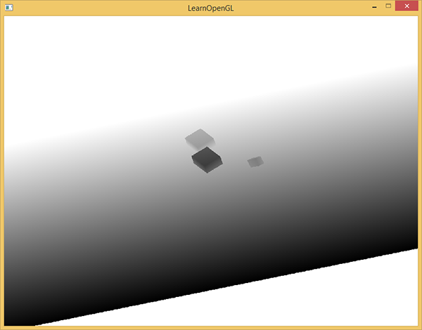

若纹理全白，应依次检查完整性、光源视锥、视口、模型变换、是否真正画了几何和深度写入状态，而不是直接增大光照强度。

## 渲染阴影

颜色阶段获得世界位置，再用相同的 light_space 得到裁剪坐标。顶点阶段传入再插值与在片段阶段对世界位置乘矩阵都是组织方式；本例在片段函数中完成这个线性变换，随后显式透视除法。

$$\mathbf p_{ndc}=\mathbf p_{clip}.xyz/p_{clip}.w,\qquad
\mathbf p_{tex}=0.5\mathbf p_{ndc}+0.5.$$

> **原提示与译注：** 正交投影通常 W=1，除法结果不变；为了兼容透视模式仍保留这一步。XY 映射用于采样，Z 映射用于与深度纹理比较。映射并不会把越界点“限制到”合法区间；光源视锥以外的点仍可能得到小于 0 或大于 1 的坐标，需另外处理。

若 `current_depth - bias > nearest_depth`，阴影遮挡因子记为 1，否则为 0。最终直接光乘 $1-shadow$；环境项继续保留，只是一个间接光的经验近似，不表示阴影里真的有同样多的散射光。不要把已经乘过反照率的环境项再乘一次颜色。

本仓库完整片段程序如下。模式 1 禁用阴影，其他模式分别进入后面的小节；同一个程序可以清楚区分比较、偏移、过滤和照明的职责。

```glsl
#version 330 core
in VertexData { vec3 position; vec3 normal; vec2 tex_coord; } vertex_in;
out vec4 frag_color;
uniform sampler2D diffuse_texture;
uniform sampler2D shadow_map;
uniform mat4 light_space;
uniform vec3 light_pos;
uniform vec3 camera_pos;
uniform int mode;
float calculate_shadow(vec3 normal, vec3 light_dir) {
    vec4 light_clip = light_space * vec4(vertex_in.position, 1.0);
    if (light_clip.w <= 0.0) return 0.0;
    vec3 projected = light_clip.xyz / light_clip.w;
    projected = projected * 0.5 + 0.5;
    if (mode != 7 && mode != 10 && (projected.z < 0.0 || projected.z > 1.0 ||
        any(lessThan(projected.xy, vec2(0.0))) || any(greaterThan(projected.xy, vec2(1.0)))))
        return 0.0;
    float bias = mode == 3 ? 0.0 : mode == 5 ? 0.08 : mode == 6 ? 0.001 :
        max(0.02 * (1.0 - dot(normal, light_dir)), 0.001);
    if (mode != 0 && mode != 8) {
        float nearest_depth = texture(shadow_map, projected.xy).r;
        return projected.z - bias > nearest_depth ? 1.0 : 0.0;
    }
    vec2 texel_size = 1.0 / vec2(textureSize(shadow_map, 0));
    float shadow = 0.0;
    for (int x = -1; x <= 1; ++x) {
        for (int y = -1; y <= 1; ++y) {
            float nearest_depth = texture(shadow_map, projected.xy + vec2(x,y) * texel_size).r;
            shadow += projected.z - bias > nearest_depth ? 1.0 : 0.0;
        }
    }
    return shadow / 9.0;
}
void main() {
    vec3 normal = normalize(vertex_in.normal);
    vec3 light_dir = normalize(light_pos);
    if (mode == 8) light_dir = normalize(light_pos - vertex_in.position);
    vec3 view_dir = normalize(camera_pos - vertex_in.position);
    float diffuse = max(dot(normal, light_dir), 0.0);
    float specular = diffuse > 0.0 ? pow(max(dot(normal, normalize(light_dir + view_dir)), 0.0), 32.0) : 0.0;
    float shadow = mode == 1 ? 0.0 : calculate_shadow(normal, light_dir);
    vec3 albedo = texture(diffuse_texture, vertex_in.tex_coord * 3.0).rgb;
    vec3 color = 0.12 * albedo + (1.0 - shadow) * (albedo * diffuse + vec3(0.2 * specular));
    frag_color = vec4(pow(max(color, vec3(0.0)), vec3(1.0 / 2.2)), 1.0);
}
```

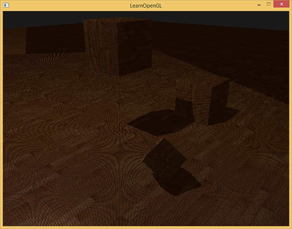

如果阴影位置错误，先查看模式 2 的深度图，并对照两遍使用的模型与光源矩阵。如果只有边缘或表面纹路异常，再继续处理精度和过滤问题。

## 改进阴影映射

有限分辨率让同一个阴影纹素覆盖多个接收片段。采样与两次光栅化的误差可能误判自遮挡，而有限捕获范围又可能造成远处错误变黑。下面每种修正针对不同原因，不能用一个很大的偏移把所有问题一起掩盖。

### 阴影失真

阴影痤疮（shadow acne，底本称“阴影失真”）常表现为表面上的交替条纹。模式 3 将 bias 设为 0，可观察当前场景中的自遮挡现象。

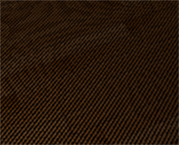

斜面上的多个接收片段采样同一个阴影纹素，而它们真实的投影深度并不相同，部分片段会被该纹素保存的近似深度误挡住。

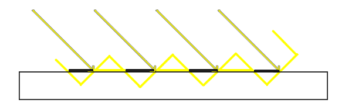

在比较时减去小偏移，相当于允许一定误差，而不是修改物体的世界位置。正负号需和深度比较方向对应。

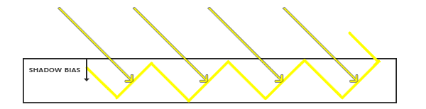

本例多数模式使用 $b=\max(0.02(1-\mathbf N\cdot\mathbf L),0.001)$：表面越接近平行于光线，所需容差往往越大。数值取决于投影范围、图分辨率与场景尺度；不是到处通用的常量。模式 4 采用有偏移的单次硬比较，与模式 0 的过滤结果区分开。

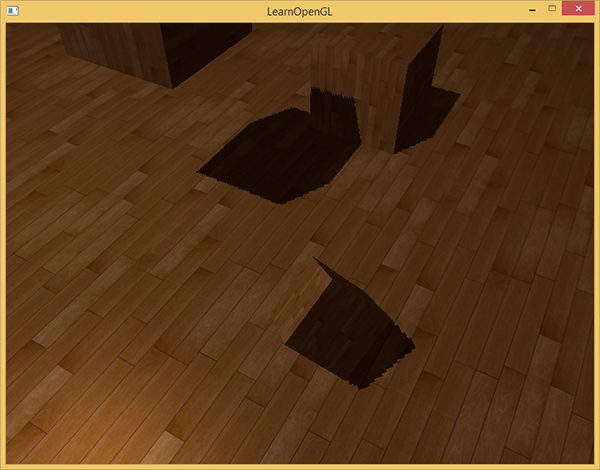

### 阴影悬浮

偏移太大会把本来应被遮挡的区域误判为明亮，物体与影子仿佛分离。模式 5 故意把偏移放大到 0.08。

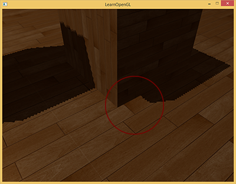

> **保留译注：** Peter Panning 的名称借用了会飞的彼得·潘，用来描述物体看似浮起的外观，并不是一种真正的几何动画。

原文还提出在深度遍中剔除闭合物体的正面，记录较靠后的背面深度。它在部分实心模型上能减少自遮挡及对大偏移的依赖，但不能保证“背面深度总是正确”，也不能普遍消除悬浮；它会改变薄物体和接触区域的遮挡。

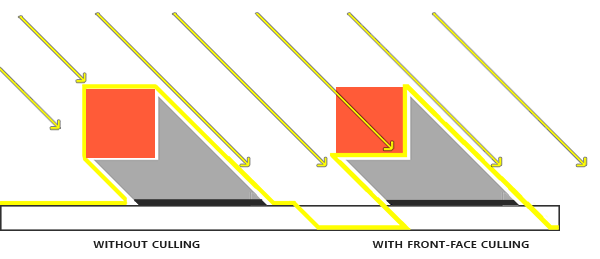

模式 6 只对箱子启用正面剔除，地板仍正常写深度，并在这一遍结束后恢复剔除状态。地板是单层平面，若一概剔除正面，整个地板可能不再进入阴影图；不能把适用于闭合体的技巧无条件用于所有物体。

```cpp
void draw_depth_scene(const shader_program& program, const mesh& cube, const mesh& quad,
                      bool cull_front) {
    draw_object(program, quad,
                glm::scale(glm::rotate(glm::mat4{1.0F}, glm::radians(-90.0F), {1.0F, 0.0F, 0.0F}),
                           {6.0F, 6.0F, 1.0F}));
    if (cull_front) {
        // OpenGL: 启用指定固定功能状态，离开当前阶段后仍会保留。
        glEnable(GL_CULL_FACE);
        glCullFace(GL_FRONT);
    }
    draw_object(program, cube, model_matrix({0.0F, 0.75F, 0.0F}, {1.5F, 1.5F, 1.5F}));
    draw_object(program, cube, model_matrix({2.0F, 0.5F, 1.0F}, {1.0F, 1.0F, 1.0F}, 0.3F));
    draw_object(program, cube, model_matrix({-1.5F, 1.8F, -1.5F}, {1.0F, 1.0F, 1.0F}, 0.7F));
    glCullFace(GL_BACK);
    // OpenGL: 关闭指定固定功能状态，不影响相关对象的生命周期。
    glDisable(GL_CULL_FACE);
}
```

### 过采样

这里保留底本小节名，“过采样”实际讨论的是**光源覆盖范围之外的取样和错误阴影**，不要与提高采样率混淆。模式 7 使用重复环绕并不做视锥越界排除，会把阴影图重复投到远处。

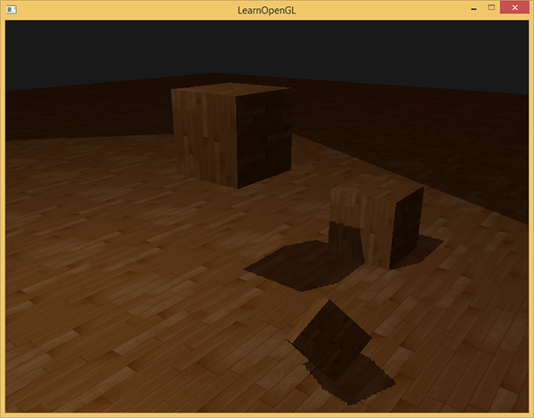

把 XY 环绕设为 `GL_CLAMP_TO_BORDER`，边界深度设为 1，可以避免重复花纹，但只改变采样行为，不会限制被比较的 Z。

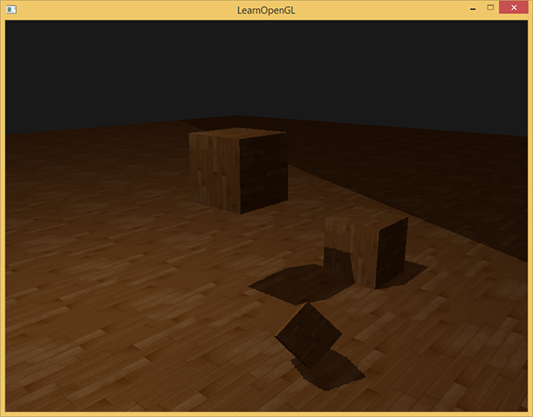

模式 10 保留边界钳制而不排除远平面外的片段，用来说明为什么还会出现错误区域。当前深度大于 1 时，即使边界采样返回 1，也可能判阴影。正常模式同时检查 W 和映射后的 XYZ；超出捕获范围就返回无遮挡。

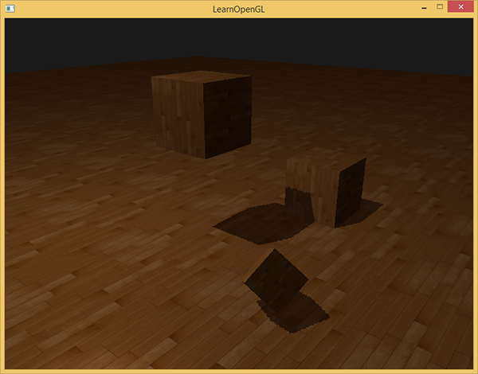

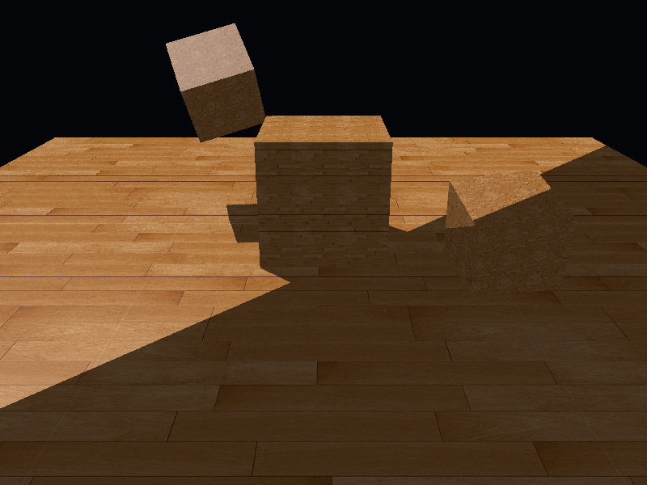


“返回无遮挡”是本例的覆盖策略，意味着范围外没有此阴影图提供的遮挡信息，并不证明那里没有遮挡物。实际引擎可扩大或跟随相机调整捕获范围，也可进一步采用级联阴影图。

## PCF

阴影图分辨率有限，单次比较得到的边缘会呈阶梯状。提高图分辨率、收紧光源视锥能提高空间采样密度，但也有存储和覆盖范围成本。

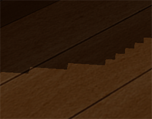

PCF（Percentage-Closer Filtering，百分比近邻过滤）先对周边各次采样分别进行深度比较，再平均比较结果。本例模式 0 与透视模式 8 使用 3×3 共九次比较。`textureSize` 对 sampler2D 返回 `ivec2`；代码显式转成 `vec2` 再取倒数，得到单个纹素的 UV 偏移量。不能把“平均深度再比较”当作相同操作。

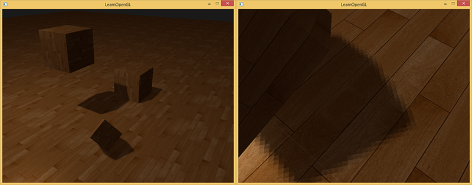

PCF 产生 0 到 1 的可见性近似，使边缘较柔和。扩大核或增加样本会改变过滤宽度和成本，它不是由真实光源面积推导出的软阴影，因此不保证接触处锐利、远处按物理规律变软。

### 正交投影 vs 透视投影

正交捕获对应平行方向；透视捕获对应一个有限视点的一段角域，适合聚光灯或点光源的单个面。单张透视图并不能覆盖点光源全部方向，下一篇使用六面深度图。

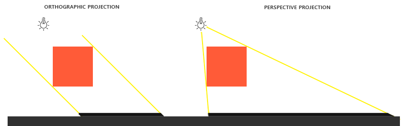

正交深度在其观察深度范围内线性分布；常规透视窗口深度非线性。显示透视深度时，可用

$$s=\frac{2nf}{f+n-(2d-1)(f-n)}$$

恢复正的观察距离，再除以 far 作为灰度。这里的“线性化”只改变诊断输出，阴影比较仍必须在两边一致的投影深度空间中进行。模式 9 与模式 2 共用以下屏幕程序：

```glsl
#version 330 core
in vec2 tex_coord;
out vec4 frag_color;
uniform sampler2D depth_texture;
uniform int perspective_depth;
void main() {
    float depth = texture(depth_texture, tex_coord).r;
    if (perspective_depth != 0) {
        float z = depth * 2.0 - 1.0;
        depth = (2.0 * 0.5 * 15.0) / (15.0 + 0.5 - z * (15.0 - 0.5)) / 15.0;
    }
    frag_color = vec4(vec3(depth), 1.0);
}
```

> **常见误解：** 阴影图的 bias 不能修正错误矩阵，PCF 不能扩大捕获范围，换透视投影也不能自动获得点光源全向阴影。先确认两遍的空间和覆盖关系，再处理误差与过滤。

> **进阶（捕获范围与精度）：** **阴影分辨率应与光源投影一起评估。** 相同的 1024² 纹理覆盖一米或一百米，会有完全不同的世界空间细节。固定视锥还能在相机移动时浪费大量样本，或遗漏远处遮挡物。优化时先确定接收者和可能投影到它们的遮挡者，再调整覆盖；提高分辨率不能代替正确的几何范围，也不能彻底消除所有自遮挡。


## 附加资源

保留底本中的源码、资源与阅读入口。外部旧程序的文件组织与本仓库不同，实际实现以本文标注的本地目标为准。

- [全向阴影贴图](https://github.com/LearnOpenGL-CN/LearnOpenGL-CN/blob/331560886468e28f28326429334fc48470f9c27b/docs/05%20Advanced%20Lighting/03%20Shadows/02%20Point%20Shadows.md)
- [级联阴影贴图](https://github.com/LearnOpenGL-CN/LearnOpenGL-CN/blob/331560886468e28f28326429334fc48470f9c27b/docs/08%20Guest%20Articles/2021/01%20CSM.md)
- [深度测试](https://github.com/LearnOpenGL-CN/LearnOpenGL-CN/blob/331560886468e28f28326429334fc48470f9c27b/docs/04%20Advanced%20OpenGL/01%20Depth%20testing.md)
- [这里](https://learnopengl.com/code_viewer_gh.php?code=src/5.advanced_lighting/3.1.1.shadow_mapping_depth/shadow_mapping_depth.cpp)
- [高级光照](https://github.com/LearnOpenGL-CN/LearnOpenGL-CN/blob/331560886468e28f28326429334fc48470f9c27b/docs/05%20Advanced%20Lighting/01%20Advanced%20Lighting.md)
- [这里](https://learnopengl.com/code_viewer_gh.php?code=src/5.advanced_lighting/3.1.2.shadow_mapping_base/shadow_mapping_base.cpp)
- [面剔除](https://github.com/LearnOpenGL-CN/LearnOpenGL-CN/blob/331560886468e28f28326429334fc48470f9c27b/docs/04%20Advanced%20OpenGL/04%20Face%20culling.md)
- [这里](https://learnopengl.com/code_viewer_gh.php?code=src/5.advanced_lighting/3.1.3.shadow_mapping/shadow_mapping.cpp)
- [Tutorial 16 : Shadow mapping](http://www.opengl-tutorial.org/intermediate-tutorials/tutorial-16-shadow-mapping/)
- [Shadow Mapping – Part 1](http://ogldev.atspace.co.uk/www/tutorial23/tutorial23.html)
- [How Shadow Mapping Works](https://www.youtube.com/watch?v=EsccgeUpdsM)
- [Common Techniques to Improve Shadow Depth Maps](https://msdn.microsoft.com/en-us/library/windows/desktop/ee416324%28v=vs.85%29.aspx)
- [How I Implemented Shadows in my Game Engine](https://www.youtube.com/watch?v=uueB2kVvbHo)

## 本仓库示例

源码：[main.cpp](../../apps/05_advanced_lighting/03_shadow_mapping/main.cpp)，目标 `05_advanced_lighting__03_shadow_mapping`。helper 保留在各文件匿名命名空间，不依赖共享源码；GLSL 为内嵌字符串。必需 uniform 在初始化时检查并缓存，资源由上下文有效期内的 RAII 守卫释放。

```powershell
cmake --preset mingw-gcc-debug
cmake --build --preset mingw-gcc-debug --target 05_advanced_lighting__03_shadow_mapping
.\build\mingw-gcc-debug\apps\05_advanced_lighting\03_shadow_mapping\05_advanced_lighting__03_shadow_mapping.exe --mode 0
```

依赖安装与其他 preset 见[构建指南](../build.md)。Esc 退出，WASD 移动，鼠标转向，滚轮调整 FOV，空格依次切换以下模式；`--mode M` 选择初始模式。 有限帧检查使用 `--frames 3 --capture output.ppm`，隐藏窗口并保存末帧。

| `--mode` | 可观察内容 |
| --- | --- |
| 0 | 正交阴影，角度相关偏移＋3×3 PCF |
| 1 | 不使用阴影 |
| 2 | 正交深度图 |
| 3 | 无偏移硬阴影 |
| 4 | 有角度偏移的硬阴影 |
| 5 | 过大偏移与悬浮 |
| 6 | 闭合箱子正面剔除，地板保持写入 |
| 7 | 重复环绕且不限制范围的错误对照 |
| 8 | 透视阴影＋PCF |
| 9 | 透视深度线性显示 |
| 10 | 边界钳制但不排除远平面的错误对照 |

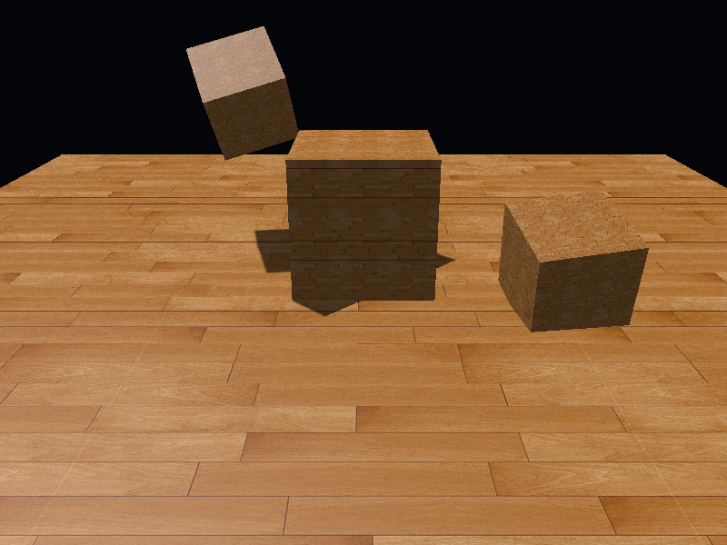

## 本章整体回顾

同一几何先从光源捕获深度，再从相机进行一致空间的比较；偏移、边界和 PCF 分别处理不同误差。 本篇保留原小节、教学图片及附加资源，程序资源与上游截图的对应和差异见[图片记录](../img/05/README.md)与[资源来源](../../assets/chapter05_resources.md)。

技术核校：[英文原文](https://learnopengl.com/Advanced-Lighting/Shadows/Shadow-Mapping)、[OpenGL 3.3 Core 规范](https://registry.khronos.org/OpenGL/specs/gl/glspec33.core.pdf)、[GLSL 3.30 规范](https://registry.khronos.org/OpenGL/specs/gl/GLSLangSpec.3.30.pdf)。

下一节：[点光源阴影](04_point_shadows.md)。
