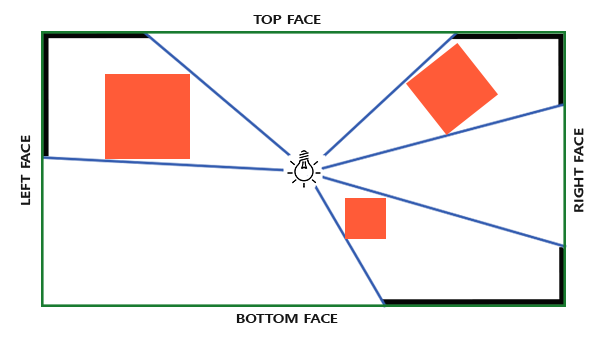
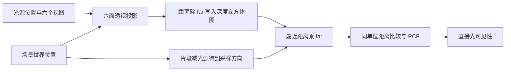
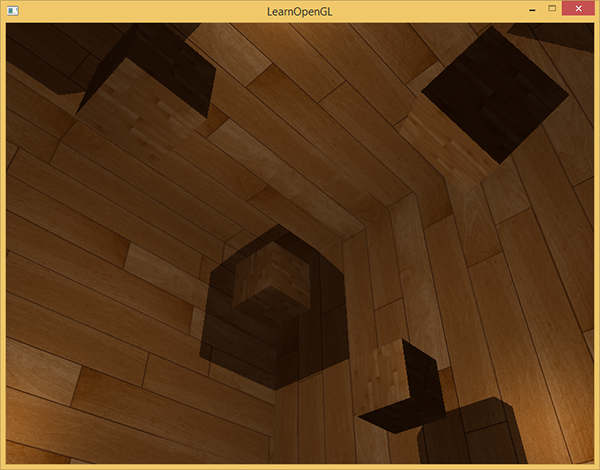
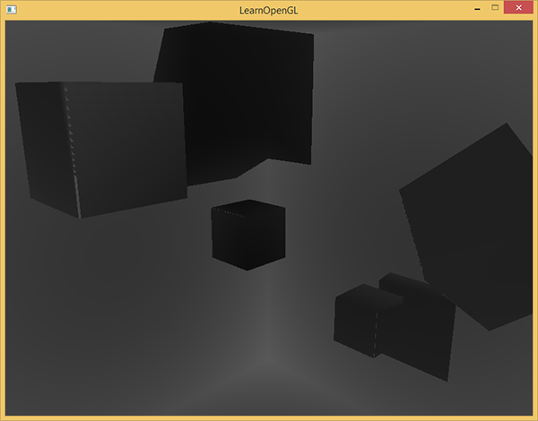
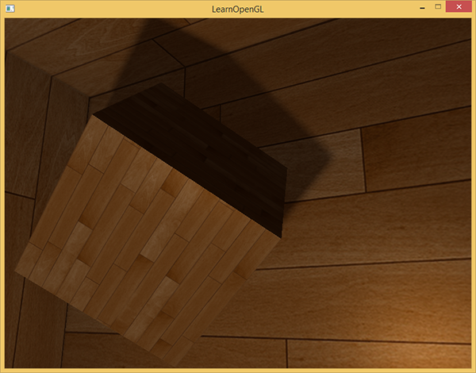
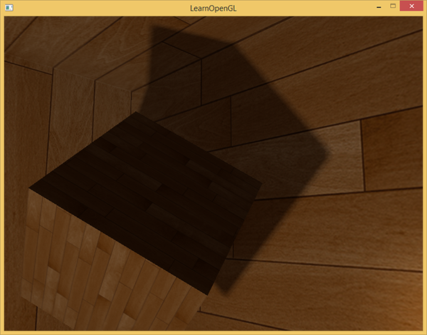
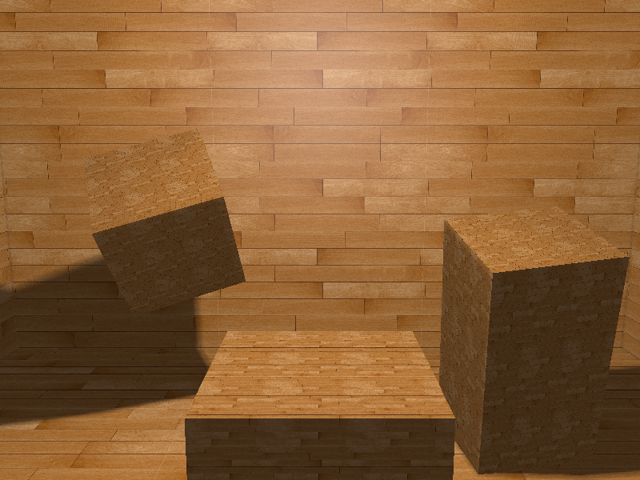

# 点光源阴影

| 项目 | 信息 |
| --- | --- |
| 原文 | [Point-Shadows](https://learnopengl.com/Advanced-Lighting/Shadows/Point-Shadows) |
| 作者 | Joey de Vries |
| 翻译 | [Django](http://bullteacher.com/) |
| 校对 | 暂无 |
| 中文底本 | [LearnOpenGL-CN 固定版本](https://github.com/LearnOpenGL-CN/LearnOpenGL-CN/blob/331560886468e28f28326429334fc48470f9c27b/docs/05%20Advanced%20Lighting/03%20Shadows/02%20Point%20Shadows.md)，`new-theme` / `331560886468e28f28326429334fc48470f9c27b` |
| 本仓库示例 | [main.cpp](../../apps/05_advanced_lighting/04_point_shadows/main.cpp) |
| 修订与范围 | [逐项覆盖与验证记录](coverage.md)；纯 GFM，代码片段逐字取自对应源码 |

**点光源阴影用六张方向相邻的深度图覆盖光源周围，并用统一的光源距离比较遮挡。** 上一篇的一张投影图只覆盖一个视域，并非阴影映射技术只能处理平行光；把六个 90° 透视视域组织成立方体贴图，就能处理点光源。

底本曾提示译文未完整重写，本篇已重新核对术语和管线。Omnidirectional 在这里译为“全向”，上游“万向”是同一技术的旧译。它仍是有限分辨率的近似，也只捕获 near/far 规定的范围。



应用建立六面视图并选择深度编码，OpenGL 提供立方体纹理、分层附件和几何阶段输出语义，驱动执行两遍渲染；GLFW 不参与阴影比较。采样器沿方向选择面，返回的是纹理里保存的数值，不会自动替我们判断遮挡。



## 生成深度立方体贴图

第一种实现逐面进行六遍绘制：每次用 `glFramebufferTexture2D` 接一个面，设置该面的矩阵，清深度并重画场景。模式 5 实际运行这条路径。第二种把整个立方体 mip 级别作为分层深度附件，由几何着色器将每个输入三角形复制到六个面；其他模式运行这一条路径。

立方体图的六面必须具有相同尺寸和格式。本例分配六个 512² 的 `GL_DEPTH_COMPONENT24` 图像，最近过滤，三个环绕方向均钳到边缘。它是深度纹理，不是上一章天空盒的 RGB 环境照片。

```cpp
bool make_depth_cubemap(gpu_resources& resources, GLuint& framebuffer, GLuint& texture) {
    glGenTextures(1, &texture);
    // OpenGL: 创建组织附件的 FBO 名称，不隐含分配颜色或深度存储。
    glGenFramebuffers(1, &framebuffer);
    resources.textures.push_back(texture);
    resources.framebuffers.push_back(framebuffer);
    bind_texture(0, texture, GL_TEXTURE_CUBE_MAP);
    for (unsigned int face{0U}; face < 6U; ++face) {
        glTexImage2D(GL_TEXTURE_CUBE_MAP_POSITIVE_X + face, 0, GL_DEPTH_COMPONENT24, 512, 512, 0,
                     GL_DEPTH_COMPONENT, GL_FLOAT, nullptr);
    }
    glTexParameteri(GL_TEXTURE_CUBE_MAP, GL_TEXTURE_MIN_FILTER, GL_NEAREST);
    glTexParameteri(GL_TEXTURE_CUBE_MAP, GL_TEXTURE_MAG_FILTER, GL_NEAREST);
    glTexParameteri(GL_TEXTURE_CUBE_MAP, GL_TEXTURE_WRAP_S, GL_CLAMP_TO_EDGE);
    glTexParameteri(GL_TEXTURE_CUBE_MAP, GL_TEXTURE_WRAP_T, GL_CLAMP_TO_EDGE);
    glTexParameteri(GL_TEXTURE_CUBE_MAP, GL_TEXTURE_WRAP_R, GL_CLAMP_TO_EDGE);
    // OpenGL: GL_FRAMEBUFFER 同时选择读目标与绘制目标。
    glBindFramebuffer(GL_FRAMEBUFFER, framebuffer);
    // OpenGL: 整个 mip 级别作为分层附件，几何阶段以 gl_Layer 选择面。
    glFramebufferTexture(GL_FRAMEBUFFER, GL_DEPTH_ATTACHMENT, texture, 0);
    glDrawBuffer(GL_NONE);
    glReadBuffer(GL_NONE);
    // OpenGL: 绘制前验证附件、读写选择等完整性条件。
    if (glCheckFramebufferStatus(GL_FRAMEBUFFER) != GL_FRAMEBUFFER_COMPLETE) {
        std::cerr << "Layered depth framebuffer incomplete\n";
        return false;
    }
    glBindFramebuffer(GL_FRAMEBUFFER, 0);
    return true;
}
```

`glFramebufferTexture` 接入整个级别，产生分层附件；`glFramebufferTexture2D` 接入一个面，是逐面目标。两种附件组织不能与输出的 gl_Layer 含义混用。纯深度 FBO 明确设置颜色读写为 `GL_NONE`，并在切换附件后检查完整性。

两种方法的第二遍相同：恢复窗口大小与目标、清除颜色/深度，以相机矩阵画房间与箱子，并把深度立方体图交给光照片段程序。本例房间从内部观察，颜色遍翻转房间法线，箱子仍用朝外法线；深度遍使用完全相同的几何变换。

### 光空间的变换

六面共享纵向 FOV 为 90°、宽高比为 1 的透视投影。视线依次为 +X、-X、+Y、-Y、+Z、-Z；上下两面的 up 必须单独选取，不能与其视线平行。把它们称为“近面、远面”易与裁剪面混淆，应使用带符号的轴名。

```cpp
    constexpr float far_plane{25.0F};
    constexpr glm::vec3 light_position{0.0F, 3.0F, 0.0F};
    const glm::mat4 shadow_projection{glm::perspective(glm::radians(90.0F), 1.0F, 0.1F, far_plane)};
    const std::array<glm::mat4, 6> shadow_matrices{
        shadow_projection * glm::lookAt(light_position,
                                        light_position + glm::vec3{1.0F, 0.0F, 0.0F},
                                        glm::vec3{0.0F, -1.0F, 0.0F}),
        shadow_projection * glm::lookAt(light_position,
                                        light_position + glm::vec3{-1.0F, 0.0F, 0.0F},
                                        glm::vec3{0.0F, -1.0F, 0.0F}),
        shadow_projection * glm::lookAt(light_position,
                                        light_position + glm::vec3{0.0F, 1.0F, 0.0F},
                                        glm::vec3{0.0F, 0.0F, 1.0F}),
        shadow_projection * glm::lookAt(light_position,
                                        light_position + glm::vec3{0.0F, -1.0F, 0.0F},
                                        glm::vec3{0.0F, 0.0F, -1.0F}),
        shadow_projection * glm::lookAt(light_position,
                                        light_position + glm::vec3{0.0F, 0.0F, 1.0F},
                                        glm::vec3{0.0F, -1.0F, 0.0F}),
        shadow_projection * glm::lookAt(light_position,
                                        light_position + glm::vec3{0.0F, 0.0F, -1.0F},
                                        glm::vec3{0.0F, -1.0F, 0.0F})};
```

这里 near=0.1，far=25。far 既限定捕获范围，又作为径向距离的归一化尺度，写入和采样恢复时必须一致。六面投影的裁剪发生在写自定义深度之前，因此离光源太近或超出捕获范围的物体仍会遗漏。

### 深度着色器

顶点程序先把位置变到世界空间，再把齐次位置交给几何阶段。这个阶段间的 gl_Position 暂存世界坐标，几何阶段输出给光栅化之前才变成真正的光源裁剪坐标。

```glsl
#version 330 core
layout(location=0) in vec3 a_pos;
uniform mat4 model;
void main() { gl_Position = model * vec4(a_pos,1.0); }
```

几何程序一次输入一个三角形，而不是三个三角形；最多输出 18 个顶点，即六个三角形。每面三个顶点输出完调用 `EndPrimitive`。

```glsl
#version 330 core
layout(triangles) in;
layout(triangle_strip, max_vertices=18) out;
uniform mat4 shadow_matrices[6];
out vec4 world_position;
void main() {
    for (int face = 0; face < 6; ++face) {
        for (int i = 0; i < 3; ++i) {
            gl_Layer = face;
            world_position = gl_in[i].gl_Position;
            gl_Position = shadow_matrices[face] * world_position;
            EmitVertex();
        }
        EndPrimitive();
    }
}
```

`EmitVertex` 后输出变量值不应继续假设有效，所以本例把 gl_Layer、world_position 和 gl_Position 都放在每次输出前赋值。修正上游在内循环之外只赋一次 gl_Layer 的写法；同一个输出图元的顶点还必须选择一致的层。

片段程序保存径向距离除以 far，而不是该面的透视窗口深度：

```glsl
#version 330 core
in vec4 world_position;
uniform vec3 light_pos;
uniform float far_plane;
void main() {
    gl_FragDepth = length(world_position.xyz - light_pos) / far_plane;
}
```

这使六个面上的查询具有相同的世界距离单位。写 `gl_FragDepth` 是这套编码的必要步骤，代价是可能限制提前深度测试优化；不能把它省掉后仍按线性距离恢复。

## 全向阴影贴图

颜色遍用 $\mathbf d=\mathbf p-\mathbf l$ 采样 `samplerCube`。它是从光源指向片段的方向，不必归一化；采样只关心方向，当前片段距离取 $\lVert\mathbf d\rVert$。保存的最近深度乘 far 后恢复为世界距离，再比较 $d_{current}-bias>d_{nearest}$。

偏移 0.05 的单位也是世界距离，不能直接沿用上一篇投影深度空间的常量。在阴影里只削减直接漫反射与镜面项，环境近似继续保留。模式 1 是硬阴影，模式 3 不使用阴影，模式 0 默认使用 20 方向 PCF。



下面的实际片段程序包含硬比较、距离显示、64 次采样和 20 方向采样。房间及内部箱子的法线由顶点阶段统一传入；颜色只在最终输出近似编码一次。

```glsl
#version 330 core
in VertexData { vec3 position; vec3 normal; vec2 tex_coord; } vertex_in;
out vec4 frag_color;
uniform sampler2D diffuse_texture;
uniform samplerCube depth_cubemap;
uniform vec3 light_pos;
uniform vec3 camera_pos;
uniform float far_plane;
uniform int mode;
const vec3 offsets[20] = vec3[](
    vec3(1,1,1),vec3(1,-1,1),vec3(-1,-1,1),vec3(-1,1,1),
    vec3(1,1,-1),vec3(1,-1,-1),vec3(-1,-1,-1),vec3(-1,1,-1),
    vec3(1,1,0),vec3(1,-1,0),vec3(-1,-1,0),vec3(-1,1,0),
    vec3(1,0,1),vec3(-1,0,1),vec3(1,0,-1),vec3(-1,0,-1),
    vec3(0,1,1),vec3(0,-1,1),vec3(0,-1,-1),vec3(0,1,-1));
float calculate_shadow(vec3 ray) {
    float distance_to_light = length(ray);
    if (distance_to_light >= far_plane) return 0.0;
    float bias = 0.05;
    if (mode == 1) return distance_to_light - bias > texture(depth_cubemap, ray).r * far_plane ? 1.0 : 0.0;
    float shadow = 0.0;
    if (mode == 4) {
        for (int x=0; x<4; ++x) for (int y=0; y<4; ++y) for (int z=0; z<4; ++z) {
            vec3 offset = (vec3(x,y,z) - vec3(1.5)) * 0.04;
            shadow += distance_to_light - bias > texture(depth_cubemap, ray + offset).r * far_plane ? 1.0 : 0.0;
        }
        return shadow / 64.0;
    }
    float view_distance = length(camera_pos - vertex_in.position);
    float disk_radius = (1.0 + view_distance / far_plane) / 25.0;
    for (int i=0; i<20; ++i) {
        float closest = texture(depth_cubemap, ray + offsets[i] * disk_radius).r * far_plane;
        shadow += distance_to_light - bias > closest ? 1.0 : 0.0;
    }
    return shadow / 20.0;
}
void main() {
    vec3 ray = vertex_in.position - light_pos;
    if (mode == 2) {
        frag_color = vec4(vec3(texture(depth_cubemap,ray).r),1.0);
        return;
    }
    vec3 normal = normalize(vertex_in.normal);
    vec3 light_dir = normalize(-ray);
    vec3 view_dir = normalize(camera_pos - vertex_in.position);
    float diffuse = max(dot(normal, light_dir),0.0);
    float specular = diffuse > 0.0 ? pow(max(dot(normal,normalize(light_dir+view_dir)),0.0),32.0) : 0.0;
    float shadow = mode == 3 ? 0.0 : calculate_shadow(ray);
    vec3 albedo = texture(diffuse_texture,vertex_in.tex_coord * 3.0).rgb;
    vec3 color = 0.12 * albedo + (1.0-shadow) * (diffuse * albedo + vec3(0.15 * specular));
    frag_color = vec4(pow(max(color,vec3(0.0)),vec3(1.0/2.2)),1.0);
}
```

### 显示立方体贴图深度缓冲

模式 2 直接输出方向采样得到的归一化径向深度。若先乘 far 恢复了世界距离，显示时就需再除以 far；若已经在 [0,1]，不能重复除，否则图像会过暗。



这张图显示的是光源在该方向看到的最近表面，而不是相机深度。相机当前看到的表面可能位于遮挡物之后，因此深度灰度不必随相机视距单调变化。检查六面是否存在、方向是否正确和房间是否进入捕获范围，比仅检查画面有没有灰色更有用。

## PCF

硬阴影仍有有限分辨率造成的锯齿。沿方向附近多次取样，每次分别比较距离，再平均遮挡结果。模式 4 采用 4×4×4 共 64 次三维偏移；修正底本“各轴采三次”的文字，四次的立方才是 64。



原始三维立方采样里，不少点投向几乎相同的立方体方向，增加了重复工作。模式 0 用上游给出的 20 个分散方向偏移，既保留 ±1 的立方角，也包含部分分量为零的方向。它们不是全都垂直于主射线，也不是严格均匀的球面采样；这里只是成本较低的实用采样集合。

偏移半径设为 $(1+d_{view}/far)/25$，随相机到表面的距离增加。它控制方向扰动的尺度，不等于一个真实面积光源的半径。更大的值会柔化边缘，也可能把错误遮挡混在一起，需要与 bias、图分辨率和场景尺度一起调节。



两条深度生成路径的运行代码如下。逐面方法清除每个面；分层方法在整个立方体附件绑定后清除并提交，不能清完一个面就以为六面已经更新。

```cpp
        bind_texture(1, 0U, GL_TEXTURE_CUBE_MAP);
        glBindFramebuffer(GL_FRAMEBUFFER, depth_framebuffer);
        glViewport(0, 0, 512, 512);
        glEnable(GL_DEPTH_TEST);
        if (mode == 5) {
            // OpenGL: 后续 uniform 更新和绘制使用当前绑定的程序。
            glUseProgram(face_program.id);
            set_vec3(face_program, "light_pos", light_position);
            set_float(face_program, "far_plane", far_plane);
            for (unsigned int face{0U}; face < 6U; ++face) {
                // OpenGL: 将纹理的一张二维图像作为当前 FBO 的附件。
                glFramebufferTexture2D(GL_FRAMEBUFFER, GL_DEPTH_ATTACHMENT,
                                       GL_TEXTURE_CUBE_MAP_POSITIVE_X + face, depth_cubemap, 0);
                if (glCheckFramebufferStatus(GL_FRAMEBUFFER) != GL_FRAMEBUFFER_COMPLETE)
                    return EXIT_FAILURE;
                // OpenGL: 清除当前绘制目标的所选缓冲，仍受写掩码约束。
                glClear(GL_DEPTH_BUFFER_BIT);
                set_mat4(face_program, "shadow_face", shadow_matrices[face]);
                draw_room(face_program, cube, false);
            }
        } else {
            glFramebufferTexture(GL_FRAMEBUFFER, GL_DEPTH_ATTACHMENT, depth_cubemap, 0);
            if (glCheckFramebufferStatus(GL_FRAMEBUFFER) != GL_FRAMEBUFFER_COMPLETE)
                return EXIT_FAILURE;
            glClear(GL_DEPTH_BUFFER_BIT);
            glUseProgram(depth_program.id);
            // OpenGL: 六个矩阵连续上传；mat4 的列主序布局与 GLSL 一致。
            glUniformMatrix4fv(depth_program.uniforms.at("shadow_matrices[0]"), 6, GL_FALSE,
                               glm::value_ptr(shadow_matrices[0]));
            set_vec3(depth_program, "light_pos", light_position);
            set_float(depth_program, "far_plane", far_plane);
            draw_room(depth_program, cube, false);
        }
        glBindFramebuffer(GL_FRAMEBUFFER, 0);
        glViewport(0, 0, width, height);
        glClear(GL_COLOR_BUFFER_BIT | GL_DEPTH_BUFFER_BIT);
        glUseProgram(program.id);
        set_mat4(program, "view", view);
        set_mat4(program, "projection", projection);
        set_vec3(program, "camera_pos", camera_position);
        set_vec3(program, "light_pos", light_position);
        set_float(program, "far_plane", far_plane);
        set_int(program, "mode", mode);
        set_int(program, "diffuse_texture", 0);
        set_int(program, "depth_cubemap", 1);
        bind_texture(0, wood);
        bind_texture(1, depth_cubemap, GL_TEXTURE_CUBE_MAP);
        draw_room(program, cube, true);
```

> **原性能提示：** 一次几何阶段提交仍复制并光栅化六份三角形，并不把工作量变为一份；六遍方法可能增加 CPU 提交，但避免某些几何阶段瓶颈。谁更快取决于场景和实现，本仓库只验证两条路径的结果，不以绘制调用数量代替 GPU 性能测试。

> **常见误解：** 全向阴影不是“无限范围阴影”，也不会自动处理所有光源。每盏点光都需要自己的捕获或明确的更新策略，内存和六方向光栅化成本仍需预算。

> **进阶（距离编码）：** **阴影比较的两边必须共享同一个度量。** 本例使用径向线性距离，因此跨立方体面仍可直接比较；若改用硬件透视深度，就需要按各面的投影一致处理，不能简单乘 far。调试时同时记录 near/far、写深度公式和采样恢复公式，可以避免“画出了六面纹理，阴影仍全黑”的常见错误；这和画天空盒时只需颜色方向采样不同。


## 附加资源

保留底本中的源码、资源与阅读入口。外部旧程序的文件组织与本仓库不同，实际实现以本文标注的本地目标为准。

- [demo的源码](http://www.learnopengl.com/code_viewer.php?code=advanced-lighting/point_shadows)
- [顶点](http://www.learnopengl.com/code_viewer.php?code=advanced-lighting/point_shadows&type=vertex)
- [片段](http://www.learnopengl.com/code_viewer.php?code=advanced-lighting/point_shadows&type=fragment)
- [Shadow Mapping for point light sources in OpenGL](http://www.sunandblackcat.com/tipFullView.php?l=eng&topicid=36)
- [Multipass Shadow Mapping With Point Lights](http://ogldev.atspace.co.uk/www/tutorial43/tutorial43.html)
- [Omni-directional Shadows](http://www.cg.tuwien.ac.at/~husky/RTR/OmnidirShadows-whyCaps.pdf)

## 本仓库示例

源码：[main.cpp](../../apps/05_advanced_lighting/04_point_shadows/main.cpp)，目标 `05_advanced_lighting__04_point_shadows`。helper 保留在各文件匿名命名空间，不依赖共享源码；GLSL 为内嵌字符串。必需 uniform 在初始化时检查并缓存，资源由上下文有效期内的 RAII 守卫释放。

```powershell
cmake --preset mingw-gcc-debug
cmake --build --preset mingw-gcc-debug --target 05_advanced_lighting__04_point_shadows
.\build\mingw-gcc-debug\apps\05_advanced_lighting\04_point_shadows\05_advanced_lighting__04_point_shadows.exe --mode 0
```

依赖安装与其他 preset 见[构建指南](../build.md)。Esc 退出，WASD 移动，鼠标转向，滚轮调整 FOV，空格依次切换以下模式；`--mode M` 选择初始模式。 有限帧检查使用 `--frames 3 --capture output.ppm`，隐藏窗口并保存末帧。

| `--mode` | 可观察内容 |
| --- | --- |
| 0 | 分层立方体深度＋20 方向 PCF |
| 1 | 单次硬阴影比较 |
| 2 | 径向深度灰度 |
| 3 | 关闭阴影 |
| 4 | 64 次三维网格 PCF |
| 5 | 逐面六遍捕获＋20 方向 PCF |



## 本章整体回顾

六面捕获与径向距离编码共同建立点光源阴影；六遍和分层路径都保留相同的比较单位。 本篇保留原小节、教学图片及附加资源，程序资源与上游截图的对应和差异见[图片记录](../img/05/README.md)与[资源来源](../../assets/chapter05_resources.md)。

技术核校：[英文原文](https://learnopengl.com/Advanced-Lighting/Shadows/Point-Shadows)、[OpenGL 3.3 Core 规范](https://registry.khronos.org/OpenGL/specs/gl/glspec33.core.pdf)、[GLSL 3.30 规范](https://registry.khronos.org/OpenGL/specs/gl/GLSLangSpec.3.30.pdf)。

下一节：[法线贴图](05_normal_mapping.md)。
