# 法线贴图

| 项目 | 信息 |
| --- | --- |
| 原文 | [Normal-Mapping](https://learnopengl.com/Advanced-Lighting/Normal-Mapping) |
| 作者 | Joey de Vries |
| 翻译 | [Django](http://bullteacher.com/) |
| 校对 | [KenLee](https://hellokenlee.github.io/) |
| 来源 | [LearnOpenGL-CN](https://github.com/LearnOpenGL-CN/LearnOpenGL-CN/blob/331560886468e28f28326429334fc48470f9c27b/docs/05%20Advanced%20Lighting/04%20Normal%20Mapping.md) |
| 本仓库示例 | [main.cpp](../../apps/05_advanced_lighting/05_normal_mapping/main.cpp) |

**法线贴图改变光照使用的局部法线方向，不改变三角形位置或真实轮廓。** 在平面上只贴砖墙颜色，光照仍把它看作一个平面：砖缝和坑洞的颜色存在，却没有相应的方向变化。

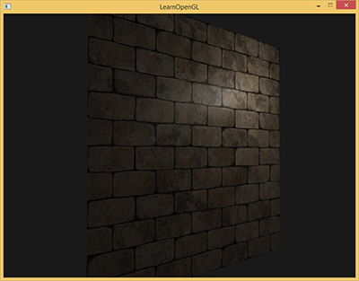

镜面遮罩只能改变高光强弱，不能凭空补出法线朝向。为片段提供不同法线，可以模拟许多微小表面的反射方向。


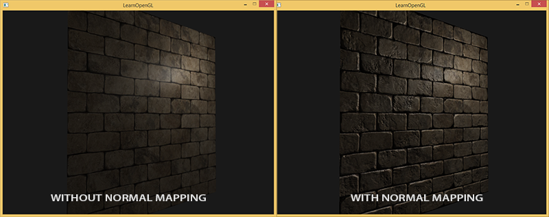

法线贴图属于表面凹凸表达技术，但不宜把它与所有 bump mapping 完全等同：高度图求导与直接存法线是不同的数据表示。原译文的未重写提示在此被技术修订取代，关键区别与原来的逐步案例继续保留。

应用定义 UV、切线基和贴图约定，Assimp 可以计算导入网格的切线，OpenGL 只按属性和纹理格式提供数值，驱动执行自定义光照；GLFW 不会决定法线图的绿色通道应如何解释。

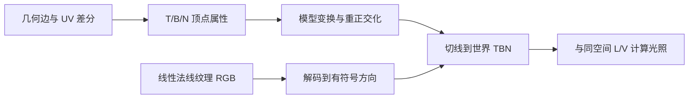

## 法线贴图

纹理的三个颜色通道也可存三维方向。把 $\mathbf n\in[-1,1]^3$ 编码成 $\mathbf c=(\mathbf n+1)/2$；采样后以 $2\mathbf c-1$ 解码，并再次归一化。它是方向数据，应使用线性内部格式，不能对采样值执行 sRGB 解码。

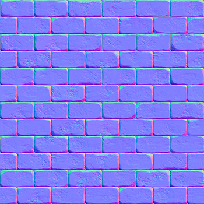

常见切线空间图偏蓝，是因为大部分法线接近切线空间 +Z，对应约 (0.5,0.5,1)。它不表示所有法线都恰好等于 +Z，也不能单看蓝色就断言资源正确。模式 0 使用几何法线，模式 2 使用正确的切线基，两者的材质、光源和旋转保持一致。

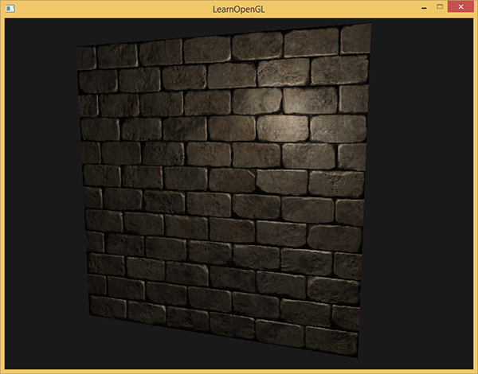

保留原资源方向提示但修正因果：图片上下翻转改变的是 UV 与图像行的对应；绿色通道翻转改变的是切线空间 Y 分量符号。两者相关但不能无条件互相替代。法线资源可能采用 +Y 或 -Y 约定，应与模型 UV、副切线方向和加载约定一起检查。本仓库颜色、法线使用同一套坐标，资源取自官方代码仓库，不额外逐张随意翻转。

如果直接把采样法线当成世界方向，朝 +Z 的平面可能看似合理；将它转到其他朝向就暴露错误。

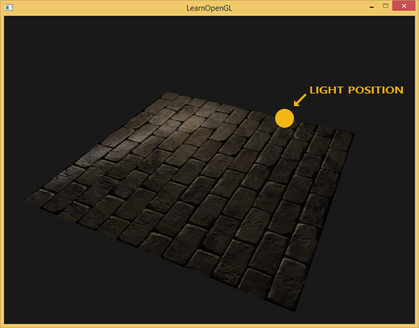

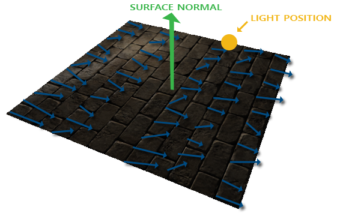

模式 1 故意忽略 TBN，把切线方向当世界方向，旋转后的平面会产生错误高光。为每个面重新画一张世界空间图并不适合通用可复用材质。对象空间法线图是另一种合法表示，但需要相应的变换流程，不能把它和切线图混用。

## 切线空间

切线空间是表面局部基：T 对齐 U 增大的方向，B 对齐 V 增大的方向，N 是几何法线。未扰动的表面法线在这个空间中是 (0,0,1)；有凹凸的采样法线当然可以偏离该方向。

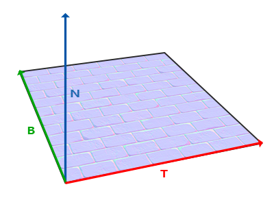

设三角形两条边为 $E_1=P_1-P_0$、$E_2=P_2-P_0$，UV 差分为 $(\Delta U_1,\Delta V_1)$、$(\Delta U_2,\Delta V_2)$。由于 T/B 代表沿 UV 轴的表面变化，有

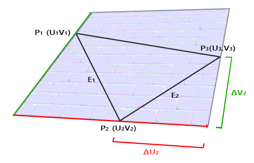

$$E_1=\Delta U_1T+\Delta V_1B,\qquad E_2=\Delta U_2T+\Delta V_2B.$$

每个向量式都可按 XYZ 展开，例如 $E_{1x}=\Delta U_1T_x+\Delta V_1B_x$，其他分量同理。把它们整理为矩阵方程：

$$\begin{bmatrix}E_1^T\\E_2^T\end{bmatrix}=
\begin{bmatrix}\Delta U_1&\Delta V_1\\\Delta U_2&\Delta V_2\end{bmatrix}
\begin{bmatrix}T^T\\B^T\end{bmatrix}.$$

左乘 UV 差分矩阵的逆，即可解出切线基。设 $D=\Delta U_1\Delta V_2-\Delta U_2\Delta V_1$：

$$\begin{bmatrix}T^T\\B^T\end{bmatrix}=
\frac1D\begin{bmatrix}\Delta V_2&-\Delta V_1\\-\Delta U_2&\Delta U_1\end{bmatrix}
\begin{bmatrix}E_1^T\\E_2^T\end{bmatrix}.$$

因此 $T=(\Delta V_2E_1-\Delta V_1E_2)/D$，$B=(-\Delta U_2E_1+\Delta U_1E_2)/D$。若 D=0，UV 映射退化，不能求这个逆，应拒绝或修复数据；不是加一个任意很小的分母就能恢复真实切线。

### 手工计算切线和副切线

本例用四个位置组成两组三角形，UV 覆盖 [0,1]²。每个三角形分别计算两条边和两个 UV 差，再套用公式。平面朝 +Z，两条切线归一化后是 +X 与 +Y。

```cpp
void append_triangle(std::vector<vertex>& vertices, const std::array<glm::vec3, 3>& points,
                     const std::array<glm::vec2, 3>& uv) {
    const glm::vec3 edge1{points[1] - points[0]};
    const glm::vec3 edge2{points[2] - points[0]};
    const glm::vec2 delta1{uv[1] - uv[0]};
    const glm::vec2 delta2{uv[2] - uv[0]};
    const float determinant{delta1.x * delta2.y - delta2.x * delta1.y};
    const glm::vec3 tangent{glm::normalize((delta2.y * edge1 - delta1.y * edge2) / determinant)};
    const glm::vec3 bitangent{glm::normalize((-delta2.x * edge1 + delta1.x * edge2) / determinant)};
    const glm::vec3 normal{glm::normalize(glm::cross(edge1, edge2))};
    for (std::size_t index{0U}; index < 3U; ++index) {
        vertices.push_back({points[index], normal, uv[index], tangent, bitangent});
    }
}
```

这里生成的 UV 已知不退化。通用模型加载器必须另外检查输入；同一三角形的三个顶点可共享计算结果，但跨三角形平滑时应考虑硬边、UV 缝与手性，不能把所有方向无条件平均。

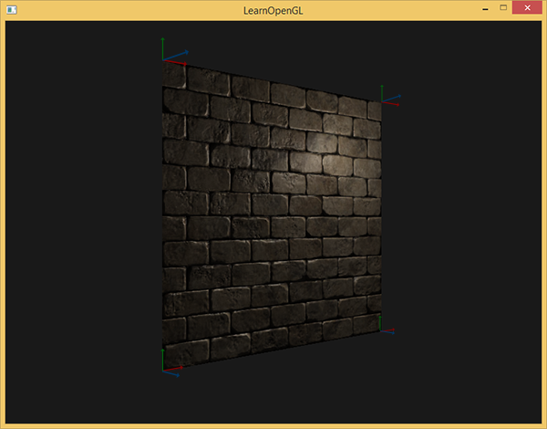

### 切线空间法线贴图

把 T/B/N 作为顶点属性上传。变到世界空间时，切线是表面的方向，使用 model 的线性部分；法线使用逆转置。原文建议把所有基向量一概改用法线矩阵不够准确，非均匀缩放下应区分两类向量，再重正交化。

```glsl
#version 330 core
layout(location=0) in vec3 a_pos;
layout(location=1) in vec3 a_normal;
layout(location=2) in vec2 a_tex_coord;
layout(location=3) in vec3 a_tangent;
layout(location=4) in vec3 a_bitangent;
out vec3 world_position;
out vec3 world_normal;
out vec2 tex_coord;
out mat3 surface_tbn;
out vec3 tangent_light;
out vec3 tangent_camera;
out vec3 tangent_position;
uniform mat4 model;
uniform mat4 view;
uniform mat4 projection;
uniform vec3 light_pos;
uniform vec3 camera_pos;
void main() {
    vec4 position = model * vec4(a_pos,1.0);
    vec3 normal = normalize(transpose(inverse(mat3(model))) * a_normal);
    vec3 tangent = normalize(mat3(model) * a_tangent);
    tangent = normalize(tangent - dot(tangent,normal) * normal);
    float handedness = dot(cross(normal,tangent),mat3(model) * a_bitangent) < 0.0 ? -1.0 : 1.0;
    vec3 bitangent = handedness * cross(normal,tangent);
    surface_tbn = mat3(tangent,bitangent,normal);
    mat3 world_to_tangent = transpose(surface_tbn);
    tangent_light = world_to_tangent * light_pos;
    tangent_camera = world_to_tangent * camera_pos;
    tangent_position = world_to_tangent * position.xyz;
    world_position = position.xyz;
    world_normal = normal;
    tex_coord = a_tex_coord;
    gl_Position = projection * view * position;
}
```

`mat3(T,B,N)` 的列就是三个基向量，因此把切线方向左乘它，得到世界方向。对右手正交基，B 的方向为 `cross(N,T)`；原译文的 `cross(T,N)` 会反向，除非同时采用相反的手性约定。镜像 UV 需保存手性，本例通过导入的副切线方向判断符号。

第一条光照路径将采样法线变到世界空间，L/V 继续使用世界空间。第二条路径将光源、相机和表面位置乘正交基的转置，改在切线空间计算 L/V。模式 2 和模式 4 对照这两种组织方式：

```glsl
#version 330 core
in vec3 world_position;
in vec3 world_normal;
in vec2 tex_coord;
in mat3 surface_tbn;
in vec3 tangent_light;
in vec3 tangent_camera;
in vec3 tangent_position;
out vec4 frag_color;
uniform sampler2D diffuse_texture;
uniform sampler2D normal_texture;
uniform sampler2D specular_texture;
uniform vec3 light_pos;
uniform vec3 camera_pos;
uniform int mode;
void main() {
    vec3 mapped = normalize(texture(normal_texture,tex_coord).rgb * 2.0 - 1.0);
    vec3 normal = mode == 0 ? normalize(world_normal) : mode == 1 ? mapped :
        normalize(surface_tbn * mapped);
    vec3 light_dir = normalize(light_pos-world_position);
    vec3 view_dir = normalize(camera_pos-world_position);
    if (mode == 4) {
        normal = mapped;
        light_dir = normalize(tangent_light-tangent_position);
        view_dir = normalize(tangent_camera-tangent_position);
    }
    float diffuse = max(dot(normal,light_dir),0.0);
    float specular = diffuse > 0.0 ? pow(max(dot(normal,normalize(light_dir+view_dir)),0.0),32.0) : 0.0;
    vec3 albedo = texture(diffuse_texture,tex_coord).rgb;
    float mask = texture(specular_texture,tex_coord).r;
    vec3 color = albedo * (0.08 + 0.8 * diffuse) + vec3(mask * specular * 0.4);
    frag_color = vec4(pow(max(color,vec3(0.0)),vec3(1.0/2.2)),1.0);
}
```

当基是单位正交基时，逆矩阵才等于转置，不是任意 TBN 都能这样替换。在顶点阶段变换位置可减少片段阶段乘法，但基跨曲面变化再插值时，两种组织不一定逐像素严格相同。本例的平面基固定，适合直接比较，优化效果仍需具体测量。

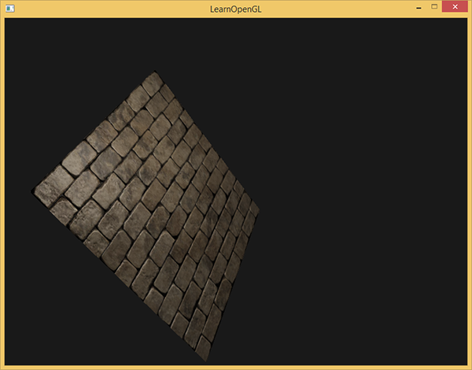

### 复杂物体

真实工作中通常在加载器里计算一次切线。本仓库模式 3 实际导入带 UV 的箱子模型，启用 `aiProcess_CalcTangentSpace`，再读取每个网格的 mTangents、mBitangents 和材质纹理；不是把模型案例降成读者练习。

```cpp
std::vector<material_mesh> load_normal_model(gpu_resources& resources) {
    Assimp::Importer importer{};
    const auto path{asset_path("models/relief_box/relief_box.obj")};
    const aiScene* scene{importer.ReadFile(
        path.string(), aiProcess_Triangulate | aiProcess_GenSmoothNormals |
                           aiProcess_CalcTangentSpace | aiProcess_JoinIdenticalVertices)};
    if (scene == nullptr || scene->mRootNode == nullptr ||
        (scene->mFlags & AI_SCENE_FLAGS_INCOMPLETE) != 0U) {
        std::cerr << "Model load failed: " << path << ": " << importer.GetErrorString() << '\n';
        return {};
    }
    std::vector<material_mesh> result{};
    if (!upload_model_node(resources, *scene, *scene->mRootNode, glm::mat4{1.0F},
                           path.parent_path(), result))
        return {};
    return result;
}
```

模型节点变换会烘焙到上传数据中：位置含平移，切线与副切线用线性部分，法线用逆转置。之后的绘制仍可有整体 model 变换。材质读取过程如下：

```cpp
GLuint material_texture(gpu_resources& resources, const aiMaterial& material, aiTextureType type,
                        const std::filesystem::path& directory, bool srgb) {
    aiString relative{};
    if (material.GetTexture(type, 0, &relative) != AI_SUCCESS) {
        std::cerr << "Required material texture missing, type=" << static_cast<int>(type) << '\n';
        return 0U;
    }
    return load_texture(resources, directory / relative.C_Str(), srgb);
}
```

OBJ 的 `map_Bump` 常被导入为 `aiTextureType_HEIGHT`，但 bump 语义本来可以是真高度，**不能把所有 HEIGHT 纹理都当作法线图**。本例自制 MTL 明确注明它存的是官方砖墙切线法线；程序先查 NORMALS，再按该资源约定回退到 HEIGHT，颜色图按 sRGB 读取，法线和镜面遮罩按线性读取。

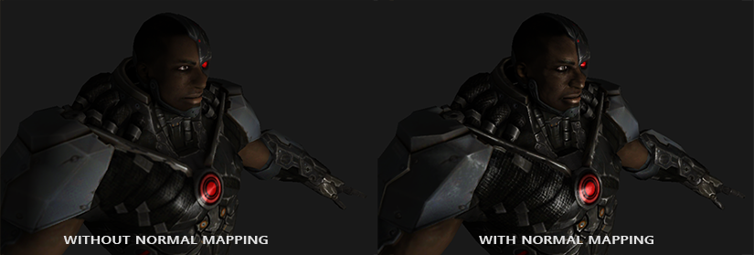

上图使用上游复杂模型，下图对比高精度几何与低精度几何加法线图。它们说明微观光照细节可以来自纹理，但真实轮廓、遮挡和大尺度几何不能由法线图补回。

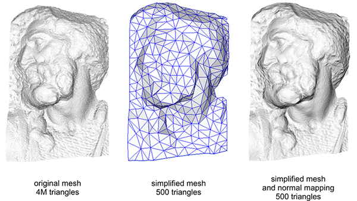

模型需要有效 UV 与法线；导入库能计算切线不代表任意镜像、退化或缝合网格都适合直接使用。应保留 UV 缝和硬边的顶点拆分，并让烘焙工具和运行时采用兼容的切线基约定。

## 最后一件事

插值、平均和非均匀变换会让 T 不再垂直 N。Gram-Schmidt 处理先从 T 中减去 N 方向分量，再归一化；B 用带手性符号的叉积恢复。本例顶点程序已包含 `T-dot(T,N)*N` 这一步，而非仅把平均后的三个向量各自归一化。

> **常见误解：** 将 T、B、N 分别归一化只能使长度为 1，不能保证相互垂直；法线图“偏蓝”也不能证明模型使用了正确空间和手性。

> **进阶（切线基约定）：** **法线贴图与切线生成规则必须配套。** 同一个低模网格可以因 UV 接缝、顶点平均权重和镜像手性不同得到不同的切线基。烘焙时若采用另一套规则，运行时即使公式无误也可能看到接缝。调试时可先显示几何法线，再显示 T/B 与采样法线，逐层确认数据；本例手工平面给出已知正确的参考基，再扩展到 Assimp 导入路径。


## 附加资源

保留底本中的源码、资源与阅读入口。外部旧程序的文件组织与本仓库不同，实际实现以本文标注的本地目标为准。

- [这个diffuse纹理](https://learnopengl.com/img/textures/brickwall.jpg)
- [这个法线贴图](https://learnopengl.com/img/textures/brickwall_normal.jpg)
- [摄像机教程](https://github.com/LearnOpenGL-CN/LearnOpenGL-CN/blob/331560886468e28f28326429334fc48470f9c27b/docs/01%20Getting%20started/09%20Camera.md)
- [源代码](http://www.learnopengl.com/code_viewer.php?code=advanced-lighting/normal_mapping)
- [顶点](http://www.learnopengl.com/code_viewer.php?code=advanced-lighting/normal_mapping&type=vertex)
- [像素](http://www.learnopengl.com/code_viewer.php?code=advanced-lighting/normal_mapping&type=fragment)
- [Tutorial 26: Normal Mapping](http://ogldev.atspace.co.uk/www/tutorial26/tutorial26.html)
- [How Normal Mapping Works](https://www.youtube.com/watch?v=LIOPYmknj5Q)
- [Normal Mapping Mathematics](https://www.youtube.com/watch?v=4FaWLgsctqY)
- [Tutorial 13: Normal Mapping](http://www.opengl-tutorial.org/intermediate-tutorials/tutorial-13-normal-mapping/)

## 本仓库示例

源码：[main.cpp](../../apps/05_advanced_lighting/05_normal_mapping/main.cpp)，目标 `05_advanced_lighting__05_normal_mapping`。helper 保留在各文件匿名命名空间，不依赖共享源码；GLSL 为内嵌字符串。必需 uniform 在初始化时检查并缓存，资源由上下文有效期内的 RAII 守卫释放。

```powershell
cmake --preset mingw-gcc-debug
cmake --build --preset mingw-gcc-debug --target 05_advanced_lighting__05_normal_mapping
.\build\mingw-gcc-debug\apps\05_advanced_lighting\05_normal_mapping\05_advanced_lighting__05_normal_mapping.exe --mode 0
```

依赖安装与其他 preset 见[构建指南](../build.md)。Esc 退出，WASD 移动，鼠标转向，滚轮调整 FOV，空格依次切换以下模式；`--mode M` 选择初始模式。 有限帧检查使用 `--frames 3 --capture output.ppm`，隐藏窗口并保存末帧。

| `--mode` | 可观察内容 |
| --- | --- |
| 0 | 几何法线基准 |
| 1 | 忽略 TBN 的错误对照 |
| 2 | 旋转平面，采样法线变到世界空间 |
| 3 | Assimp 模型、材质法线/镜面图与切线 |
| 4 | 平面在切线空间计算光照 |

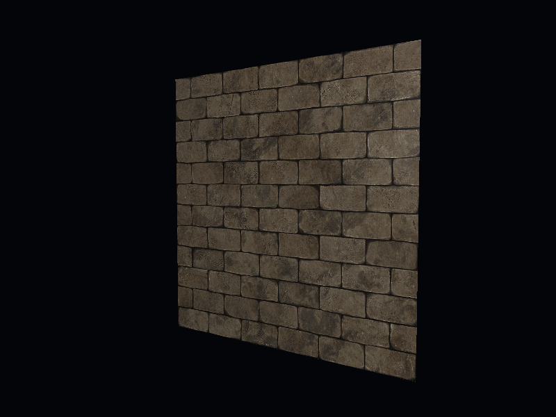

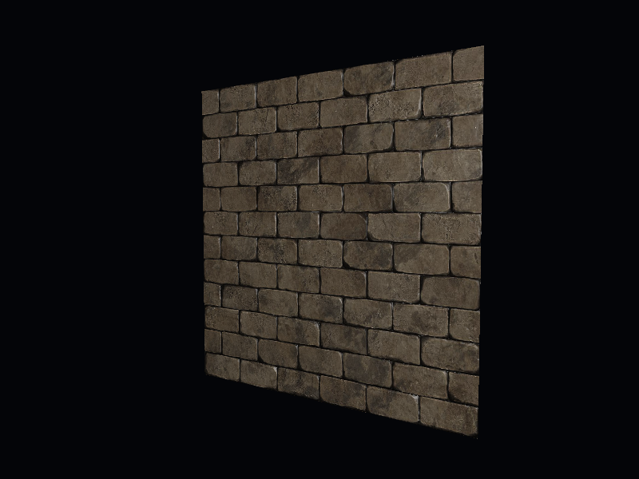

## 本章整体回顾

UV 决定局部切线方向，TBN 将法线图与光照统一到同一空间；手性、逆转置和正交性不能混淆。 本篇保留原小节、教学图片及附加资源，程序资源与上游截图的对应和差异见[图片记录](../img/05/README.md)与[资源来源](../../assets/chapter05_resources.md)。

技术核校：[英文原文](https://learnopengl.com/Advanced-Lighting/Normal-Mapping)、[OpenGL 3.3 Core 规范](https://registry.khronos.org/OpenGL/specs/gl/glspec33.core.pdf)、[GLSL 3.30 规范](https://registry.khronos.org/OpenGL/specs/gl/GLSLangSpec.3.30.pdf)。 Assimp 切线处理另见[官方后处理说明](https://the-asset-importer-lib-documentation.readthedocs.io/en/latest/usage/postprocessing.html)。

下一节：[视差贴图](06_parallax_mapping.md)。
