# 视差贴图

| 项目 | 信息 |
| --- | --- |
| 原文 | [Parallax-Mapping](https://learnopengl.com/Advanced-Lighting/Parallax-Mapping) |
| 作者 | Joey de Vries |
| 翻译 | [Django](http://bullteacher.com/) |
| 校对 | 暂无 |
| 中文底本 | [LearnOpenGL-CN 固定版本](https://github.com/LearnOpenGL-CN/LearnOpenGL-CN/blob/331560886468e28f28326429334fc48470f9c27b/docs/05%20Advanced%20Lighting/05%20Parallax%20Mapping.md)，`new-theme` / `331560886468e28f28326429334fc48470f9c27b` |
| 本仓库示例 | [main.cpp](../../apps/05_advanced_lighting/06_parallax_mapping/main.cpp) |
| 修订与范围 | [逐项覆盖与验证记录](coverage.md)；纯 GFM，代码片段逐字取自对应源码 |

**视差贴图沿观察方向修改纹理坐标，以较少几何模拟表面深度；它本身不移动顶点。** 法线贴图改变反射方向，视差贴图改变“应看见纹理的哪个位置”，两者结合才让外观深度和光照细节相互配合。它不是一种光照方程，因此仍可和不同的直接光照模型组合。

原译文把视差映射与真实几何位移混写，本篇明确区分：位移贴图可以真正移动细分网格的顶点；本篇的视差映射在片段阶段估计交点，两个三角形的位置与深度轮廓仍保持原样。原“未重写”提示对应的技术内容已重新核校。

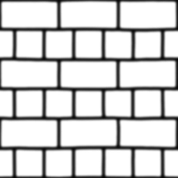

高度图的明暗描述相对高度。若真正按它移动顶点，需要足够密的网格，否则大幅度高度变化会缺少几何采样；这不意味着“一千个顶点必然太昂贵”，而是要比较几何、采样与目标精度的成本。

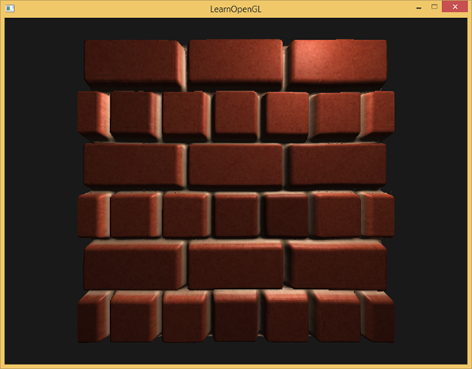

上游图示的表面只用两个三角形产生外观深度，提示我们不必为每个纹素增添一个顶点。但这样的平面仍无法自动改变真实遮挡和轮廓。


图中 A 是观察射线与原平面的交点，B 是与假想起伏表面的交点。如果在 A 的片段位置改用 B 对应的 UV，观察者就获得表面起伏的错觉。先用 A 处的高度估计沿视线的位移，再取与表面纹理平行的两个分量。

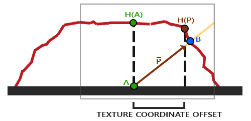

单次高度估计只对变化缓慢的表面较合理；高度骤变时，估计的点可能与真实交点相差很远。

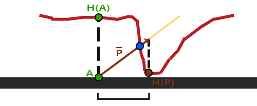

观察向量必须放到与 UV 方向对应的切线空间，才能把 X/Y 当作 U/V 偏移；直接取世界向量 XY 会在旋转模型后失效。应用决定高度定义、方向和尺度，OpenGL 提供线性纹理采样与片段丢弃，驱动执行求交近似，GLFW 仍只负责窗口和输入。

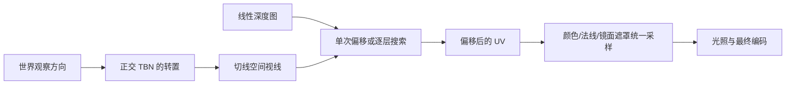

## 视差贴图

本例仍从平面两组三角形计算切线基，顶点阶段把相机与表面位置送入切线空间。颜色、法线与深度资源来自同一组材质；模式 0 只有法线贴图，模式 1 开启基本视差，模式 2 开启偏移限制版本。

```glsl
#version 330 core
layout(location=0) in vec3 a_pos;
layout(location=1) in vec3 a_normal;
layout(location=2) in vec2 a_tex_coord;
layout(location=3) in vec3 a_tangent;
layout(location=4) in vec3 a_bitangent;
out vec3 world_position;
out vec3 world_normal;
out vec2 tex_coord;
out mat3 surface_tbn;
out vec3 tangent_light;
out vec3 tangent_camera;
out vec3 tangent_position;
uniform mat4 model;
uniform mat4 view;
uniform mat4 projection;
uniform vec3 light_pos;
uniform vec3 camera_pos;
void main() {
    vec4 position = model * vec4(a_pos,1.0);
    vec3 normal = normalize(transpose(inverse(mat3(model))) * a_normal);
    vec3 tangent = normalize(mat3(model) * a_tangent);
    tangent = normalize(tangent - dot(tangent,normal) * normal);
    float handedness = dot(cross(normal,tangent),mat3(model) * a_bitangent) < 0.0 ? -1.0 : 1.0;
    vec3 bitangent = handedness * cross(normal,tangent);
    surface_tbn = mat3(tangent,bitangent,normal);
    mat3 world_to_tangent = transpose(surface_tbn);
    tangent_light = world_to_tangent * light_pos;
    tangent_camera = world_to_tangent * camera_pos;
    tangent_position = world_to_tangent * position.xyz;
    world_position = position.xyz;
    world_normal = normal;
    tex_coord = a_tex_coord;
    gl_Position = projection * view * position;
}
```

为了沿“进入表面”的方向搜索，本例加载的是深度图，0 表示外层，1 表示更深处。它与高度图的语义相反；若源图存高度，可用 $D=1-H$ 转换一次，不能把已经反相的深度图再反相。

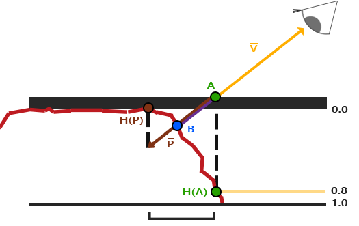

基本偏移近似为

$$\Delta\mathbf{uv}=\frac{\mathbf V_{ts}.xy}{\mathbf V_{ts}.z}\,D(\mathbf{uv})\,h,
\qquad \mathbf{uv}'=\mathbf{uv}-\Delta\mathbf{uv},$$

其中 V 从表面指向观察者，h 是深度尺度。垂直观察时 XY 很小，偏移很小；掠射时 Z 接近零，位移显著增大。模式 1 将分母下限设为 0.05，避免数值爆炸；这是掠射角的稳定化近似，不是精确求交。背面视线 Z≤0 的片段直接丢弃。

模式 2 不除以 Z，称为偏移限制（offset limiting），用更小的掠射位移换取稳定性。两者不是只改亮度，最终必须用同一个偏移 UV 采样颜色、法线和镜面遮罩，否则凹凸与光照会错位。

```glsl
vec2 parallax_coords(vec2 uv, vec3 view_dir) {
    if (mode == 0) return uv;
    float depth = texture(depth_texture,uv).r;
    float safe_z = max(view_dir.z,0.05);
    if (mode == 1) return uv - view_dir.xy / safe_z * depth * height_scale;
    if (mode == 2) return uv - view_dir.xy * depth * height_scale;
    float layers = mix(32.0,8.0,clamp(view_dir.z,0.0,1.0));
    float layer_step = 1.0 / layers;
    vec2 delta_uv = view_dir.xy / safe_z * height_scale / layers;
    vec2 current_uv = uv;
    float current_layer = 0.0;
    float sampled_depth = depth;
    for (int i=0; i<32 && current_layer < sampled_depth; ++i) {
        current_uv -= delta_uv;
        sampled_depth = texture(depth_texture,current_uv).r;
        current_layer += layer_step;
    }
    if (mode == 3) return current_uv;
    vec2 previous_uv = current_uv + delta_uv;
    float after_depth = sampled_depth-current_layer;
    float before_depth = texture(depth_texture,previous_uv).r-current_layer+layer_step;
    float denominator = after_depth-before_depth;
    float weight = abs(denominator) > 0.000001 ? clamp(after_depth/denominator,0.0,1.0) : 0.0;
    return mix(current_uv,previous_uv,weight);
}
```

函数中的模式 1/2 对应刚讨论的单次估计，模式 3/4/5 对应后面两种多层方法。Q/E 将 h 在 [0,0.25] 中调整；默认 h=0.1。比较时先固定视角和尺度，再改变算法，避免误把参数变化当作精度差异。

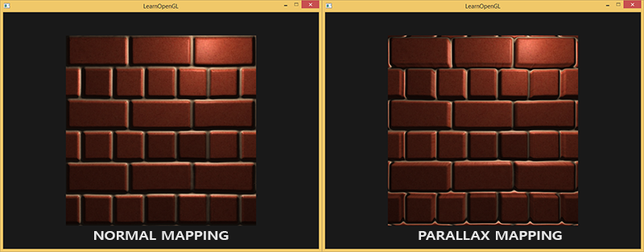

平面边缘的 UV 可能被偏移到 [0,1] 外；重复环绕会把另一侧的砖块引进来。本例用 `discard` 丢弃这些片段，使平面演示的边缘更合理。

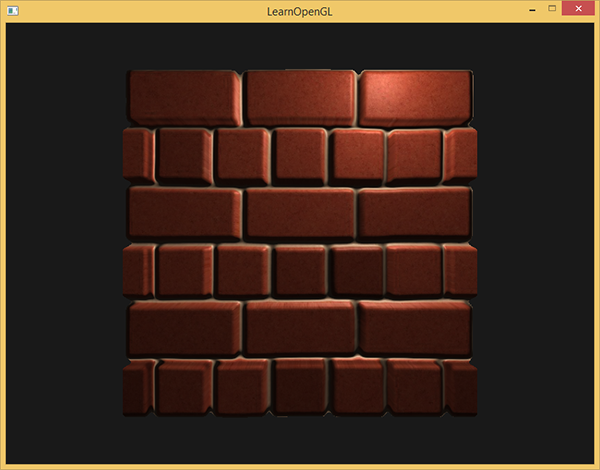

丢弃并没有真的生成侧面，不能无条件用于需要连续平铺的任意网格。基本视差在陡峭高度上仍可能出现拉伸或错误覆盖。

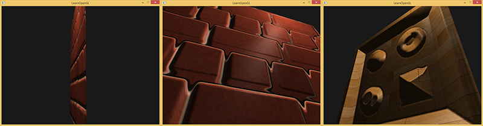

## 陡峭视差映射

将归一化深度 [0,1] 分为 N 层，步长 $\Delta d=1/N$，每层的 UV 步长为 $\Delta\mathbf{uv}=\mathbf V_{ts}.xy/\mathbf V_{ts}.z\cdot h/N$。从原 UV 和层深度 0 出发，沿负 UV 偏移逐步进入表面，比较“当前层深度”和“该 UV 的深度图值”。

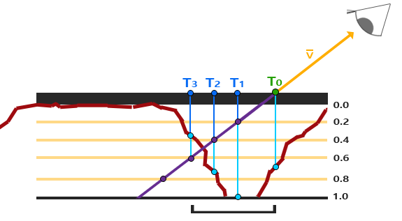

若层深度仍小于贴图深度，射线点尚未达到表面，继续前进；首次满足层深度不小于贴图深度时，已跨过交点。修正原译文对“在表面上下”的反向描述：例如层深度 0.4 对贴图 0.73 还未穿入；层深度 0.6 对贴图 0.37 已越过表面。

模式 3 返回这一层的 UV。代码预先计算每层的深度与 UV 偏移，再在有界循环内更新坐标、重新取样并累加层深度。层数用 $N=\operatorname{mix}(32,8,\operatorname{clamp}(V_z,0,1))$，正面较少、掠射较多，不会无限循环。

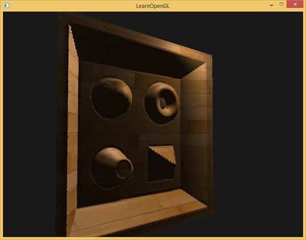

上游木制玩具箱示例强调高度不连续时的差异；本仓库模式 5 实际加载同一套玩具箱颜色、法线和深度图并采用 POM，不只保留资源链接。砖墙模式可从 0 逐步切换到 4，观察一次估计、多层步进与插值的区别。

有限层数把交点量化到某一层，因此会有阶梯与断层；增加层数能改善却增加纹理采样成本。

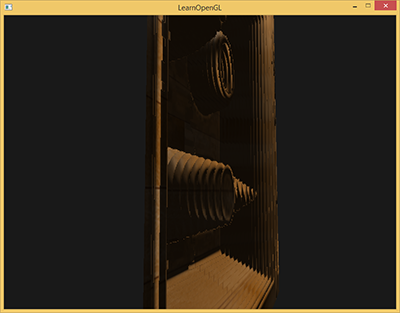

原文接着介绍两种进一步搜索：relief mapping 往往在交叉区间内再做细化，例如二分搜索；POM 直接在最后两个层样本间插值。哪种更快或更精确取决于采样预算和高度场，不能给出与实现无关的绝对排序。下面保留并实现 POM。

## 视差遮蔽映射

POM（Parallax Occlusion Mapping）仍先找到首次穿越，只把“返回当前层”替换成“在上一层与当前层之间估计交点”。它不需要重新从顶层开始。

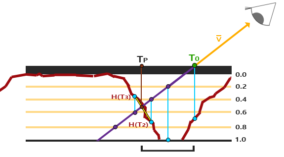

设穿越后的差值为 $a=D_{after}-d_{after}$，穿越前为 $b=D_{before}-d_{before}$，则权重 $w=a/(a-b)$，返回 $(1-w)\mathbf{uv}_{after}+w\mathbf{uv}_{before}$。前后差值应使用各自的层深度；漏加上一层的 layer_step 会改变插值位置。代码还检查近零分母并钳制权重。

模式 4 为砖墙 POM，模式 5 为玩具箱 POM。完整片段程序展示所有材质如何使用同一个求交结果：

```glsl
#version 330 core
in vec3 world_position;
in vec3 world_normal;
in vec2 tex_coord;
in mat3 surface_tbn;
in vec3 tangent_light;
in vec3 tangent_camera;
in vec3 tangent_position;
out vec4 frag_color;
uniform sampler2D diffuse_texture;
uniform sampler2D normal_texture;
uniform sampler2D specular_texture;
uniform vec3 light_pos;
uniform vec3 camera_pos;
uniform int mode;
uniform sampler2D depth_texture;
uniform float height_scale;
vec2 parallax_coords(vec2 uv, vec3 view_dir) {
    if (mode == 0) return uv;
    float depth = texture(depth_texture,uv).r;
    float safe_z = max(view_dir.z,0.05);
    if (mode == 1) return uv - view_dir.xy / safe_z * depth * height_scale;
    if (mode == 2) return uv - view_dir.xy * depth * height_scale;
    float layers = mix(32.0,8.0,clamp(view_dir.z,0.0,1.0));
    float layer_step = 1.0 / layers;
    vec2 delta_uv = view_dir.xy / safe_z * height_scale / layers;
    vec2 current_uv = uv;
    float current_layer = 0.0;
    float sampled_depth = depth;
    for (int i=0; i<32 && current_layer < sampled_depth; ++i) {
        current_uv -= delta_uv;
        sampled_depth = texture(depth_texture,current_uv).r;
        current_layer += layer_step;
    }
    if (mode == 3) return current_uv;
    vec2 previous_uv = current_uv + delta_uv;
    float after_depth = sampled_depth-current_layer;
    float before_depth = texture(depth_texture,previous_uv).r-current_layer+layer_step;
    float denominator = after_depth-before_depth;
    float weight = abs(denominator) > 0.000001 ? clamp(after_depth/denominator,0.0,1.0) : 0.0;
    return mix(current_uv,previous_uv,weight);
}
void main() {
    vec3 view_tangent = normalize(tangent_camera-tangent_position);
    if (view_tangent.z <= 0.0) discard;
    vec2 uv = parallax_coords(tex_coord,view_tangent);
    if (any(lessThan(uv,vec2(0.0))) || any(greaterThan(uv,vec2(1.0)))) discard;
    vec3 mapped = normalize(texture(normal_texture,uv).rgb * 2.0 - 1.0);
    vec3 normal = normalize(surface_tbn * mapped);
    vec3 light_dir = normalize(light_pos-world_position);
    vec3 view_dir = normalize(camera_pos-world_position);
    float diffuse = max(dot(normal,light_dir),0.0);
    float specular = diffuse > 0.0 ? pow(max(dot(normal,normalize(light_dir+view_dir)),0.0),32.0) : 0.0;
    vec3 albedo = texture(diffuse_texture,uv).rgb;
    float mask = texture(specular_texture,uv).r;
    vec3 color = (0.1 + diffuse * 0.8) * albedo + vec3(mask * specular * 0.25);
    frag_color = vec4(pow(max(color,vec3(0.0)),vec3(1.0/2.2)),1.0);
}
```

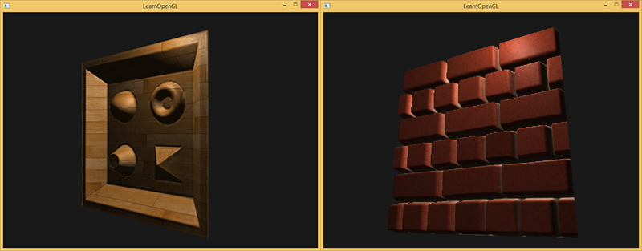

结果通常比取整到某一层平滑，但仍是高度场上的近似，不会自动生成真实侧面、位移深度、投影阴影或任意自阴影。适合本来就不容易看清外轮廓的墙面和地面；观察角度过于掠射或高度尺度过大时仍会暴露局限。

> **常见误解：** 名称里的“遮蔽”不表示这一版程序已经计算光源方向的自阴影。它估计观察射线对应的可见 UV，光照仍由偏移后法线参与 Blinn-Phong 计算。

> **进阶（轮廓与深度）：** **片段里的 UV 位移不能替代几何可见性。** 本例的裁剪、光栅化和深度仍来自原来的两个三角形，屏幕上看似凹进去的砖缝不会改变其他物体与它的真实相交。若需要正确轮廓和交叉遮挡，应选择实际几何位移，或额外设计一致的深度与阴影处理。提高层数只能改善当前高度场求交的估计，无法凭空补足未建模的几何。


## 附加资源

保留底本中的源码、资源与阅读入口。外部旧程序的文件组织与本仓库不同，实际实现以本文标注的本地目标为准。

- [源代码](http://www.learnopengl.com/code_viewer.php?code=advanced-lighting/parallax_mapping)
- [顶点](http://www.learnopengl.com/code_viewer.php?code=advanced-lighting/parallax_mapping&type=vertex)
- [像素](http://www.learnopengl.com/code_viewer.php?code=advanced-lighting/parallax_mapping&type=fragment)
- [像素](http://www.learnopengl.com/code_viewer.php?code=advanced-lighting/parallax_mapping_occlusion&type=fragment)
- [Parallax Occlusion Mapping in GLSL](http://sunandblackcat.com/tipFullView.php?topicid=28)
- [How Parallax Displacement Mapping Works](https://www.youtube.com/watch?v=xvOT62L-fQI)

## 本仓库示例

源码：[main.cpp](../../apps/05_advanced_lighting/06_parallax_mapping/main.cpp)，目标 `05_advanced_lighting__06_parallax_mapping`。helper 保留在各文件匿名命名空间，不依赖共享源码；GLSL 为内嵌字符串。必需 uniform 在初始化时检查并缓存，资源由上下文有效期内的 RAII 守卫释放。

```powershell
cmake --preset mingw-gcc-debug
cmake --build --preset mingw-gcc-debug --target 05_advanced_lighting__06_parallax_mapping
.\build\mingw-gcc-debug\apps\05_advanced_lighting\06_parallax_mapping\05_advanced_lighting__06_parallax_mapping.exe --mode 0
```

依赖安装与其他 preset 见[构建指南](../build.md)。Esc 退出，WASD 移动，鼠标转向，滚轮调整 FOV，空格依次切换以下模式；`--mode M` 选择初始模式。 Q/E 分别降低/增加视差深度尺度。 有限帧检查使用 `--frames 3 --capture output.ppm`，隐藏窗口并保存末帧。

| `--mode` | 可观察内容 |
| --- | --- |
| 0 | 只有法线贴图 |
| 1 | 基本视差，除以观察方向 Z |
| 2 | 偏移限制版本 |
| 3 | 陡峭视差步进 |
| 4 | 砖墙 POM 插值 |
| 5 | 玩具箱 POM，实际加载另一组材质 |

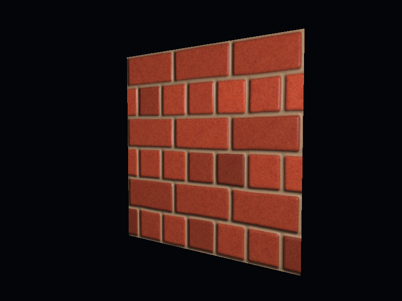

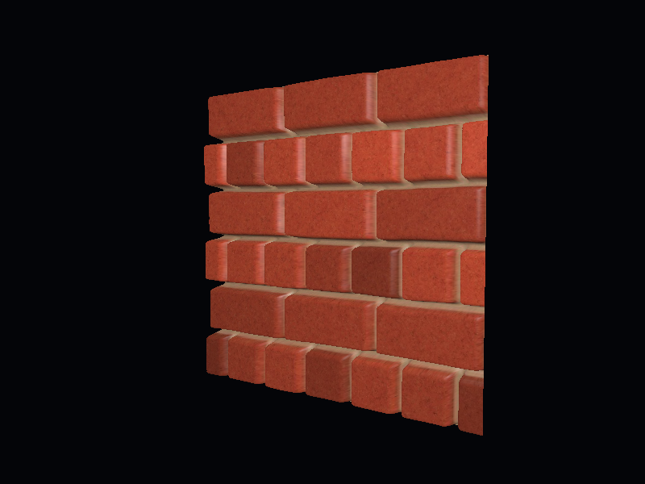

## 本章整体回顾

单次偏移、多层步进和交叉层插值逐步提高 UV 交点估计，真实几何轮廓与深度仍未改变。 本篇保留原小节、教学图片及附加资源，程序资源与上游截图的对应和差异见[图片记录](../img/05/README.md)与[资源来源](../../assets/chapter05_resources.md)。

技术核校：[英文原文](https://learnopengl.com/Advanced-Lighting/Parallax-Mapping)、[OpenGL 3.3 Core 规范](https://registry.khronos.org/OpenGL/specs/gl/glspec33.core.pdf)、[GLSL 3.30 规范](https://registry.khronos.org/OpenGL/specs/gl/GLSLangSpec.3.30.pdf)。

下一节：[HDR](07_hdr.md)。
