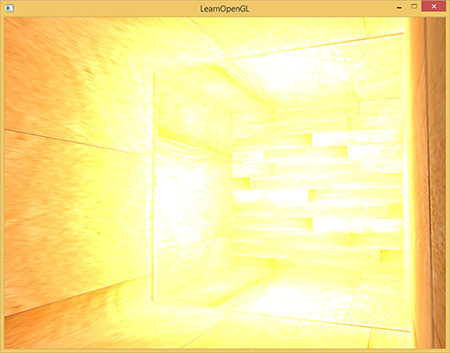
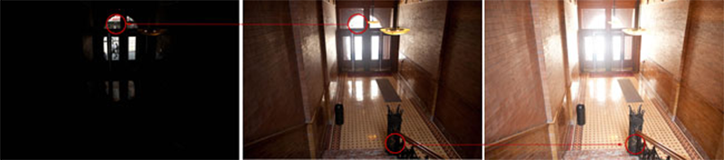
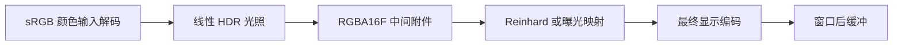
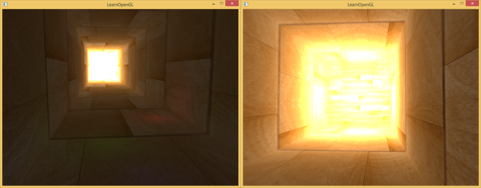
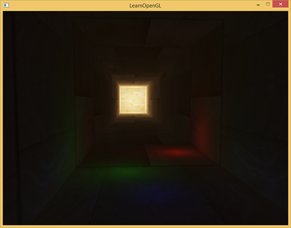
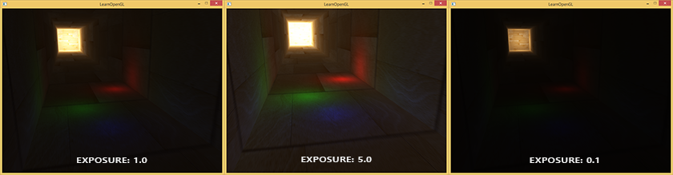

# HDR

| 项目 | 信息 |
| --- | --- |
| 原文 | [HDR](https://learnopengl.com/Advanced-Lighting/HDR) |
| 作者 | Joey de Vries |
| 翻译 | Krasjet |
| 校对 | 暂无 |
| 来源 | [LearnOpenGL-CN](https://github.com/LearnOpenGL-CN/LearnOpenGL-CN/blob/331560886468e28f28326429334fc48470f9c27b/docs/05%20Advanced%20Lighting/06%20HDR.md) |
| 本仓库示例 | [main.cpp](../../apps/05_advanced_lighting/07_hdr/main.cpp) |

**HDR 渲染先保留超过 1 的线性光照结果，再通过色调映射得到适合输出的范围。** 使用常见归一化定点颜色附件时，多个亮光相加后的值可能被钳到 1，原来不同的亮部都变成相同数值，后续再降低亮度也无法找回差别。



把灯光整体调弱可避免部分溢出，却也改变了暗部和其他场景参数。浮点中间缓冲让我们先保留照明结果，再决定曝光与显示映射。它不让屏幕无限明亮，而是延后不可逆的范围压缩。

摄影中的多次曝光可以分别捕获暗部和亮部细节，再组合成较大动态范围的表示；这是理解 HDR 的类比，不表示实时场景必须先渲染多张曝光图。



人眼也会随观察条件适应，但本例不是完整的人眼模型。本篇把浮点存储、色调映射和最终编码三个环节拆开；GLFW 创建窗口，OpenGL 定义附件与数值转换，驱动进行浮点渲染，应用选择曝光和映射曲线。



## 浮点帧缓冲

使用 `GL_RGBA16F` 等浮点内部格式，可以保存大于 1 的值；`GL_RGBA8` 等归一化定点格式的有效范围则为 [0,1]。外部参数 `GL_FLOAT` 描述上传数据的类型，**只有它本身并不会把 RGBA8 附件变成 HDR**。本例分配空纹理时由内部格式明确规定存储。

```cpp
bool resize_target(gpu_resources& resources, color_target& target, int width, int height,
                   std::span<const GLint> formats, bool depth) {
    if (target.framebuffer == 0U) {
        // OpenGL: FBO 组织附件，纹理/RBO 才拥有实际存储。
        glGenFramebuffers(1, &target.framebuffer);
        resources.framebuffers.push_back(target.framebuffer);
        target.colors.resize(formats.size());
        glGenTextures(static_cast<GLsizei>(target.colors.size()), target.colors.data());
        resources.textures.insert(resources.textures.end(), target.colors.begin(),
                                  target.colors.end());
        if (depth) {
            // OpenGL: 创建供离屏深度/模板使用的渲染缓冲对象名称。
            glGenRenderbuffers(1, &target.depth_stencil);
            resources.renderbuffers.push_back(target.depth_stencil);
        }
    }
    // OpenGL: GL_FRAMEBUFFER 同时选择读目标与绘制目标。
    glBindFramebuffer(GL_FRAMEBUFFER, target.framebuffer);
    if (target.width != width || target.height != height) {
        for (std::size_t index{0U}; index < formats.size(); ++index) {
            bind_texture(0, target.colors[index]);
            glTexImage2D(GL_TEXTURE_2D, 0, formats[index], width, height, 0,
                         formats[index] == GL_R16F ? GL_RED : GL_RGBA, GL_FLOAT, nullptr);
            glTexParameteri(GL_TEXTURE_2D, GL_TEXTURE_MIN_FILTER, GL_NEAREST);
            glTexParameteri(GL_TEXTURE_2D, GL_TEXTURE_MAG_FILTER, GL_NEAREST);
            glTexParameteri(GL_TEXTURE_2D, GL_TEXTURE_WRAP_S, GL_CLAMP_TO_EDGE);
            glTexParameteri(GL_TEXTURE_2D, GL_TEXTURE_WRAP_T, GL_CLAMP_TO_EDGE);
            // OpenGL: location 与 glDrawBuffers 指定的附件槽一一对应。
            glFramebufferTexture2D(GL_FRAMEBUFFER,
                                   GL_COLOR_ATTACHMENT0 + static_cast<GLenum>(index), GL_TEXTURE_2D,
                                   target.colors[index], 0);
        }
        if (depth) {
            // OpenGL: 选择随后分配存储或挂接附件的 RBO。
            glBindRenderbuffer(GL_RENDERBUFFER, target.depth_stencil);
            glRenderbufferStorage(GL_RENDERBUFFER, GL_DEPTH24_STENCIL8, width, height);
            // OpenGL: 将 RBO 存储挂接到当前 FBO 的指定附件点。
            glFramebufferRenderbuffer(GL_FRAMEBUFFER, GL_DEPTH_STENCIL_ATTACHMENT, GL_RENDERBUFFER,
                                      target.depth_stencil);
        }
        constexpr std::array<GLenum, 3> attachments{GL_COLOR_ATTACHMENT0, GL_COLOR_ATTACHMENT1,
                                                    GL_COLOR_ATTACHMENT2};
        // OpenGL: 只启用本目标实际拥有的颜色输出。
        glDrawBuffers(static_cast<GLsizei>(formats.size()), attachments.data());
        target.width = width;
        target.height = height;
    }
    // OpenGL: 绘制前验证附件、读写选择等完整性条件。
    const GLenum status{glCheckFramebufferStatus(GL_FRAMEBUFFER)};
    if (status != GL_FRAMEBUFFER_COMPLETE) {
        std::cerr << "Framebuffer incomplete: " << status << '\n';
        return false;
    }
    return true;
}
```

相同分辨率、相同分量数下，32 位浮点相对 8 位定点需要四倍分量存储，16 位浮点需要两倍；RGB 与 RGBA 的实际分配和带宽还受实现影响，不能跨不同布局只按“四倍”估算。浮点也有有限精度与范围，不是任意实数的无损容器。

本例创建带 D24S8 的颜色 FBO，随着窗口像素尺寸更新颜色与深度附件。先将一个拉长的立方体作为隧道，翻转法线从内部照明，再把结果交给铺屏程序。四个点光中，远端白光强度为 (200,200,200)，其余弱色光照亮部分近处区域。

```cpp
    constexpr std::array<glm::vec3, 4> positions{
        {{0.0F, 0.0F, 24.0F}, {-1.0F, -1.0F, 4.0F}, {2.0F, 1.0F, 8.0F}, {-1.0F, 1.0F, 12.0F}}};
    constexpr std::array<glm::vec3, 4> colors{
        {{200.0F, 200.0F, 200.0F}, {0.5F, 0.0F, 0.0F}, {0.0F, 0.0F, 0.5F}, {0.0F, 0.5F, 0.0F}}};
```

隧道是自包含教学几何，颜色贴图用 sRGB 格式采样。光照在世界空间中累加，片段程序向浮点附件输出线性 RGB；不会在这里提前执行 Gamma 编码。

```glsl
#version 330 core
in VertexData { vec3 position; vec3 normal; vec2 tex_coord; } vertex_in;
layout(location=0) out vec4 scene_color;
layout(location=1) out vec4 bright_color;
uniform sampler2D diffuse_texture;
uniform vec3 camera_pos;
uniform vec3 light_positions[4];
uniform vec3 light_colors[4];
uniform vec3 emission;
uniform int reverse_normals;
void main() {
    vec3 normal = normalize(vertex_in.normal) * (reverse_normals != 0 ? -1.0 : 1.0);
    vec3 albedo = texture(diffuse_texture,vertex_in.tex_coord * 4.0).rgb;
    vec3 color = albedo * 0.005;
    vec3 view_dir = normalize(camera_pos-vertex_in.position);
    for (int i=0; i<4; ++i) {
        vec3 delta = light_positions[i]-vertex_in.position;
        float distance_squared = max(dot(delta,delta),0.01);
        vec3 light_dir = normalize(delta);
        float diffuse = max(dot(normal,light_dir),0.0);
        float specular = diffuse > 0.0 ? pow(max(dot(normal,normalize(light_dir+view_dir)),0.0),32.0) : 0.0;
        color += (albedo * diffuse + vec3(specular * 0.1)) * light_colors[i] / distance_squared;
    }
    if (any(greaterThan(emission,vec3(0.0)))) color = emission;
    scene_color = vec4(color,1.0);
    float brightness = dot(color,vec3(0.2126,0.7152,0.0722));
    bright_color = brightness > 1.0 ? vec4(color,1.0) : vec4(0.0,0.0,0.0,1.0);
}
```

程序还声明亮区输出，以便与下一篇 MRT 管线对应；本篇 FBO 只启用颜色附件 0，未接入的第二个颜色输出不被保存。创建浮点目标后仍需执行实际绘制、正确的视口与深度测试，单独分配纹理不会自动产生 HDR 数据。

模式 1 从 HDR 附件取样后直接钳到 [0,1] 再输出；这等价地展示了最后一步仍然丢掉亮部差异的情况。



原译文把所有显示器都描述为只能显示 0–1，这不适合作为现代设备的绝对结论。本仓库走的是普通窗口的 SDR 输出路径；HDR 显示还涉及输出格式、色域、传递函数与系统链路，不是选了浮点 FBO 就自动启用。

## 色调映射

色调映射把宽范围线性值压缩到目标范围，是有损映射。它可保留更多可见层次，但不能保证无损或所有暗部亮部同时最佳。上游示例使用简单逐通道曲线，足够展示“存储”与“显示”的区别。

Reinhard 的逐通道形式为

$$C_{mapped}=\frac{C_{hdr}}{1+C_{hdr}}.$$

对非负输入，它保持单调，亮值渐近接近 1，而不是所有大于 1 的值立即相同。模式 2 使用这个公式，然后执行最终近似编码。



这不是对整个图像求平均，也不必然比其他曲线更“真实”。逐通道处理会改变某些高亮颜色的饱和度；本篇重点是看见原先一片白的远端纹理现在出现层次。

另一种是带曝光参数的指数曲线：

$$C_{mapped}=1-\exp(-E\,C_{hdr}).$$

曝光 E 越高，同一输入通常映射得越亮，暗部更容易看见，但高亮更快接近上限；低曝光保留更多明亮区域的层次，却可能压暗近处。模式 0 为 E=1 的默认起点，模式 3/4 在当前用户曝光基础上乘 0.25 或 3。Q/E 可调整基准曝光。

```glsl
#version 330 core
in vec2 tex_coord;
out vec4 frag_color;
uniform sampler2D scene_texture;
uniform int mode;
uniform float exposure;
void main() {
    vec3 hdr_color = max(texture(scene_texture,tex_coord).rgb,vec3(0.0));
    vec3 mapped;
    if (mode == 1) mapped = clamp(hdr_color,0.0,1.0);
    else if (mode == 2) mapped = hdr_color / (hdr_color + vec3(1.0));
    else mapped = vec3(1.0)-exp(-hdr_color * exposure);
    frag_color = vec4(pow(mapped,vec3(1.0/2.2)),1.0);
}
```



比较时保持灯光、纹理与相机不变，只切换最终映射，才能确认变化来自曝光而非重新调灯。没有 HDR 存储时，被前一阶段钳掉的不同亮值都等于 1，后期降低曝光也不会恢复原来的木纹差异。

### HDR 扩展

Reinhard 与指数曲线只占色调映射方法的一小部分。更完整的映射可能基于亮度、白点或显示目标，并处理高亮颜色；自动曝光则通常分析场景亮度，以时间平滑调整曝光，避免瞬间跳变。HDR 输入图像与 HDR 渲染附件也不是同一个概念：本例从普通颜色贴图解码后，就可以产生 HDR 光照结果。

原文提到“人眼适应”的扩展在本篇仍作为扩展解释，不冒称已实现自动曝光。当前程序的曝光来自用户与模式参数，没有亮度测量或时间适应过程。下一篇的泛光可以直接使用保留下来的亮部数值，因而与 HDR 很适合组合。

> **常见误解：** HDR 不等于泛光，也不等于把画面调得更亮。一个没有光晕的场景仍能通过浮点存储和合适映射保留高亮层次。

> **进阶（存储与输出）：** **浮点缓冲只是颜色链路中的中间表示。** 它避免过早把光照钳在归一化范围，却不会替应用选择曝光、色域和输出编码。调试时先确认附件内部格式及 shader 输出，再看映射曲线，最后检查是否重复编码；如果前一级已经用定点存储丢失信息，后一级再换成浮点纹理也只能保存已经受损的结果，无法逆转截断。


## 附加资源

保留底本中的源码、资源与阅读入口。外部旧程序的文件组织与本仓库不同，实际实现以本文标注的本地目标为准。

- [这里](http://learnopengl.com/code_viewer.php?code=advanced-lighting/hdr)
- [顶点](http://learnopengl.com/code_viewer.php?code=advanced-lighting/hdr&type=vertex)
- [片段](http://learnopengl.com/code_viewer.php?code=advanced-lighting/hdr&type=fragment)
- [如果泛光效果不被应用HDR渲染还有好处吗？](http://gamedev.stackexchange.com/questions/62836/does-hdr-rendering-have-any-benefits-if-bloom-wont-be-applied)
- [什么是色调映射? 它与HDR有什么联系？](http://photo.stackexchange.com/questions/7630/what-is-tone-mapping-how-does-it-relate-to-hdr)

## 本仓库示例

源码：[main.cpp](../../apps/05_advanced_lighting/07_hdr/main.cpp)，目标 `05_advanced_lighting__07_hdr`。helper 保留在各文件匿名命名空间，不依赖共享源码；GLSL 为内嵌字符串。必需 uniform 在初始化时检查并缓存，资源由上下文有效期内的 RAII 守卫释放。

```powershell
cmake --preset mingw-gcc-debug
cmake --build --preset mingw-gcc-debug --target 05_advanced_lighting__07_hdr
.\build\mingw-gcc-debug\apps\05_advanced_lighting\07_hdr\05_advanced_lighting__07_hdr.exe --mode 0
```

依赖安装与其他 preset 见[构建指南](../build.md)。Esc 退出，WASD 移动，鼠标转向，滚轮调整 FOV，空格依次切换以下模式；`--mode M` 选择初始模式。 Q/E 分别降低/增加曝光。 有限帧检查使用 `--frames 3 --capture output.ppm`，隐藏窗口并保存末帧。

| `--mode` | 可观察内容 |
| --- | --- |
| 0 | 指数色调映射，基准曝光 |
| 1 | 直接截断 HDR 后输出 |
| 2 | Reinhard |
| 3 | 低曝光：基准×0.25 |
| 4 | 高曝光：基准×3 |


## 本章整体回顾

浮点存储避免过早截断，色调映射负责范围压缩，最终编码负责输出解释；三者不是同一个开关。 本篇保留原小节、教学图片及附加资源，程序资源与上游截图的对应和差异见[图片记录](../img/05/README.md)与[资源来源](../../assets/chapter05_resources.md)。

技术核校：[英文原文](https://learnopengl.com/Advanced-Lighting/HDR)、[OpenGL 3.3 Core 规范](https://registry.khronos.org/OpenGL/specs/gl/glspec33.core.pdf)、[GLSL 3.30 规范](https://registry.khronos.org/OpenGL/specs/gl/GLSLangSpec.3.30.pdf)。

下一节：[泛光](08_bloom.md)。
