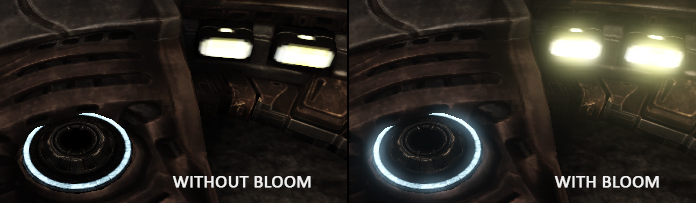
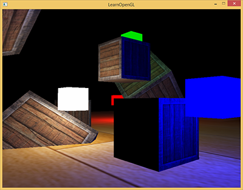
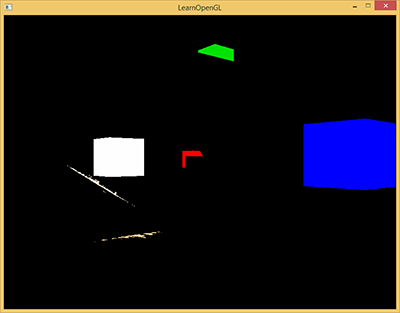
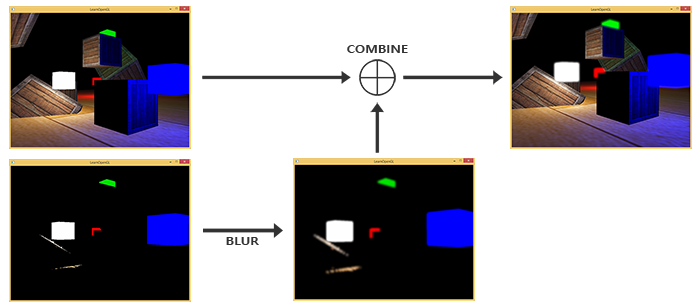
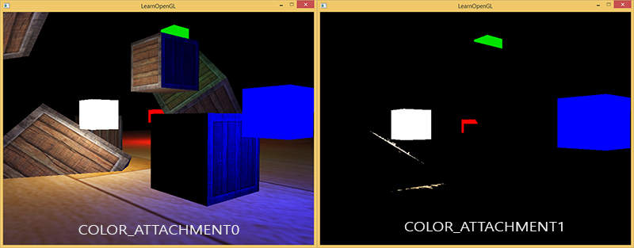
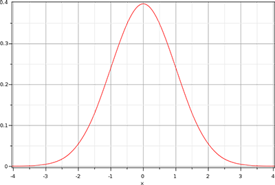
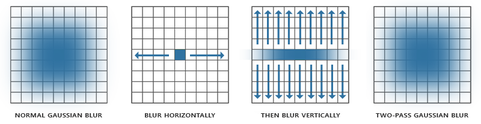
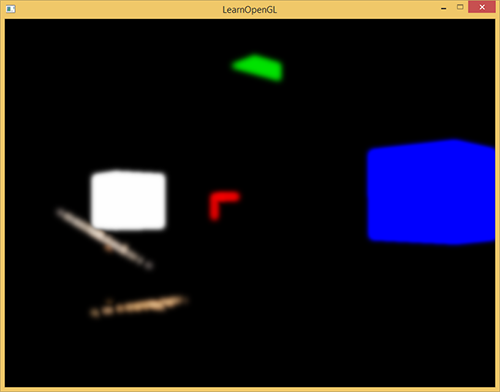
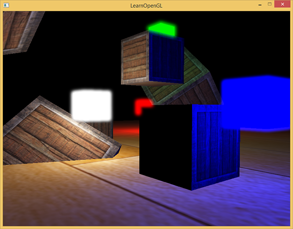
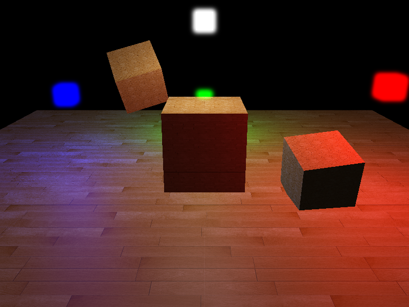

# 泛光

| 项目 | 信息 |
| --- | --- |
| 原文 | [Bloom](https://learnopengl.com/Advanced-Lighting/Bloom) |
| 作者 | Joey de Vries |
| 翻译 | [Django](http://bullteacher.com/) |
| 校对 | gjy_1992, [AoZhang](https://github.com/SuperAoao) |
| 来源 | [LearnOpenGL-CN](https://github.com/LearnOpenGL-CN/LearnOpenGL-CN/blob/331560886468e28f28326429334fc48470f9c27b/docs/05%20Advanced%20Lighting/07%20Bloom.md) |
| 本仓库示例 | [main.cpp](../../apps/05_advanced_lighting/08_bloom/main.cpp) |

**泛光提取亮部、扩散其图像贡献，再在线性 HDR 场景上相加；最后才做色调映射与显示编码。** 普通输出范围下，太阳和白纸都可能映射成白色，光晕能额外提供“极亮”的视觉线索，但它并不让实际显示设备超出自身能力。



保留上游 HDR 与泛光的区别：HDR 是较大数值范围的渲染与存储流程，泛光是图像后处理。LDR 也能做泛光，HDR 也可完全不加泛光；两者不是同一个开关。原译文的未重写提示已由本篇的分阶段说明和源码对应取代。

应用决定亮度阈值、模糊权重与合成次序，OpenGL 提供 MRT 附件、采样和帧缓冲绑定，驱动执行每个 pass；GLFW 不会替两个 ping-pong 目标自动选择当前来源。


本例有地面、箱子和四个高亮彩色光源标记。先获得没有泛光的场景，再保留亮部，再模糊，最终合成。图示采用上游场景，本仓库对应步骤均可直接选择模式查看。






这四张图分别说明内容提取、空间扩散与合成的职责。亮部阈值并不决定扩散宽度，模糊次数也不会把低于阈值的整个原图重新变成亮区。



## 提取亮色

MRT（Multiple Render Targets，多渲染目标）允许一次几何阶段写多个颜色附件。在片段输出上分别声明 location 0 与 1，再在 FBO 上接两张 `GL_RGBA16F` 纹理，并用 `glDrawBuffers` 启用这两个槽。location 指向的是 draw buffer 索引，不能只创建附件而不配置输出映射。

```cpp
bool resize_target(gpu_resources& resources, color_target& target, int width, int height,
                   std::span<const GLint> formats, bool depth) {
    if (target.framebuffer == 0U) {
        // OpenGL: FBO 组织附件，纹理/RBO 才拥有实际存储。
        glGenFramebuffers(1, &target.framebuffer);
        resources.framebuffers.push_back(target.framebuffer);
        target.colors.resize(formats.size());
        glGenTextures(static_cast<GLsizei>(target.colors.size()), target.colors.data());
        resources.textures.insert(resources.textures.end(), target.colors.begin(),
                                  target.colors.end());
        if (depth) {
            // OpenGL: 创建供离屏深度/模板使用的渲染缓冲对象名称。
            glGenRenderbuffers(1, &target.depth_stencil);
            resources.renderbuffers.push_back(target.depth_stencil);
        }
    }
    // OpenGL: GL_FRAMEBUFFER 同时选择读目标与绘制目标。
    glBindFramebuffer(GL_FRAMEBUFFER, target.framebuffer);
    if (target.width != width || target.height != height) {
        for (std::size_t index{0U}; index < formats.size(); ++index) {
            bind_texture(0, target.colors[index]);
            glTexImage2D(GL_TEXTURE_2D, 0, formats[index], width, height, 0,
                         formats[index] == GL_R16F ? GL_RED : GL_RGBA, GL_FLOAT, nullptr);
            glTexParameteri(GL_TEXTURE_2D, GL_TEXTURE_MIN_FILTER, GL_NEAREST);
            glTexParameteri(GL_TEXTURE_2D, GL_TEXTURE_MAG_FILTER, GL_NEAREST);
            glTexParameteri(GL_TEXTURE_2D, GL_TEXTURE_WRAP_S, GL_CLAMP_TO_EDGE);
            glTexParameteri(GL_TEXTURE_2D, GL_TEXTURE_WRAP_T, GL_CLAMP_TO_EDGE);
            // OpenGL: location 与 glDrawBuffers 指定的附件槽一一对应。
            glFramebufferTexture2D(GL_FRAMEBUFFER,
                                   GL_COLOR_ATTACHMENT0 + static_cast<GLenum>(index), GL_TEXTURE_2D,
                                   target.colors[index], 0);
        }
        if (depth) {
            // OpenGL: 选择随后分配存储或挂接附件的 RBO。
            glBindRenderbuffer(GL_RENDERBUFFER, target.depth_stencil);
            glRenderbufferStorage(GL_RENDERBUFFER, GL_DEPTH24_STENCIL8, width, height);
            // OpenGL: 将 RBO 存储挂接到当前 FBO 的指定附件点。
            glFramebufferRenderbuffer(GL_FRAMEBUFFER, GL_DEPTH_STENCIL_ATTACHMENT, GL_RENDERBUFFER,
                                      target.depth_stencil);
        }
        constexpr std::array<GLenum, 3> attachments{GL_COLOR_ATTACHMENT0, GL_COLOR_ATTACHMENT1,
                                                    GL_COLOR_ATTACHMENT2};
        // OpenGL: 只启用本目标实际拥有的颜色输出。
        glDrawBuffers(static_cast<GLsizei>(formats.size()), attachments.data());
        target.width = width;
        target.height = height;
    }
    // OpenGL: 绘制前验证附件、读写选择等完整性条件。
    const GLenum status{glCheckFramebufferStatus(GL_FRAMEBUFFER)};
    if (status != GL_FRAMEBUFFER_COMPLETE) {
        std::cerr << "Framebuffer incomplete: " << status << '\n';
        return false;
    }
    return true;
}
```

本例为场景请求两个格式相同的浮点附件和一个深度附件。两张颜色图开始时都清为黑色：亮区背景也必须是黑色，不能带着普通清屏色进入模糊后被额外加回。

光照输出保持线性，亮度近似用与线性 sRGB/Rec.709 原色对应的权重计算：

$$Y\approx0.2126R+0.7152G+0.0722B.$$

超过 1 的片段向 bright_color 输出原始 HDR RGB，否则输出黑色。光源标记也经过同样的判定，而非只让材质表面发光。

```glsl
#version 330 core
in VertexData { vec3 position; vec3 normal; vec2 tex_coord; } vertex_in;
layout(location=0) out vec4 scene_color;
layout(location=1) out vec4 bright_color;
uniform sampler2D diffuse_texture;
uniform vec3 camera_pos;
uniform vec3 light_positions[4];
uniform vec3 light_colors[4];
uniform vec3 emission;
uniform int reverse_normals;
void main() {
    vec3 normal = normalize(vertex_in.normal) * (reverse_normals != 0 ? -1.0 : 1.0);
    vec3 albedo = texture(diffuse_texture,vertex_in.tex_coord * 4.0).rgb;
    vec3 color = albedo * 0.005;
    vec3 view_dir = normalize(camera_pos-vertex_in.position);
    for (int i=0; i<4; ++i) {
        vec3 delta = light_positions[i]-vertex_in.position;
        float distance_squared = max(dot(delta,delta),0.01);
        vec3 light_dir = normalize(delta);
        float diffuse = max(dot(normal,light_dir),0.0);
        float specular = diffuse > 0.0 ? pow(max(dot(normal,normalize(light_dir+view_dir)),0.0),32.0) : 0.0;
        color += (albedo * diffuse + vec3(specular * 0.1)) * light_colors[i] / distance_squared;
    }
    if (any(greaterThan(emission,vec3(0.0)))) color = emission;
    scene_color = vec4(color,1.0);
    float brightness = dot(color,vec3(0.2126,0.7152,0.0722));
    bright_color = brightness > 1.0 ? vec4(color,1.0) : vec4(0.0,0.0,0.0,1.0);
}
```



使用 HDR 可以把阈值设在 1 之上，区分普通白色表面与高强度结果。若输出先被压到 LDR 再提取，只能在 [0,1] 内选择阈值，白墙、雪地等大片区域更容易一起被选中。它仍可工作，只是输入信息和阈值解释不同。

## 高斯模糊

高斯权重随距中心增加而下降，相比简单均值给近邻更高权重。这里保留原文介绍的盒式均值与高斯的区别，并修正跨章节的混称：上一章的固定 3×3 加权核本身也可以是小型高斯近似，不应把所有旧模糊都叫盒式过滤。



二维高斯 $G(x,y)=g(x)g(y)$ 可分离。宽度 K 的完整二维核需要约 $K^2$ 次采样，先横向再纵向各一遍只需约 $2K$ 次；例如 32×32 的 1024 次可换成 32+32 次。这个等价关系要求可分离权重及一致的边界处理，而不是任意模糊核都能这样拆。



本例每遍取中心一次与正负方向各四次，共九次采样，数组只有五项是因为两侧共享权重。修正上游末尾“每方向只有五个样本”的含混表述：五个权重不是五次总采样。中心权重与两侧权重总和约为 1，避免每次模糊顺便改变整体亮度。

```glsl
#version 330 core
in vec2 tex_coord;
out vec4 frag_color;
uniform sampler2D image;
uniform int horizontal;
void main() {
    const float weights[5] = float[](0.2270270270,0.1945945946,0.1216216216,0.0540540541,0.0162162162);
    vec2 texel_size = 1.0 / vec2(textureSize(image,0));
    vec3 color = texture(image,tex_coord).rgb * weights[0];
    for (int i=1; i<5; ++i) {
        vec2 offset = horizontal != 0 ? vec2(texel_size.x * float(i),0.0) : vec2(0.0,texel_size.y * float(i));
        color += texture(image,tex_coord+offset).rgb * weights[i];
        color += texture(image,tex_coord-offset).rgb * weights[i];
    }
    frag_color = vec4(color,1.0);
}
```

两张 ping-pong 纹理分别作为当前写入目标与另一个读取来源。第一次来源是提取亮区，此后来源是刚完成的另一张纹理。每一遍覆盖整个目标，深度测试关闭；最终索引从实际最后一次写入推导，不能固定认为总是编号 0。

```cpp
        glDisable(GL_DEPTH_TEST);
        GLuint blurred{hdr.colors[1]};
        constexpr std::array<GLint, 1> blur_format{GL_RGBA16F};
        for (int pass{0}; pass < 10; ++pass) {
            color_target& destination{ping_pong[static_cast<std::size_t>(pass % 2)]};
            if (!resize_target(resources, destination, width, height, blur_format, false))
                return EXIT_FAILURE;
            glUseProgram(blur_program.id);
            set_int(blur_program, "image", 0);
            set_int(blur_program, "horizontal", pass % 2 == 0 ? 1 : 0);
            // OpenGL: blurred 只指向另一个目标，避免采样正在写入的附件。
            bind_texture(0, blurred);
            draw_mesh(quad);
            blurred = destination.colors[0];
        }
```

循环运行 10 遍，即五组水平/垂直处理。它是五次二维可分离模糊，不应把十个 pass 误称十次完整二维核。纹理环绕为钳到边缘，防止光晕绕回图像另一侧；窗口变化时所有目标同步更新尺寸。



> **原步骤提示与修订：** 第一遍不能从尚未初始化的 ping-pong 纹理读取；必须明确以 bright 附件为来源。“两个目标都空所以随意选一个”只对选择写入目的地成立，不对输入成立。对正在作为输出附件的同一图像进行纹理读取会形成反馈，不能把它当作可定义的就地模糊。

## 把两个纹理混合

最终在同一个线性空间中计算 $C_{sum}=C_{scene}+C_{blurred}$，再做曝光映射，最后执行一次输出编码。本例这一步是片段程序中的纹理相加，不是依赖固定功能混合状态。

```glsl
#version 330 core
in vec2 tex_coord;
out vec4 frag_color;
uniform sampler2D scene_texture;
uniform sampler2D bloom_texture;
uniform int mode;
uniform float exposure;
void main() {
    vec3 hdr_color = texture(scene_texture,tex_coord).rgb;
    if (mode == 0 || mode == 4) hdr_color += texture(bloom_texture,tex_coord).rgb;
    vec3 mapped = vec3(1.0)-exp(-max(hdr_color,vec3(0.0)) * exposure);
    frag_color = vec4(pow(mapped,vec3(1.0/2.2)),1.0);
}
```

模式 0 为泛光合成，模式 1 只有原 HDR 场景，模式 2 显示提取亮区，模式 3 显示模糊结果，模式 4 为较高曝光的合成。诊断模式仍经过色调映射以便在普通窗口观察；它们不是直接显示所有浮点数值。



调节模糊核半径、重复次数和合成强度都会影响观感，但更强、更宽不一定更好。可用多尺度下采样、多组权重或双线性采样等方法改善性能和光晕形状，原文附加阅读保留这些方向；当前示例明确采用全分辨率、九采样、十遍处理，不冒称已经实现其他优化。

> **常见误解：** 在色调映射之后再相加编码颜色，与在线性 HDR 中先合成不是同一效果。看起来同样“发亮”并不能说明数值管线正确。

> **进阶（附件生命周期）：** **多遍后处理的关键是知道每张图在何时被写完、何时被读取。** 本例两个目的地交替，来源名称每遍更新，避免反馈，也保证最后合成拿到最后一遍而非倒数第二遍。扩展到更多尺度时，应为每一级记录尺寸、格式和来源，不要让一个泛用“当前纹理”变量隐含所有约定。资源 RAII 只管释放对象，不会自动恢复正确的绑定与阶段状态。


## 附加资源

保留底本中的源码、资源与阅读入口。外部旧程序的文件组织与本仓库不同，实际实现以本文标注的本地目标为准。

- [帧缓冲](https://github.com/LearnOpenGL-CN/LearnOpenGL-CN/blob/331560886468e28f28326429334fc48470f9c27b/docs/04%20Advanced%20OpenGL/05%20Framebuffers.md)
- [这里](https://learnopengl.com/code_viewer_gh.php?code=src/5.advanced_lighting/7.bloom/bloom.cpp)
- [Efficient Gaussian Blur with linear sampling](http://rastergrid.com/blog/2010/09/efficient-gaussian-blur-with-linear-sampling/)
- [Bloom Post Process Effect](https://udn.epicgames.com/Three/Bloom.html)
- [How to do good bloom for HDR rendering](http://kalogirou.net/2006/05/20/how-to-do-good-bloom-for-hdr-rendering/)

## 本仓库示例

源码：[main.cpp](../../apps/05_advanced_lighting/08_bloom/main.cpp)，目标 `05_advanced_lighting__08_bloom`。helper 保留在各文件匿名命名空间，不依赖共享源码；GLSL 为内嵌字符串。必需 uniform 在初始化时检查并缓存，资源由上下文有效期内的 RAII 守卫释放。

```powershell
cmake --preset mingw-gcc-debug
cmake --build --preset mingw-gcc-debug --target 05_advanced_lighting__08_bloom
.\build\mingw-gcc-debug\apps\05_advanced_lighting\08_bloom\05_advanced_lighting__08_bloom.exe --mode 0
```

依赖安装与其他 preset 见[构建指南](../build.md)。Esc 退出，WASD 移动，鼠标转向，滚轮调整 FOV，空格依次切换以下模式；`--mode M` 选择初始模式。 Q/E 分别降低/增加曝光。 有限帧检查使用 `--frames 3 --capture output.ppm`，隐藏窗口并保存末帧。

| `--mode` | 可观察内容 |
| --- | --- |
| 0 | 亮部提取＋十遍模糊＋合成 |
| 1 | 原 HDR 场景，关闭泛光 |
| 2 | 亮部提取诊断 |
| 3 | 模糊后亮部诊断 |
| 4 | 泛光合成，曝光×2 |



## 本章整体回顾

MRT 保留场景与亮部，交替目标完成可分离模糊，在线性 HDR 中合成后再映射和编码。 本篇保留原小节、教学图片及附加资源，程序资源与上游截图的对应和差异见[图片记录](../img/05/README.md)与[资源来源](../../assets/chapter05_resources.md)。

技术核校：[英文原文](https://learnopengl.com/Advanced-Lighting/Bloom)、[OpenGL 3.3 Core 规范](https://registry.khronos.org/OpenGL/specs/gl/glspec33.core.pdf)、[GLSL 3.30 规范](https://registry.khronos.org/OpenGL/specs/gl/GLSLangSpec.3.30.pdf)。

下一节：[延迟着色法](09_deferred_shading.md)。
