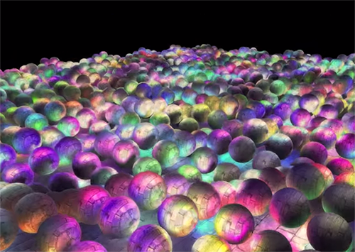
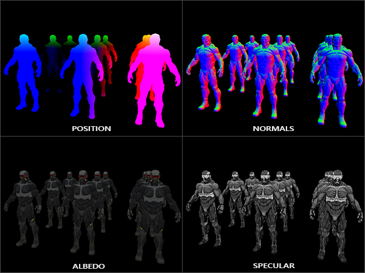
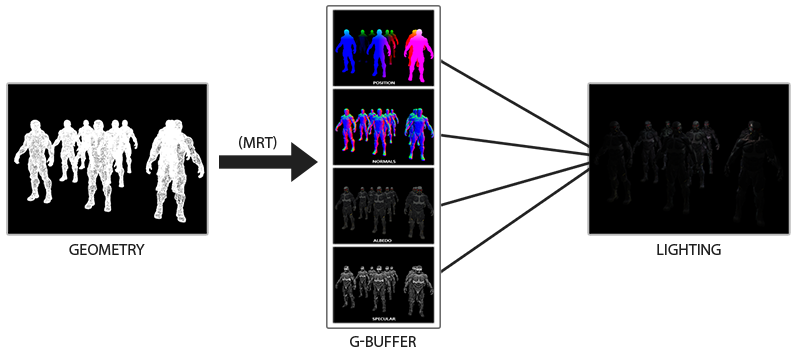
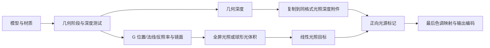
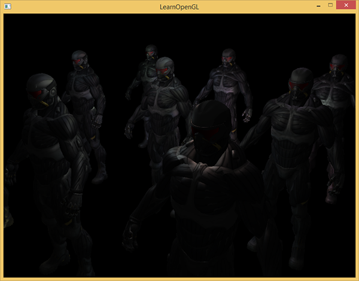
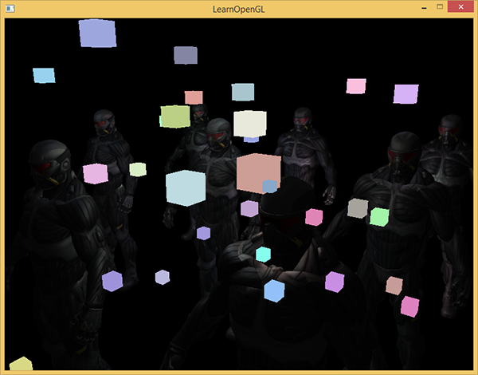
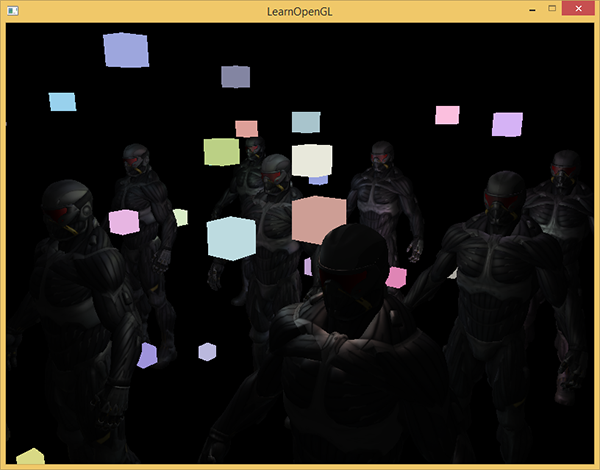
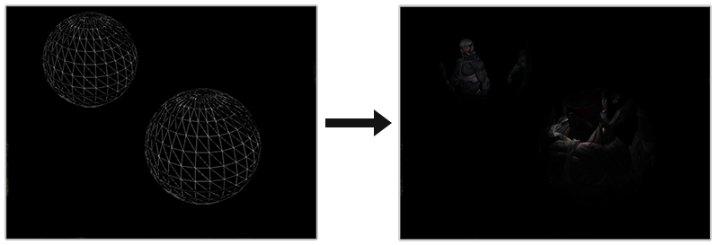
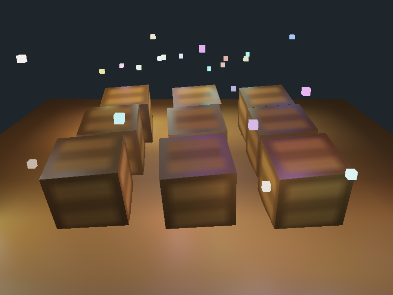

# 延迟着色法

| 项目 | 信息 |
| --- | --- |
| 原文 | [Deferred-Shading](https://learnopengl.com/Advanced-Lighting/Deferred-Shading) |
| 作者 | Joey de Vries |
| 翻译 | Krasjet |
| 校对 | [KenLee](https://hellokenlee.github.io/) |
| 中文底本 | [LearnOpenGL-CN 固定版本](https://github.com/LearnOpenGL-CN/LearnOpenGL-CN/blob/331560886468e28f28326429334fc48470f9c27b/docs/05%20Advanced%20Lighting/08%20Deferred%20Shading.md)，`new-theme` / `331560886468e28f28326429334fc48470f9c27b` |
| 本仓库示例 | [main.cpp](../../apps/05_advanced_lighting/09_deferred_shading/main.cpp) |
| 修订与范围 | [逐项覆盖与验证记录](coverage.md)；纯 GFM，代码片段逐字取自对应源码 |

**延迟着色把可见表面的几何/材质记录下来，再在屏幕空间计算光照；它推迟的是光照，不是把所有绘制工作都省掉。** 正向渲染在对象绘制过程中计算光照，深度复杂度高且灯光多时可能重复计算被覆盖的片段。提前深度测试、深度预遍和光源剔除也能改善正向管线，因此不能把“大量光源对正向渲染几乎不可能”作为普适结论。



上图的 1874 盏灯是上游引用的场景，不是本仓库的性能数据。这里用 32 盏点光和九个导入的木箱，保留几何记录、逐像素光照、正向叠加、半径裁剪与真实球形光体积的完整过程。



第一遍几何阶段将最终通过深度测试的表面写到 G 缓冲。第二遍画铺屏四边形，按像素采样这些数据计算光照，输入不再直接来自本次物体顶点插值。OpenGL 管理 MRT 和附件读写，驱动运行各阶段；应用定义每个通道的含义、空间、材质模型与灯光分配，GLFW 不会替 G 缓冲保存所有透明层。





延迟光照可避免对许多最终不可见的表面重复做昂贵照明，但几何阶段仍可能发生覆盖和写入，G 缓冲也有带宽与显存成本。它不是保证每个屏幕像素在整帧只运行一次片段着色器。

## G 缓冲

重建本例 Blinn-Phong 光照需要表面位置、法线、线性反照率和镜面强度，还需要光源位置/颜色与观察者位置。前四项逐片段变化，进入 G 缓冲；灯光和相机参数通过 uniform 提供，不必按像素重复保存。

本例三个颜色附件分别是：

| 附件 | 格式 | 分量含义 |
| --- | --- | --- |
| 0 | RGBA16F | RGB 世界位置，A=1 表示有效几何 |
| 1 | RGBA16F | RGB 世界法线，A 保留 |
| 2 | RGBA8 | RGB 线性反照率，A 为镜面强度 |

原例使用 RGB 浮点位置和法线，本仓库选 RGBA16F 并使用有效性标记，避免背景零向量被当成几何法线归一化。名义颜色存储为每像素 20 字节，另有深度/模板；真实分配、缓存与带宽仍由实现决定。RGBA8 是归一化定点，不是“每分量八位浮点”。

创建附件后要通过 `glDrawBuffers` 选择输出槽；G 缓冲用最近过滤，避免在不相关的几何边界之间混合位置或法线。片段着色器只写几何与材质，不做直接光照：

```glsl
#version 330 core
in VertexData { vec3 position; vec3 normal; vec2 tex_coord; } vertex_in;
layout(location=0) out vec4 g_position;
layout(location=1) out vec4 g_normal;
layout(location=2) out vec4 g_albedo_spec;
uniform sampler2D diffuse_texture;
uniform sampler2D specular_texture;
void main() {
    g_position = vec4(vertex_in.position,1.0);
    g_normal = vec4(normalize(vertex_in.normal),1.0);
    g_albedo_spec = vec4(texture(diffuse_texture,vertex_in.tex_coord).rgb,
                         texture(specular_texture,vertex_in.tex_coord).r);
}
```

> **原空间提醒：** 本篇记录世界位置和世界法线，灯光与相机也在世界空间。下一篇 SSAO 改为观察空间，是整条计算链路的约定变更，不能只把 G 缓冲中其中一张图换空间。

本仓库用 Assimp 导入已有木箱，保留实际模型处理和 UV/法线上传；在 3×3 阵列中绘制，材质使用本仓库的漫反射与镜面贴图。位置/法线图可用模式 1/2，反照率与镜面遮罩可用 3/4 检查。

```cpp
        glBindFramebuffer(GL_FRAMEBUFFER, g_buffer.framebuffer);
        glEnable(GL_DEPTH_TEST);
        glClearColor(0.0F, 0.0F, 0.0F, 0.0F);
        // OpenGL: 清除当前绘制目标的所选缓冲，仍受写掩码约束。
        glClear(GL_COLOR_BUFFER_BIT | GL_DEPTH_BUFFER_BIT);
        glUseProgram(geometry_program.id);
        set_mat4(geometry_program, "view", view);
        set_mat4(geometry_program, "projection", projection);
        set_int(geometry_program, "diffuse_texture", 0);
        set_int(geometry_program, "specular_texture", 1);
        bind_texture(0, diffuse);
        bind_texture(1, specular);
        draw_object(
            geometry_program, quad,
            glm::scale(glm::rotate(glm::mat4{1.0F}, glm::radians(-90.0F), {1.0F, 0.0F, 0.0F}),
                       {6.0F, 6.0F, 1.0F}));
        for (int x{-1}; x <= 1; ++x)
            for (int z{-1}; z <= 1; ++z) {
                for (const mesh& part : imported)
                    draw_object(geometry_program, part,
                                model_matrix({static_cast<float>(x) * 2.0F, 0.65F,
                                              static_cast<float>(z) * 2.0F},
                                             glm::vec3{1.3F}, 0.2F));
            }
```


诊断图将位置缩放、法线映射到可显示区间，不是把所有负数原样输出到 SDR 后缓冲。先确认这些数据对应预期表面，再进入光照，避免把 UV 错误或法线空间错误归因于延迟渲染。

## 延迟光照处理阶段

绑定三张 G 缓冲纹理，在铺屏片段中读取世界位置 P、法线 N、反照率与镜面强度，仍按上一章的方法构造 L、V、H，计算每盏灯的贡献。变化的是光照输入的来源，并非反射方程本身。

```glsl
#version 330 core
in vec2 tex_coord;
out vec4 frag_color;
uniform sampler2D g_position;
uniform sampler2D g_normal;
uniform sampler2D g_albedo_spec;
uniform vec3 camera_pos;
uniform vec3 light_positions[32];
uniform vec3 light_colors[32];
uniform float light_radii[32];
uniform int mode;
uniform int light_index;
void main() {
    vec2 uv = tex_coord;
    vec4 position_data = texture(g_position,uv);
    if (position_data.a == 0.0) { frag_color = vec4(0.01,0.015,0.02,1.0); return; }
    vec3 position = position_data.xyz;
    vec3 normal = normalize(texture(g_normal,uv).xyz);
    vec4 material = texture(g_albedo_spec,uv);
    if (mode == 1) { frag_color = vec4(abs(position) * 0.15,1.0); return; }
    if (mode == 2) { frag_color = vec4(normal * 0.5 + 0.5,1.0); return; }
    if (mode == 3) { frag_color = vec4(material.rgb,1.0); return; }
    if (mode == 4) { frag_color = vec4(vec3(material.a),1.0); return; }
    vec3 color = mode == 7 ? vec3(0.0) : material.rgb * 0.06;
    if (mode == 8) { frag_color = vec4(color,1.0); return; }
    vec3 view_dir = normalize(camera_pos-position);
    for (int i=0; i<32; ++i) {
        if (mode == 7 && i != light_index) continue;
        vec3 delta = light_positions[i]-position;
        float distance_to_light = length(delta);
        if ((mode == 6 || mode == 7) && distance_to_light > light_radii[i]) continue;
        vec3 light_dir = normalize(delta);
        float diffuse = max(dot(normal,light_dir),0.0);
        float specular = diffuse > 0.0 ? pow(max(dot(normal,normalize(light_dir+view_dir)),0.0),32.0) : 0.0;
        float attenuation = 1.0 / (1.0 + 0.7 * distance_to_light + 1.8 * distance_to_light * distance_to_light);
        color += (material.rgb * diffuse + vec3(material.a * specular)) * light_colors[i] * attenuation;
    }
    frag_color = vec4(color,1.0);
}
```

模式 0 遍历 32 盏灯，保存线性 HDR 光照，再进行最后曝光映射。背景由位置附件 A=0 区分。不要把未覆盖像素的 (0,0,0) 法线直接 normalize 后参与光照。



这种单层 G 缓冲只记录最近表面，不能直接表达一般透明混合所需要的多个深度层；也难以用少量固定通道表达任意材质模型。可将材质编号或额外参数打包进去，但会改变存储与程序组织。常见做法是延迟处理适合的物体，再正向处理透明、特殊材质或光源标记。

## 结合延迟渲染与正向渲染

先画完铺屏光照，再像普通几何一样画小立方体光源。若光照目标的深度仍是清屏值，小立方体就会忽略已有场景遮挡，看似贴在图像最前面。模式 5 故意不复制场景深度，展示这个错误。



解决方法是把几何遍留下的深度复制到正向绘制所在的目标，再启用深度测试。本仓库在两个自建目标间复制，它们都显式使用相同 D24S8 和尺寸；这样避免假设窗口默认深度格式恰好匹配。

```cpp
            if (mode != 5) {
                // OpenGL: 两个自建目标使用相同 D24S8 格式和尺寸，保证深度 blit 兼容。
                glBindFramebuffer(GL_READ_FRAMEBUFFER, g_buffer.framebuffer);
                glBindFramebuffer(GL_DRAW_FRAMEBUFFER, lighting_target.framebuffer);
                // OpenGL: 在显式读/写 FBO 之间复制指定区域，过滤与格式须兼容。
                glBlitFramebuffer(0, 0, width, height, 0, 0, width, height, GL_DEPTH_BUFFER_BIT,
                                  GL_NEAREST);
                glBindFramebuffer(GL_FRAMEBUFFER, lighting_target.framebuffer);
            }
```

若直接复制到默认窗口，也必须检查源/目标深度格式、尺寸和采样数的兼容性，不能把任意两张深度附件 blit 看作总是合法。随后再绘制光源标记，它们就能被场景遮挡。



本例标记仍画到线性浮点光照目标，最后统一色调映射和编码；不是先把延迟场景编码，再叠加一批未编码颜色。透明物体还需要自己的排序、深度写入和混合策略，复制深度只解决其中的可见性输入。

## 更多的光源

基础全屏光照仍为每个可见像素遍历所有灯。灯离片段很远时，其贡献可能已足够小，继续计算方向、镜面和衰减浪费工作。光体积将每盏灯的近似有效范围表示为几何区域，从空间上限制需要处理的像素。

### 计算一个光源的体积或半径

使用第二章的经验衰减

$$F(d)=\frac{I}{K_c+K_ld+K_qd^2}.$$

对于正的强度与正常系数，它一般不会在有限距离严格等于 0，所以先指定可忽略阈值 $\epsilon>0$。令最强颜色通道为 $I_{max}$，本例沿用 $\epsilon=5/256$：

$$\epsilon=\frac{I_{max}}{K_c+K_ld+K_qd^2}.$$

先移项得到 $\epsilon(K_c+K_ld+K_qd^2)=I_{max}$，再除以 $\epsilon$，得到

$$K_c+K_ld+K_qd^2=I_{max}/\epsilon,$$

$$K_qd^2+K_ld+K_c-I_{max}/\epsilon=0.$$

当 $K_q>0$ 且存在正根时，取

$$r=\frac{-K_l+\sqrt{K_l^2-4K_q(K_c-I_{max}/\epsilon)}}{2K_q}.$$

代入 $\epsilon=5/256$ 即得到底本的 $I_{max}\cdot256/5$。本例固定 $K_c=1,K_l=0.7,K_q=1.8$ 并计算每个光源的半径；一般实现还应处理零二次项、负判别式和阈值高于源强度等情况，不能照抄公式后假设所有参数有正根。

```cpp
    std::array<glm::vec3, 32> positions{};
    std::array<glm::vec3, 32> colors{};
    std::array<float, 32> radii{};
    std::mt19937 generator{42U};
    std::uniform_real_distribution<float> random{0.0F, 1.0F};
    for (std::size_t index{0U}; index < positions.size(); ++index) {
        positions[index] = {random(generator) * 8.0F - 4.0F, random(generator) * 2.5F + 0.5F,
                            random(generator) * 8.0F - 4.0F};
        colors[index] = {random(generator) * 2.0F + 0.5F, random(generator) * 2.0F + 0.5F,
                         random(generator) * 2.0F + 0.5F};
        const float intensity{std::max({colors[index].r, colors[index].g, colors[index].b})};
        constexpr float linear{0.7F};
        constexpr float quadratic{1.8F};
        const float discriminant{linear * linear -
                                 4.0F * quadratic * (1.0F - intensity * 256.0F / 5.0F)};
        radii[index] = (-linear + std::sqrt(std::max(discriminant, 0.0F))) / (2.0F * quadratic);
    }
```

> **原阈值提示与修订：** 阈值较低时半径扩大、工作增加，较高时裁剪更积极也更易出现边界截断。5/256 是教学阈值，不是由八位输出自动推导出的精确线性亮度步长；最终 Gamma 与色调映射还会改变其可见程度，多个微弱灯的累积也可能变得明显。

模式 6 在全屏程序里比较距离与半径，范围外跳过该灯。它保留了上游的半径分支案例，是否加速需要测量。

### 真正使用光体积

修正原文“GPU 总会执行 if 的所有分支，所以优化完全无效”的绝对结论。现代 GPU 的分支、掩码和预测执行取决于实现；相邻片段走不同路径可能降低效率，但范围一致的跳过也可能有效。半径测试不能保证消除所有循环成本，却不是必然无效。

下一步真正画出每盏灯的球体，中心是光源位置、缩放是半径。球体投影覆盖的像素才运行该灯的光照片段程序，再用加法混合累加贡献。模式 7 实际实现这一步：先画环境项，再逐球累加，片段中仍做距离剔除以限制三维范围。



```cpp
        if (mode == 7) {
            configure_lighting(volume_program);
            set_mat4(volume_program, "view", view);
            set_mat4(volume_program, "projection", projection);
            set_int(volume_program, "mode", 7);
            // OpenGL: 上传当前帧缓冲物理尺寸，用于屏幕坐标归一化。
            glUniform2f(volume_program.uniforms.at("frame_size"), static_cast<float>(width),
                        static_cast<float>(height));
            // OpenGL: 只累加球体背面，每个覆盖像素一次；相机进入球体仍可看到退出面。
            glEnable(GL_CULL_FACE);
            glCullFace(GL_FRONT);
            glEnable(GL_BLEND);
            // OpenGL: 设置加法等混合方程，独立于源/目标系数。
            glBlendEquation(GL_FUNC_ADD);
            glBlendFunc(GL_ONE, GL_ONE);
            for (std::size_t index{0U}; index < positions.size(); ++index) {
                set_int(volume_program, "light_index", static_cast<int>(index));
                draw_object(volume_program, sphere,
                            model_matrix(positions[index], glm::vec3{radii[index]}));
            }
            glDisable(GL_BLEND);
            glDisable(GL_CULL_FACE);
            glCullFace(GL_BACK);
        }
```

本例关闭深度测试，只画球体背面，使用 G 缓冲位置判断是否位于球内；相机进入球体仍可看到退出面。球面需在视锥内，远裁剪等情况仍要处理。更一般的引擎也可使用模板体积技巧。剔除或深度策略若不正确，可能把同一盏灯加两次，或在相机入球时让它消失。

球体减少的是与光源不相关的像素调用，不能把全部复杂度笼统写成“对象数乘光源数变为二者相加”：真实成本还包括几何遍、各光体积投影面积、重叠、带宽和混合。若球覆盖整屏，收益可能很小。模式 6/7 可在同一场景比较结果，不把它们当作已完成的性能基准。

原文的延伸方向仍保留：deferred lighting/light pre-pass 可先聚合照明再结合材质；tile-based deferred shading 按屏幕小块组织相关灯光，降低每个像素的候选集合。这些是进一步架构，不是本例的球体模式已经实现的功能。

## 延迟渲染 vs 正向渲染

小场景、灯光少或材质复杂时，G 缓冲成本可能超过省下的照明工作；大规模可见几何与灯光分配则可能更适合延迟管线。不能仅由“正向/延迟”标签判断性能。透明通常仍与正向管线配合，材质表达需要提前设计通道预算。

基础单采样 G 缓冲不直接提供普通正向 MSAA 的处理方式，但“延迟渲染不能使用 MSAA”不准确：可用多采样附件与按样本处理/边缘选择等方式实现，代价和复杂度更高。本仓库仍使用单采样，不宣称已经实现这些扩展。

法线贴图可在几何遍先通过 TBN 把采样法线变到统一空间，写入法线附件；视差映射则先得到新 UV，再采样材质各项。之后的照明程序可保持相同输入约定。这个例子说明延迟的是照明，不是限制所有表面必须只有一根未扰动的法线。

> **常见误解：** G 缓冲存的是可见表面的数据，不是完整场景模型，也不等同于所有图层的材质列表。把它用于后处理时必须尊重背景、边界、遮挡和坐标空间。

> **进阶（数据布局）：** **G 缓冲的每个通道都应有明确单位和有效性约定。** 浮点位置、单位法线、线性颜色和经验镜面强度虽然都能放在纹理里，却不能以同一种方式过滤或编码。压缩通道可以省带宽，但同时会引入重建成本和误差。先建立可显示、可检查的完整布局，再有依据地尝试法线编码或由深度重建位置，比分不清数据意义时先压缩更容易验证。


## 附加资源

保留底本中的源码、资源与阅读入口。外部旧程序的文件组织与本仓库不同，实际实现以本文标注的本地目标为准。

- [泛光教程](https://github.com/LearnOpenGL-CN/LearnOpenGL-CN/blob/331560886468e28f28326429334fc48470f9c27b/docs/05%20Advanced%20Lighting/07%20Bloom.md)
- [源代码](http://learnopengl.com/code_viewer.php?code=advanced-lighting/deferred)
- [顶点](http://learnopengl.com/code_viewer.php?code=advanced-lighting/deferred_geometry&type=vertex)
- [片段](http://learnopengl.com/code_viewer.php?code=advanced-lighting/deferred_geometry&type=fragment)
- [顶点](http://learnopengl.com/code_viewer.php?code=advanced-lighting/deferred&type=vertex)
- [片段](http://learnopengl.com/code_viewer.php?code=advanced-lighting/deferred&type=fragment)
- [混合](https://github.com/LearnOpenGL-CN/LearnOpenGL-CN/blob/331560886468e28f28326429334fc48470f9c27b/docs/04%20Advanced%20OpenGL/03%20Blending.md)
- [抗锯齿](http://learnopengl-cn.readthedocs.org/zh/latest/04%20Advanced%20OpenGL/11%20Anti%20Aliasing/)
- [这里](http://learnopengl.com/code_viewer.php?code=advanced-lighting/deferred_light_cube)
- [顶点](http://learnopengl.com/code_viewer.php?code=advanced-lighting/deferred_light_cube&type=vertex)
- [片段](http://learnopengl.com/code_viewer.php?code=advanced-lighting/deferred_light_cube&type=fragment)
- [投光物](http://learnopengl-cn.readthedocs.org/zh/latest/02%20Lighting/05%20Light%20casters/)
- [这里](http://learnopengl.com/code_viewer.php?code=advanced-lighting/deferred_final)
- [片段着色器](http://learnopengl.com/code_viewer.php?code=advanced-lighting/deferred_final&type=fragment)
- [Tutorial 35: Deferred Shading - Part 1](http://ogldev.atspace.co.uk/www/tutorial35/tutorial35.html)
- [Deferred Rendering for Current and Future Rendering Pipelines](https://software.intel.com/sites/default/files/m/d/4/1/d/8/lauritzen_deferred_shading_siggraph_2010.pdf)

## 本仓库示例

源码：[main.cpp](../../apps/05_advanced_lighting/09_deferred_shading/main.cpp)，目标 `05_advanced_lighting__09_deferred_shading`。helper 保留在各文件匿名命名空间，不依赖共享源码；GLSL 为内嵌字符串。必需 uniform 在初始化时检查并缓存，资源由上下文有效期内的 RAII 守卫释放。

```powershell
cmake --preset mingw-gcc-debug
cmake --build --preset mingw-gcc-debug --target 05_advanced_lighting__09_deferred_shading
.\build\mingw-gcc-debug\apps\05_advanced_lighting\09_deferred_shading\05_advanced_lighting__09_deferred_shading.exe --mode 0
```

依赖安装与其他 preset 见[构建指南](../build.md)。Esc 退出，WASD 移动，鼠标转向，滚轮调整 FOV，空格依次切换以下模式；`--mode M` 选择初始模式。 有限帧检查使用 `--frames 3 --capture output.ppm`，隐藏窗口并保存末帧。

| `--mode` | 可观察内容 |
| --- | --- |
| 0 | 32 盏灯的全屏光照＋正向光源标记 |
| 1 | 世界位置诊断 |
| 2 | 世界法线诊断 |
| 3 | 线性反照率诊断 |
| 4 | 镜面遮罩诊断 |
| 5 | 不复制深度时光源标记的错误对照 |
| 6 | 全屏半径条件裁剪 |
| 7 | 实际球形光体积，加法累加 |



## 本章整体回顾

几何、照明与正向补充阶段通过明确的数据布局和深度传递连接；光体积限制相关像素但不保证性能。 本篇保留原小节、教学图片及附加资源，程序资源与上游截图的对应和差异见[图片记录](../img/05/README.md)与[资源来源](../../assets/chapter05_resources.md)。

技术核校：[英文原文](https://learnopengl.com/Advanced-Lighting/Deferred-Shading)、[OpenGL 3.3 Core 规范](https://registry.khronos.org/OpenGL/specs/gl/glspec33.core.pdf)、[GLSL 3.30 规范](https://registry.khronos.org/OpenGL/specs/gl/GLSLangSpec.3.30.pdf)。

下一节：[SSAO](10_ssao.md)。
