# SSAO

| 项目 | 信息 |
| --- | --- |
| 原文 | [SSAO](https://learnopengl.com/Advanced-Lighting/SSAO) |
| 作者 | Joey de Vries |
| 翻译 | Krasjet |
| 校对 | 未校对 |
| 中文底本 | [LearnOpenGL-CN 固定版本](https://github.com/LearnOpenGL-CN/LearnOpenGL-CN/blob/331560886468e28f28326429334fc48470f9c27b/docs/05%20Advanced%20Lighting/09%20SSAO.md)，`new-theme` / `331560886468e28f28326429334fc48470f9c27b` |
| 本仓库示例 | [main.cpp](../../apps/05_advanced_lighting/10_ssao/main.cpp) |
| 修订与范围 | [逐项覆盖与验证记录](coverage.md)；纯 GFM，代码片段逐字取自对应源码 |

**SSAO 用当前屏幕可见表面的邻域深度近似环境遮蔽，再只衰减环境光项。** 常量环境光会把墙角、缝隙和接触面一视同仁；AO 则尝试描述周围几何限制入射间接光的程度。它不是所有间接光的物理求解，也不能保证任何墙角在任意照明下都更暗。

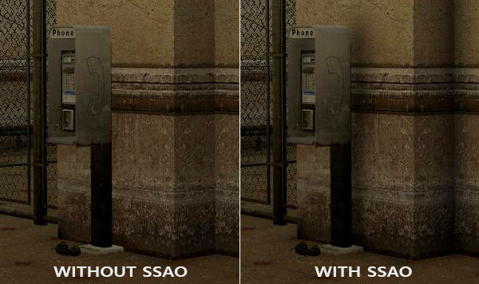

原译文“光线难以流失所以更暗”的解释应改为可接收的环境入射方向受限。本篇对照英文与规范重新整理，不沿用底本未重写提示中的技术错误。屏幕空间方法只知道当前视图中的可见表面，屏幕外和被挡住的几何缺失，这是算法的基本限制。

早期球形核在表面周围选取样本。对一个平面，约一半方向天然落在表面下面，于是平面也容易被压灰。样本少会产生条带，固定排列还会显出规律；随机旋转能打散图案，但会引入噪声。

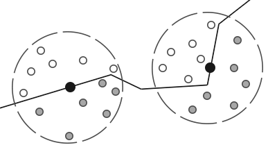

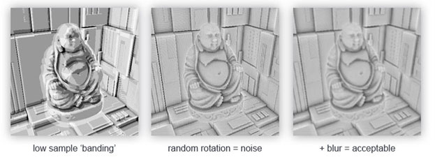

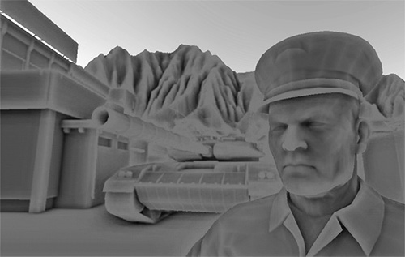

本篇采用沿表面法线朝外的半球核，避免把平面下半球当作默认遮挡。它仍只是可见深度上的近似，不是跟踪真实场景射线。

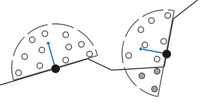

OpenGL 提供纹理、MRT 和片段程序，驱动执行采样，应用定义位置空间、比较符号、核分布和背景策略；GLFW 负责窗口和输入，不能替算法判断屏幕外有什么。

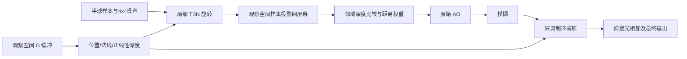

## 样本缓冲

本例在上一篇延迟渲染基础上保留位置、法线与反照率/镜面数据，再添加采样核和随机旋转纹理。AO 本身主要读取位置与法线；颜色在最后照明时使用，不是邻域遮挡测试的必需输入。

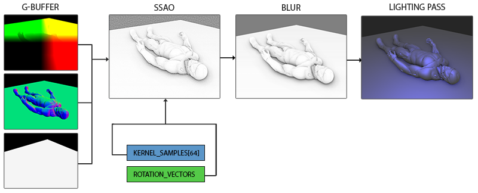

> **原前置提示：** 先理解几何遍和铺屏光照的分工。本篇改在观察空间计算：位置和法线都包含 view 变换，点光位置也由 CPU 乘 view；不能让灯仍处于世界空间。

位置附件用 RGBA16F，RGB 保存观察位置，A 保存正线性深度 $s=-z_{eye}$，背景清为 0。对于常规投影，若只有窗口深度 d，也可恢复

$$s=\frac{2nf}{f+n-(2d-1)(f-n)}.$$

本例已有观察位置，直接取 -Z 得到同一量，无须从 gl_FragCoord.z 再解一次。保存的正距离可以超过 1，必须使用浮点格式或另行归一化。与上一篇世界位置 A=1 的布局相比，这是有意的布局变更。

```glsl
#version 330 core
layout(location=0) in vec3 a_pos;
layout(location=1) in vec3 a_normal;
layout(location=2) in vec2 a_tex_coord;
out VertexData { vec3 position; vec3 normal; vec2 tex_coord; } vertex_out;
uniform mat4 model;
uniform mat4 view;
uniform mat4 projection;
void main() {
    vec4 world = model * vec4(a_pos, 1.0);
    vertex_out.position = (view * world).xyz;
    vertex_out.normal = transpose(inverse(mat3(view * model))) * a_normal;
    vertex_out.tex_coord = a_tex_coord;
    gl_Position = projection * view * world;
}
```

```glsl
#version 330 core
in VertexData { vec3 position; vec3 normal; vec2 tex_coord; } vertex_in;
layout(location=0) out vec4 g_position;
layout(location=1) out vec4 g_normal;
layout(location=2) out vec4 g_albedo_spec;
uniform sampler2D diffuse_texture;
uniform sampler2D specular_texture;
void main() {
    g_position = vec4(vertex_in.position,-vertex_in.position.z);
    g_normal = vec4(normalize(vertex_in.normal),1.0);
    g_albedo_spec = vec4(texture(diffuse_texture,vertex_in.tex_coord).rgb,
                         texture(specular_texture,vertex_in.tex_coord).r);
}
```

位置纹理使用钳到边缘防止周期重复；AO 阶段仍显式排除投影出屏幕的样本，而不是把边缘像素当作已知的屏外几何。所有附件随实际窗口像素数变化。

> **保留扩展提示：** 可由深度与逆投影重建位置，省掉大尺寸位置附件，但增加重建计算，也要正确处理投影约定、深度范围和背景。当前程序保留完整位置，便于逐项观察，不宣称已经采用该优化。

## 法向半球

先在局部空间生成朝 +Z 的半球样本，再按每个片段的表面法线旋转它们，不需要为模型上每根法线离线生成一套核。


本例使用固定随机种子生成 64 个样本。方向由均匀的 Z∈[0,1] 和方位角构造，再乘随机半径；随后根据样本序号施加 $\operatorname{lerp}(0.1,1,t^2)$，让较多样本集中在靠近中心的位置。方向与径向分布是两回事，不能把这种加权核称为整体积均匀分布。

```cpp
    std::mt19937 generator{42U};
    std::uniform_real_distribution<float> random{0.0F, 1.0F};
    std::array<glm::vec3, 64> kernel{};
    for (std::size_t index{0U}; index < kernel.size(); ++index) {
        const float z{random(generator)};
        const float angle{random(generator) * 2.0F * std::numbers::pi_v<float>};
        const float radial{std::sqrt(std::max(0.0F, 1.0F - z * z))};
        glm::vec3 sample{radial * std::cos(angle), radial * std::sin(angle), z};
        sample *= random(generator);
        const float fraction{static_cast<float>(index) / static_cast<float>(kernel.size())};
        sample *= std::lerp(0.1F, 1.0F, fraction * fraction);
        kernel[index] = sample;
    }
```

这里 $\operatorname{lerp}(a,b,t)=a+t(b-a)$。平方 t 让靠前的样本维持较小缩放，再逐渐扩展；这是强调局部接触遮蔽的经验分布，而不是对真实照明积分的无偏估计。

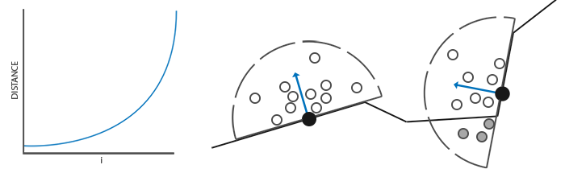

## 随机核心转动

固定核在相邻像素上会重复相同的相对方向，因此用一张很小的噪声图改变切线朝向。4×4 纹理保存 XY 平面上的单位方向，Z=0，采用最近过滤与重复环绕；它是方向数据，不采用 sRGB 格式。

```cpp
GLuint make_noise_texture(gpu_resources& resources, std::mt19937& generator) {
    std::uniform_real_distribution<float> random{0.0F, 1.0F};
    std::array<glm::vec3, 16> noise{};
    for (glm::vec3& direction : noise) {
        const float angle{random(generator) * 2.0F * std::numbers::pi_v<float>};
        direction = {std::cos(angle), std::sin(angle), 0.0F};
    }
    static_assert(sizeof(glm::vec3) == 3U * sizeof(float));
    GLuint texture{0U};
    glGenTextures(1, &texture);
    resources.textures.push_back(texture);
    bind_texture(0, texture);
    glTexImage2D(GL_TEXTURE_2D, 0, GL_RGB16F, 4, 4, 0, GL_RGB, GL_FLOAT, noise.data());
    glTexParameteri(GL_TEXTURE_2D, GL_TEXTURE_MIN_FILTER, GL_NEAREST);
    glTexParameteri(GL_TEXTURE_2D, GL_TEXTURE_MAG_FILTER, GL_NEAREST);
    glTexParameteri(GL_TEXTURE_2D, GL_TEXTURE_WRAP_S, GL_REPEAT);
    glTexParameteri(GL_TEXTURE_2D, GL_TEXTURE_WRAP_T, GL_REPEAT);
    return texture;
}
```

噪声 UV 乘以 `textureSize(g_position,0)/4`，使一个噪声周期在窗口中覆盖约 4×4 像素。分辨率不能永远写死为 800×600，否则缩放后图案尺度改变。这个噪声向量只是构造局部基的辅助方向，不是材质的真实切线，也不要求模型提供 UV 切线属性。

## SSAO 着色器

新建 R16F 颜色目标保存单通道 AO；值 1 表示不衰减环境项，0 表示完全衰减。它是颜色附件中的灰度参数，不是拿默认帧缓冲的深度附件来写 AO。

先读取当前观察位置与法线，对噪声向量做 Gram-Schmidt：$T=\operatorname{normalize}(R-N\operatorname{dot}(R,N))$，$B=N\times T$，构造 `mat3(T,B,N)`。当辅助向量近似平行于法线时要选备用方向，不能归一化零向量。

将第 i 个局部样本变为 $P_i=P+TBN\,k_i\,radius$，再乘 projection 得到裁剪位置。除 W 后把 XY 从 NDC 映射到 [0,1]，用于读取相机在该屏幕位置记录的最近几何。

```glsl
#version 330 core
in vec2 tex_coord;
out float occlusion_factor;
uniform sampler2D g_position;
uniform sampler2D g_normal;
uniform sampler2D noise_texture;
uniform vec3 samples[64];
uniform mat4 projection;
uniform float radius;
uniform float bias;
void main() {
    vec4 position_data = texture(g_position,tex_coord);
    if (position_data.a <= 0.0) { occlusion_factor = 1.0; return; }
    vec3 position = position_data.xyz;
    vec3 normal = normalize(texture(g_normal,tex_coord).xyz);
    vec2 noise_scale = vec2(textureSize(g_position,0)) / 4.0;
    vec3 random_vector = texture(noise_texture,tex_coord * noise_scale).xyz;
    vec3 tangent = random_vector - normal * dot(random_vector,normal);
    if (dot(tangent,tangent) < 0.000001)
        tangent = cross(normal,abs(normal.z) < 0.9 ? vec3(0,0,1) : vec3(0,1,0));
    tangent = normalize(tangent);
    mat3 tbn = mat3(tangent,cross(normal,tangent),normal);
    float occluded = 0.0;
    for (int i=0; i<64; ++i) {
        vec3 sample_position = position + tbn * samples[i] * radius;
        vec4 clip = projection * vec4(sample_position,1.0);
        if (clip.w <= 0.0) continue;
        vec2 uv = clip.xy / clip.w * 0.5 + 0.5;
        if (any(lessThan(uv,vec2(0.0))) || any(greaterThan(uv,vec2(1.0)))) continue;
        vec4 sampled = texture(g_position,uv);
        if (sampled.a <= 0.0) continue;
        float sample_depth = sampled.z;
        float range_weight = smoothstep(0.0,1.0,radius / max(abs(position.z-sample_depth),0.0001));
        occluded += (sample_depth >= sample_position.z + bias ? 1.0 : 0.0) * range_weight;
    }
    occlusion_factor = 1.0 - occluded / 64.0;
}
```

这里保留负的观察空间 Z 做比较：离相机近的 Z 较大；若记录的 `sample_depth >= sample_position.z + bias`，表示可见表面挡在假想样本点前面。底本旧版用正线性深度时就需要相应改变符号，不能只把读取通道从 Z 换成 A 而照抄比较方向。本例 A 的正距离用来标记有效性和诊断显示，Z 用于统一的观察空间比较。

radius=0.75、bias=0.025 都按本场景世界尺度解释。核旋转只有方向作用，视图变换是刚体变换，因此观察空间距离与场景单位一致。偏移防止表面误判自身，但过大也会丢失真实接触遮蔽。

仅作比较仍不够。边缘附近的样本可能落到背景或远处其他表面，错误地产生大范围暗晕：

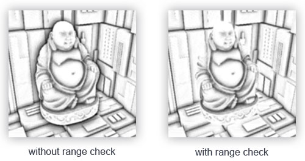

本例对深度差加入 $w=\operatorname{smoothstep}(0,1,radius/|z-z_s|)$ 的权重，并保护近零分母。差值小时权重接近 1，差值大时逐渐减小。这个公式是软衰减，不是“超过 radius 一律为零”的硬裁剪。

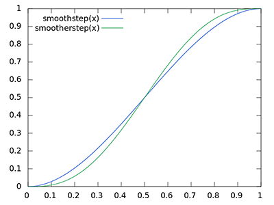

把加权遮挡累加后除以 64，再用 1 减去得到环境可见性。W≤0、投影在屏幕外或采到背景时，本例不增加遮挡，仍以 64 归一化；这让屏幕边缘趋向少遮挡，承认缺少信息，而不是伪造屏外表面。

模式 2 显示原始 AO。它能表现接触与墙角，也会有周期噪声和欠采样图案。

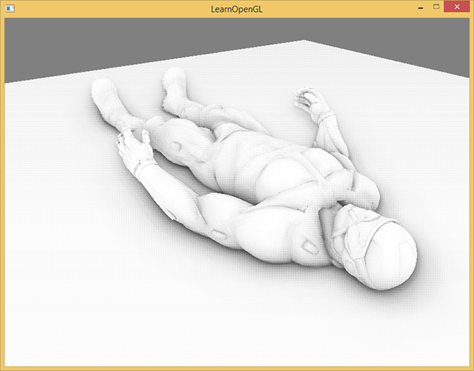

## 环境遮蔽模糊

用另一个 R16F 目标保存平滑结果，避免在同一张 AO 图上读写反馈。原噪声图周期是 4×4，本例用 4×4 共 16 次邻域均值降低可见噪声；采样偏移通过当前纹理实际尺寸求得。

```glsl
#version 330 core
in vec2 tex_coord;
out float occlusion_factor;
uniform sampler2D image;
void main() {
    vec2 texel_size = 1.0 / vec2(textureSize(image,0));
    float sum = 0.0;
    for (int x=-2; x<2; ++x) for (int y=-2; y<2; ++y)
        sum += texture(image,tex_coord+vec2(x,y) * texel_size).r;
    occlusion_factor = sum / 16.0;
}
```

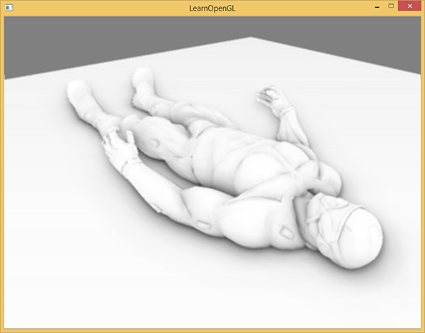

普通均值会把几何边缘两侧也混在一起，不能保证只消除噪声而不损失细节。更高级的双边过滤可参考深度与法线保护边界，但本例保持原教程的基本模糊算法，模式 3 单独显示其结果。

## 应用环境遮蔽

照明阶段从观察空间 G 缓冲中读取数据，视线为 `normalize(-position)`，光源也已在观察空间。只把环境项乘以 AO，然后加上直接漫反射与镜面项；若把整个颜色乘 AO，会连直接光也不合理地压暗。

```glsl
#version 330 core
in vec2 tex_coord;
out vec4 frag_color;
uniform sampler2D g_position;
uniform sampler2D g_normal;
uniform sampler2D g_albedo_spec;
uniform sampler2D raw_ao;
uniform sampler2D blurred_ao;
uniform vec3 light_pos;
uniform int mode;
void main() {
    vec4 position_data = texture(g_position,tex_coord);
    if (mode == 2 || mode == 3) {
        float value = mode == 2 ? texture(raw_ao,tex_coord).r : texture(blurred_ao,tex_coord).r;
        frag_color = vec4(vec3(value),1.0);
        return;
    }
    if (position_data.a <= 0.0) { frag_color = vec4(0.015,0.02,0.03,1.0); return; }
    vec3 position = position_data.xyz;
    vec3 normal = normalize(texture(g_normal,tex_coord).xyz);
    if (mode == 4) { frag_color = vec4(vec3(position_data.a/15.0),1.0); return; }
    if (mode == 5) { frag_color = vec4(normal*0.5+0.5,1.0); return; }
    vec4 material = texture(g_albedo_spec,tex_coord);
    float ao = mode == 1 ? 1.0 : texture(blurred_ao,tex_coord).r;
    if (mode == 6) ao = pow(ao,2.0);
    vec3 ambient = 0.35 * material.rgb * ao;
    vec3 delta = light_pos-position;
    vec3 light_dir = normalize(delta);
    vec3 view_dir = normalize(-position);
    float diffuse = max(dot(normal,light_dir),0.0);
    float specular = diffuse > 0.0 ? pow(max(dot(normal,normalize(light_dir+view_dir)),0.0),32.0) : 0.0;
    vec3 direct = (material.rgb * diffuse + vec3(material.a * specular)) * vec3(2.0,2.0,3.0) /
        max(dot(delta,delta),0.1);
    vec3 mapped = vec3(1.0)-exp(-(ambient+direct));
    frag_color = vec4(pow(mapped,vec3(1.0/2.2)),1.0);
}
```

模式 0 应用模糊 AO，模式 1 关闭 AO，其余照明条件不变。模式 4 显示正线性深度，模式 5 显示观察空间法线，帮助区分几何错误与 AO 参数错误。

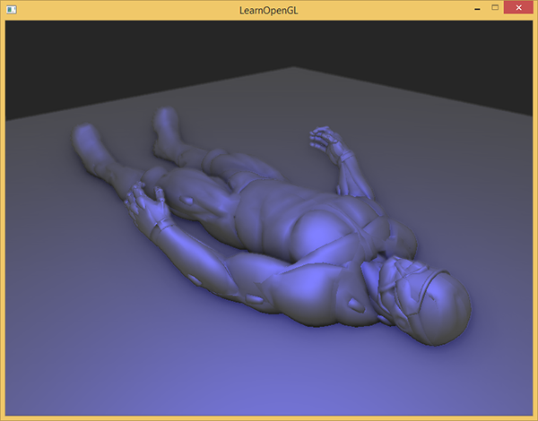

上游使用复杂模型，本仓库实际导入木箱模型，置于有地板与两面墙的场景中。几何、核采样、模糊与最终照明四个阶段都已执行，不以一张预先画好的暗纹理代替 AO。

核大小、半径、噪声周期、偏移与最终强度都影响结果，没有适合任意尺度场景的一组常数。当前核和循环均为 64；修改核数量时必须同步数组、上传数量、循环与归一化，不能只改一个 CPU 数字。增大半径会考虑更远的几何，也可能增加边缘伪影。

原文还提到用幂控制强度：对 0–1 的可见性做 $AO^p$，p>1 通常更暗。模式 6 实际采用平方，便于比较这种艺术控制；它不是更精确的遮挡估计。更少样本可能更快，增加模糊也可能遮盖部分噪声，但都需要对目标场景观察与测量。

> **常见误解：** SSAO 不能看到相机后方、屏幕外或被前层表面盖住的全部几何。相机移动时遮蔽变化不一定是灯光在变，可能只是算法获得或失去了屏幕空间信息。

> **进阶（屏幕空间边界）：** **AO 结果应被看作局部估计，而不是完整的环境照明。** 有限视图和单层深度会在物体边缘、薄表面与远近突变处产生缺失或假遮挡。先检查有效像素、投影出界和深度符号，再调整半径与模糊；仅加深颜色可能让伪影更明显。若引入时间滤波，还需处理相机与物体运动造成的历史失效，不能简单把上一帧 AO 无条件平均进来。


## 附加资源

保留底本中的源码、资源与阅读入口。外部旧程序的文件组织与本仓库不同，实际实现以本文标注的本地目标为准。

- [John Chapman](http://john-chapman-graphics.blogspot.com/)
- [SSAO教程](http://john-chapman-graphics.blogspot.com/2013/01/ssao-tutorial.html)
- [延迟着色法](https://github.com/LearnOpenGL-CN/LearnOpenGL-CN/blob/331560886468e28f28326429334fc48470f9c27b/docs/05%20Advanced%20Lighting/08%20Deferred%20Shading.md)
- [博客](https://mynameismjp.wordpress.com/2010/09/05/position-from-depth-3/)
- [切线空间](https://github.com/LearnOpenGL-CN/LearnOpenGL-CN/blob/331560886468e28f28326429334fc48470f9c27b/docs/05%20Advanced%20Lighting/04%20Normal%20Mapping.md)
- [这里](http://learnopengl.com/code_viewer.php?code=advanced-lighting/ssao)
- [顶点](http://learnopengl.com/code_viewer.php?code=advanced-lighting/ssao_geometry&type=vertex)
- [片段](http://learnopengl.com/code_viewer.php?code=advanced-lighting/ssao_geometry&type=fragment)
- [顶点](http://learnopengl.com/code_viewer.php?code=advanced-lighting/ssao&type=vertex)
- [片段](http://learnopengl.com/code_viewer.php?code=advanced-lighting/ssao&type=fragment)
- [片段](http://learnopengl.com/code_viewer.php?code=advanced-lighting/ssao_blur&type=fragment)
- [片段](http://learnopengl.com/code_viewer.php?code=advanced-lighting/ssao_lighting&type=fragment)
- [SSAO教程](http://john-chapman-graphics.blogspot.nl/2013/01/ssao-tutorial.html)
- [了解你的SSAO效果](https://mtnphil.wordpress.com/2013/06/26/know-your-ssao-artifacts/)
- [深度值重构SSAO](http://ogldev.atspace.co.uk/www/tutorial46/tutorial46.html)

## 本仓库示例

源码：[main.cpp](../../apps/05_advanced_lighting/10_ssao/main.cpp)，目标 `05_advanced_lighting__10_ssao`。helper 保留在各文件匿名命名空间，不依赖共享源码；GLSL 为内嵌字符串。必需 uniform 在初始化时检查并缓存，资源由上下文有效期内的 RAII 守卫释放。

```powershell
cmake --preset mingw-gcc-debug
cmake --build --preset mingw-gcc-debug --target 05_advanced_lighting__10_ssao
.\build\mingw-gcc-debug\apps\05_advanced_lighting\10_ssao\05_advanced_lighting__10_ssao.exe --mode 0
```

依赖安装与其他 preset 见[构建指南](../build.md)。Esc 退出，WASD 移动，鼠标转向，滚轮调整 FOV，空格依次切换以下模式；`--mode M` 选择初始模式。 有限帧检查使用 `--frames 3 --capture output.ppm`，隐藏窗口并保存末帧。

| `--mode` | 可观察内容 |
| --- | --- |
| 0 | 模糊 AO 只调制环境项 |
| 1 | 关闭 AO |
| 2 | 原始 AO |
| 3 | 模糊 AO |
| 4 | 正线性观察深度 |
| 5 | 观察空间法线 |
| 6 | 平方 AO 可见性，强化遮蔽 |

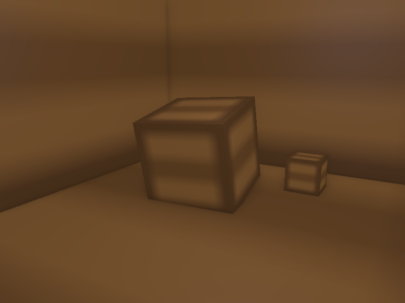

## 本章整体回顾

观察空间几何、半球核、随机旋转、邻域比较和模糊共同产生 AO，只调制环境项并承认屏幕空间限制。 本篇保留原小节、教学图片及附加资源，程序资源与上游截图的对应和差异见[图片记录](../img/05/README.md)与[资源来源](../../assets/chapter05_resources.md)。

技术核校：[英文原文](https://learnopengl.com/Advanced-Lighting/SSAO)、[OpenGL 3.3 Core 规范](https://registry.khronos.org/OpenGL/specs/gl/glspec33.core.pdf)、[GLSL 3.30 规范](https://registry.khronos.org/OpenGL/specs/gl/GLSLangSpec.3.30.pdf)。

下一节：后续教程章节尚未编写；PBR 等专题按仓库后续计划接续。
