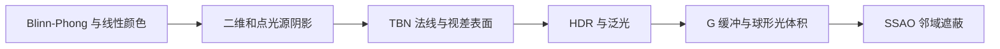

# 高级光照教程（05 章）

本章承接[高级 OpenGL](../04_advanced_opengl/README.md)，学习 Blinn-Phong、Gamma、阴影、法线与视差贴图、HDR、泛光、延迟着色和 SSAO。教程参考 [LearnOpenGL-CN](https://github.com/LearnOpenGL-CN/LearnOpenGL-CN) 与英文原文修订，内容对应与验证记录见 [覆盖清单](coverage.md)。

| 篇 | 教程 | 示例模式 |
| --- | --- | --- |
| 01 | [高级光照](01_advanced_lighting.md) | 4 |
| 02 | [Gamma 校正](02_gamma_correction.md) | 6 |
| 03 | [阴影映射](03_shadow_mapping.md) | 11 |
| 04 | [点光源阴影](04_point_shadows.md) | 6 |
| 05 | [法线贴图](05_normal_mapping.md) | 5 |
| 06 | [视差贴图](06_parallax_mapping.md) | 6 |
| 07 | [HDR](07_hdr.md) | 5 |
| 08 | [泛光](08_bloom.md) | 5 |
| 09 | [延迟着色法](09_deferred_shading.md) | 8 |
| 10 | [SSAO](10_ssao.md) | 7 |

## 构建与运行

10 个自包含目标、63 个模式；GLSL 内嵌，helper 在各文件匿名命名空间独立复制。复用 GLFW/GLAD/GLM/stb/Assimp，不增加 Conan 包。首次依赖准备、preset 和全部目标名称见[构建指南](../build.md#高级光照示例)。

Esc 退出，WASD/鼠标移动观察，滚轮改变 FOV，空格按各篇表格循环模式；`--mode M` 选择初始模式，`--frames 3 --capture output.ppm` 隐藏运行并保存末帧。视差示例 Q/E 调深度尺度，HDR/泛光 Q/E 调曝光。

```powershell
cmake --preset mingw-gcc-debug
cmake --build --preset mingw-gcc-debug --target 05_advanced_lighting__10_ssao
.\build\mingw-gcc-debug\apps\05_advanced_lighting\10_ssao\05_advanced_lighting__10_ssao.exe --mode 0
```

## 章节主线



## 资源与验证

94 个上游教学图片文件已本地化，出处及 blob SHA 见[图片记录](../img/05/README.md)。程序实际使用的 9 个材质资源与模型约定见[资源来源](../../assets/chapter05_resources.md)。本仓库场景截图单独标注，不能替代原理图。

MinGW GCC Debug / GTX 1660 上 63 个模式均运行 3 帧并保存截图。其他工具链/显卡、完整键鼠/缩放和性能基准未实测；未以该结果声称跨平台完成或固定帧率。原文中的自动曝光、位置重建、tile-based 和时间滤波仍作为扩展说明，当前没有对应实现。

上一章：[高级 OpenGL](../04_advanced_opengl/README.md) · 下一章：[PBR](../06_pbr/README.md)。
