# 理论

| 项目 | 信息 |
| --- | --- |
| 原文 | [Theory](https://learnopengl.com/PBR/Theory) |
| 作者 | Joey de Vries |
| 翻译 | [J.moons](https://github.com/JiangMuWen) |
| 校对 | Krasjet, JeremyYvv |
| 来源 | [LearnOpenGL-CN 固定底本](https://github.com/LearnOpenGL-CN/LearnOpenGL-CN/blob/331560886468e28f28326429334fc48470f9c27b/docs/07%20PBR/01%20Theory.md)；本仓库整理、纠错与代码适配 |

**PBR 用可解释的材质参数与线性光照计算，让材质在不同光照下保持一致的响应规律。** 本文以金属度工作流、Lambert 漫反射和各向同性微表面镜面反射为范围；它不是所有基于物理渲染方法的定义。

应用选择 BRDF、单位和近似，OpenGL 规范定义纹理格式及绘制语义，驱动执行着色器，GLFW 负责窗口与当前上下文。规范不会自动替应用保证能量预算或材质正确性。

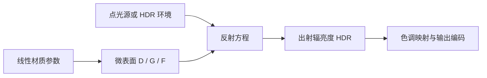

> **常见误解：** PBR 不是某一个 OpenGL 开关，也不保证所有近似自动严格守恒；是否物理可信取决于材质、采样、BRDF 和完整光照管线的约定。

> **说明：**
>
> 上游译者提示本节旧译尚有待重写；本仓库保留其教学内容，并依据英文原文与辐射度量、微表面理论修正术语、公式和适用边界，详见覆盖清单。
>

PBR，或者用更通俗一些的称呼是指**基于物理的渲染**(Physically Based Rendering)，它指的是一些在不同程度上都基于与现实世界的物理原理更相符的基本理论所构成的渲染技术的集合。正因为基于物理的渲染目的便是为了使用一种更符合物理学规律的方式来模拟光线，因此这种渲染方式与我们原来的Phong或者Blinn-Phong光照算法相比总体上看起来要更真实一些。除了看起来更好些以外，由于它与物理性质非常接近，因此我们（尤其是美术师们）可以直接以物理参数为依据来编写表面材质，而不必依靠粗劣的修改与调整来让光照效果看上去正常。使用基于物理参数的方法来编写材质还有一个更大的好处，就是不论光照条件如何，这些材质看上去都会是正确的，而在非PBR的渲染管线当中有些东西就不会那么真实了。

PBR 仍是对现实光传输的近似。本系列采用三项建模原则：微表面表面模型、能量守恒约束、物理上合理的 BRDF。它们描述本文采用的实时不透明表面方案，不是对所有 PBR 技术的充分必要定义；理想镜面、体积散射和其他模型也能属于基于物理渲染。

1. 基于微平面(Microfacet)的表面模型。
2. 能量守恒。
3. 应用基于物理的BRDF。

本系列选取 Disney 与 Epic Games 文献讨论的金属度工作流。相关思想经历了长期研究，不能表述为 Disney 首次提出全部 PBR、Epic 首次实现实时 PBR；我们具体采用 Lambert 漫反射、GGX 分布、Schlick 菲涅尔和 Smith 几何项，目标效果如下。


请注意这个系列的教程所探讨的内容属于相当高端的领域，因此要求读者对OpenGL和着色器光照有较好的理解。读者将会需要这些相关的知识：[帧缓冲](../04_advanced_opengl/05_framebuffers.md)，[立方体贴图](../04_advanced_opengl/06_cubemaps.md)，[Gamma校正](../05_advanced_lighting/02_gamma_correction.md)，[HDR](../05_advanced_lighting/07_hdr.md)和[法线贴图](../05_advanced_lighting/05_normal_mapping.md)。我们还会深入探讨一些高等数学的内容，我会尽我所能将相关的概念阐述清楚。

## 微平面模型

本文的镜面反射采用微表面理论：把不可逐像素分辨的细小表面近似为理想镜面微面元，通过其法线分布表示宏观粗糙度。并非所有 PBR 算法都必须采用这一模型。


产生的效果就是：一个平面越是粗糙，这个平面上的微平面的排列就越混乱。这些微小镜面这样无序取向排列的影响就是，当我们特指镜面光/镜面反射时，入射光线更趋向于向完全不同的方向**发散**(Scatter)开来，进而产生出分布范围更广泛的镜面反射。而与之相反的是，对于一个光滑的平面，光线大体上会更趋向于向同一个方向反射，造成更小更锐利的反射：


粗糙度控制无法逐一分辨的微面元法线分布。对给定入射方向 l 和观察方向 v，能够把该入射光镜面反射到观察者的微面元法线与半程向量 h 对齐；这是一种分布密度的计算，不是“恰好朝向某一连续方向”的离散概率。l、v 均取表面向外的单位方向，且 l+v 不为零：

$$
h = \frac{l + v}{\|l + v\|}
$$

微平面的朝向方向与半程向量的方向越是一致，镜面反射的效果就越是强烈越是锐利。通过使用一个介于0到1之间的粗糙度参数，我们就能概略地估算微平面的取向情况了：

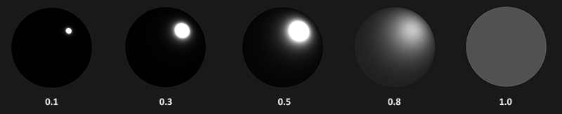

我们可以看到，较高的粗糙度显示出来的镜面反射的轮廓要更大一些。与之相反，较小的粗糙度显示出的镜面反射轮廓则更小更锐利。

> **进阶（分布与概率）：** **NDF 的峰值不是反射能量百分比。** D 是带投影归一化条件的法线分布密度；高而窄的峰可以大于一，能量约束看的是 BRDF 乘余弦在半球上的积分。采样 h 时相应 pdf 是 D(h)(n·h)，反射到 l 又需要变量变换的 Jacobian。先明确分布的测度，再比较密度、BRDF 与反射率，能避免把三个不同量都限制到 [0,1] 的误解。

## 能量守恒

微平面近似法使用了这样一种形式的**能量守恒**(Energy Conservation)：出射光线的能量永远不能超过入射光线的能量（发光面除外）。如上图我们可以看到，随着粗糙度的上升，镜面反射区域会增加，但是镜面反射的亮度却会下降。如果每个像素的镜面反射强度都一样（不管反射轮廓的大小），那么粗糙的平面就会放射出过多的能量，而这样就违背了能量守恒定律。这也就是为什么正如我们看到的一样，光滑平面的镜面反射更强烈而粗糙平面的反射更昏暗。

为分配能量，需要区分界面镜面反射、进入材质后的吸收和散射。未在界面反射的能量可能进入介质；其中重新离开表面的部分可贡献漫反射，吸收的部分转为其他能量形式。不能把“被吸收”直接称作漫反射。

进入介质不意味着立即全部吸收。光与材质相互作用时，一部分能量可被吸收，另一部分发生散射并继续传播；经过多次相互作用后，有的路径离开表面，有的被吸收。下图用粒子散射示意这一过程，并不是逐个粒子的真实光线追踪结果：

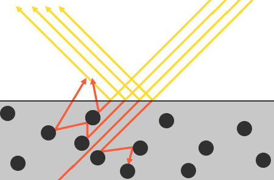

进入非金属介质的光可经历多次散射和吸收；重新离开表面的光形成漫反射。在本地着色近似中，把入射与出射位置视为同一点，并不假定全部进入的光都被吸收。次表面散射允许入射和出射位置分离，可改善皮肤、蜡和大理石等材质，但增加计算与数据开销。

对于可见光下常见的不透明金属，进入导体的光在很短距离内被强烈吸收，体散射形成的漫反射通常忽略，只保留界面镜面反射。非金属又称电介质。这里是金属度工作流的实用近似，不意味着金属内部不存在电磁波传播或真实材料永远没有其他散射机制。

反射光与折射光之间的这个区别使我们得到了另一条关于能量守恒的经验结论：反射光与折射光它们二者之间是**互斥**的关系。无论何种光线，其被材质表面所反射的能量将无法再被材质吸收。因此，诸如折射光这样的余下的进入表面之中的能量正好就是我们计算完反射之后余下的能量。

我们按照能量守恒的关系，首先计算镜面反射部分，它的值等于入射光线被反射的能量所占的百分比。然后折射光部分就可以直接由镜面反射部分计算得出：

源码摘录：[`apps/06_pbr/02_lighting/main.cpp`](../../apps/06_pbr/02_lighting/main.cpp)。

```glsl
        vec3 kd = (1.0 - f) * (1.0 - metal);
```

上式中的 (1−F)(1−metallic) 分配可用于漫反射的份额；金属的这一项为零。份额之和不超过一只是能量约束的一部分，完整 BRDF 还必须满足半球积分约束。单次散射微表面模型可能因未模拟微面元间多次反射而损失能量，因此本例不宣称严格恢复所有能量。

## 反射率方程

渲染方程描述光的发射与散射传输；这里忽略自发光与透射，仅保留不透明表面反射，得到反射方程。它说明：观察者看到的出射辐亮度，是半球内各入射方向经 BRDF 加权后的累积：

$$
L_o(p,\omega_o) = \int\limits_{\Omega} f_r(p,\omega_i,\omega_o) L_i(p,\omega_i) n \cdot \omega_i  d\omega_i
$$

理解方程需先区分辐射度量学中的功率、方向密度和面积密度。Radiance 在本文统一译为“辐亮度”L，Irradiance 为“辐照度”E；旧译“辐亮度”容易与其他物理量混淆。它们不是一个可以互换的“光强”数值。下面逐项解释。

**辐射通量** Φ 是单位时间通过的辐射能量，即功率，单位 W，而不是能量本身。它对光谱功率分布积分；可见波段边界因定义与观察条件不同而略有差异，图中展示日光的光谱分布。图形学常以线性 RGB 近似表示三通道光谱响应，不能据此把 RGB 与完整光谱视为等价：

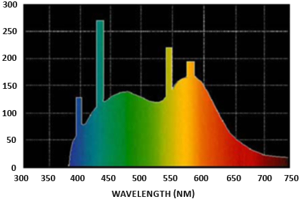

光谱曲线下面积给出相应波段功率。RGB 可显著降低计算量，但丢失光谱信息，可能影响窄带光源、色散和同色异谱等现象；本教程限定三刺激值近似，不讨论光谱渲染。

**立体角** Ω 是面在球心所张的角度范围，单位 sr；在单位球上等于所覆盖球面面积。一般球半径为 R 时有 Ω=A/R²。方向用 ω，方向微元用 dω，不能把一个三维方向向量的长度理解成立体角或体积：

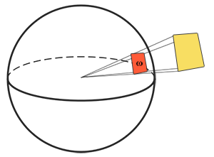

可以把自己想象成为一个站在单位球面的中心的观察者，向着投影的方向看。这个投影轮廓的大小就是立体角。

**辐射强度** I=dΦ/dω 表示点状发射源每单位立体角发出的功率，单位 W/sr。均匀全向光源总功率 Φ 对应 I=Φ/(4π)。它不是单位面积上的功率，图中的球面扇区表示方向范围：

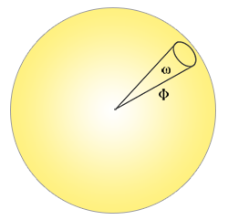

计算辐射强度的公式如下所示：

$$
I = \frac{d\Phi}{d\omega}
$$

其中$I$表示辐射通量$\Phi$除以立体角$\omega$。

再把功率按投影面积与立体角分解，就得到**辐亮度** L，单位 W/(m²·sr)。对于面积微元 dA 与方向微元 dω，θ 是方向与表面法线的夹角：

$$
L=\frac{d^2\Phi}{ dA d\omega \cos\theta}
$$

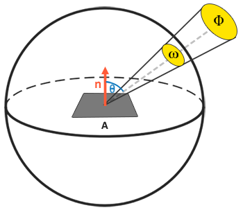

辐亮度按垂直于传播方向的投影面积定义；余弦位于定义的分母，不应因此说同一束光的辐亮度又随接收平面的角度减弱。对于接收表面，单个方向对辐照度的贡献为 dE=L_i cosθ dω，最终反射积分中只乘一次这个投影余弦：

源码摘录：[`apps/06_pbr/02_lighting/main.cpp`](../../apps/06_pbr/02_lighting/main.cpp)。

```glsl
        float nl = max(dot(n, l), 0.0);
```

面积与立体角取微分极限后，可在表面点 p 和方向 ω 处定义辐亮度场 L(p,ω)。面积、立体角与方向的物理意义并未互相转换或消失；着色器只是在离散片段位置查询这个连续场的近似。

辐照度 E(p)=∫Ω L_i(p,ω_i) max(n·ω_i,0)dω_i，单位 W/m²，是所有入射方向辐亮度按投影与立体角加权的积分。出射方向上的 L_o 仍是辐亮度，不是辐照度。

$$
L_o(p,\omega_o) = \int\limits_{\Omega} f_r(p,\omega_i,\omega_o) L_i(p,\omega_i) n \cdot \omega_i  d\omega_i
$$

方程中 L_i 是方向上的入射辐亮度，L_o 是给定观察方向 ω_o 的出射辐亮度。f_r 根据入射与观察方向描述散射，n·ω_i 是投影因子；dω_i 才是立体角微元。积分域是 n 上方的半球，所有方向的贡献共同形成一个观察方向上的结果。

基于反射率公式是围绕所有入射辐亮度的总和，也就是辐照度来计算的，所以我们需要计算的就不只是是单一的一个方向上的入射光，而是一个以点$p$为球心的半球域$\Omega$内所有方向上的入射光。一个**半球域**(Hemisphere)可以描述为以平面法线$n$为轴所环绕的半个球体：

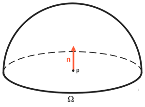

积分把连续方向的贡献累积起来；此处积分域是二维球面方向集合，不是半球内部的体积。特殊光照与 BRDF 组合可以有解析解，但一般复杂环境难以得到闭式解，故采用数值求积。黎曼和必须带每个小块的立体角权重，不能把整个半球的 dω 写成无条件的 1/steps：

概念伪代码（用于说明数值求积，sample_directions、solid_angle_weights 与 brdf 是抽象输入，不是可直接编译的示例）：

```text
outgoing = RGB(0)
for each direction wi with solid-angle weight delta_omega:
    outgoing += brdf(p, wi, wo) * incident_radiance(p, wi)
                * max(dot(n, wi), 0) * delta_omega
```

上述 delta_omega 是每个离散方向代表的立体角。若在 φ、θ 上均匀取样，则它约为 sinθ Δθ Δφ；若采用概率采样，则使用相应的 1/(N·pdf) 权重。样本增多通常可减少离散误差，但不能修正错误的权重或不合适的模型假设。

反射率方程概括了在半球域$\Omega$内，碰撞到了点$p$上的所有入射方向$\omega_i$ 上的光线的辐亮度，并受到$f_r$的约束，然后返回观察方向上反射光的$L_o$。正如我们所熟悉的那样，入射光辐亮度可以由[光源](02_lighting.md)处获得，此外还可以利用一个环境贴图来测算所有入射方向上的辐亮度，我们将在未来的[IBL](03_diffuse_irradiance.md)教程中讨论这个方法。

现在唯一剩下的未知符号就是$f_r$了，它被称为**BRDF**，或者**双向反射分布函数**(Bidirectional Reflective Distribution Function) ，它的作用是基于表面材质属性来对入射辐亮度进行缩放或者加权。


## BRDF

**BRDF**（Bidirectional Reflectance Distribution Function，双向反射分布函数）定义为出射辐亮度对入射辐照度微元的比值，单位 sr⁻¹。它以入射、出射方向及材质为变量，通常非负、满足互易性与能量积分约束。理想镜面由狄拉克 δ 分布表示，不能描述为“只有一个方向函数值为 1、其余为 0”的普通有限函数。

BRDF 可以由微表面理论构造，也可来自测量或其他模型。未归一化的 Blinn-Phong 实用公式通常不守恒，但存在规范化版本；不能说这一类函数都不可能用于物理着色。Cook-Torrance 是常用的微表面镜面反射框架，实时引擎还会使用各种其他模型和扩展。

这里的整体材质 BRDF 由 Lambert 漫反射与 Cook-Torrance 镜面反射组合。为避免重复菲涅尔权重，后文把已经包含 F 的镜面项记为 f_s，而漫反射权重记为 k_d=(1−F)(1−metallic)：

$$
f_r = k_d f_{lambert} + f_s,\qquad k_d=(1-F)(1-metallic)
$$

k_d 分配进入材质后可形成漫反射的份额；镜面项 f_s 已含菲涅尔 F，不再额外乘一次 k_s=F。下文介绍三项 D、F、G 后使用这一统一记号。

$$
f_{lambert} = \frac{c}{\pi}
$$

$c$表示表面颜色（回想一下漫反射表面纹理）。除以$\pi$是为了对漫反射光进行标准化，因为前面含有BRDF的积分方程是受$\pi$影响的（我们会在[IBL](03_diffuse_irradiance.md)的教程中探讨这个问题的）。

> **重要：**
>
> 你也许会感到好奇，这个Lambertian漫反射和我们之前经常使用的漫反射到底有什么关系：之前我们是用表面法向量与光照方向向量进行点乘，然后再将结果与平面颜色相乘得到漫反射参数。点乘依然还在，但是却不在BRDF之内，而是转变成为了$L_o$积分末公式末尾处的$n \cdot \omega_i$ 。
>

目前存在着许多不同类型的模型来实现BRDF的漫反射部分，大多看上去都相当真实，但是相应的运算开销也非常的昂贵。不过按照Epic公司给出的结论，Lambertian漫反射模型已经足够应付大多数实时渲染的用途了。

BRDF的镜面反射部分要稍微更高级一些，它的形式如下所示：

$$
f_{cook-torrance} = \frac{DFG}{4(\omega_o \cdot n)(\omega_i \cdot n)}
$$

Cook-Torrance BRDF的镜面反射部分包含三个函数，此外分母部分还有一个标准化因子 。字母D，F与G分别代表着一种类型的函数，各个函数分别用来近似的计算出表面反射特性的一个特定部分。三个函数分别为法线分布函数(Normal **D**istribution Function)，菲涅尔方程(**F**resnel Equation)和几何函数(**G**eometry Function)：

- **法线分布函数**：估算在受到表面粗糙度的影响下，朝向方向与半程向量一致的微平面的数量。这是用来估算微平面的主要函数。
- **几何函数**：描述了微平面自成阴影的属性。当一个平面相对比较粗糙的时候，平面表面上的微平面有可能挡住其他的微平面从而减少表面所反射的光线。
- **菲涅尔方程**：菲涅尔方程描述的是在不同的表面角下表面所反射的光线所占的比率。

以上的每一种函数都是用来估算相应的物理参数的，而且你会发现用来实现相应物理机制的每种函数都有不止一种形式。它们有的非常真实，有的则性能高效。你可以按照自己的需求任意选择自己想要的函数的实现方法。Epic Games的Brian Karis对于这些函数的多种近似实现方式进行了大量的[研究](http://graphicrants.blogspot.nl/2013/08/specular-brdf-reference.html)。我们将会采用Epic Games在Unreal Engine 4中所使用的函数，其中D使用Trowbridge-Reitz GGX，F使用Fresnel-Schlick近似(Fresnel-Schlick Approximation)，而G使用Smith's Schlick-GGX。


### 法线分布函数

**法线分布函数** D(h) 是相对立体角定义并满足投影归一化的微面元法线分布，不是“35% 就返回 0.35”的离散比例。满足 ∫Ω D(h)(n·h)dω_h=1，峰值可以大于一。GGX 形式如下：

$$
NDF_{GGX TR}(n, h, \alpha) = \frac{\alpha^2}{\pi((n \cdot h)^2 (\alpha^2 - 1) + 1)^2}
$$

h 是入射与观察方向的半程法线；公式中的 α 是分布尺度。本仓库把材质感知粗糙度记为 r，并采用 α=r²，因此下面源码的 alpha2=r⁴。r=0 的理想镜面极限不能直接用普通 GGX 除法处理，实际着色把 r 下限设为 0.05。

固定粗糙度后，可以比较不同 h 与宏观法线 n 的夹角如何改变 NDF；改变粗糙度则改变这一分布的宽度。h 始终来自 l 与 v 的半程关系，不是 n 与 l 的中间向量：


当粗糙度很低（也就是说表面很光滑）的时候，与半程向量取向一致的微平面会高度集中在一个很小的半径范围内。由于这种集中性，NDF最终会生成一个非常明亮的斑点。但是当表面比较粗糙的时候，微平面的取向方向会更加的随机。你将会发现与$h$向量取向一致的微平面分布在一个大得多的半径范围内，但是同时较低的集中性也会让我们的最终效果显得更加灰暗。

使用GLSL代码编写的Trowbridge-Reitz GGX法线分布函数是下面这个样子的：

源码摘录：[`apps/06_pbr/02_lighting/main.cpp`](../../apps/06_pbr/02_lighting/main.cpp)。

```glsl
float distribution_ggx(vec3 n, vec3 h, float r) {
    float alpha = r * r;
    float alpha2 = alpha * alpha;
    float nh = max(dot(n, h), 0.0);
    float denominator = nh * nh * (alpha2 - 1.0) + 1.0;
    return alpha2 / max(pi * denominator * denominator, 0.0000001);
}
```

### 几何函数

几何函数从统计学上近似的求得了微平面间相互遮蔽的比率，这种相互遮蔽会损耗光线的能量。


与NDF类似，几何函数采用一个材料的粗糙度参数作为输入参数，粗糙度较高的表面其微平面间相互遮蔽的概率就越高。我们将要使用的几何函数是GGX与Schlick-Beckmann近似的结合体，因此又称为Schlick-GGX：

$$
G_{SchlickGGX}(n, v, k) = \frac{n \cdot v}{(n \cdot v)(1 - k) + k }
$$

几何函数使用重映射参数 k。本例统一用感知粗糙度 r 表述：直接光照 k=(r+1)²/8，IBL 的 Schlick-GGX 近似 k=r²/2。它们是具体的近似选择，不能把不同代码中同名的 a 或 α 不加区分地代入。

$$
k_{direct} = \frac{(r + 1)^2}{8}
$$

$$
k_{IBL} = \frac{r^2}{2}
$$

r、α 与 k 的约定必须随 BRDF、预过滤和 LUT 保持一致；直接光照的重映射不应无条件复制到 IBL。后两篇会分别实现并核对。

为了有效的估算几何部分，需要将观察方向（几何遮蔽(Geometry Obstruction)）和光线方向向量（几何阴影(Geometry Shadowing)）都考虑进去。我们可以使用**史密斯法**(Smith's method)来把两者都纳入其中：

$$
G(n, v, l, k) = G_{sub}(n, v, k) G_{sub}(n, l, k)
$$

使用史密斯法与Schlick-GGX作为$G_{sub}$可以得到如下所示不同粗糙度的视觉效果：

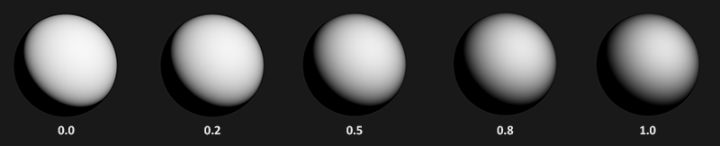

几何函数是一个值域为[0.0, 1.0]的乘数，其中白色或者说1.0表示没有微平面阴影，而黑色或者说0.0则表示微平面彻底被遮蔽。

使用GLSL编写的几何函数代码如下：

源码摘录：[`apps/06_pbr/02_lighting/main.cpp`](../../apps/06_pbr/02_lighting/main.cpp)。

```glsl
float geometry_schlick_ggx(float nx, float k) {
    return nx / max(nx * (1.0 - k) + k, 0.000001);
}
float geometry_smith(vec3 n, vec3 v, vec3 l, float r) {
    float k = (r + 1.0) * (r + 1.0) / 8.0;
    return geometry_schlick_ggx(max(dot(n, v), 0.0), k) *
           geometry_schlick_ggx(max(dot(n, l), 0.0), k);
}
```

### 菲涅尔方程

菲涅尔（发音为Freh-nel）方程描述的是被反射的光线对比光线被折射的部分所占的比率，这个比率会随着我们观察的角度不同而不同。当光线碰撞到一个表面的时候，菲涅尔方程会根据观察角度告诉我们被反射的光线所占的百分比。利用这个反射比率和能量守恒原则，我们可以直接得出光线被折射的部分以及光线剩余的能量。

法向入射反射率记为 F0。对于常见界面，从接近法线观察到接近掠射角观察，镜面反射份额通常增强；可用桌面观察这一趋势。单一理想界面的菲涅尔反射在掠射极限趋于一，但不能据此宣称所有粗糙、多层、吸收表面在任意观察方向都完全反射。这里的角度相对于法线计算，保留上游译注所提醒的角度约定。

菲涅尔方程是一个相当复杂的方程式，不过幸运的是菲涅尔方程可以用**Fresnel-Schlick**近似法求得近似解：

$$
F_{Schlick}(h, v, F_0) = F_0 + (1 - F_0) ( 1 - (h \cdot v))^5
$$

$F_0$表示平面的基础反射率，它是利用所谓**折射指数**(Indices of Refraction)或者说IOR计算得出的。然后正如你可以从球体表面看到的那样，我们越是朝球面掠角的方向上看（此时视线和表面法线的夹角接近90度）菲涅尔现象就越明显，反光就越强：

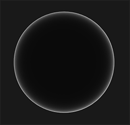

非金属界面的法向反射率可由实折射率估计，导体通常需要复折射率或测量数据。Schlick 形式也可用给定的彩色 F0 近似导体的角度响应，并非“只对非金属有定义”；真实导体菲涅尔仍可能与此近似有差别。

平面对于法向入射的响应或者说基础反射率可以在一些大型数据库中找到，比如[这个](http://refractiveindex.info/)。下面列举的这一些常见数值就是从Naty Hoffman的课程讲义中所得到的：

| 材料 | F0（线性） | 显示编码（sRGB，近似） | 色块参考（sRGB 十六进制） |
| --- | --- | --- | --- |
| 水 | (0.02, 0.02, 0.02) | (0.15, 0.15, 0.15) | #272727 |
| 塑料/玻璃（低） | (0.03, 0.03, 0.03) | (0.19, 0.19, 0.19) | #303030 |
| 塑料（高） | (0.05, 0.05, 0.05) | (0.25, 0.25, 0.25) | #3F3F3F |
| 玻璃（高）/红宝石 | (0.08, 0.08, 0.08) | (0.31, 0.31, 0.31) | #505050 |
| 钻石 | (0.17, 0.17, 0.17) | (0.45, 0.45, 0.45) | #737373 |
| 铁 | (0.56, 0.57, 0.58) | (0.77, 0.78, 0.79) | #C5C7C8 |
| 铜 | (0.95, 0.64, 0.54) | (0.98, 0.82, 0.76) | #F9D1C2 |
| 金 | (1.00, 0.71, 0.29) | (1.00, 0.86, 0.57) | #FFDB93 |
| 铝 | (0.91, 0.92, 0.92) | (0.96, 0.96, 0.96) | #F5F6F6 |
| 银 | (0.95, 0.93, 0.88) | (0.98, 0.97, 0.95) | #F9F7F1 |


表中数值只是常见材料示例，不是所有电介质 F0≤0.17 的定律。对非吸收介质的单界面，F0=((η1−η2)/(η1+η2))²，许多常用非金属约为 0.04。导体在可见波段往往有较高且带色的反射率，但真实材料、镀层、薄膜与吸收介质还会有其他行为。

这些金属表面相比于电介质表面所独有的特性引出了所谓的**金属工作流**的概念。也就是我们需要额外使用一个被称为**金属度**(Metalness)的参数来参与编写表面材质。金属度用来描述一个材质表面是金属还是非金属的。

> **重要：**
>
> 理论上来说，一个表面的金属度应该是二元的：要么是金属要么不是金属，不能两者皆是。但是，大多数的渲染管线都允许在0.0至1.0之间线性的调配金属度。这主要是由于材质纹理精度不足以描述一个拥有诸如细沙/沙状粒子/刮痕的金属表面。通过对这些小的类非金属粒子/刮痕调整金属度值，我们可以获得非常好看的视觉效果。
>

通过预先计算电介质与导体的$F_0$值，我们可以对两种类型的表面使用相同的Fresnel-Schlick近似，但是如果是金属表面的话就需要对基础反射率添加色彩。我们一般是按下面这样来实现的：

源码摘录：[`apps/06_pbr/02_lighting/main.cpp`](../../apps/06_pbr/02_lighting/main.cpp)。

```glsl
    vec3 f0 = mix(vec3(0.04), base_color, metal);
```

我们为大多数电介质表面定义了一个近似的基础反射率。$F_0$取最常见的电介质表面的平均值，这又是一个近似值。不过对于大多数电介质表面而言使用0.04作为基础反射率已经足够好了，而且可以在不需要输入额外表面参数的情况下得到物理可信的结果。然后，基于金属表面特性，我们要么使用电介质的基础反射率要么就使用$F_0$来作为表面颜色。因为金属表面会吸收所有折射光线而没有漫反射，所以我们可以直接使用表面颜色纹理来作为它们的基础反射率。

Fresnel Schlick近似可以用代码表示为：

源码摘录：[`apps/06_pbr/02_lighting/main.cpp`](../../apps/06_pbr/02_lighting/main.cpp)。

```glsl
vec3 fresnel_schlick(float cos_theta, vec3 f0) {
    return f0 + (1.0 - f0) * pow(clamp(1.0 - cos_theta, 0.0, 1.0), 5.0);
}
```

在微表面镜面 BRDF 中，cos_theta 使用 h·v（等于 h·l），不是宏观 n·v；后面的环境光近似使用 n·v 时会单独说明。

### Cook-Torrance反射率方程

随着Cook-Torrance BRDF中所有元素都介绍完毕，我们现在可以将基于物理的BRDF纳入到最终的反射率方程当中去了：

$$
L_o(p,\omega_o) = \int\limits_{\Omega} (k_d\frac{c}{\pi} + \frac{DFG}{4(\omega_o \cdot n)(\omega_i \cdot n)})L_i(p,\omega_i) n \cdot \omega_i  d\omega_i
$$

这个方程现在完整的描述了一个基于物理的渲染模型，它现在可以认为就是我们一般意义上理解的基于物理的渲染也就是PBR。如果你还没有能完全理解我们将如何把所有这些数学运算结合到一起并融入到代码当中去的话也不必担心。在下一个教程当中，我们将探索如何实现反射率方程来在我们渲染的光照当中获得更加物理可信的结果，而所有这些零零星星的碎片将会慢慢组合到一起来。

> **进阶（单次散射的边界）：** **分配了漫反射份额，不等于恢复了所有微面元间的反射。** 这里的 Smith 遮蔽把被挡住的路径扣除，未继续追踪这些光在其他微面元上的多次反射，因此高粗糙度金属可能偏暗。多重散射补偿需要额外推导和验证，不能简单任意加亮后称作物理修正；本系列保持单次散射框架，以便明确学习 D、F、G 的职责。

## 编写PBR材质

在了解了PBR后面的数学模型之后，最后我们将通过说明美术师一般是如何编写一个我们可以直接输入PBR的平面物理属性的来结束这部分的讨论。PBR渲染管线所需要的每一个表面参数都可以用纹理来定义或者建模。使用纹理可以让我们逐个片段的来控制每个表面上特定的点对于光线是如何响应的：不论那个点是不是金属，粗糙或者平滑，也不论表面对于不同波长的光会有如何的反应。

在下面你可以看到在一个PBR渲染管线当中经常会碰到的纹理列表，还有将它们输入PBR渲染器所能得到的相应的视觉输出：

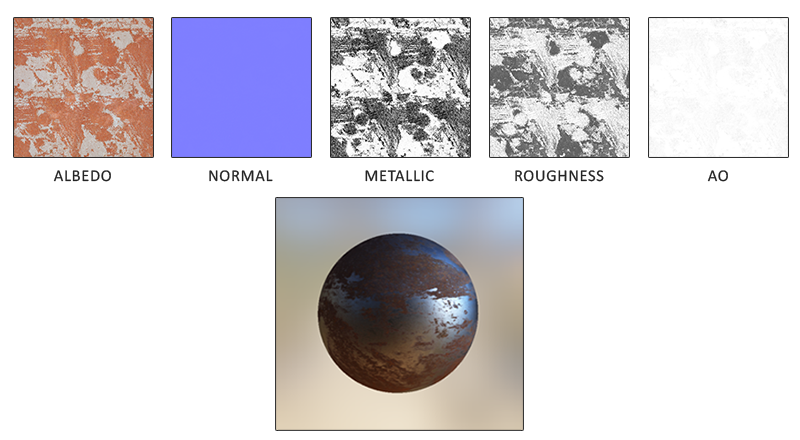

**反照率/基础颜色**：对非金属，base color 表示不带烘焙光照的漫反射颜色；对金属，它表示彩色法向镜面反射率 F0。纹理不能混入固定光源的高光和阴影；AO 单独存储，而非让反照率去重复表达遮蔽。

**法线**：法线贴图纹理和我们之前在[法线贴图](../05_advanced_lighting/05_normal_mapping.md)教程中所使用的贴图是完全一样的。法线贴图使我们可以逐片段的指定独特的法线，来为表面制造出起伏不平的假象。

**金属度**：金属(Metallic)贴图逐个纹素的指定该纹素是不是金属质地的。根据PBR引擎设置的不同，美术师们既可以将金属度编写为灰度值又可以编写为1或0这样的二元值。

**粗糙度**：粗糙度(Roughness)贴图可以以纹素为单位指定某个表面有多粗糙。采样得来的粗糙度数值会影响一个表面的微平面统计学上的取向度。一个比较粗糙的表面会得到更宽阔更模糊的镜面反射（高光），而一个比较光滑的表面则会得到集中而清晰的镜面反射。某些PBR引擎预设采用的是对某些美术师来说更加直观的**光滑度**(Smoothness)贴图而非粗糙度贴图，不过这些数值在采样之时就马上用（1.0 – 光滑度）转换成了粗糙度。

**AO**：**环境光遮蔽**(Ambient Occlusion)贴图或者说**AO**贴图为表面和周围潜在的几何图形指定了一个额外的阴影因子。比如如果我们有一个砖块表面，反照率纹理上的砖块裂缝部分应该没有任何阴影信息。然而AO贴图则会把那些光线较难逃逸出来的暗色边缘指定出来。在光照的结尾阶段引入环境遮蔽可以明显的提升你场景的视觉效果。网格/表面的环境遮蔽贴图要么通过手动生成，要么由3D建模软件自动生成。

纹素级参数可来自测量或合理的材质制作流程，在更换光照时保持材质定义不变，因此相比随场景任意调整高光颜色和指数更容易取得一致结果。跨引擎共享仍需核对 BRDF、粗糙度、通道、法线方向、单位与显示变换约定；PBR 参数并不自动保证外观逐像素一致。

材质能否跨引擎一致，还依赖粗糙度重映射、法线图坐标约定、颜色编码、BRDF 和显示变换；参数具有稳定物理含义，有助于迁移，但不会自动保证所有实现产生相同图像。

## 延伸阅读

- [Background: Physics and Math of Shading by Naty Hoffmann](http://blog.selfshadow.com/publications/s2013-shading-course/hoffman/s2013_pbs_physics_math_notes.pdf)：由于在这一篇文章中要谈论的理论点太多，所以这里的理论知识都只是涉及到了皮毛。如果你希望了解更多关于光线背后的物理知识以及它们和PBR理论之间有什么关联的话，**这**才是你需要阅读的资源。
- [Real shading in Unreal Engine 4](http://blog.selfshadow.com/publications/s2013-shading-course/karis/s2013_pbs_epic_notes_v2.pdf)：探讨了Epic Games在他们的Unreal 4引擎中所采用的PBR模型。我们这些教程中主要涉及的PBR系统就是基于他们的PBR模型。
- [Marmoset: PBR Theory](https://www.marmoset.co/toolbag/learn/pbr-theory)：主要针对美术师的PBR介绍，不过仍然是很好的读物。
- [Coding Labs: Physically based rendering](http://www.codinglabs.net/article_physically_based_rendering.aspx)：介绍渲染方程以及它和PBR直接的关系。
- [Coding Labs: Physically Based Rendering - Cook–Torrance](http://www.codinglabs.net/article_physically_based_rendering_cook_torrance.aspx)：介绍了Cook-Torrance BRDF.
- [Wolfire Games - Physically based rendering](http://blog.wolfire.com/2015/10/Physically-based-rendering)：介绍了PBR，由Lukas Orsvärn所著。

## 本章整体回顾

从微表面统计到能量分配，再到辐射度量与反射积分，D、F、G 和金属度工作流把材质参数与光照响应连接起来。下一篇将这些概念逐项落实到实际 shader。

图片、资源和逐项验证边界见[覆盖清单](coverage.md)、[图片记录](../img/06/README.md)及[运行资源来源](../../assets/chapter06_resources.md)。

技术核校：[英文原文](https://learnopengl.com/PBR/Theory)、[OpenGL 3.3 Core 规范](https://registry.khronos.org/OpenGL/specs/gl/glspec33.core.pdf)、[GLSL 3.30 规范](https://registry.khronos.org/OpenGL/specs/gl/GLSLangSpec.3.30.pdf)、[PBRT 辐射度量](https://pbr-book.org/4ed/Radiometry,_Spectra,_and_Color/Radiometry)、[PBRT 微表面理论](https://pbr-book.org/4ed/Reflection_Models/Roughness_Using_Microfacet_Theory)、[PBRT 积分与重要性采样](https://pbr-book.org/4ed/Monte_Carlo_Integration/Improving_Efficiency)。

下一节：[光照](02_lighting.md)
