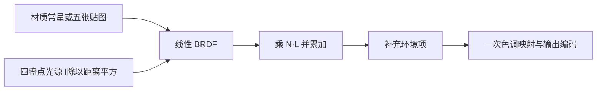
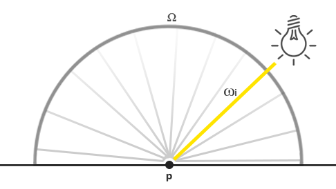
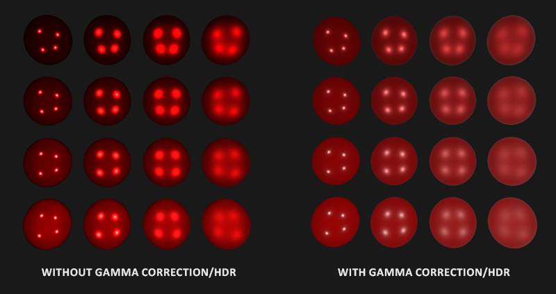
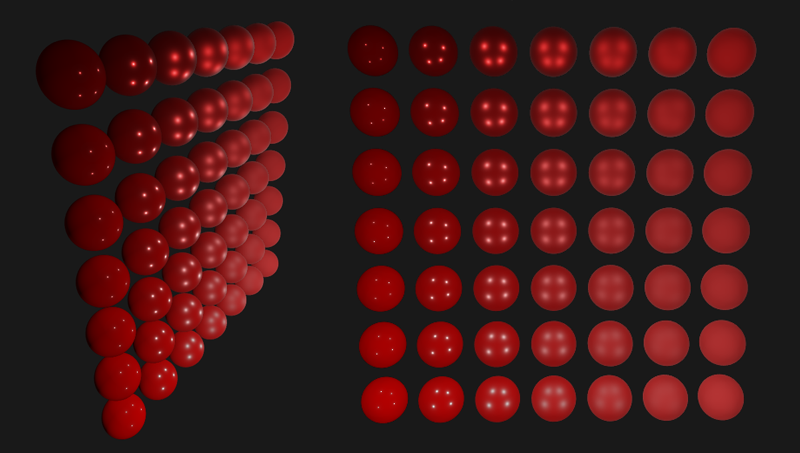
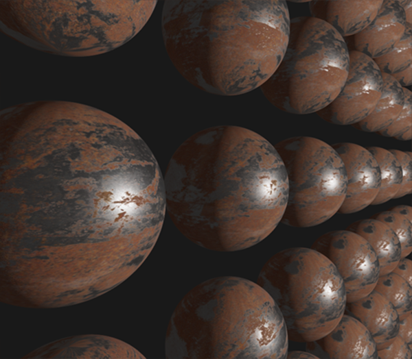
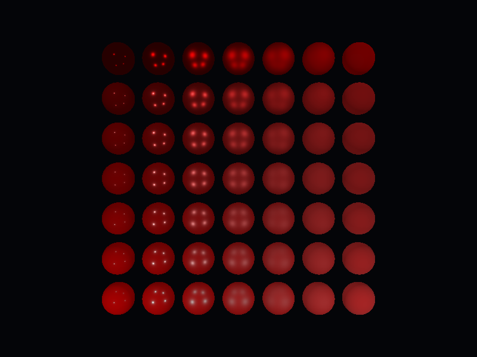

# 光照

| 项目 | 信息 |
| --- | --- |
| 原文 | [Lighting](https://learnopengl.com/PBR/Lighting) |
| 作者 | Joey de Vries |
| 翻译 | [KenLee](https://hellokenlee.github.io/) |
| 校对 | JeremyYvv |
| 来源 | [LearnOpenGL-CN 固定底本](https://github.com/LearnOpenGL-CN/LearnOpenGL-CN/blob/331560886468e28f28326429334fc48470f9c27b/docs/07%20PBR/02%20Lighting.md)；本仓库整理、纠错与代码适配 |
| 本仓库示例 | [`06_pbr__02_lighting`](../../apps/06_pbr/02_lighting/main.cpp) |

**直接 PBR 将每个已知解析光源的贡献，按同一 BRDF 与投影余弦求和。** 应用负责光强、距离、材质和单位，GLFW 创建上下文，OpenGL/驱动按程序与纹理状态执行。设置 uniform 与随后绘制的每一个球是两个阶段；本例先上传四灯参数再绘制物体，避免首帧使用未设置的光源。



> **常见误解：** 不能把 N·L 同时乘进 incident 和最终累加；否则会重复计算投影效应。这里 incident 是经距离缩放、尚未乘余弦的向量。


在[上一个教程](01_theory.md)中，我们讨论了一些PBR的基础知识。在本章节中，我们把重点放在将之前讨论的理论转化为实际的渲染器，这个渲染器将使用直接的（或解析的）光源：比如点光源，定向灯或聚光灯。

我们先来看看上一个章提到的反射方程的最终版：

$$
L_o(p,\omega_o) = \int\limits_{\Omega}
        (k_d\frac{c}{\pi} + \frac{DFG}{4(\omega_o \cdot n)(\omega_i \cdot n)})
        L_i(p,\omega_i) n \cdot \omega_i  d\omega_i
$$

上一节区分了辐射通量 Φ、辐射强度 I、辐亮度 L 与辐照度 E。不能把它们都称作某个方向上的“光能”。解析点光源可视为方向上的 δ 分布，使半球积分化为有限项求和；以下 RGB 强度采用场景一致的相对单位，不冒称已测量的绝对瓦特值。

考虑一个向各方向均匀发光的理想点光源。将其每单位立体角的 RGB 辐射强度设为 (23.47,21.31,20.79)；若已知总通量，则各向同性时应先除以 4π。对表面点 p 而言，仅指向该光源的方向有直接贡献，其他方向来自这个点光源的贡献为零：



为了理解方向，可以暂时忽略距离变化，把光源贡献看作常量；但这不是有限功率点光源的物理传播模型。真正的点光源在真空中沿各方向发出的辐射强度 I 不因接收点改变，接收表面的辐照度却因球面扩散按 1/d² 衰减。

表面点 p 的变化同时改变入射方向与距离。实现中先计算 delta=light_position−p、距离平方和 I/d²，再让 BRDF 累加式乘一次 max(n·l,0)。这一步不要把辐射强度本身说成“因接收点而缩小”，也不要把余弦重复包含两次。

下面的 incident 表示已经按距离平方缩放、尚未乘投影余弦的三通道贡献。变量保持 vec3 类型，统一小写 l，避免旧示例的 Wi/wi 大小写和 float/vec3 错误：

源码摘录：[`apps/06_pbr/02_lighting/main.cpp`](../../apps/06_pbr/02_lighting/main.cpp)。

```glsl
        vec3 delta = light_positions[index] - vertex_in.position;
        float distance2 = max(dot(delta, delta), 0.0001);
        vec3 l = delta * inversesqrt(distance2);
        float nl = max(dot(n, l), 0.0);
        float nv = max(dot(n, v), 0.0);
        if (nl <= 0.0 || nv <= 0.0 || dot(v + l, v + l) < 0.000001) continue;
        vec3 h = normalize(v + l);
        vec3 incident = light_colors[index] / distance2;
```

除了一些术语上的差异外，这段代码对你们来说应该很熟悉：这正是我们一直以来怎么计算漫反射光照的！当涉及到直接光照(direct lighting)时，辐亮度的计算方式和我们之前计算只有一个光源照射在物体表面的时候非常相似。

> **重要：**
>
> 请注意，这个假设成立的条件是点光源体积无限小，相当于在空间中的一个点。如果我们认为该光源是具有体积的，它的辐亮度会在不只一个入射光方向上非零。
>

对于其它类型的从单点发出来的光源我们类似地计算出辐亮度。比如，定向光(directional light)拥有恒定的$w_i$而不会有衰减因子；而一个聚光灯光源则没有恒定的辐射强度，其辐射强度是根据聚光灯的方向向量来缩放的。

理想点光源的贡献可通过 δ 分布解释，因此其积分恰好化为已知灯光的有限和。这里不是把点采样值当作覆盖整个半球的平均辐亮度。后面的 IBL 中环境方向连续分布，必须进行半球数值积分或使用预计算结果。定向光使用固定方向且不做距离平方衰减；聚光灯还应按出射方向调制源强度。

## 一个PBR表面模型

现在让我们开始写片段着色器来实现上述的PBR模型吧~ 首先我们需要把PBR相关的输入放进片段着色器。

源码摘录：[`apps/06_pbr/02_lighting/main.cpp`](../../apps/06_pbr/02_lighting/main.cpp)。

```glsl
#version 330 core
in VertexData { vec3 position; vec3 normal; vec2 tex_coord; } vertex_in;
out vec4 frag_color;
uniform vec3 camera_pos;
uniform vec3 albedo;
uniform float metallic;
uniform float roughness;
uniform float ao;
uniform int textured;
uniform int normal_mapping;
uniform int display_mode;
uniform int ambient_mode;
uniform int direct_enabled;
uniform int emissive;
uniform sampler2D albedo_map;
uniform sampler2D normal_map;
uniform sampler2D metallic_map;
uniform sampler2D roughness_map;
uniform sampler2D ao_map;
uniform vec3 light_positions[4];
uniform vec3 light_colors[4];
```

我们把通用的顶点着色器的输出作为输入的一部分。另一部分输入则是物体表面模型的一些材质参数。

然后在片段着色器的开始部分我们做一下任何光照算法都需要做的计算:

源码摘录：[`apps/06_pbr/02_lighting/main.cpp`](../../apps/06_pbr/02_lighting/main.cpp)。

```glsl
    vec3 n = material_normal();
    vec3 v = normalize(camera_pos - vertex_in.position);
```

### 直接光照

在本教程的例子中我们会采用总共4个点光源来直接表示场景的辐照度。为了满足反射率方程，我们循环遍历每一个光源，计算他们各自的辐亮度然后求和，接着根据BRDF和光源的入射角来缩放该辐亮度。我们可以把循环当作在物体的半球域内对所有直接光源求积分。首先我们来计算一些可以预计算的光照变量：

源码摘录：[`apps/06_pbr/02_lighting/main.cpp`](../../apps/06_pbr/02_lighting/main.cpp)。

```glsl
    vec3 outgoing = vec3(0.0);
    for (int index = 0; index < 4; ++index) {
        vec3 delta = light_positions[index] - vertex_in.position;
        float distance2 = max(dot(delta, delta), 0.0001);
        vec3 l = delta * inversesqrt(distance2);
        float nl = max(dot(n, l), 0.0);
        float nv = max(dot(n, v), 0.0);
        if (nl <= 0.0 || nv <= 0.0 || dot(v + l, v + l) < 0.000001) continue;
        vec3 h = normalize(v + l);
        vec3 incident = light_colors[index] / distance2;
        vec3 f = fresnel_schlick(max(dot(h, v), 0.0), f0);
        float d = distribution_ggx(n, h, r);
        float g = geometry_smith(n, v, l, r);
        vec3 specular = d * g * f / max(4.0 * nv * nl, 0.0001);
        vec3 kd = (1.0 - f) * (1.0 - metal);
        outgoing += (kd * base_color / pi + specular) * incident * nl;
    }
    if (direct_enabled == 0) outgoing = vec3(0.0);
```

由于我们在线性空间内计算光照（我们会在着色器的最后进行Gamma校正），我们使用在物理上更为准确的平方倒数作为衰减。

> **重要：**
>
> 相对于物理上正确来说，你可能仍然想使用常量，线性或者二次衰减方程（他们在物理上相对不准确），却可以为您提供在光的能量衰减更多的控制。
>

然后，对于每一个光源我们都想计算完整的 Cook-Torrance specular BRDF项：

$$
\frac{DFG}{4(\omega_o \cdot n)(\omega_i \cdot n)}
$$

首先我们想计算的是镜面反射和漫反射之间的比值，或者说与表面折射的光线相比，它反射了多少光线。 我们从[上一个教程](01_theory.md)知道可以使用菲涅尔方程计算（注意这里用的`clamp`是为了避免黑点）：

源码摘录：[`apps/06_pbr/02_lighting/main.cpp`](../../apps/06_pbr/02_lighting/main.cpp)。

```glsl
vec3 fresnel_schlick(float cos_theta, vec3 f0) {
    return f0 + (1.0 - f0) * pow(clamp(1.0 - cos_theta, 0.0, 1.0), 5.0);
}
```

Fresnel-Schlick近似法接收一个参数`F0`，被称为0°入射角的反射率，或者说是直接(垂直)观察表面时有多少光线会被反射。 这个参数`F0`会因为材料不同而不同，而且对于金属材质会带有颜色。在PBR金属度工作流中我们简单地认为大多数的绝缘体在`F0`为0.04的时候看起来视觉上是正确的，对于金属表面我们根据反射率特别地指定`F0`。 因此代码上看起来会像是这样：

源码摘录：[`apps/06_pbr/02_lighting/main.cpp`](../../apps/06_pbr/02_lighting/main.cpp)。

```glsl
    vec3 f0 = mix(vec3(0.04), base_color, metal);
```

可以看到，对于非金属表面`F0`始终为0.04。对于金属表面，我们根据初始的`F0`和表现金属属性的反射率进行线性插值。

我们已经算出$F$， 剩下的项就是计算法线分布函数$D$和几何遮蔽函数$G$了。

在直接PBR光照着色器中$D$和$G$的计算代码类似于：

源码摘录：[`apps/06_pbr/02_lighting/main.cpp`](../../apps/06_pbr/02_lighting/main.cpp)。

```glsl
float distribution_ggx(vec3 n, vec3 h, float r) {
    float alpha = r * r;
    float alpha2 = alpha * alpha;
    float nh = max(dot(n, h), 0.0);
    float denominator = nh * nh * (alpha2 - 1.0) + 1.0;
    return alpha2 / max(pi * denominator * denominator, 0.0000001);
}
float geometry_schlick_ggx(float nx, float k) {
    return nx / max(nx * (1.0 - k) + k, 0.000001);
}
float geometry_smith(vec3 n, vec3 v, vec3 l, float r) {
    float k = (r + 1.0) * (r + 1.0) / 8.0;
    return geometry_schlick_ggx(max(dot(n, v), 0.0), k) *
           geometry_schlick_ggx(max(dot(n, l), 0.0), k);
}
```

所有函数都接收同一个感知粗糙度 r，但各自按约定重映射：GGX 使用 α=r²，几何近似使用 k=(r+1)²/8。不是把 r 在每个函数中都重复平方；预计算 LUT 将采用另一 k，必须与对应近似匹配。

现在两个函数都给出了定义，在计算反射的循环中计算NDF和G项就变得很简单：

源码摘录：[`apps/06_pbr/02_lighting/main.cpp`](../../apps/06_pbr/02_lighting/main.cpp)。

```glsl
        float d = distribution_ggx(n, h, r);
        float g = geometry_smith(n, v, l, r);
```

这样我们就凑够了足够的项来计算Cook-Torrance BRDF:

源码摘录：[`apps/06_pbr/02_lighting/main.cpp`](../../apps/06_pbr/02_lighting/main.cpp)。

```glsl
        vec3 specular = d * g * f / max(4.0 * nv * nl, 0.0001);
```

本实现以 max 限制分母，并在 N·L、N·V 非正或半程向量退化时跳过贡献；GGX 与粗糙度也分别设数值下限。固定添加很大的偏置虽然能避免零除，却会改变高光形状，因此需要明确这一数值近似的影响。

现在我们终于可以计算每个光源在反射率方程中的贡献值了！因为菲涅尔方程直接给出了$k_S$， 我们可以使用`F`表示所有打在物体表面上的镜面反射光的贡献。 从$k_S$我们很容易计算折射的比值$k_D$：

源码摘录：[`apps/06_pbr/02_lighting/main.cpp`](../../apps/06_pbr/02_lighting/main.cpp)。

```glsl
        vec3 kd = (1.0 - f) * (1.0 - metal);
```

F 表示界面的菲涅尔反射份额，(1−F)(1−metallic) 分配漫反射权重。金属中进入介质的能量主要被吸收，本文忽略其漫反射；不是说金属没有任何内部电磁场或完全不发生折射过程。镜面 BRDF 已包含 F，不再额外乘 k_S。

源码摘录：[`apps/06_pbr/02_lighting/main.cpp`](../../apps/06_pbr/02_lighting/main.cpp)。

```glsl
        outgoing += (kd * base_color / pi + specular) * incident * nl;
```

最终的结果`Lo`，或者说是出射光线的辐亮度，实际上是反射率方程的在半球域$\Omega$的积分的结果。但是我们实际上不需要去求积，因为对于所有可能的入射光线方向我们知道只有4个方向的入射光线会影响片段的着色。因为这样，我们可以直接循环N次计算这些入射光线的方向(N也就是场景中光源的数目)。

剩下的工作就是加一个环境光照项给`Lo`，然后我们就拥有了片段的最后颜色：

源码摘录：[`apps/06_pbr/02_lighting/main.cpp`](../../apps/06_pbr/02_lighting/main.cpp)。

```glsl
    vec3 ambient = ambient_mode != 0 ? 0.03 * base_color * occlusion : vec3(0.0);
    vec3 color = emissive != 0 ? albedo : ambient + outgoing;
```

> **进阶（点光源奇点）：** **距离平方模型要求接收点不与理想点光源重合。** 理想点源没有有限面积，d 趋零时模型发散。本例用距离平方下限防止除零，并为常用材质粗糙度设下限；这些是数值保护，不是面积光源的物理解法。物体靠近真实灯具时，需要有限形状与角度分布来描述光源，同时保持场景长度单位与光强单位的一致性。

### 线性空间和HDR渲染

所有光照运算都在线性 RGB 空间完成。反照率颜色需先解码，法线和各类标量数据保持线性。出射辐亮度可超过 1：在写入默认 LDR 帧缓冲前，先做 HDR → LDR 色调映射，再编码输出；旧译把这个方向写反了。

源码摘录：[`apps/06_pbr/02_lighting/main.cpp`](../../apps/06_pbr/02_lighting/main.cpp)。

```glsl
        color = color / (color + vec3(1.0));
        frag_color = vec4(pow(max(color, vec3(0.0)), vec3(1.0 / 2.2)), 1.0);
```

这里采用逐通道 Reinhard 映射和近似 1/2.2 输出编码。这两个步骤在所有光源、环境项合成之后，每片段只执行一次，不是每盏灯算完就执行一次。此例无需中间 HDR 附件，是因为浮点着色计算先于最终写入；若继续泛光或其他后处理，则应保留 HDR 附件再统一映射。



采用线性颜色空间和HDR在PBR渲染管线中非常重要。如果没有这些操作，几乎是不可能正确地捕获到因光照强度变化的细节，这最终会导致你的计算变得不正确，在视觉上看上去非常不自然。

### 完整的直接光照PBR着色器

现在剩下的事情就是把做好色调映射和Gamma 校正的颜色值传给片段着色器的输出，然后我们就拥有了自己的直接光照PBR着色器。 为了完整性，这里给出了完整的代码：

源码摘录：[`apps/06_pbr/02_lighting/main.cpp`](../../apps/06_pbr/02_lighting/main.cpp)。

```glsl
#version 330 core
in VertexData { vec3 position; vec3 normal; vec2 tex_coord; } vertex_in;
out vec4 frag_color;
uniform vec3 camera_pos;
uniform vec3 albedo;
uniform float metallic;
uniform float roughness;
uniform float ao;
uniform int textured;
uniform int normal_mapping;
uniform int display_mode;
uniform int ambient_mode;
uniform int direct_enabled;
uniform int emissive;
uniform sampler2D albedo_map;
uniform sampler2D normal_map;
uniform sampler2D metallic_map;
uniform sampler2D roughness_map;
uniform sampler2D ao_map;
uniform vec3 light_positions[4];
uniform vec3 light_colors[4];
const float pi = 3.141592653589793;

// GLSL: 参数 r 是感知粗糙度；GGX 的 alpha=r²，公式中的 alpha²=r⁴。
float distribution_ggx(vec3 n, vec3 h, float r) {
    float alpha = r * r;
    float alpha2 = alpha * alpha;
    float nh = max(dot(n, h), 0.0);
    float denominator = nh * nh * (alpha2 - 1.0) + 1.0;
    return alpha2 / max(pi * denominator * denominator, 0.0000001);
}
float geometry_schlick_ggx(float nx, float k) {
    return nx / max(nx * (1.0 - k) + k, 0.000001);
}
float geometry_smith(vec3 n, vec3 v, vec3 l, float r) {
    float k = (r + 1.0) * (r + 1.0) / 8.0;
    return geometry_schlick_ggx(max(dot(n, v), 0.0), k) *
           geometry_schlick_ggx(max(dot(n, l), 0.0), k);
}
vec3 fresnel_schlick(float cos_theta, vec3 f0) {
    return f0 + (1.0 - f0) * pow(clamp(1.0 - cos_theta, 0.0, 1.0), 5.0);
}
vec3 fresnel_schlick_roughness(float nv, vec3 f0, float r) {
    return f0 + (max(vec3(1.0 - r), f0) - f0) * pow(clamp(1.0 - nv, 0.0, 1.0), 5.0);
}
vec3 material_normal() {
    vec3 n = normalize(vertex_in.normal);
    if (textured == 0 || normal_mapping == 0) return n;
    vec3 q1 = dFdx(vertex_in.position);
    vec3 q2 = dFdy(vertex_in.position);
    vec2 st1 = dFdx(vertex_in.tex_coord);
    vec2 st2 = dFdy(vertex_in.tex_coord);
    float determinant = st1.x * st2.y - st1.y * st2.x;
    if (abs(determinant) < 0.0000001) return n;
    vec3 tangent = (q1 * st2.y - q2 * st1.y) / determinant;
    vec3 bitangent = (-q1 * st2.x + q2 * st1.x) / determinant;
    tangent -= n * dot(n, tangent);
    if (dot(tangent, tangent) < 0.0000001) return n;
    tangent = normalize(tangent);
    float sign_uv = dot(cross(n, tangent), bitangent) < 0.0 ? -1.0 : 1.0;
    bitangent = sign_uv * cross(n, tangent);
    vec3 sampled = texture(normal_map, vertex_in.tex_coord).xyz * 2.0 - 1.0;
    return normalize(mat3(tangent, bitangent, n) * sampled);
}

void main() {
    vec3 base_color = textured != 0 ? texture(albedo_map, vertex_in.tex_coord).rgb : albedo;
    float metal = textured != 0 ? texture(metallic_map, vertex_in.tex_coord).r : metallic;
    float r = clamp(textured != 0 ? texture(roughness_map, vertex_in.tex_coord).r : roughness, 0.05, 1.0);
    float occlusion = textured != 0 ? texture(ao_map, vertex_in.tex_coord).r : ao;
    vec3 n = material_normal();
    vec3 v = normalize(camera_pos - vertex_in.position);
    vec3 f0 = mix(vec3(0.04), base_color, metal);
    vec3 outgoing = vec3(0.0);
    for (int index = 0; index < 4; ++index) {
        vec3 delta = light_positions[index] - vertex_in.position;
        float distance2 = max(dot(delta, delta), 0.0001);
        vec3 l = delta * inversesqrt(distance2);
        float nl = max(dot(n, l), 0.0);
        float nv = max(dot(n, v), 0.0);
        if (nl <= 0.0 || nv <= 0.0 || dot(v + l, v + l) < 0.000001) continue;
        vec3 h = normalize(v + l);
        vec3 incident = light_colors[index] / distance2;
        vec3 f = fresnel_schlick(max(dot(h, v), 0.0), f0);
        float d = distribution_ggx(n, h, r);
        float g = geometry_smith(n, v, l, r);
        vec3 specular = d * g * f / max(4.0 * nv * nl, 0.0001);
        vec3 kd = (1.0 - f) * (1.0 - metal);
        outgoing += (kd * base_color / pi + specular) * incident * nl;
    }
    if (direct_enabled == 0) outgoing = vec3(0.0);
    vec3 ambient = ambient_mode != 0 ? 0.03 * base_color * occlusion : vec3(0.0);
    vec3 color = emissive != 0 ? albedo : ambient + outgoing;
    if (display_mode == 1) {
        // GLSL: 故意省略色调映射和输出编码，作为错误对照。
        frag_color = vec4(color, 1.0);
    } else {
        color = color / (color + vec3(1.0));
        frag_color = vec4(pow(max(color, vec3(0.0)), vec3(1.0 / 2.2)), 1.0);
    }
}
```

希望经过上一个教程的[理论知识](01_theory.md)以及学习过关于渲染方程的一些知识后，这个着色器看起来不会太可怕。如果我们采用这个着色器，加上4个点光源和一些球体，同时令这些球体的金属性(metallic)和粗糙度(roughness)沿垂直和水平方向分别变化，我们会得到这样的结果：



(上述图片)从下往上球体的金属性从0.0变到1.0， 从左到右球体的粗糙度从0.0变到1.0。你可以看到仅仅改变这两个值，显示的效果会发生巨大的改变！

你可以在[这里](https://learnopengl.com/code_viewer_gh.php?code=src/6.pbr/1.1.lighting/lighting.cpp)找到整个demo的完整代码。

## 带贴图的 PBR

把我们系统扩展成可以接受纹理作为参数可以让我们对物体的材质有更多的自定义空间：

源码摘录：[`apps/06_pbr/02_lighting/main.cpp`](../../apps/06_pbr/02_lighting/main.cpp)。

```cpp
material_maps load_material(gpu_resources& resources, const char* name) {
    constexpr std::array<const char*, 5> files{"albedo.png", "normal.png", "metallic.png",
                                               "roughness.png", "ao.png"};
    material_maps result{};
    for (std::size_t index{0U}; index < files.size(); ++index) {
        const auto path{asset_path("textures/pbr") / name / files[index]};
        result.textures[index] = load_texture(resources, path, index == 0U);
    }
    return result;
}
```

源码摘录：[`apps/06_pbr/02_lighting/main.cpp`](../../apps/06_pbr/02_lighting/main.cpp)。

```glsl
vec3 material_normal() {
    vec3 n = normalize(vertex_in.normal);
    if (textured == 0 || normal_mapping == 0) return n;
    vec3 q1 = dFdx(vertex_in.position);
    vec3 q2 = dFdy(vertex_in.position);
    vec2 st1 = dFdx(vertex_in.tex_coord);
    vec2 st2 = dFdy(vertex_in.tex_coord);
    float determinant = st1.x * st2.y - st1.y * st2.x;
    if (abs(determinant) < 0.0000001) return n;
    vec3 tangent = (q1 * st2.y - q2 * st1.y) / determinant;
    vec3 bitangent = (-q1 * st2.x + q2 * st1.x) / determinant;
    tangent -= n * dot(n, tangent);
    if (dot(tangent, tangent) < 0.0000001) return n;
    tangent = normalize(tangent);
    float sign_uv = dot(cross(n, tangent), bitangent) < 0.0 ? -1.0 : 1.0;
    bitangent = sign_uv * cross(n, tangent);
    vec3 sampled = texture(normal_map, vertex_in.tex_coord).xyz * 2.0 - 1.0;
    return normalize(mat3(tangent, bitangent, n) * sampled);
}
```

源码摘录：[`apps/06_pbr/02_lighting/main.cpp`](../../apps/06_pbr/02_lighting/main.cpp)。

```glsl
    vec3 base_color = textured != 0 ? texture(albedo_map, vertex_in.tex_coord).rgb : albedo;
    float metal = textured != 0 ? texture(metallic_map, vertex_in.tex_coord).r : metallic;
    float r = clamp(textured != 0 ? texture(roughness_map, vertex_in.tex_coord).r : roughness, 0.05, 1.0);
    float occlusion = textured != 0 ? texture(ao_map, vertex_in.tex_coord).r : ao;
```

反照率通常按 sRGB 存储，本例使用 GL_SRGB8_ALPHA8 由采样器解码，因此 shader 不再 pow(...,2.2)。normal、metallic、roughness、AO 都是数据贴图，采用 GL_RGBA8 保持线性；特别是 AO 不应一律做 sRGB 解码。实际资产的通道与编码约定仍需随资产来源确认。

> **进阶（颜色与数据）：** **sRGB 解码由纹理内部格式决定，不由文件扩展名决定。** 同为 PNG 的反照率和粗糙度可以分别承担颜色与数值数据的角色，不能按“所有 PNG 都要 Gamma”处理。采样器从 sRGB 内部格式解码 RGB，但不会替应用识别材质语义；选择格式前必须知道各通道代表什么。若资产将 AO、粗糙度与金属度打包进一张图，该图应保持线性数据格式。

只是把之前的球体的材质性质换成纹理属性，就在视觉上有巨大的提升：



上游[带纹理完整示例](https://learnopengl.com/code_viewer_gh.php?code=src/6.pbr/1.2.lighting_textured/lighting_textured.cpp)和[锈铁材质来源](http://freepbr.com/materials/rusted-iron-pbr-metal-material-alt/)保留供对照。本仓库实际加载 LearnOpenGL 固定提交的五张 rusted_iron 贴图，包含其已有 AO 图，不要求读者另建文件。模式 1 启用法线图，模式 4 使用相同材质但保留几何法线。直接光下某些金属区域很暗，是因为还没有环境镜面光；下一节会逐步补齐。

相比起在网上找到的其他PBR渲染结果来说，尽管在视觉上不算是非常震撼，因为我们还没考虑到[基于图片的光照(IBL)](03_diffuse_irradiance.md)，但我们现在也算是有了一个基于物理的渲染器了，虽然还没考虑IBL，但你会发现你的光照看起来更加真实了。

## 本仓库示例

源码：[`apps/06_pbr/02_lighting/main.cpp`](../../apps/06_pbr/02_lighting/main.cpp)，目标 `06_pbr__02_lighting`。Esc 退出键，WASD/鼠标移动视角，滚轮调整 FOV，空格按下切换模式；`--mode M` 选择初始模式。

| 模式 | 可观察内容 |
| --- | --- |
| 0 | 四点光源、7×7 金属度/粗糙度球阵列，简化常量环境项 |
| 1 | 锈铁五贴图球，含导数 TBN 法线贴图 |
| 2 | 省略色调映射与输出编码的错误对照 |
| 3 | 直接光球阵列，关闭常量环境项 |
| 4 | 与模式 1 同一材质，关闭法线贴图 |

```powershell
cmake --preset mingw-gcc-debug
cmake --build --preset mingw-gcc-debug --target 06_pbr__02_lighting
.\build\mingw-gcc-debug\apps\06_pbr\02_lighting\06_pbr__02_lighting.exe --frames 3 --mode 0 --capture build/pbr_2.ppm
```

依赖尚未安装时先按[构建指南](../build.md)执行 Conan；资源路径基于编译期资源根。`--frames` 使用隐藏窗口并有限帧退出，`--capture` 需要同时指定 `--frames`。IBL 启动预计算可能先于第一帧花费时间；截图帧数不是预计算时间限制。

本仓库默认模式实测截图（与正文上游示意图分开）：



## 本章整体回顾

直接光把反射积分化为解析灯光求和，五张材质贴图分别提供线性颜色或数值数据，最后统一完成显示变换。下一篇以 HDR 环境替代任意常量环境项。

图片、资源和逐项验证边界见[覆盖清单](coverage.md)、[图片记录](../img/06/README.md)及[运行资源来源](../../assets/chapter06_resources.md)。

技术核校：[英文原文](https://learnopengl.com/PBR/Lighting)、[OpenGL 3.3 Core 规范](https://registry.khronos.org/OpenGL/specs/gl/glspec33.core.pdf)、[GLSL 3.30 规范](https://registry.khronos.org/OpenGL/specs/gl/GLSLangSpec.3.30.pdf)、[PBRT 微表面理论](https://pbr-book.org/4ed/Reflection_Models/Roughness_Using_Microfacet_Theory)、[PBRT 积分与重要性采样](https://pbr-book.org/4ed/Monte_Carlo_Integration/Improving_Efficiency)。

下一节：[漫反射辐照度](03_diffuse_irradiance.md)
