# 漫反射辐照度

| 项目 | 信息 |
| --- | --- |
| 原文 | [IBL/Diffuse-irradiance](https://learnopengl.com/PBR/IBL/Diffuse-irradiance) |
| 作者 | Joey de Vries |
| 翻译 | [flyingSnow](https://github.com/flyingSnow-hu) |
| 校对 | 上游未署名 |
| 来源 | [LearnOpenGL-CN 固定底本](https://github.com/LearnOpenGL-CN/LearnOpenGL-CN/blob/331560886468e28f28326429334fc48470f9c27b/docs/07%20PBR/03%20IBL/01%20Diffuse%20irradiance.md)；本仓库整理、纠错与代码适配 |
| 本仓库示例 | [`06_pbr__03_diffuse_irradiance`](../../apps/06_pbr/03_diffuse_irradiance/main.cpp) |

**漫反射 IBL 把环境的余弦加权半球积分预先存到立方体贴图，运行时按表面法线采样。** 应用负责 HDR 解码、六个观察矩阵和积分权重；OpenGL 规范定义浮点纹理、FBO 和采样，驱动执行卷积。GLFW 的窗口尺寸与离屏捕获尺寸分开管理，每个阶段都重新设置视口。

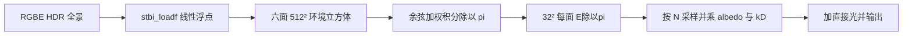

> **常见误解：** 本例名为 irradiance 的纹理实际存储 E/π。运行时乘反照率即可；若换成存储物理辐照度 E 的工具结果，则运行时还应除以 π。

**基于图像的光照**(Image based lighting, IBL)是一类光照技术的集合。其光源不是如[前一节教程](02_lighting.md)中描述的可分解的直接光源，而是将周围环境整体视为一个大光源。IBL 通常使用（取自现实世界或从3D场景生成的）环境立方体贴图 (Cubemap) ，我们可以将立方体贴图的每个像素视为光源，在渲染方程中直接使用它。这种方式可以有效地捕捉环境的全局光照和氛围，使物体**更好地融入**其环境。

由于基于图像的光照算法会捕捉部分甚至全部的环境光照，通常认为它是一种更精确的环境光照输入格式，甚至也可以说是一种全局光照的粗略近似。基于此特性，IBL 对 PBR 很有意义，因为当我们将环境光纳入计算之后，物体在物理方面看起来会更加准确。

要开始将 IBL 引入我们的 PBR 系统，让我们再次快速看一下反射方程：

$$
L_o(p,\omega_o) = \int\limits_{\Omega}
        (k_d\frac{c}{\pi} + \frac{DFG}{4(\omega_o \cdot n)(\omega_i \cdot n)})
        L_i(p,\omega_i) n \cdot \omega_i  d\omega_i
$$

如前所述，我们的主要目标是计算半球 $\Omega$ 上所有入射光方向 $w_i$ 的积分。解决上一节教程中的积分非常简单，因为我们事先已经知道了对积分有贡献的、若干精确的光线方向 $w_i$ 。然而这次，来自周围环境的**每个**方向 $w_i$ 的入射光都可能具有一些辐亮度，使得解决积分变得不那么简单。这为解决积分提出了两个要求：

 * 给定任何方向向量 $w_i$ ，我们需要一些方法来获取这个方向上场景的辐亮度。
 * 解决积分需要快速且实时。

环境贴图提供一个方向辐亮度函数：把纹素理解为某个小方向范围的样本，而不是直接把“一个像素的颜色”当作已积分好的光源功率。方向查询得到 L_i，积分时还需要 BRDF、余弦和采样权重。

如此，给定方向向量 $w_i$ ，获取此方向上场景辐亮度的方法就简化为：

源码摘录：[`apps/06_pbr/03_diffuse_irradiance/main.cpp`](../../apps/06_pbr/03_diffuse_irradiance/main.cpp)。

```glsl
    vec3 color = textureLod(environment_map, normalize(local_pos), lod).rgb;
```

为了以更有效的方式解决积分，我们需要对其大部分结果进行预处理——或称**预计算**。为此，我们必须深入研究反射方程：

$$
L_o(p,\omega_o) = \int\limits_{\Omega}
        (k_d\frac{c}{\pi} + \frac{DFG}{4(\omega_o \cdot n)(\omega_i \cdot n)})
        L_i(p,\omega_i) n \cdot \omega_i  d\omega_i
$$

仔细研究反射方程，我们发现 BRDF 的漫反射 $k_d$ 和镜面 $k_s$ 项是相互独立的，我们可以将积分分成两部分：

$$
L_o(p,\omega_o) =
        \int\limits_{\Omega} (k_d\frac{c}{\pi}) L_i(p,\omega_i) n \cdot \omega_i  d\omega_i
        +
        \int\limits_{\Omega} (\frac{DFG}{4(\omega_o \cdot n)(\omega_i \cdot n)})
            L_i(p,\omega_i) n \cdot \omega_i  d\omega_i
$$

通过将积分分成两部分，我们可以分开研究漫反射和镜面反射部分，本教程的重点是漫反射积分部分。

Lambert 项 c/π 与入射方向无关，可以提到积分外。k_d 若通过逐入射方向的菲涅尔 F(h·v) 定义则不是常量；本节为实时 IBL 采用随 n·v、粗糙度和金属度变化的近似 k_d，将它放在预计算之外。必须说明这一假设，不能把它当作精确代数恒等式：

$$
L_o(p,\omega_o) =
        k_d\frac{c}{\pi} \int\limits_{\Omega} L_i(p,\omega_i) n \cdot \omega_i  d\omega_i
$$

这给了我们一个只依赖于 $w_i$ 的积分（假设 $p$ 位于环境贴图的中心）。有了这些知识，我们就可以计算或预计算一个新的立方体贴图，它在每个采样方向——也就是纹素——中存储漫反射积分的结果，这些结果是通过**卷积**计算出来的。

卷积的特性是，对数据集中的一个条目做一些计算时，要考虑到数据集中的所有其他条目。这里的数据集就是场景的辐亮度或环境贴图。因此，要对立方体贴图中的每个采样方向做计算，我们都会考虑半球 $\Omega$ 上的所有其他采样方向。

为了对环境贴图进行卷积，我们通过对半球 $\Omega$ 上的大量方向进行离散采样并对其辐亮度取平均值，来计算每个输出采样方向 $w_o$ 的积分。用来采样方向 $w_i$ 的半球，要面向卷积的输出采样方向 $w_o$ 。

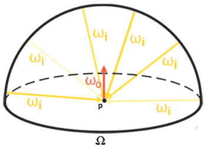

对每个宏观法线方向 n，计算该法线所对应半球上的余弦加权积分 E(n)。通常称结果为辐照度图；但本教程沿用运行时只乘 albedo 的接口，因此实际存储 E(n)/π，并在后面用显式求积权重保证这一归一化。本节图示解释从方向辐亮度到平面入射积分的差别。

> **重要：**
>
> 辐射方程也依赖了位置 $p$ ，不过这里我们假设它位于辐照度图的中心。这就意味着所有漫反射间接光只能来自同一个环境贴图，这样可能会破坏现实感（特别是在室内）。渲染引擎通过在场景中放置多个**反射探针**来解决此问题，每个反射探针单独预计算其周围环境的辐照度图。这样，位置 $p$ 处的辐照度（以及辐亮度）是取离其最近的反射探针之间的辐照度（辐亮度）内插值。目前，我们假设总是从中心采样环境贴图，把反射探针的讨论留给后面的教程。
>

下面是一个环境立方体贴图及其生成的辐照度图的示例（由 [Wave 引擎](http://www.indiedb.com/features/using-image-based-lighting-ibl)提供），每个方向 $w_o$ 的场景辐亮度取平均值。

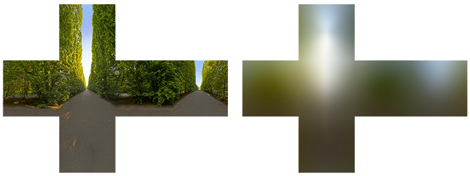

由于立方体贴图每个纹素中存储了（ $w_o$ 方向的）卷积结果，辐照度图看起来有点像环境的平均颜色或光照图。使用任何一个向量对立方体贴图进行采样，就可以获取该方向上的场景辐照度。

## PBR 和 HDR

我们在[光照教程](02_lighting.md)中简单提到过：在 PBR 渲染管线中考虑高动态范围(High Dynamic Range, HDR)的场景光照非常重要。由于 PBR 的大部分输入基于实际物理属性和测量，因此为入射光值找到其[物理等效值](https://zh.wikipedia.org/wiki/%E6%B5%81%E6%98%8E)是很重要的。无论我们是对光线的辐射通量进行研究性猜测，还是使用它们的直接物理等效值，诸如一个简单灯泡和太阳之间的这种差异都是很重要的，如果不在 [HDR](../05_advanced_lighting/07_hdr.md) 渲染环境中工作，就无法正确指定每个光的相对强度。

因此，PBR 和 HDR 需要密切合作，但这些与基于图像的光照有什么关系？我们在之前的教程中已经看到，让 PBR 在 HDR 下工作还比较容易。然而，回想一下基于图像的光照，我们将环境的间接光强度建立在环境立方体贴图的颜色值上，我们需要某种方式将光照的高动态范围存储到环境贴图中。

前面的照片天空盒使用 LDR 颜色，动态范围被限制，并且包含曝光和输出编码。它可用于显示背景，解码后也可近似照明，但不能恢复拍摄时已裁剪的高亮或未知绝对光强。因此本节用线性 HDR 数据保留不同光源的相对亮度。

### Radiance HDR 文件格式

Radiance 的 .hdr 常用 RGBE 编码二维图像，文件本身不等于包含六面的 cubemap。每像素三个 8 位尾数与一个共享指数，指数并不是 alpha 透明度；解码后才能得到线性 RGB 浮点值。它以有限精度保留较大动态范围，随后由应用按投影约定转换为六面纹理。

[sIBL 档案](http://www.hdrlabs.com/sibl/archive.html) 中有很多可以免费获取的辐亮度 HDR 环境贴图，下面是一个示例：

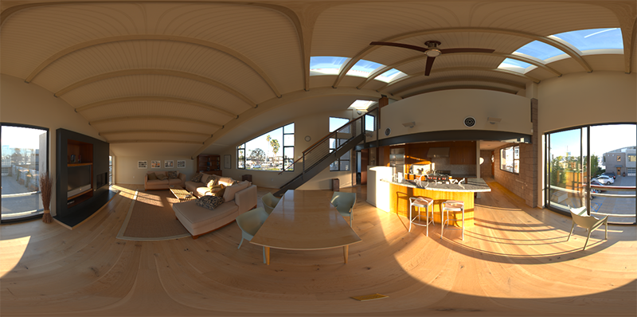

图像不是六个方形面，而是经纬角映射到二维的等距柱状全景：横向 φ 跨 2π，纵向纬度跨 π。相邻像素具有相同角间距，但所代表的立体角不同；极区被拉伸、相对单位立体角采样过密，不能说极区“分辨率更低”。后续卷积必须使用球面权重，而非平面像素简单平均。

### HDR 和 stb_image.h

Radiance 的[文件格式说明](https://radsite.lbl.gov/radiance/refer/Notes/picture_format.html)解释 RGBE 与扫描行存储。stb_image 已支持这一格式，本仓库直接使用 stbi_loadf 解码为 float，并以 unique_ptr+自定义删除器管理 CPU 数据。翻转状态在读取 HDR 后恢复，避免影响后来读取的普通材质：

源码摘录：[`apps/06_pbr/03_diffuse_irradiance/main.cpp`](../../apps/06_pbr/03_diffuse_irradiance/main.cpp)。

```cpp
GLuint load_hdr(gpu_resources& resources, const char* relative) {
    const auto path{asset_path(relative)};
    int width{0};
    int height{0};
    int channels{0};
    stbi_set_flip_vertically_on_load(1);
    const std::unique_ptr<float, hdr_deleter> pixels{
        stbi_loadf(path.string().c_str(), &width, &height, &channels, STBI_rgb)};
    stbi_set_flip_vertically_on_load(0);
    if (!pixels) {
        std::cerr << "HDR load failed: " << path << '\n';
        return 0U;
    }
    GLuint texture{0U};
    // OpenGL: 在当前上下文中配置或使用此阶段的资源与状态；失败由初始化检查或帧末错误检查报告。
    glGenTextures(1, &texture);
    resources.textures.push_back(texture);
    glBindTexture(GL_TEXTURE_2D, texture);
    // OpenGL: 浮点内部格式保留超过 1 的辐亮度，不使用 sRGB 解码。
    glTexImage2D(GL_TEXTURE_2D, 0, GL_RGB16F, width, height, 0, GL_RGB, GL_FLOAT, pixels.get());
    // OpenGL: 在当前上下文中配置或使用此阶段的资源与状态；失败由初始化检查或帧末错误检查报告。
    glTexParameteri(GL_TEXTURE_2D, GL_TEXTURE_WRAP_S, GL_REPEAT);
    glTexParameteri(GL_TEXTURE_2D, GL_TEXTURE_WRAP_T, GL_CLAMP_TO_EDGE);
    glTexParameteri(GL_TEXTURE_2D, GL_TEXTURE_MIN_FILTER, GL_LINEAR);
    glTexParameteri(GL_TEXTURE_2D, GL_TEXTURE_MAG_FILTER, GL_LINEAR);
    return texture;
}
```

stb_image.h 自动将 HDR 值映射到一个浮点数列表：默认情况下，每个通道32位，每个颜色 3 个通道。我们要将等距柱状投影 HDR 环境贴图转存到 2D 浮点纹理中，这就是所要做的全部工作。

### 从等距柱状投影到立方体贴图

当然也可以直接使用等距柱状投影图获取环境信息，但是这些操作还是显得相对昂贵，在这种情况下，直接采样立方体贴图的性能更高。因此，在本教程中，我们首先将等距柱状投影图转换为立方体贴图以备进一步处理。请注意，在此过程中，我们还将展示如何对等距柱状格式的投影图采样，如同采样 3D 环境贴图一样，您可以自由选择您喜欢的任何解决方案。

要将等距柱状投影图转换为立方体贴图，我们需要渲染一个（单位）立方体，并从内部将等距柱状图投影到立方体的每个面，并将立方体的六个面的图像构造成立方体贴图。此立方体的顶点着色器只是按原样渲染立方体，并将其局部坐标作为 3D 采样向量传递给片段着色器：

源码摘录：[`apps/06_pbr/03_diffuse_irradiance/main.cpp`](../../apps/06_pbr/03_diffuse_irradiance/main.cpp)。

```glsl
#version 330 core
layout(location=0) in vec3 a_pos;
out vec3 local_pos;
uniform mat4 projection;
uniform mat4 view;
void main() { local_pos = a_pos; gl_Position = projection * view * vec4(a_pos, 1.0); }
```

而在片段着色器中，我们为立方体的每个部分着色，方法类似于将等距柱状投影图整齐地折叠到立方体的每个面一样。为了实现这一点，我们先获取片段的采样方向，这个方向是从立方体的局部坐标进行插值得到的，然后使用此方向向量和一些三角学魔法对等距柱状投影图进行采样，如同立方体图本身一样。我们直接将结果存储到立方体每个面的片段中，以下就是我们需要做的：

源码摘录：[`apps/06_pbr/03_diffuse_irradiance/main.cpp`](../../apps/06_pbr/03_diffuse_irradiance/main.cpp)。

```glsl
#version 330 core
in vec3 local_pos;
out vec4 frag_color;
uniform sampler2D panorama;
void main() {
    vec3 direction = normalize(local_pos);
    vec2 uv = vec2(atan(direction.z, direction.x) / (2.0 * 3.141592653589793),
                   asin(clamp(direction.y, -1.0, 1.0)) / 3.141592653589793) + 0.5;
    frag_color = vec4(texture(panorama, uv).rgb, 1.0);
}
```

如果给定HDR等距柱状投影图，在场景的中心渲染一个立方体，将得到如下所示的内容：

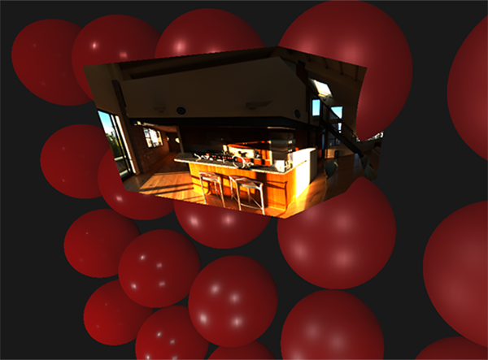

这表明我们有效地将等距柱状投影图映射到了立方体，但我们还需要将源HDR图像转换为立方体贴图纹理。为了实现这一点，我们必须对同一个立方体渲染六次，每次面对立方体的一个面，并用[帧缓冲](../04_advanced_opengl/05_framebuffers.md)对象记录其结果：

源码摘录：[`apps/06_pbr/03_diffuse_irradiance/main.cpp`](../../apps/06_pbr/03_diffuse_irradiance/main.cpp)。

```cpp
capture_target make_capture(gpu_resources& resources) {
    capture_target result{};
    // OpenGL: FBO 持有附件引用；RBO 提供深度存储。
    glGenFramebuffers(1, &result.framebuffer);
    // OpenGL: 在当前上下文中配置或使用此阶段的资源与状态；失败由初始化检查或帧末错误检查报告。
    glGenRenderbuffers(1, &result.depth);
    resources.framebuffers.push_back(result.framebuffer);
    resources.renderbuffers.push_back(result.depth);
    // OpenGL: 在当前上下文中配置或使用此阶段的资源与状态；失败由初始化检查或帧末错误检查报告。
    glBindFramebuffer(GL_FRAMEBUFFER, result.framebuffer);
    // OpenGL: 选择随后需要重新分配存储的深度附件。
    glBindRenderbuffer(GL_RENDERBUFFER, result.depth);
    // OpenGL: 在当前上下文中配置或使用此阶段的资源与状态；失败由初始化检查或帧末错误检查报告。
    glFramebufferRenderbuffer(GL_FRAMEBUFFER, GL_DEPTH_ATTACHMENT, GL_RENDERBUFFER, result.depth);
    return result;
}
```

当然，我们此时就可以生成相应的立方体贴图了，首先为其六个面预先分配内存：

源码摘录：[`apps/06_pbr/03_diffuse_irradiance/main.cpp`](../../apps/06_pbr/03_diffuse_irradiance/main.cpp)。

```cpp
GLuint make_float_cube(gpu_resources& resources, int size, int levels) {
    GLuint texture{0U};
    glGenTextures(1, &texture);
    resources.textures.push_back(texture);
    glBindTexture(GL_TEXTURE_CUBE_MAP, texture);
    for (int level{0}; level < levels; ++level) {
        for (GLuint face{0U}; face < 6U; ++face) {
            glTexImage2D(GL_TEXTURE_CUBE_MAP_POSITIVE_X + face, level, GL_RGB16F,
                         std::max(size >> level, 1), std::max(size >> level, 1), 0, GL_RGB,
                         GL_FLOAT, nullptr);
        }
    }
    glTexParameteri(GL_TEXTURE_CUBE_MAP, GL_TEXTURE_MAX_LEVEL, levels - 1);
    glTexParameteri(GL_TEXTURE_CUBE_MAP, GL_TEXTURE_MIN_FILTER,
                    levels > 1 ? GL_LINEAR_MIPMAP_LINEAR : GL_LINEAR);
    glTexParameteri(GL_TEXTURE_CUBE_MAP, GL_TEXTURE_MAG_FILTER, GL_LINEAR);
    glTexParameteri(GL_TEXTURE_CUBE_MAP, GL_TEXTURE_WRAP_S, GL_CLAMP_TO_EDGE);
    glTexParameteri(GL_TEXTURE_CUBE_MAP, GL_TEXTURE_WRAP_T, GL_CLAMP_TO_EDGE);
    glTexParameteri(GL_TEXTURE_CUBE_MAP, GL_TEXTURE_WRAP_R, GL_CLAMP_TO_EDGE);
    return texture;
}
```

那剩下要做的就是将等距柱状 2D 纹理捕捉到立方体贴图的面上。

之前在[帧缓冲](../04_advanced_opengl/05_framebuffers.md)和[点阴影](https://learnopengl-cn.github.io/05%20Advanced%20Lighting/03%20Shadows/02%20Point%20Shadows/)教程中讨论过的代码细节，我就不再次详细说明，实际过程可以概括为：面向立方体六个面设置六个不同的视图矩阵，给定投影矩阵的 fov 为 90 度以捕捉整个面，并渲染立方体六次，将结果存储在浮点帧缓冲中：

源码摘录：[`apps/06_pbr/03_diffuse_irradiance/main.cpp`](../../apps/06_pbr/03_diffuse_irradiance/main.cpp)。

```cpp
bool capture_cube(const capture_target& target, const shader_program& program, const mesh& cube,
                  GLuint texture, int size, int level) {
    const glm::mat4 projection{glm::perspective(glm::radians(90.0F), 1.0F, 0.1F, 10.0F)};
    const std::array<glm::mat4, 6> views{
        glm::lookAt(glm::vec3{0.0F}, {1.0F, 0.0F, 0.0F}, {0.0F, -1.0F, 0.0F}),
        glm::lookAt(glm::vec3{0.0F}, {-1.0F, 0.0F, 0.0F}, {0.0F, -1.0F, 0.0F}),
        glm::lookAt(glm::vec3{0.0F}, {0.0F, 1.0F, 0.0F}, {0.0F, 0.0F, 1.0F}),
        glm::lookAt(glm::vec3{0.0F}, {0.0F, -1.0F, 0.0F}, {0.0F, 0.0F, -1.0F}),
        glm::lookAt(glm::vec3{0.0F}, {0.0F, 0.0F, 1.0F}, {0.0F, -1.0F, 0.0F}),
        glm::lookAt(glm::vec3{0.0F}, {0.0F, 0.0F, -1.0F}, {0.0F, -1.0F, 0.0F})};
    // OpenGL: 在当前上下文中配置或使用此阶段的资源与状态；失败由初始化检查或帧末错误检查报告。
    glUseProgram(program.id);
    set_mat4(program, "projection", projection);
    glBindFramebuffer(GL_FRAMEBUFFER, target.framebuffer);
    glBindRenderbuffer(GL_RENDERBUFFER, target.depth);
    // OpenGL: 按当前捕获层级的像素尺寸分配深度存储。
    glRenderbufferStorage(GL_RENDERBUFFER, GL_DEPTH_COMPONENT24, size, size);
    glViewport(0, 0, size, size);
    for (GLuint face{0U}; face < views.size(); ++face) {
        set_mat4(program, "view", views[face]);
        // OpenGL: 把对应面的指定 mip 设为颜色输出；采样输入必须是另一张纹理。
        glFramebufferTexture2D(GL_FRAMEBUFFER, GL_COLOR_ATTACHMENT0,
                               GL_TEXTURE_CUBE_MAP_POSITIVE_X + face, texture, level);
        if (!check_capture())
            return false;
        // OpenGL: 在当前上下文中配置或使用此阶段的资源与状态；失败由初始化检查或帧末错误检查报告。
        glClear(GL_COLOR_BUFFER_BIT | GL_DEPTH_BUFFER_BIT);
        draw_mesh(cube);
    }
    glBindFramebuffer(GL_FRAMEBUFFER, 0);
    return true;
}
```

我们采用帧缓冲的颜色值并围绕立方体贴图的每个面切换纹理目标，直接将场景渲染到立方体贴图的一个面上。一旦这个流程完毕——我们只需做一次——立方体贴图 `envCubemap` 就应该是原 HDR 图的环境立方体贴图版。

让我们编写一个非常简单的天空盒着色器来测试立方体贴图，用来显示周围的立方体贴图：

源码摘录：[`apps/06_pbr/03_diffuse_irradiance/main.cpp`](../../apps/06_pbr/03_diffuse_irradiance/main.cpp)。

```glsl
#version 330 core
layout(location=0) in vec3 a_pos;
out vec3 local_pos;
uniform mat4 projection;
uniform mat4 view;
void main() { local_pos = a_pos; vec4 clip = projection * view * vec4(a_pos, 1.0); gl_Position = clip.xyww; }
```

注意这里的小技巧 xyww 可以确保渲染的立方体片段的深度值总是 1.0，即最大深度，如[立方体贴图](../04_advanced_opengl/06_cubemaps.md)教程中所述。注意我们需要将深度比较函数更改为 GL_LEQUAL：

源码摘录：[`apps/06_pbr/03_diffuse_irradiance/main.cpp`](../../apps/06_pbr/03_diffuse_irradiance/main.cpp)。

```cpp
void draw_sky(const shader_program& sky, const mesh& cube, const glm::mat4& view,
              const glm::mat4& projection, GLuint texture, float lod) {
    // OpenGL: xyww 写入最远深度，允许等于清除深度，且不改写深度缓冲。
    glDepthFunc(GL_LEQUAL);
    // OpenGL: 控制深度写入；天空盒之后恢复写入。
    glDepthMask(GL_FALSE);
    glUseProgram(sky.id);
    set_mat4(sky, "view", glm::mat4{glm::mat3{view}});
    set_mat4(sky, "projection", projection);
    set_int(sky, "environment_map", 7);
    set_float(sky, "lod", lod);
    bind_texture(7, texture, GL_TEXTURE_CUBE_MAP);
    draw_mesh(cube);
    glDepthMask(GL_TRUE);
    glDepthFunc(GL_LESS);
}
```

这个片段着色器直接使用立方体的片段局部坐标，对环境立方体贴图采样：

源码摘录：[`apps/06_pbr/03_diffuse_irradiance/main.cpp`](../../apps/06_pbr/03_diffuse_irradiance/main.cpp)。

```glsl
#version 330 core
in vec3 local_pos;
out vec4 frag_color;
uniform samplerCube environment_map;
uniform float lod;
void main() {
    vec3 color = textureLod(environment_map, normalize(local_pos), lod).rgb;
    color = color / (color + vec3(1.0));
    frag_color = vec4(pow(max(color, vec3(0.0)), vec3(1.0 / 2.2)), 1.0);
}
```

我们使用插值的立方体顶点坐标对环境贴图进行采样，这些坐标直接对应于正确的采样方向向量。注意，相机的平移分量被忽略掉了，在立方体上渲染此着色器会得到非移动状态下的环境贴图。另外还请注意，当我们将环境贴图的 HDR 值直接输出到默认的 LDR 帧缓冲时，希望对颜色值进行正确的色调映射。此外，默认情况下，几乎所有 HDR 图都处于线性颜色空间中，因此我们需要在写入默认帧缓冲之前应用[Gamma 校正](../05_advanced_lighting/02_gamma_correction.md)。

现在，在之前渲染的球体上渲染环境贴图，效果应该如下图：

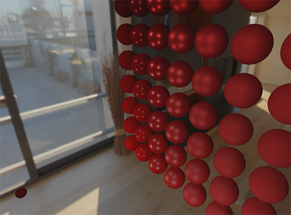

好的...我们用了相当多的设置终于来到了这里，我们设法成功地读取了 HDR 环境贴图，将它从等距柱状投影图转换为立方体贴图，并将 HDR 立方体贴图作为天空盒渲染到了场景中。此外，我们设置了一个小系统来渲染立方体贴图的所有六个面，我们在计算环境贴图卷积时还会需要它。您可以在[此处](https://learnopengl.com/code_viewer_gh.php?code=src/6.pbr/2.1.1.ibl_irradiance_conversion/ibl_irradiance_conversion.cpp)找到整个转化过程的源代码。

## 立方体贴图的卷积

如本节教程开头所述，我们的主要目标是计算所有间接漫反射光的积分，其中光照的辐照度以环境立方体贴图的形式给出。我们已经知道，在方向 $w_i$ 上采样 HDR 环境贴图，可以获得场景在此方向上的辐亮度 $L(p, w_i)$ 。虽然如此，要解决积分，我们仍然不能仅从一个方向对环境贴图采样，而要从半球 $\Omega$ 上所有可能的方向进行采样，这对于片段着色器而言还是过于昂贵。

然而，计算上又不可能从 $\Omega$ 的每个可能的方向采样环境光照，理论上可能的方向数量是无限的。不过我们可以对有限数量的方向采样以近似求解，在半球内均匀间隔或随机取方向可以获得一个相当精确的辐照度近似值，从而离散地计算积分 $\int$ 。

每片段重复大量方向采样代价过高，因此先在离散的宏观法线方向上求积。cubemap 六个面覆盖所有法线朝向；运行时插值查询，只近似原连续积分，并不是预先计算了无穷多个方向：

$$
L_o(p,\omega_o) =
        k_d\frac{c}{\pi} \int\limits_{\Omega} L_i(p,\omega_i) n \cdot \omega_i  d\omega_i
$$

给定表面法线 n，查询卷积图可得到该法线所对应的 E(n)/π；再乘 k_d 和反照率得漫反射出射辐亮度。它与用任意入射方向 w_i 查询原环境 L_i 的操作不同，下面的 diffuse 已包含 base_color：

源码摘录：[`apps/06_pbr/03_diffuse_irradiance/main.cpp`](../../apps/06_pbr/03_diffuse_irradiance/main.cpp)。

```glsl
    vec3 diffuse = texture(irradiance_map, n).rgb * base_color;
```

生成辐照度图需要对每个输出法线 n，在其半球上积分输入的方向辐亮度。输出方向不是一个任意观察方向：Lambert 漫反射不依赖观察方向，纹理索引代表宏观表面法线。

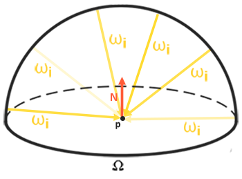

值得庆幸的是，本节教程中所有繁琐的设置并非毫无用处，因为我们现在可以直接获取转换后的立方体贴图，在片段着色器中对其进行卷积，渲染所有六个面，将其结果用帧缓冲捕捉到新的立方体贴图中。之前已经将等距柱状投影图转换为立方体贴图，这次我们可以采用完全相同的方法，但使用不同的片段着色器：

源码摘录：[`apps/06_pbr/03_diffuse_irradiance/main.cpp`](../../apps/06_pbr/03_diffuse_irradiance/main.cpp)。

```glsl
#version 330 core
in vec3 local_pos;
out vec4 frag_color;
uniform samplerCube environment_map;
const float pi = 3.141592653589793;
void main() {
    vec3 n = normalize(local_pos);
    vec3 up = abs(n.z) < 0.999 ? vec3(0.0, 0.0, 1.0) : vec3(1.0, 0.0, 0.0);
    vec3 tangent = normalize(cross(up, n));
    vec3 bitangent = cross(n, tangent);
    const int phi_count = 128;
    const int theta_count = 64;
    float delta_phi = 2.0 * pi / float(phi_count);
    float delta_theta = 0.5 * pi / float(theta_count);
    vec3 integral = vec3(0.0);
    for (int p = 0; p < phi_count; ++p) {
        float phi = (float(p) + 0.5) * delta_phi;
        for (int t = 0; t < theta_count; ++t) {
            float theta = (float(t) + 0.5) * delta_theta;
            vec3 local_sample = vec3(sin(theta) * cos(phi), sin(theta) * sin(phi), cos(theta));
            vec3 direction = tangent * local_sample.x + bitangent * local_sample.y + n * local_sample.z;
            integral += textureLod(environment_map, direction, 0.0).rgb * cos(theta) * sin(theta);
        }
    }
    // GLSL: 存储 E/pi，运行时乘 albedo；这里不再沿用有歧义的 PI/样本数近似。
    frag_color = vec4(integral * delta_phi * delta_theta / pi, 1.0);
}
```

`environmentMap` 是从等距柱状投影图转换而来的 HDR 立方体贴图。
有很多方法可以对环境贴图进行卷积，但是对于本教程，我们的方法是：对于立方体贴图的每个纹素，在纹素所代表的方向的半球 $\Omega$ 内生成固定数量的采样向量，并对采样结果取平均值。数量固定的采样向量将均匀地分布在半球内部。注意，积分是连续函数，在采样向量数量固定的情况下离散地采样只是一种近似计算方法，我们采样的向量越多，就越接近正确的结果。
反射方程的积分 $\int$ 是围绕立体角 $dw$ 旋转，而这个立体角相当难以处理。为了避免对难处理的立体角求积分，我们使用球坐标 $\theta$ 和 $\phi$ 来代替立体角。

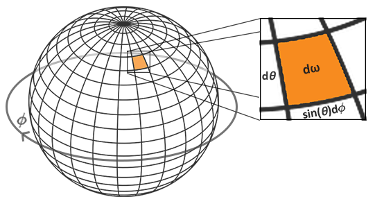

对于围绕半球大圆的航向角 $\phi$ ，我们在 $0$ 到 $2\pi$ 内采样，而从半球顶点出发的倾斜角 $\theta$ ，采样范围是 $0$ 到 $\frac{1}{2}\pi$ 。于是我们更新一下反射积分方程：

$$
L_o(p,\phi_o, \theta_o) =
        k_d\frac{c}{\pi} \int_{\phi = 0}^{2\pi} \int_{\theta = 0}^{\frac{1}{2}\pi} L_i(p,\phi_i, \theta_i) \cos(\theta) \sin(\theta)  d\phi d\theta
$$

在 φ 与 θ 上分别取 nφ、nθ 个中点样本，Δφ=2π/nφ，Δθ=(π/2)/nθ。离散积分包含且只包含一次立体角的 Jacobian sinθ：

$$
L_{o,d}(p,n) \approx k_d\frac{c}{\pi} \sum_{j=0}^{n_\phi-1}\sum_{k=0}^{n_\theta-1} L_i(p,\phi_j,\theta_k)\cos\theta_k\sin\theta_k\Delta\phi\Delta\theta
$$

Δφ、Δθ 相同不意味着每个样本覆盖相同立体角。极角 θ 趋于零时靠近法线顶点，小块面积随 sinθ 减小；靠近地平线时 cosθ 减小。两者作用不同，一个来自球面面积，一个来自表面投影。

给定每个片段的积分球坐标，对半球进行离散采样，过程代码如下：

源码摘录：[`apps/06_pbr/03_diffuse_irradiance/main.cpp`](../../apps/06_pbr/03_diffuse_irradiance/main.cpp)。

```glsl
    vec3 n = normalize(local_pos);
    vec3 up = abs(n.z) < 0.999 ? vec3(0.0, 0.0, 1.0) : vec3(1.0, 0.0, 0.0);
    vec3 tangent = normalize(cross(up, n));
    vec3 bitangent = cross(n, tangent);
    const int phi_count = 128;
    const int theta_count = 64;
    float delta_phi = 2.0 * pi / float(phi_count);
    float delta_theta = 0.5 * pi / float(theta_count);
    vec3 integral = vec3(0.0);
    for (int p = 0; p < phi_count; ++p) {
        float phi = (float(p) + 0.5) * delta_phi;
        for (int t = 0; t < theta_count; ++t) {
            float theta = (float(t) + 0.5) * delta_theta;
            vec3 local_sample = vec3(sin(theta) * cos(phi), sin(theta) * sin(phi), cos(theta));
            vec3 direction = tangent * local_sample.x + bitangent * local_sample.y + n * local_sample.z;
            integral += textureLod(environment_map, direction, 0.0).rgb * cos(theta) * sin(theta);
        }
    }
    // GLSL: 存储 E/pi，运行时乘 albedo；这里不再沿用有歧义的 PI/样本数近似。
    frag_color = vec4(integral * delta_phi * delta_theta / pi, 1.0);
```

源码用 128×64 个角度中点样本，明确乘 ΔφΔθ/π，直接得到 E/π。上游 sampleDelta 循环后乘 π/样本数是另一种近似归一化写法；不能再在离散公式中重复保留 dφdθ。增大样本数通常可改善离散误差，恒定环境是检查归一化最直接的输入。

循环先在法线的局部切线基中构造样本，再变到世界方向查询环境。辅助 up 会在接近极点时切换，避免固定 up 与 n 平行导致叉积为零。加权采用 cosθ sinθ；最终乘角度步长并除以 π。代码中 normal/N 的命名保持一致，修正旧示例中混用导致无法编译的问题。

现在剩下要做的就是设置 OpenGL 渲染代码，以便我们可以对之前捕捉的 `envCubemap` 求卷积。首先我们创建一个辐照度立方体贴图（重复一遍，我们只需要在渲染循环之前执行一次）：

源码摘录：[`apps/06_pbr/03_diffuse_irradiance/main.cpp`](../../apps/06_pbr/03_diffuse_irradiance/main.cpp)。

```cpp
    result.irradiance = make_float_cube(resources, 32, 1);
```

由于辐照度图对所有周围的辐射值取了平均值，因此它丢失了大部分高频细节，所以我们可以以较低的分辨率（32x32）存储，并让 OpenGL 的线性滤波完成大部分工作。接下来，我们将捕捉到的帧缓冲图像缩放到新的分辨率：

源码摘录：[`apps/06_pbr/03_diffuse_irradiance/main.cpp`](../../apps/06_pbr/03_diffuse_irradiance/main.cpp)。

```cpp
    glBindFramebuffer(GL_FRAMEBUFFER, target.framebuffer);
    glBindRenderbuffer(GL_RENDERBUFFER, target.depth);
    // OpenGL: 按当前捕获层级的像素尺寸分配深度存储。
    glRenderbufferStorage(GL_RENDERBUFFER, GL_DEPTH_COMPONENT24, size, size);
    glViewport(0, 0, size, size);
```

我们使用卷积着色器——和捕捉环境立方体贴图类似的方式——来对环境贴图求卷积：

源码摘录：[`apps/06_pbr/03_diffuse_irradiance/main.cpp`](../../apps/06_pbr/03_diffuse_irradiance/main.cpp)。

```cpp
environment_maps bake_diffuse(gpu_resources& resources, const capture_target& target,
                              const mesh& cube, const shader_program& convert,
                              const shader_program& convolution, const char* path) {
    environment_maps result{};
    result.panorama = load_hdr(resources, path);
    if (result.panorama == 0U)
        return {};
    result.environment = make_float_cube(resources, 512, 10);
    glUseProgram(convert.id);
    set_int(convert, "panorama", 0);
    bind_texture(0, result.panorama);
    if (!capture_cube(target, convert, cube, result.environment, 512, 0))
        return {};
    glBindTexture(GL_TEXTURE_CUBE_MAP, result.environment);
    // OpenGL: 这是源环境的普通缩小 mip；输出预过滤图则必须逐层做 GGX 卷积。
    glGenerateMipmap(GL_TEXTURE_CUBE_MAP);
    result.irradiance = make_float_cube(resources, 32, 1);
    glUseProgram(convolution.id);
    set_int(convolution, "environment_map", 0);
    bind_texture(0, result.environment, GL_TEXTURE_CUBE_MAP);
    if (!capture_cube(target, convolution, cube, result.irradiance, 32, 0))
        return {};
    return result;
}
```

现在，完成这个流程之后，我们应该得到了一个预计算好的辐照度图，可以直接将其用于IBL 计算。为了查看我们是否成功地对环境贴图进行了卷积，让我们将天空盒的环境采样贴图替换为辐照度贴图：

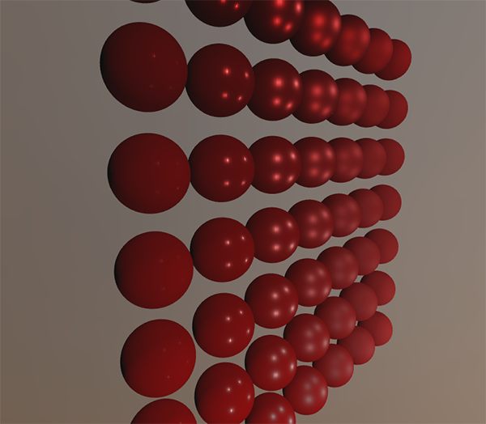

如果它看起来像模糊的环境贴图，说明您已经成功地对环境贴图进行了卷积。

> **进阶（恒定环境校验）：** **输入所有方向均为 C 时，E/π 应仍为 C。** 因为半球余弦积分为 π，白环境可把投影、Jacobian、角度步长和 Lambert 归一化的错误直接暴露出来。有限角度采样和半精度存储会带来小量误差，应使用容差判断。这个检查比“图像看起来模糊”更能证明确实算了约定的积分，也可发现极点切线基退化造成的非有限值。

## PBR 和间接辐照度光照

辐照度图表示所有周围的间接光累积的反射率的漫反射部分的积分。注意光不是来自任何直接光源，而是来自周围环境，我们将间接漫反射和间接镜面反射视为环境光，取代了我们之前设定的常数项。

首先，务必将预计算的辐照度图添加为一个立方体采样器：

源码摘录：[`apps/06_pbr/03_diffuse_irradiance/main.cpp`](../../apps/06_pbr/03_diffuse_irradiance/main.cpp)。

```glsl
uniform samplerCube irradiance_map;
```

给定一张辐照度图，它存储了场景中的所有间接漫反射光，获取片段的辐照度就简化为给定法线的一次纹理采样：

源码摘录：[`apps/06_pbr/03_diffuse_irradiance/main.cpp`](../../apps/06_pbr/03_diffuse_irradiance/main.cpp)。

```glsl
    vec3 diffuse = texture(irradiance_map, n).rgb * base_color;
    ambient = ambient_mode != 0 ? kd_ambient * diffuse * occlusion : vec3(0.0);
```

然而，由于间接光照包括漫反射和镜面反射两部分，正如我们从分割版的反射方程中看到的那样，我们需要对漫反射部分进行相应的加权。与我们在前一节教程中所做的类似，我们使用菲涅耳公式来计算表面的间接反射率，我们从中得出折射率或称漫反射率：

源码摘录：[`apps/06_pbr/03_diffuse_irradiance/main.cpp`](../../apps/06_pbr/03_diffuse_irradiance/main.cpp)。

```glsl
    vec3 f_ambient = fresnel_schlick_roughness(max(dot(n, v), 0.0), f0, r);
    vec3 kd_ambient = (1.0 - f_ambient) * (1.0 - metal);
    vec3 diffuse = texture(irradiance_map, n).rgb * base_color;
    ambient = ambient_mode != 0 ? kd_ambient * diffuse * occlusion : vec3(0.0);
```

环境积分包含许多入射方向，不能直接找到一个代表所有样本的半程向量。本节以 n·v 和粗糙度调节环境权重，是实践中的近似；它用于减少粗糙非金属边缘过强的反射权重，不是重新推导出的精确菲涅尔方程。金属的漫反射权重还必须乘 (1−metallic)。

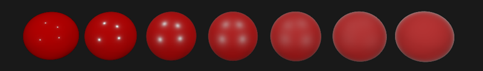

我们可以通过在 [Sébastien Lagarde](https://seblagarde.wordpress.com/2011/08/17/hello-world/) 提出的 Fresnel-Schlick 方程中加入粗糙度项来缓解这个问题：

源码摘录：[`apps/06_pbr/03_diffuse_irradiance/main.cpp`](../../apps/06_pbr/03_diffuse_irradiance/main.cpp)。

```glsl
vec3 fresnel_schlick_roughness(float nv, vec3 f0, float r) {
    return f0 + (max(vec3(1.0 - r), f0) - f0) * pow(clamp(1.0 - nv, 0.0, 1.0), 5.0);
}
```

在计算菲涅耳效应时纳入表面粗糙度，环境光代码最终确定为：

源码摘录：[`apps/06_pbr/03_diffuse_irradiance/main.cpp`](../../apps/06_pbr/03_diffuse_irradiance/main.cpp)。

```glsl
    vec3 f_ambient = fresnel_schlick_roughness(max(dot(n, v), 0.0), f0, r);
    vec3 kd_ambient = (1.0 - f_ambient) * (1.0 - metal);
    vec3 diffuse = texture(irradiance_map, n).rgb * base_color;
    ambient = ambient_mode != 0 ? kd_ambient * diffuse * occlusion : vec3(0.0);
```

如您所见，实践上基于图像的光照计算非常简单，只需要采样一次立方体贴图，大部分的工作量在于将环境贴图预计算或卷积成辐照度图。

回到我们在[光照教程](02_lighting.md)中建立的初始场景，场景中排列的球体金属度沿垂直方向递增，粗糙度沿水平方向递增。向场景中添加基于漫反射图像的光照之后，它看起来像这样：

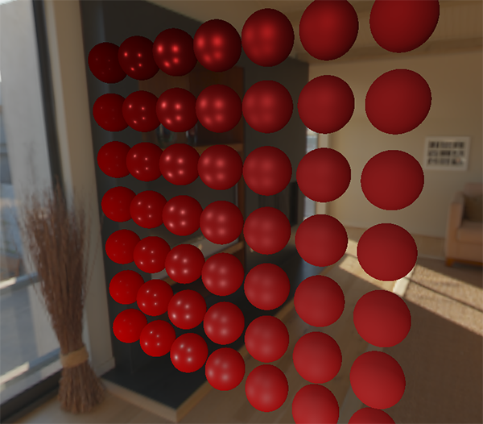

现在看起来仍然有点奇怪，因为金属度较高的球体**需要**某种形式的反射以便看起来更像金属表面（因为金属表面没有漫反射），不过目前只有来自点光源的反射——而且可以说几乎没有。不过尽管如此，您也可以看出，球体在环境中的感觉更加和谐了（特别是在环境贴图之间切换的时候），因为表面会正确地响应环境光照。

您可以在[此处](https://learnopengl.com/code_viewer_gh.php?code=src/6.pbr/2.1.2.ibl_irradiance/ibl_irradiance.cpp)找到以上讨论过的整套源代码。在[下一节教程](04_specular_ibl.md)中，我们将添加反射积分的间接镜面反射部分，此时我们将真正看到 PBR 的力量。

## 进阶阅读

 * [Coding Labs: Physically based rendering](http://www.codinglabs.net/article_physically_based_rendering.aspx)：介绍 PBR ，如何以及为何要生成辐照度图。
 * [The Mathematics of Shading](http://www.scratchapixel.com/lessons/mathematics-physics-for-computer-graphics/mathematics-of-shading)：借助 ScratchAPixel，对本教程中涉及的一些数学知识的简要介绍，特别是关于极坐标和积分。


## 本仓库示例

源码：[`apps/06_pbr/03_diffuse_irradiance/main.cpp`](../../apps/06_pbr/03_diffuse_irradiance/main.cpp)，目标 `06_pbr__03_diffuse_irradiance`。Esc 退出键，WASD/鼠标移动视角，滚轮调整 FOV，空格按下切换模式；`--mode M` 选择初始模式。

| 模式 | 可观察内容 |
| --- | --- |
| 0 | 漫反射 IBL＋直接光，环境天空盒 |
| 1 | 仅直接光与环境天空盒，不用 IBL |
| 2 | 漫反射 IBL＋直接光，显示 E/π 纹理为天空盒 |
| 3 | 仅漫反射 IBL，金属保持无漫反射 |
| 4 | 显示原始 HDR 等距柱状全景，做显示映射 |

```powershell
cmake --preset mingw-gcc-debug
cmake --build --preset mingw-gcc-debug --target 06_pbr__03_diffuse_irradiance
.\build\mingw-gcc-debug\apps\06_pbr\03_diffuse_irradiance\06_pbr__03_diffuse_irradiance.exe --frames 3 --mode 0 --capture build/pbr_3.ppm
```

依赖尚未安装时先按[构建指南](../build.md)执行 Conan；资源路径基于编译期资源根。`--frames` 使用隐藏窗口并有限帧退出，`--capture` 需要同时指定 `--frames`。IBL 启动预计算可能先于第一帧花费时间；截图帧数不是预计算时间限制。

本仓库默认模式实测截图（与正文上游示意图分开）：

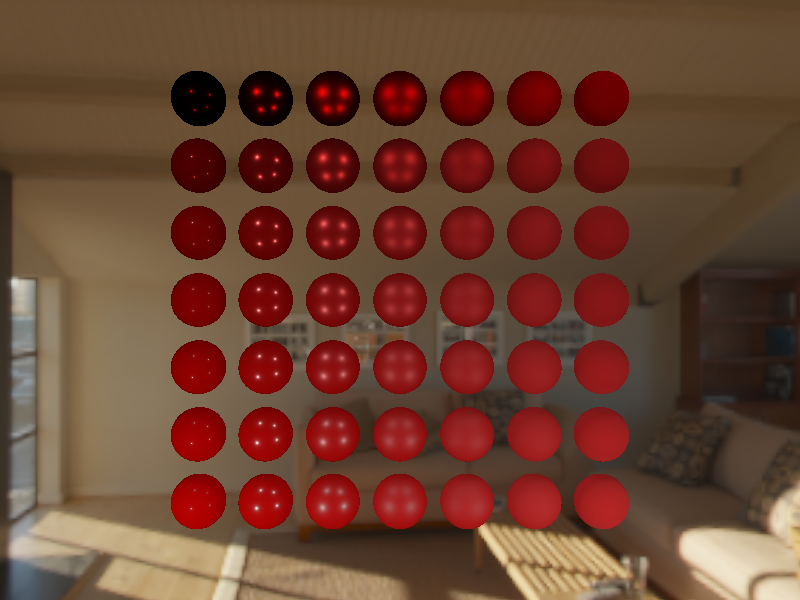

## 本章整体回顾

HDR 解码、六面捕获、角度求积与 E/π 归一化构成漫反射 IBL。它改善环境一致性，但金属仍需要下一篇的镜面环境反射。

图片、资源和逐项验证边界见[覆盖清单](coverage.md)、[图片记录](../img/06/README.md)及[运行资源来源](../../assets/chapter06_resources.md)。

技术核校：[英文原文](https://learnopengl.com/PBR/IBL/Diffuse-irradiance)、[OpenGL 3.3 Core 规范](https://registry.khronos.org/OpenGL/specs/gl/glspec33.core.pdf)、[GLSL 3.30 规范](https://registry.khronos.org/OpenGL/specs/gl/GLSLangSpec.3.30.pdf)、[PBRT 微表面理论](https://pbr-book.org/4ed/Reflection_Models/Roughness_Using_Microfacet_Theory)、[PBRT 积分与重要性采样](https://pbr-book.org/4ed/Monte_Carlo_Integration/Improving_Efficiency)。

下一节：[镜面反射 IBL](04_specular_ibl.md)
