# 镜面反射 IBL

| 项目 | 信息 |
| --- | --- |
| 原文 | [IBL/Specular-IBL](https://learnopengl.com/PBR/IBL/Specular-IBL) |
| 作者 | Joey de Vries |
| 翻译 | [flyingSnow](https://github.com/flyingSnow-hu) |
| 校对 | 上游未署名 |
| 来源 | [LearnOpenGL-CN 固定底本](https://github.com/LearnOpenGL-CN/LearnOpenGL-CN/blob/331560886468e28f28326429334fc48470f9c27b/docs/07%20PBR/03%20IBL/02%20Specular%20IBL.md)；本仓库整理、纠错与代码适配 |
| 本仓库示例 | [`06_pbr__04_specular_ibl`](../../apps/06_pbr/04_specular_ibl/main.cpp) |

**镜面 IBL 用按粗糙度预过滤的 HDR 环境与二维 BRDF LUT，近似替代运行时的大量环境采样。** 应用选择分割求和近似和参数约定，OpenGL/驱动负责逐面逐 mip 渲染及纹理查找，GLFW 管理交互与窗口。预计算只在初始化或首次需要对照贴图时发生，主循环直接采样结果。

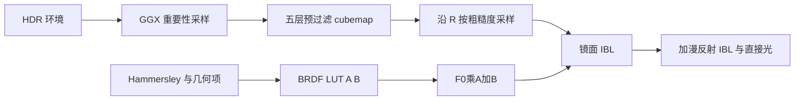

> **常见误解：** 分割求和是两份预计算结果的乘积近似，不是把两个任意积分严格相乘；重要性采样本身也不意味着估计有偏。

在[上一节教程](03_diffuse_irradiance.md)中，我们预计算了辐照度图作为光照的间接漫反射部分，以将 PBR 与基于图像的照明相结合。在本教程中，我们将重点关注反射方程的镜面部分：

$$
L_o(p,\omega_o) = \int\limits_{\Omega}
        (k_d\frac{c}{\pi} + \frac{DFG}{4(\omega_o \cdot n)(\omega_i \cdot n)})
        L_i(p,\omega_i) n \cdot \omega_i  d\omega_i
$$

Cook-Torrance 镜面项已经包含菲涅尔 F，不再额外乘 k_s。它随入射方向与观察方向共同变化，若为所有方向组合预计算会形成高维数据；分割求和通过限制这一维度换取实时可行性。

分割求和把环境预过滤与单位白光下的 BRDF 积分分开计算，再相乘近似镜面结果。它不是对两个任意积分的严格因式分解，也不是运行时“把两张图相加”。下面保留分割求和的引入顺序，并区分精确镜面积分、环境加权平均和 LUT 系数：

$$
L_o(p,\omega_o) =
        \int\limits_{\Omega} \frac{DFG}{4(\omega_o \cdot n)(\omega_i \cdot n)}
            L_i(p,\omega_i) n \cdot \omega_i  d\omega_i
            =
        \int\limits_{\Omega} f_s(p, \omega_i, \omega_o) L_i(p,\omega_i) n \cdot \omega_i  d\omega_i
$$

由于与辐照度卷积相同的（性能）原因，我们无法以合理的性能实时求解积分的镜面反射部分。因此，我们最好预计算这个积分，以得到像镜面 IBL 贴图这样的东西，用片段的法线对这张图采样并计算。但是，有一个地方有点棘手：我们能够预计算辐照度图，是因为其积分仅依赖于$\omega_i$，并且可以将漫反射反射率常数项移出积分，但这一次，积分不仅仅取决于$\omega_i$，从 BRDF 可以看出：

$$
f_s(p, w_i, w_o) = \frac{DFG}{4(\omega_o \cdot n)(\omega_i \cdot n)}
$$

这次积分还依赖$\omega_o$，我们无法用两个方向向量采样预计算的立方体图。如前一个教程中所述，位置$p$与此处无关。在实时状态下，对每种可能的$\omega_i$和$\omega_o$的组合预计算该积分是不可行的。

预计算可以分成两项：L_prefilter(R,r) 表示按 GGX 波瓣加权并归一化的环境平均；另一项表示白色环境下的方向 BRDF 积分，最终写成 F0·A(N·V,r)+B(N·V,r)。下式是近似关系，不能将第一项理解为不带核、不归一化的 ∫L_i dω：

$$
L_{o,s}(p,v) \approx L_{prefilter}(R,r)\left[F_0 A(n\cdot v,r)+B(n\cdot v,r)\right]
$$

卷积的第一部分被称为**预滤波环境贴图**，它类似于辐照度图，是预先计算的环境卷积贴图，但这次考虑了粗糙度。因为随着粗糙度的增加，参与环境贴图卷积的采样向量会更分散，导致反射更模糊，所以对于卷积的每个粗糙度级别，我们将按顺序把模糊后的结果存储在预滤波贴图的 mipmap 中。例如，预过滤的环境贴图在其 5 个 mipmap 级别中存储 5 个不同粗糙度值的预卷积结果，如下图所示：

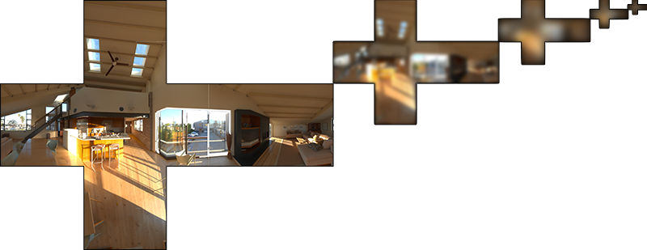

预过滤以每个输出方向作为 n，并假设 v=n，反射方向 R=n。以 GGX 的半程法线分布产生 h，再用 v 关于 h 反射得到 l。这使预过滤只需方向与粗糙度，代价是丢失一般视角下的拉伸波瓣信息：

源码摘录：[`apps/06_pbr/04_specular_ibl/main.cpp`](../../apps/06_pbr/04_specular_ibl/main.cpp)。

```glsl
    vec3 n = normalize(local_pos);
    vec3 v = n;
```

这样，预过滤的环境卷积就不需要关心视角方向了。这意味着当从如下图的角度观察表面的镜面反射时，得到的掠角镜面反射效果不是很好（图片来自文章《Moving Frostbite to PBR》）。然而，通常可以认为这是一个体面的妥协：

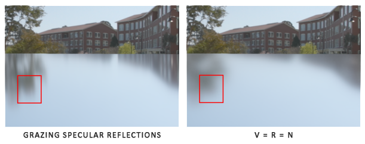

第二部分在单位白色环境中积分镜面 BRDF，输入是**观察方向**与法线夹角 N·V，以及粗糙度 r；不是 N·L。Schlick 展开后，R 通道存 F0 的系数 A，G 通道存偏置 B。环境强度并不进入这张 LUT，所以同一 BRDF 的 LUT 可以在不同环境间复用：

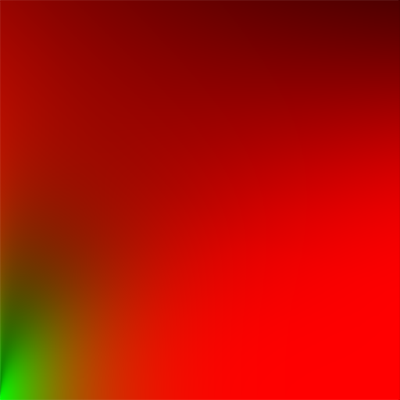

本仓库计算的 A/B LUT（模式 9）：


二维 LUT 以 N·V 为横坐标、r 为纵坐标，范围均为 [0,1]。运行时根据反射方向 R 和 r 采样预过滤环境，再乘 F0·A+B。本例保留这一推导的严格系数对应；上游用带粗糙度的环境菲涅尔 F 替代 F0 的版本属于进一步经验调整，后文说明差别。

源码摘录：[`apps/06_pbr/04_specular_ibl/main.cpp`](../../apps/06_pbr/04_specular_ibl/main.cpp)。

```glsl
    vec3 reflected = reflect(-v, n);
    vec3 prefiltered = textureLod(prefilter_map, reflected, r * 4.0).rgb;
    vec2 coefficients = texture(brdf_lut, vec2(max(dot(n, v), 0.0), r)).rg;
    // GLSL: LUT 按 F0 分离推导，所以镜面项使用 F0*A+B；粗糙度 Fresnel 仅分配漫反射权重。
    vec3 indirect_specular = prefiltered * (f0 * coefficients.x + coefficients.y);
```

至此，你应该对 Epic Games 的分割求和近似法的原理，以及它如何近似求解反射方程的间接镜面反射部分有了一些基本印象。让我们现在尝试一下自己构建预卷积部分。

## 预滤波HDR环境贴图

预滤波环境贴图的方法与我们对辐亮度贴图求卷积的方法非常相似。对于卷积的每个粗糙度级别，我们将按顺序把模糊后的结果存储在预滤波贴图的 mipmap 中。

先为输出预过滤 cubemap 分配存储。上游用 glGenerateMipmap 从基础层建立完整 mip 存储，再逐层覆盖；本仓库直接为五个层级的六个面调用 glTexImage2D，并把 GL_TEXTURE_MAX_LEVEL 设为 4，保证三线性采样不会访问未写入层。两者都不能把普通缩小 mip 当作 GGX 预过滤的替代。

源码摘录：[`apps/06_pbr/04_specular_ibl/main.cpp`](../../apps/06_pbr/04_specular_ibl/main.cpp)。

```cpp
GLuint make_float_cube(gpu_resources& resources, int size, int levels) {
    GLuint texture{0U};
    glGenTextures(1, &texture);
    resources.textures.push_back(texture);
    glBindTexture(GL_TEXTURE_CUBE_MAP, texture);
    for (int level{0}; level < levels; ++level) {
        for (GLuint face{0U}; face < 6U; ++face) {
            glTexImage2D(GL_TEXTURE_CUBE_MAP_POSITIVE_X + face, level, GL_RGB16F,
                         std::max(size >> level, 1), std::max(size >> level, 1), 0, GL_RGB,
                         GL_FLOAT, nullptr);
        }
    }
    glTexParameteri(GL_TEXTURE_CUBE_MAP, GL_TEXTURE_MAX_LEVEL, levels - 1);
    glTexParameteri(GL_TEXTURE_CUBE_MAP, GL_TEXTURE_MIN_FILTER,
                    levels > 1 ? GL_LINEAR_MIPMAP_LINEAR : GL_LINEAR);
    glTexParameteri(GL_TEXTURE_CUBE_MAP, GL_TEXTURE_MAG_FILTER, GL_LINEAR);
    glTexParameteri(GL_TEXTURE_CUBE_MAP, GL_TEXTURE_WRAP_S, GL_CLAMP_TO_EDGE);
    glTexParameteri(GL_TEXTURE_CUBE_MAP, GL_TEXTURE_WRAP_T, GL_CLAMP_TO_EDGE);
    glTexParameteri(GL_TEXTURE_CUBE_MAP, GL_TEXTURE_WRAP_R, GL_CLAMP_TO_EDGE);
    return texture;
}
```

注意，因为我们计划采样 `prefilterMap` 的 mipmap，所以需要确保将其缩小过滤器设置为 `GL_LINEAR_MIPMAP_LINEAR` 以启用三线性过滤。它存储的是预滤波的镜面反射，基础 mip 级别的分辨率是每面 128×128，对于大多数反射来说可能已经足够了，但如果场景里有大量光滑材料（想想汽车上的反射），可能需要提高分辨率。

在上一节教程中，我们使用球面坐标生成均匀分布在半球 $\Omega$ 上的采样向量，以对环境贴图进行卷积。虽然这个方法非常适用于辐照度，但对于镜面反射效果较差。镜面反射依赖于表面的粗糙度，反射光线可能比较松散，也可能比较紧密，但是一定会围绕着反射向量$r$，除非表面极度粗糙：


所有可能出射的反射光构成的形状称为**镜面波瓣**。随着粗糙度的增加，镜面波瓣的大小增加；随着入射光方向不同，形状会发生变化。因此，镜面波瓣的形状高度依赖于材质。
在微表面模型里给定入射光方向，则镜面波瓣指向微平面的半向量的反射方向。考虑到大多数光线最终会反射到一个基于半向量的镜面波瓣内，采样时以类似的方式选取采样向量是有意义的，因为大部分其余的向量都被浪费掉了，这个过程称为**重要性采样**。

### 蒙特卡洛积分和重要性采样

为了充分理解重要性采样，我们首先要了解一种数学结构，称为**蒙特卡洛积分**。蒙特卡洛积分主要是统计和概率理论的组合。蒙特卡洛可以帮助我们离散地解决人口统计问题，而不必考虑**所有**人。

例如，假设您想要计算一个国家所有公民的平均身高。为了得到结果，你可以测量**每个**公民并对他们的身高求平均，这样会得到你需要的**确切**答案。但是，由于大多数国家人海茫茫，这个方法不现实：需要花费太多精力和时间。

另一种方法是随机选择较小的人口样本并估计平均身高。抽样设计合理且方差有限时，样本平均随数量增加趋近总体平均；大数定律不保证任意 100 人就足够准确。用于积分时还必须处理非均匀抽样密度，不能只求被选样本的简单平均。

对 ∫f(x)dx，若 x_i 来自密度 p(x)，可用 1/N∑ f(x_i)/p(x_i) 估计，要求所有有贡献区域具有非零采样密度。有限样本结果是近似值；合适条件下它的期望等于积分，并随样本数增加而收敛：

$$
\int_a^b f(x)\,dx \approx \widehat I_N = \frac{1}{N}\sum_{i=0}^{N-1}\frac{f(x_i)}{p(x_i)},\qquad x_i\sim p
$$

这里 pdf 是连续概率密度，不是“恰好选中某个实数样本的概率”。例如身高分布中 1.70 米附近区间可能比 1.50 米附近同宽区间更常见，区间概率由密度积分得到。下面的分布图用于说明密度高低：

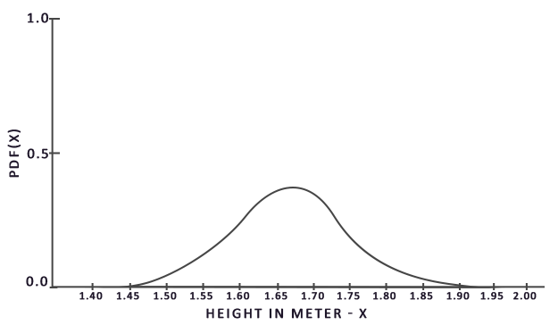

从该图中我们可以看出，如果我们对人口任意随机采样，那么挑选身高为 1.70 的人口样本的可能性更高，而样本身高为 1.50 的概率较低。

非均匀采样需除以该样本的 pdf。若正确加权、密度覆盖被积函数的支撑集，重要性采样可以保持无偏；“样本更偏向某些方向”不等于统计意义上的偏差。反之，错误权重、截断或其他近似可能引入偏差，不能仅凭是否均匀判断。

有偏估计的期望偏离目标积分；它可能用更低方差换取系统误差，但并不保证更快收敛到正确答案。本教程的分割求和、v=n 和有限分辨率属于模型/表示近似。将重要性采样正确按 pdf 加权，不应归类为“天然有偏”。

蒙特卡洛积分在计算机图形学中非常普遍，因为它是一种以高效的离散方式对连续的积分求近似而且非常直观的方法：对任何面积/体积进行采样——例如半球 $\Omega$ ——在该面积/体积内生成数量 $N$ 的随机采样，权衡每个样本对最终结果的贡献并求和。

样本可来自伪随机数或低差异点集。Hammersley 是确定性的低差异构造，不是“仍然完全随机”的序列；用它做积分通常称拟蒙特卡洛。讨论无偏性需要区分确定性求积误差与随机化后的统计估计，不能混用。

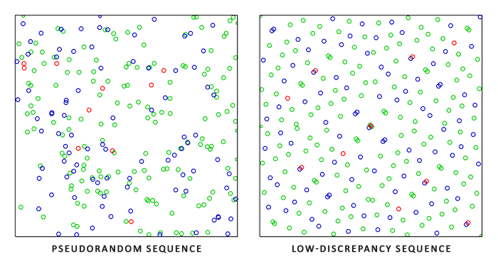

当使用低差异序列生成蒙特卡洛样本向量时，该过程称为**拟蒙特卡洛积分**。拟蒙特卡洛方法具有更快的**收敛速度**，这使得它对于性能繁重的应用很有用。

镜面反射的主要贡献通常集中于波瓣附近，因此按照 GGX 生成半程法线可把更多样本用于重要区域。波瓣外并非一律没有贡献，GGX 也有长尾；正确的 pdf 用于补偿非均匀样本。选择不匹配光照的密度仍可能产生较大方差。

重要性采样让密度尽量接近被积函数形状，从而降低方差。与低差异点集结合常可在相同样本量下得到更稳定结果，但不保证所有函数和参数下都有同样收益。本例只在初始化执行昂贵积分，运行时读取预计算贴图。

> **进阶（密度变换）：** **采样半程法线 h 的 pdf 与采样入射方向 l 的 pdf 不相同。** 对反射关系 l=2(v·h)h−v，有 p_l=D(h)(n·h)/(4|v·h|)。源码用这个密度估计一个样本代表的立体角，再选择源环境 mip，以缓解亮点。此处还近似认为 cubemap 纹素平均立体角为 4π/(6R²)，实际各纹素覆盖量并不完全相等，所以它是过滤启发式，不是精确球面面积计算。

### 低差异序列

本文使用 Hammersley 点集：第一个坐标 i/N，第二个坐标为二进制基的 radical inverse。Van der Corput 是正确拼写，上游的 Van Der Corpus 为笔误。将索引的二进制位反转到小数点后，可得到第二坐标；GLSL 3.30 支持这里所需的 uint 与位运算：

给出一些巧妙的技巧，我们可以在着色器程序中非常有效地生成 Van Der Corput 序列，我们将用它来获得 Hammersley 序列，设总样本数为 `N`，样本索引为 `i`：

源码摘录：[`apps/06_pbr/04_specular_ibl/main.cpp`](../../apps/06_pbr/04_specular_ibl/main.cpp)。

```glsl
float radical_inverse_vdc(uint bits) {
    bits = (bits << 16u) | (bits >> 16u);
    bits = ((bits & 0x55555555u) << 1u) | ((bits & 0xAAAAAAAAu) >> 1u);
    bits = ((bits & 0x33333333u) << 2u) | ((bits & 0xCCCCCCCCu) >> 2u);
    bits = ((bits & 0x0F0F0F0Fu) << 4u) | ((bits & 0xF0F0F0F0u) >> 4u);
    bits = ((bits & 0x00FF00FFu) << 8u) | ((bits & 0xFF00FF00u) >> 8u);
    return float(bits) * 2.3283064365386963e-10;
}
vec2 hammersley(uint index, uint count) {
    return vec2(float(index) / float(count), radical_inverse_vdc(index));
}
```

GLSL 的 `Hammersley` 函数可以获取大小为 `N` 的样本集中的低差异样本 `i`。

> **重要：无需位运算的 Hammersley 点集。** OpenGL 3.3/GLSL 3.30 支持这里的位运算；WebGL 1/GLSL ES 1.00 等旧语言不支持同样的 uint 位运算表达。可用下面的算术 radical inverse 生成第二坐标，第一坐标仍取 i/N。它提供迁移思路；可移植性还受 float 精度、循环限制和目标语言验证规则约束，不能声称所有硬件都能无条件运行。

源码摘录：[`apps/06_pbr/04_specular_ibl/main.cpp`](../../apps/06_pbr/04_specular_ibl/main.cpp)。

```glsl
float radical_inverse_arithmetic(float index) {
    float result = 0.0;
    float factor = 0.5;
    for (int bit = 0; bit < 32; ++bit) {
        result += mod(index, 2.0) * factor;
        index = floor(index / 2.0);
        factor *= 0.5;
    }
    return result;
}
```

### GGX 重要性采样

有别于均匀或纯随机地（比如蒙特卡洛）在积分半球 $\Omega$ 产生采样向量，我们的采样会根据粗糙度，偏向微表面的半向量的宏观反射方向。采样过程将与我们之前看到的过程相似：开始一个大循环，生成一个随机（低差异）序列值，用该序列值在切线空间中生成样本向量，将样本向量变换到世界空间并对场景的辐亮度采样。不同之处在于，我们现在使用低差异序列值作为输入来生成采样向量：

源码摘录：[`apps/06_pbr/04_specular_ibl/main.cpp`](../../apps/06_pbr/04_specular_ibl/main.cpp)。

```glsl
    const uint sample_count = 1024u;
    float total_weight = 0.0;
```

此外，要构建采样向量，我们需要一些方法定向和偏移采样向量，以使其朝向特定粗糙度的镜面波瓣方向。我们可以如理论教程中所述使用 NDF，并将 GGX NDF 结合到 Epic Games 所述的球形采样向量的处理中：

源码摘录：[`apps/06_pbr/04_specular_ibl/main.cpp`](../../apps/06_pbr/04_specular_ibl/main.cpp)。

```glsl
vec3 importance_sample_ggx(vec2 xi, vec3 n, float r) {
    float alpha = r * r;
    float phi = 2.0 * pi * xi.x;
    float cos_theta = sqrt((1.0 - xi.y) / max(1.0 + (alpha * alpha - 1.0) * xi.y, 0.000001));
    float sin_theta = sqrt(max(1.0 - cos_theta * cos_theta, 0.0));
    vec3 h = vec3(cos(phi) * sin_theta, sin(phi) * sin_theta, cos_theta);
    vec3 up = abs(n.z) < 0.999 ? vec3(0.0, 0.0, 1.0) : vec3(1.0, 0.0, 0.0);
    vec3 tangent = normalize(cross(up, n));
    return normalize(tangent * h.x + cross(n, tangent) * h.y + n * h.z);
}
```

基于特定的粗糙度输入和低差异序列值 `Xi`，我们获得了一个采样向量，该向量大体围绕着预估的微表面的半向量。注意，根据迪士尼对 PBR 的研究，Epic Games 使用了平方粗糙度以获得更好的视觉效果。

使用低差异 Hammersley 序列和上述定义的样本生成方法，我们可以最终完成预滤波器卷积着色器：

源码摘录：[`apps/06_pbr/04_specular_ibl/main.cpp`](../../apps/06_pbr/04_specular_ibl/main.cpp)。

```glsl
#version 330 core
in vec3 local_pos;
out vec4 frag_color;
uniform samplerCube environment_map;
uniform float roughness;
uniform int filtered_sampling;
const float pi = 3.141592653589793;
float distribution_ggx(vec3 n, vec3 h, float r) {
    float alpha = r * r;
    float alpha2 = alpha * alpha;
    float nh = max(dot(n, h), 0.0);
    float denominator = nh * nh * (alpha2 - 1.0) + 1.0;
    return alpha2 / max(pi * denominator * denominator, 0.0000001);
}
float radical_inverse_vdc(uint bits) {
    bits = (bits << 16u) | (bits >> 16u);
    bits = ((bits & 0x55555555u) << 1u) | ((bits & 0xAAAAAAAAu) >> 1u);
    bits = ((bits & 0x33333333u) << 2u) | ((bits & 0xCCCCCCCCu) >> 2u);
    bits = ((bits & 0x0F0F0F0Fu) << 4u) | ((bits & 0xF0F0F0F0u) >> 4u);
    bits = ((bits & 0x00FF00FFu) << 8u) | ((bits & 0xFF00FF00u) >> 8u);
    return float(bits) * 2.3283064365386963e-10;
}
vec2 hammersley(uint index, uint count) {
    return vec2(float(index) / float(count), radical_inverse_vdc(index));
}
// GLSL: 旧着色语言的算术替代；float 输入只在其可精确表示的整数范围内可靠。
float radical_inverse_arithmetic(float index) {
    float result = 0.0;
    float factor = 0.5;
    for (int bit = 0; bit < 32; ++bit) {
        result += mod(index, 2.0) * factor;
        index = floor(index / 2.0);
        factor *= 0.5;
    }
    return result;
}
// GLSL: 生成 GGX 半程法线 h；之后反射 v 得到入射采样方向 l。
vec3 importance_sample_ggx(vec2 xi, vec3 n, float r) {
    float alpha = r * r;
    float phi = 2.0 * pi * xi.x;
    float cos_theta = sqrt((1.0 - xi.y) / max(1.0 + (alpha * alpha - 1.0) * xi.y, 0.000001));
    float sin_theta = sqrt(max(1.0 - cos_theta * cos_theta, 0.0));
    vec3 h = vec3(cos(phi) * sin_theta, sin(phi) * sin_theta, cos_theta);
    vec3 up = abs(n.z) < 0.999 ? vec3(0.0, 0.0, 1.0) : vec3(1.0, 0.0, 0.0);
    vec3 tangent = normalize(cross(up, n));
    return normalize(tangent * h.x + cross(n, tangent) * h.y + n * h.z);
}

void main() {
    vec3 n = normalize(local_pos);
    vec3 v = n;
    if (roughness <= 0.0) {
        frag_color = vec4(textureLod(environment_map, n, 0.0).rgb, 1.0);
        return;
    }
    const uint sample_count = 1024u;
    float total_weight = 0.0;
    vec3 sum = vec3(0.0);
    float resolution = float(textureSize(environment_map, 0).x);
    float texel_solid_angle = 4.0 * pi / (6.0 * resolution * resolution);
    for (uint index = 0u; index < sample_count; ++index) {
        vec3 h = importance_sample_ggx(hammersley(index, sample_count), n, roughness);
        vec3 l = normalize(2.0 * dot(v, h) * h - v);
        float nl = max(dot(n, l), 0.0);
        if (nl > 0.0) {
            float nh = max(dot(n, h), 0.0);
            float hv = max(dot(h, v), 0.000001);
            float pdf = max(distribution_ggx(n, h, roughness) * nh / (4.0 * hv), 0.000001);
            float sample_solid_angle = 1.0 / (float(sample_count) * pdf);
            float lod = filtered_sampling != 0 ? max(0.5 * log2(sample_solid_angle / texel_solid_angle), 0.0) : 0.0;
            sum += textureLod(environment_map, l, lod).rgb * nl;
            total_weight += nl;
        }
    }
    frag_color = vec4(sum / max(total_weight, 0.000001), 1.0);
}
```

输入的粗糙度随着预过滤的立方体贴图的 mipmap 级别变化（从0.0到1.0），我们根据据粗糙度预过滤环境贴图，把结果存在 `prefilteredColor` 里。再用 `prefilteredColor` 除以采样权重总和，其中对最终结果影响较小（`NdotL` 较小）的采样最终权重也较小。

### 捕获预过滤 mipmap 级别

剩下要做的就是让 OpenGL 在多个 mipmap 级别上以不同的粗糙度值预过滤环境贴图。有了最开始的辐照度教程作为基础，实际上很简单：

源码摘录：[`apps/06_pbr/04_specular_ibl/main.cpp`](../../apps/06_pbr/04_specular_ibl/main.cpp)。

```cpp
GLuint bake_specular(gpu_resources& resources, const capture_target& target, const mesh& cube,
                     const shader_program& prefilter, GLuint environment, bool filtered) {
    const GLuint texture{make_float_cube(resources, 128, 5)};
    glUseProgram(prefilter.id);
    set_int(prefilter, "environment_map", 0);
    set_int(prefilter, "filtered_sampling", filtered ? 1 : 0);
    bind_texture(0, environment, GL_TEXTURE_CUBE_MAP);
    for (int mip{0}; mip < 5; ++mip) {
        set_float(prefilter, "roughness", static_cast<float>(mip) / 4.0F);
        if (!capture_cube(target, prefilter, cube, texture, 128 >> mip, mip))
            return 0U;
    }
    return texture;
}
```

这个过程类似于辐照度贴图卷积，但是这次我们将帧缓冲区缩放到适当的 mipmap 尺寸， mip 级别每增加一级，尺寸缩小为一半。此外，我们在 `glFramebufferTexture2D` 的最后一个参数中指定要渲染的目标 mip 级别，然后将要预过滤的粗糙度传给预过滤着色器。

这样我们会得到一张经过适当预过滤的环境贴图，访问该贴图时指定的 mip 等级越高，获得的反射就越模糊。如果我们在天空盒着色器中显示这张预过滤的环境立方体贴图，并在其着色器中强制在其第一个 mip 级别以上采样，如下所示：

源码摘录：[`apps/06_pbr/04_specular_ibl/main.cpp`](../../apps/06_pbr/04_specular_ibl/main.cpp)。

```glsl
    vec3 color = textureLod(environment_map, normalize(local_pos), lod).rgb;
```

我们得到的结果看起来确实像原始环境的模糊版本：

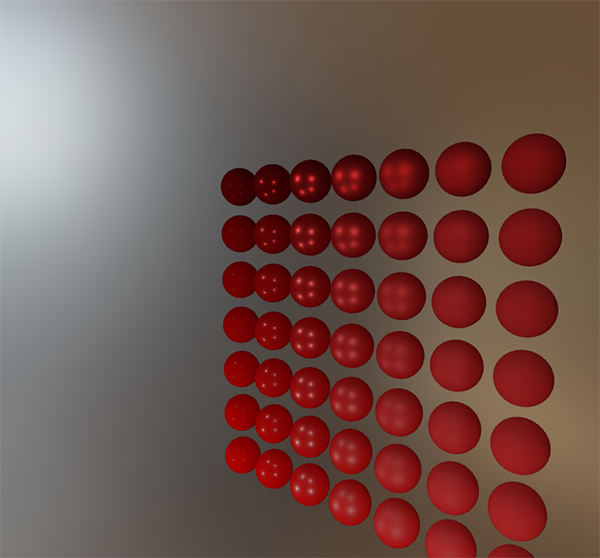

如果 HDR 环境贴图的预过滤看起来差不多没问题，尝试一下不同的 mipmap 级别，观察预过滤贴图随着 mip 级别增加，反射逐渐从锐利变模糊的过程。

## 预过滤卷积的伪像

当前的预过滤贴图可以在大多数情况下正常工作，不过你迟早会遇到几个与预过滤卷积直接相关的渲染问题。我将在这里列出最常见的一些问题，以及如何修复它们。

### 高粗糙度的立方体贴图接缝

在具有粗糙表面的表面上对预过滤贴图采样，也就等同于在较低的 mip 级别上对预过滤贴图采样。在对立方体贴图进行采样时，默认情况下，OpenGL不会在立方体面**之间**进行线性插值。由于较低的 mip 级别具有更低的分辨率，并且预过滤贴图代表了与更大的采样波瓣卷积，因此缺乏**立方体的面和面之间的滤波**的问题就更明显：

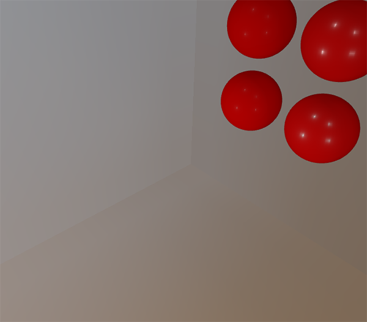

幸运的是，OpenGL 可以启用 `GL_TEXTURE_CUBE_MAP_SEAMLESS`，以为我们提供在立方体贴图的面之间进行正确过滤的选项：

源码摘录：[`apps/06_pbr/04_specular_ibl/main.cpp`](../../apps/06_pbr/04_specular_ibl/main.cpp)。

```cpp
    glEnable(GL_TEXTURE_CUBE_MAP_SEAMLESS);
```

### 预过滤卷积的亮点

由于镜面反射中光强度的变化大，高频细节多，所以对镜面反射进行卷积需要大量采样，才能正确反映 HDR 环境反射的混乱变化。我们已经进行了大量的采样，但是在某些环境下，在某些较粗糙的 mip 级别上可能仍然不够，导致明亮区域周围出现点状图案：

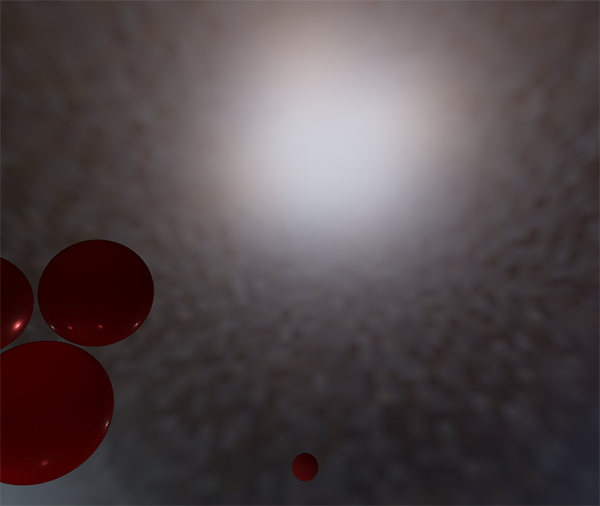

一种解决方案是进一步增加样本数量，但在某些情况下还是不够。另一种方案如 [Chetan Jags](https://chetanjags.wordpress.com/2015/08/26/image-based-lighting/) 所述，我们可以在预过滤卷积时，不直接采样环境贴图，而是基于积分的 PDF 和粗糙度采样环境贴图的 mipmap ，以减少伪像：

源码摘录：[`apps/06_pbr/04_specular_ibl/main.cpp`](../../apps/06_pbr/04_specular_ibl/main.cpp)。

```glsl
            float nh = max(dot(n, h), 0.0);
            float hv = max(dot(h, v), 0.000001);
            float pdf = max(distribution_ggx(n, h, roughness) * nh / (4.0 * hv), 0.000001);
            float sample_solid_angle = 1.0 / (float(sample_count) * pdf);
            float lod = filtered_sampling != 0 ? max(0.5 * log2(sample_solid_angle / texel_solid_angle), 0.0) : 0.0;
            sum += textureLod(environment_map, l, lod).rgb * nl;
```

既然要采样 mipmap ，不要忘记在环境贴图上开启三线性过滤：

源码摘录：[`apps/06_pbr/04_specular_ibl/main.cpp`](../../apps/06_pbr/04_specular_ibl/main.cpp)。

```cpp
GLuint make_float_cube(gpu_resources& resources, int size, int levels) {
    GLuint texture{0U};
    glGenTextures(1, &texture);
    resources.textures.push_back(texture);
    glBindTexture(GL_TEXTURE_CUBE_MAP, texture);
    for (int level{0}; level < levels; ++level) {
        for (GLuint face{0U}; face < 6U; ++face) {
            glTexImage2D(GL_TEXTURE_CUBE_MAP_POSITIVE_X + face, level, GL_RGB16F,
                         std::max(size >> level, 1), std::max(size >> level, 1), 0, GL_RGB,
                         GL_FLOAT, nullptr);
        }
    }
    glTexParameteri(GL_TEXTURE_CUBE_MAP, GL_TEXTURE_MAX_LEVEL, levels - 1);
    glTexParameteri(GL_TEXTURE_CUBE_MAP, GL_TEXTURE_MIN_FILTER,
                    levels > 1 ? GL_LINEAR_MIPMAP_LINEAR : GL_LINEAR);
    glTexParameteri(GL_TEXTURE_CUBE_MAP, GL_TEXTURE_MAG_FILTER, GL_LINEAR);
    glTexParameteri(GL_TEXTURE_CUBE_MAP, GL_TEXTURE_WRAP_S, GL_CLAMP_TO_EDGE);
    glTexParameteri(GL_TEXTURE_CUBE_MAP, GL_TEXTURE_WRAP_T, GL_CLAMP_TO_EDGE);
    glTexParameteri(GL_TEXTURE_CUBE_MAP, GL_TEXTURE_WRAP_R, GL_CLAMP_TO_EDGE);
    return texture;
}
```

设置立方体贴图的基本纹理后，让 OpenGL 生成 mipmap：

源码摘录：[`apps/06_pbr/04_specular_ibl/main.cpp`](../../apps/06_pbr/04_specular_ibl/main.cpp)。

```cpp
    glBindTexture(GL_TEXTURE_CUBE_MAP, result.environment);
    // OpenGL: 这是源环境的普通缩小 mip；输出预过滤图则必须逐层做 GGX 卷积。
    glGenerateMipmap(GL_TEXTURE_CUBE_MAP);
```

这个方法效果非常好，可以去除预过滤贴图中较粗糙表面上的大多数甚至全部亮点。

## 预计算 BRDF

预过滤的环境贴图已经可以设置并运行，我们可以集中精力于求和近似的第二部分：BRDF。让我们再次简要回顾一下镜面部分的分割求和近似法：

$$
L_{o,s}(p,v) \approx L_{prefilter}(R,r)\left[F_0 A(n\cdot v,r)+B(n\cdot v,r)\right]
$$

我们已经在预过滤贴图的各个粗糙度级别上预计算了分割求和近似的左半部分。右半部分要求我们在 $n \cdot \omega_o$ 、表面粗糙度、菲涅尔系数 $F_0$ 上计算 BRDF 方程的卷积。这等同于在纯白的环境光或者辐亮度恒定为 $L_i$=1.0 的设置下，对镜面 BRDF 求积分。对3个变量做卷积有点复杂，不过我们可以把 $F_0$ 移出镜面 BRDF 方程：

$$
\int\limits_{\Omega} f_s(p, \omega_i, \omega_o) n \cdot \omega_i d\omega_i = \int\limits_{\Omega} f_s(p, \omega_i, \omega_o) \frac{F(\omega_o, h)}{F(\omega_o, h)} n \cdot \omega_i d\omega_i
$$

$F$ 为菲涅耳方程。将菲涅耳分母移到 BRDF 下面可以得到如下等式：

$$
\int\limits_{\Omega} \frac{f_s(p, \omega_i, \omega_o)}{F(\omega_o, h)} F(\omega_o, h)  n \cdot \omega_i d\omega_i
$$

用 Fresnel-Schlick 近似公式替换右边的 $F$ 可以得到：

$$
\int\limits_{\Omega} \frac{f_s(p, \omega_i, \omega_o)}{F(\omega_o, h)} (F_0 + (1 - F_0){(1 - \omega_o \cdot h)}^5)  n \cdot \omega_i d\omega_i
$$

让我们用 $q$ 替换 ${(1 - \omega_o \cdot h)}^5$ 以便更轻松地求解 $F_0$：

$$
\int\limits_{\Omega} \frac{f_s(p, \omega_i, \omega_o)}{F(\omega_o, h)} (F_0 + (1 - F_0)q)  n \cdot \omega_i d\omega_i
$$

$$
\int\limits_{\Omega} \frac{f_s(p, \omega_i, \omega_o)}{F(\omega_o, h)} (F_0 + 1*q - F_0*q)  n \cdot \omega_i d\omega_i
$$

$$
\int\limits_{\Omega} \frac{f_s(p, \omega_i, \omega_o)}{F(\omega_o, h)} (F_0 * (1 - q) + q)  n \cdot \omega_i d\omega_i
$$

然后我们将菲涅耳函数 $F$ 分拆到两个积分里：

$$
\int\limits_{\Omega} \frac{f_s(p, \omega_i, \omega_o)}{F(\omega_o, h)} (F_0 * (1 - q))  n \cdot \omega_i d\omega_i
              +
    \int\limits_{\Omega} \frac{f_s(p, \omega_i, \omega_o)}{F(\omega_o, h)} (q)  n \cdot \omega_i d\omega_i
$$

这样，$F_0$在整个积分上是恒定的，我们可以从积分中提取出$F_0$。接下来，我们将$q$替换回其原始形式，从而得到最终分割求和的 BRDF 方程：

$$
F_0 \int\limits_{\Omega} g(p, \omega_i, \omega_o)(1 - {(1 - \omega_o \cdot h)}^5)  n \cdot \omega_i d\omega_i
              +
    \int\limits_{\Omega} g(p, \omega_i, \omega_o) {(1 - \omega_o \cdot h)}^5  n \cdot \omega_i d\omega_i
$$

定义不含菲涅尔的镜面核 g=f_s/F=DG/[4(N·V)(N·L)] 后，最终两项分别是 A 和 B。上面的各步先乘 F/F，再展开 Schlick，F0 在积分方向上为常量，因而可以提出；最后的 g 记号必须始终明确“不含 F”，不能与含 F 的 f_s 混用。

和之前卷积环境贴图类似，我们可以对 BRDF 方程求卷积，其输入是 $n$ 和 $\omega_o$ 的夹角，以及粗糙度，并将卷积的结果存储在纹理中。我们将卷积后的结果存储在 2D 查找纹理（Look Up Texture, LUT）中，这张纹理被称为 **BRDF 积分贴图**，稍后会将其用于 PBR 光照着色器中，以获得间接镜面反射的最终卷积结果。

BRDF 卷积着色器在 2D 平面上执行计算，直接使用其 2D 纹理坐标作为卷积输入（`NdotV` 和 `roughness`）。代码与预滤波器的卷积代码大体相似，不同之处在于，它现在根据 BRDF 的几何函数和 Fresnel-Schlick 近似来处理采样向量：

源码摘录：[`apps/06_pbr/04_specular_ibl/main.cpp`](../../apps/06_pbr/04_specular_ibl/main.cpp)。

```glsl
vec2 integrate_brdf(float nv, float r) {
    vec3 v = vec3(sqrt(max(1.0 - nv * nv, 0.0)), 0.0, nv);
    vec3 n = vec3(0.0, 0.0, 1.0);
    vec2 coefficients = vec2(0.0);
    const uint sample_count = 1024u;
    for (uint index = 0u; index < sample_count; ++index) {
        vec3 h = importance_sample_ggx(hammersley(index, sample_count), n, r);
        vec3 l = normalize(2.0 * dot(v, h) * h - v);
        float nl = max(l.z, 0.0);
        float nh = max(h.z, 0.0);
        float vh = max(dot(v, h), 0.0);
        if (nl > 0.0) {
            float g = geometry_ibl(nv, r) * geometry_ibl(nl, r);
            float g_visible = g * vh / max(nh * nv, 0.000001);
            float fc = pow(1.0 - vh, 5.0);
            coefficients += vec2((1.0 - fc) * g_visible, fc * g_visible);
        }
    }
    return coefficients / float(sample_count);
}
```

如你所见，BRDF 卷积部分是从数学到代码的直接转换。我们将角度 $\theta$ 和粗糙度作为输入，以重要性采样产生采样向量，在整个几何体上结合 BRDF 的菲涅耳项对向量进行处理，然后输出每个样本上 $F_0$ 的系数和偏差，最后取平均值。

你可能回想起[理论](01_theory.md)教程中的一个细节：与 IBL 一起使用时，BRDF 的几何项略有不同，因为 $k$ 变量的含义稍有不同：

$$
k_{direct} = \frac{(r + 1)^2}{8}
$$

$$
k_{IBL} = \frac{r^2}{2}
$$

由于 BRDF 卷积是镜面 IBL 积分的一部分，因此我们要在 Schlick-GGX 几何函数中使用 $k_{IBL}$：

源码摘录：[`apps/06_pbr/04_specular_ibl/main.cpp`](../../apps/06_pbr/04_specular_ibl/main.cpp)。

```glsl
float geometry_ibl(float nx, float r) {
    float k = r * r / 2.0;
    return nx / max(nx * (1.0 - k) + k, 0.000001);
}
```

统一约定 r 为感知粗糙度、α=r²。GGX 的 NDF 和采样公式使用 α；这里的 Schlick 几何近似使用 k_IBL=r²/2，而直接光使用 (r+1)²/8。旧代码局部变量 a 被重用不代表“假装平方过了”，应按各公式的实际参数语义推导并保持 LUT 与运行时一致。

最后，为了存储 BRDF 卷积结果，我们需要生成一张 512 × 512 分辨率的 2D 纹理。

源码摘录：[`apps/06_pbr/04_specular_ibl/main.cpp`](../../apps/06_pbr/04_specular_ibl/main.cpp)。

```cpp
    GLuint texture{0U};
    glGenTextures(1, &texture);
    resources.textures.push_back(texture);
    glBindTexture(GL_TEXTURE_2D, texture);
    glTexImage2D(GL_TEXTURE_2D, 0, GL_RG16F, 512, 512, 0, GL_RG, GL_FLOAT, nullptr);
    glTexParameteri(GL_TEXTURE_2D, GL_TEXTURE_MIN_FILTER, GL_LINEAR);
    glTexParameteri(GL_TEXTURE_2D, GL_TEXTURE_MAG_FILTER, GL_LINEAR);
    glTexParameteri(GL_TEXTURE_2D, GL_TEXTURE_WRAP_S, GL_CLAMP_TO_EDGE);
    glTexParameteri(GL_TEXTURE_2D, GL_TEXTURE_WRAP_T, GL_CLAMP_TO_EDGE);
    glBindFramebuffer(GL_FRAMEBUFFER, target.framebuffer);
```

请注意，我们使用的是 Epic Games 推荐的16位精度浮点格式。将环绕模式设置为 `GL_CLAMP_TO_EDGE` 以防止边缘采样的伪像。
然后，我们复用同一个帧缓冲区对象，并在 NDC (译注：Normalized Device Coordinates) 屏幕空间四边形上运行此着色器：

源码摘录：[`apps/06_pbr/04_specular_ibl/main.cpp`](../../apps/06_pbr/04_specular_ibl/main.cpp)。

```cpp
    glBindFramebuffer(GL_FRAMEBUFFER, target.framebuffer);
    glBindRenderbuffer(GL_RENDERBUFFER, target.depth);
    glRenderbufferStorage(GL_RENDERBUFFER, GL_DEPTH_COMPONENT24, 512, 512);
    glFramebufferTexture2D(GL_FRAMEBUFFER, GL_COLOR_ATTACHMENT0, GL_TEXTURE_2D, texture, 0);
    if (!check_capture())
        return 0U;
    glViewport(0, 0, 512, 512);
    glClear(GL_COLOR_BUFFER_BIT | GL_DEPTH_BUFFER_BIT);
    glUseProgram(lut.id);
    draw_mesh(quad);
    glBindFramebuffer(GL_FRAMEBUFFER, 0);
    return texture;
```

分割积分和的 BRDF 卷积部分应该得到以下结果：


预过滤的环境贴图和 BRDF 的 2D LUT 都已经齐备，我们可以根据分割求和近似法重建间接镜面部分积分了。最后合并的结果将被用作间接镜面反射或环境镜面反射。

## 完成 IBL 反射

为了使反射方程的间接镜面反射部分正确运行，我们需要将分割求和近似法的两个部分缝合在一起。第一步是将预计算的光照数据声明到 PBR 着色器的最上面：

源码摘录：[`apps/06_pbr/04_specular_ibl/main.cpp`](../../apps/06_pbr/04_specular_ibl/main.cpp)。

```glsl
uniform samplerCube prefilter_map;
uniform sampler2D brdf_lut;
```

首先，使用反射向量采样预过滤的环境贴图，获取表面的间接镜面反射。请注意，我们会根据表面粗糙度在合适的 mip 级别采样，以使更粗糙的表面产生更模糊的镜面反射。

源码摘录：[`apps/06_pbr/04_specular_ibl/main.cpp`](../../apps/06_pbr/04_specular_ibl/main.cpp)。

```glsl
    vec3 reflected = reflect(-v, n);
    vec3 prefiltered = textureLod(prefilter_map, reflected, r * 4.0).rgb;
```

预过滤输出共有五层，层级 0–4，源码用 r*4.0 把粗糙度映射到纹理 LOD。GL_TEXTURE_MAX_LEVEL 同样设为 4，分数 LOD 可在相邻层间插值；这与源环境用于抑制亮点的普通 mip 属于不同用途。LUT 再按 N·V 与 r 采样。

源码摘录：[`apps/06_pbr/04_specular_ibl/main.cpp`](../../apps/06_pbr/04_specular_ibl/main.cpp)。

```glsl
    vec2 coefficients = texture(brdf_lut, vec2(max(dot(n, v), 0.0), r)).rg;
    // GLSL: LUT 按 F0 分离推导，所以镜面项使用 F0*A+B；粗糙度 Fresnel 仅分配漫反射权重。
    vec3 indirect_specular = prefiltered * (f0 * coefficients.x + coefficients.y);
```

LUT 展开式是 F0·A+B，所以本仓库镜面组合使用 f0；上游使用 fresnelSchlickRoughness 的 F 替代 F0 是额外的经验修正，与严格系数对应并不相同。漫反射分配仍可用带粗糙度的环境 Fresnel 近似，但不应把这两个用途混为一谈。

于是我们得到了反射方程的间接镜面反射部分。现在，将其与[上一节教程](03_diffuse_irradiance.md)中的反射方程的漫反射部分结合起来，我们可以获得完整的 PBR IBL 结果：

源码摘录：[`apps/06_pbr/04_specular_ibl/main.cpp`](../../apps/06_pbr/04_specular_ibl/main.cpp)。

```glsl
    vec3 f_ambient = fresnel_schlick_roughness(max(dot(n, v), 0.0), f0, r);
    vec3 kd_ambient = (1.0 - f_ambient) * (1.0 - metal);
    vec3 diffuse = texture(irradiance_map, n).rgb * base_color;
    ambient = ambient_mode != 0 ? kd_ambient * diffuse * occlusion : vec3(0.0);
    vec3 reflected = reflect(-v, n);
    vec3 prefiltered = textureLod(prefilter_map, reflected, r * 4.0).rgb;
    vec2 coefficients = texture(brdf_lut, vec2(max(dot(n, v), 0.0), r)).rg;
    // GLSL: LUT 按 F0 分离推导，所以镜面项使用 F0*A+B；粗糙度 Fresnel 仅分配漫反射权重。
    vec3 indirect_specular = prefiltered * (f0 * coefficients.x + coefficients.y);
    if (specular_enabled != 0) ambient += indirect_specular * occlusion;
```

请注意，`specular` 没有乘以 `kS`，因为已经乘过了菲涅耳系数。
现在，在一系列粗糙度和金属度各异的球上运行此代码，我们终于可以在最终的 PBR 渲染器中看到其真实颜色：

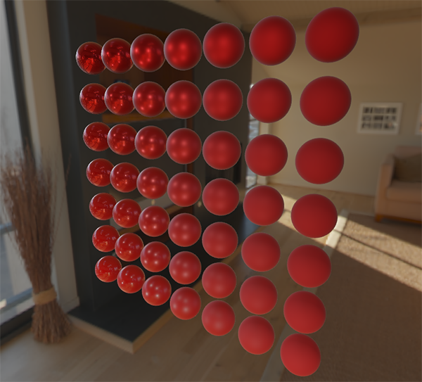

我们甚至可以再疯狂一点，使用一些带酷炫纹理的 [PBR 材质](http://freepbr.com/)：

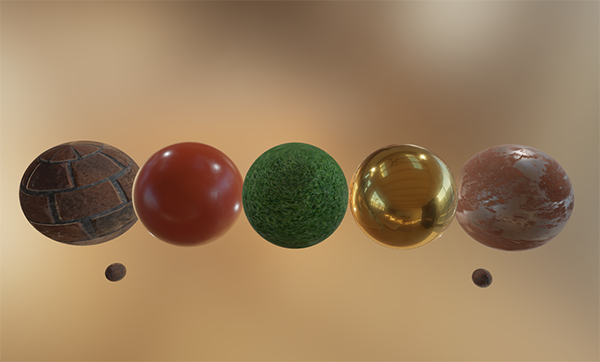

本仓库五种实际材质（模式 3）：

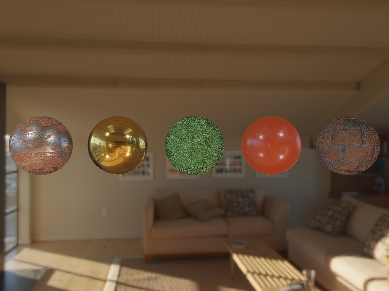

或加载 Andrew Maximov 的[这款出色的免费 PBR 3D 模型](http://artisaverb.info/PBT.html)：

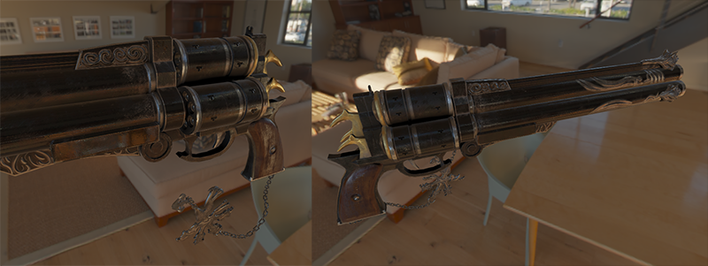

本仓库 Assimp 六部件模型（模式 4）：

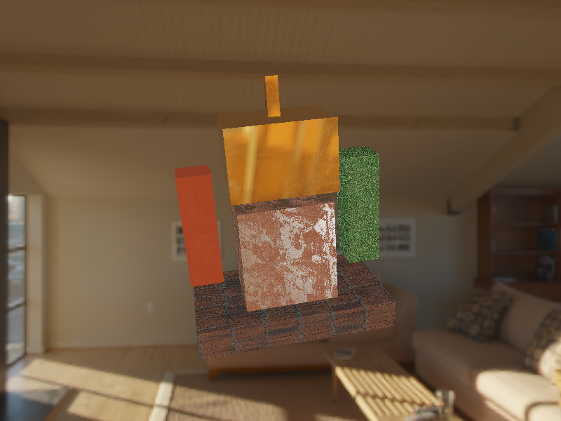

固定材质在不同环境下应保持相同参数定义，并随入射光产生相应外观变化；这并不意味着预过滤近似在所有环境、视角下都严格物理正确。本仓库模式 5/12 使用另一张自制线性 HDR 摄影棚环境，材质参数不作重调；以下保留上游不同环境的对照图：

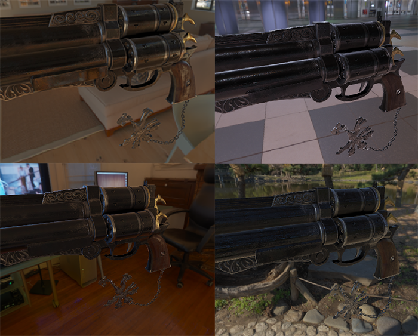

本仓库相同材质切换摄影棚环境（模式 12）：

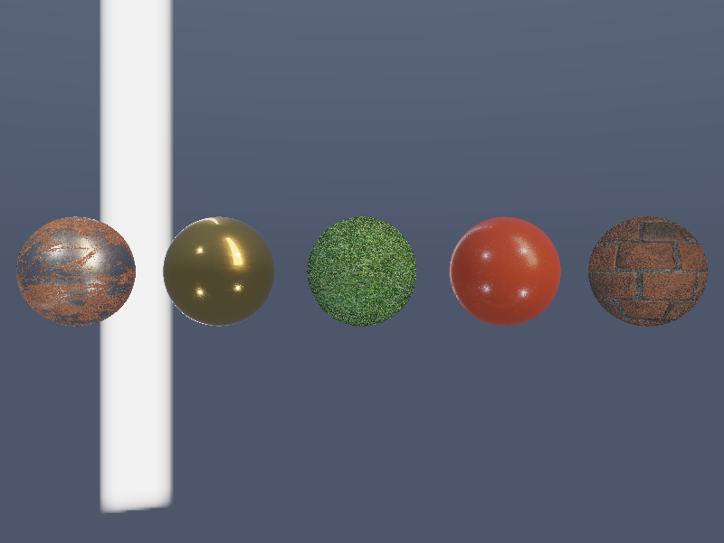

参数球阵列切换同一摄影棚环境（模式 5）：

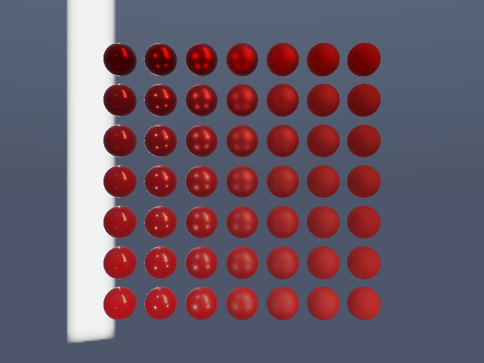

好吧，这是一场长长的 PBR 冒险。有很多步骤可能会出错，所以如果遇到问题卡住，请仔细研究[球形场景](https://learnopengl.com/code_viewer_gh.php?code=src/6.pbr/2.2.1.ibl_specular/ibl_specular.cpp)或[带纹理的场景代码](https://learnopengl.com/code_viewer_gh.php?code=src/6.pbr/2.2.2.ibl_specular_textured/ibl_specular_textured.cpp)示例——也包括所有着色器，或者检查之后在评论中提问。

本仓库的模型模式实际使用 Assimp 导入六部件雕塑，沿节点树应用变换，保留法线与 UV，再按 MTL 材质名选择五贴图集合。该模型是自制资源，替代上游展示的第三方模型；加载与多材质步骤均实际执行。OBJ/MTL 没有在这里被冒称为统一 PBR 语义标准，名称映射由应用明确规定。

> **进阶（预计算复用）：** **BRDF LUT 与环境无关，预过滤 cubemap 与环境有关。** 修改 HDR 环境应重建对应环境卷积，修改 BRDF 或粗糙度约定则还可能需要重建 LUT。生产缓存的键应包含源文件与算法版本、尺寸、样本量、材质参数约定；仅复用同名文件不能保证有效。本例在启动时计算两套环境、只算一次 LUT，便于观察完整流程，离线缓存和局部探针仍留给后续。

### 下一步是？

希望在本教程结束时，你会对 PBR 的相关内容有一个清晰的了解，甚至可以构造并运行一个实际的 PBR 渲染器。在这几节教程中，我们已经在应用程序开始阶段，渲染循环之前，预计算了所有 PBR 相关的基于图像的光照数据。出于教育目的，这很好，但对于任何 PBR 的实践应用来说，都不是很漂亮。首先，预计算实际上只需要执行一次，而不是每次启动时都要做。其次，当使用多个环境贴图时，你必须在每次程序启动时全部预计算一遍，这是个必须步骤。

因此，通常只需要一次将环境贴图预计算为辐照度贴图和预过滤贴图，然后将其存储在磁盘上（注意，BRDF 积分贴图不依赖于环境贴图，因此只需要计算或加载一次）。这意味着您需要提出一种自定义图像格式来存储 HDR 立方体贴图，包括其 mip 级别。或者将图像存储为某种可用格式——例如支持存储 mip 级别的 .dds——并按其格式加载。

此外，我们也在教程中描述了**整个**过程，包括生成预计算的 IBL 图像，以帮助我们进一步了解 PBR 管线。此外还可以通过 [cmftStudio](https://github.com/dariomanesku/cmftStudio) 或 [IBLBaker](https://github.com/derkreature/IBLBaker) 等一些出色的工具为您生成这些预计算贴图，也很好用。

上游把反射探针插值和视差校正留给后续：在多个位置捕获并卷积局部环境，运行时根据着色点/反射位置选择、混合并校正探针。不能仅按相机位置混合就声称修复了所有位置误差。本例仍是无限远环境近似，没有实现局部探针、遮挡或视差校正，以下阅读资料保留供继续学习。

## 进阶阅读

 * [Real Shading in Unreal Engine 4](http://blog.selfshadow.com/publications/s2013-shading-course/karis/s2013_pbs_epic_notes_v2.pdf)：讲解了 Epic Games 的分割求和近似法。IBL PBR 部分的代码就脱胎于此文。
 * [Physically Based Shading and Image Based Lighting](http://www.trentreed.net/blog/physically-based-shading-and-image-based-lighting/)：Trent Reed 的精彩博客文章，介绍了如何将镜面反射 IBL 实时集成到 PBR 管道中。
 * [Image Based Lighting](https://chetanjags.wordpress.com/2015/08/26/image-based-lighting/)：Chetan Jags 对基于镜面反射的 IBL 及其一些注意事项（包括光照探针插值）进行了广泛的讲解。
 * [Moving Frostbite to PBR](https://seblagarde.files.wordpress.com/2015/07/course_notes_moving_frostbite_to_pbr_v32.pdf)：Sébastien Lagarde 和 Charles de Rousiers 撰写的，对于如何将 PBR 集成到 AAA 游戏引擎进行了详尽而深入的概述。
 * [Physically Based Rendering – Part Three](https://jmonkeyengine.github.io/wiki/jme3/advanced/pbr_part3.html)：JMonkeyEngine 团队对 IBL 和 PBR 进行了较高层次的概述。
 * [Implementation Notes: Runtime Environment Map Filtering for Image Based Lighting](https://placeholderart.wordpress.com/2015/07/28/implementation-notes-runtime-environment-map-filtering-for-image-based-lighting/)：Padraic Hennessy 撰写的大量有关预过滤 HDR 环境贴图并显著优化采样过程的文章。


## 本仓库示例

源码：[`apps/06_pbr/04_specular_ibl/main.cpp`](../../apps/06_pbr/04_specular_ibl/main.cpp)，目标 `06_pbr__04_specular_ibl`。Esc 退出键，WASD/鼠标移动视角，滚轮调整 FOV，空格按下切换模式；`--mode M` 选择初始模式。

| 模式 | 可观察内容 |
| --- | --- |
| 0 | 完整 IBL＋直接光，参数球阵列 |
| 1 | 关闭镜面 IBL，对照漫反射 IBL＋直接光 |
| 2 | 仅镜面 IBL，不加漫反射与直接光 |
| 3 | 锈铁、金、草、塑料、墙五种五贴图材质球 |
| 4 | Assimp 加载六部件五材质雕塑模型 |
| 5 | 同一参数球阵列切换摄影棚 HDR 环境 |
| 6 | 预过滤环境 mip 0 天空盒 |
| 7 | 预过滤环境 mip 2 天空盒 |
| 8 | 预过滤环境 mip 4 天空盒，无缝过滤 |
| 9 | 显示 BRDF LUT：R=A，G=B |
| 10 | 预过滤仅采样源环境 mip 0 的对照球阵列 |
| 11 | 与模式 8 相同，关闭跨面无缝过滤 |
| 12 | 模式 3 相同材质改用摄影棚环境 |

```powershell
cmake --preset mingw-gcc-debug
cmake --build --preset mingw-gcc-debug --target 06_pbr__04_specular_ibl
.\build\mingw-gcc-debug\apps\06_pbr\04_specular_ibl\06_pbr__04_specular_ibl.exe --frames 3 --mode 0 --capture build/pbr_4.ppm
```

依赖尚未安装时先按[构建指南](../build.md)执行 Conan；资源路径基于编译期资源根。`--frames` 使用隐藏窗口并有限帧退出，`--capture` 需要同时指定 `--frames`。IBL 启动预计算可能先于第一帧花费时间；截图帧数不是预计算时间限制。

本仓库默认模式实测截图（与正文上游示意图分开）：

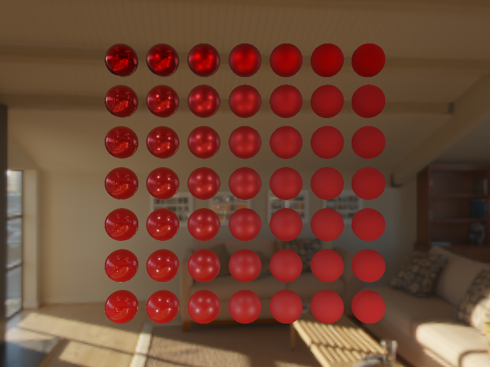

## 本章整体回顾

GGX/Hammersley 预过滤、源环境 mip 过滤、BRDF A/B LUT 和运行时组合共同完成镜面 IBL。材质、模型和第二环境都使用相同参数约定；局部反射探针与离线缓存属于保留讨论的后续方向。

图片、资源和逐项验证边界见[覆盖清单](coverage.md)、[图片记录](../img/06/README.md)及[运行资源来源](../../assets/chapter06_resources.md)。

技术核校：[英文原文](https://learnopengl.com/PBR/IBL/Specular-IBL)、[OpenGL 3.3 Core 规范](https://registry.khronos.org/OpenGL/specs/gl/glspec33.core.pdf)、[GLSL 3.30 规范](https://registry.khronos.org/OpenGL/specs/gl/GLSLangSpec.3.30.pdf)、[PBRT 微表面理论](https://pbr-book.org/4ed/Reflection_Models/Roughness_Using_Microfacet_Theory)、[PBRT 积分与重要性采样](https://pbr-book.org/4ed/Monte_Carlo_Integration/Improving_Efficiency)。

下一节：后续为实践专题；章节尚未创建，暂不设置文件链接。
